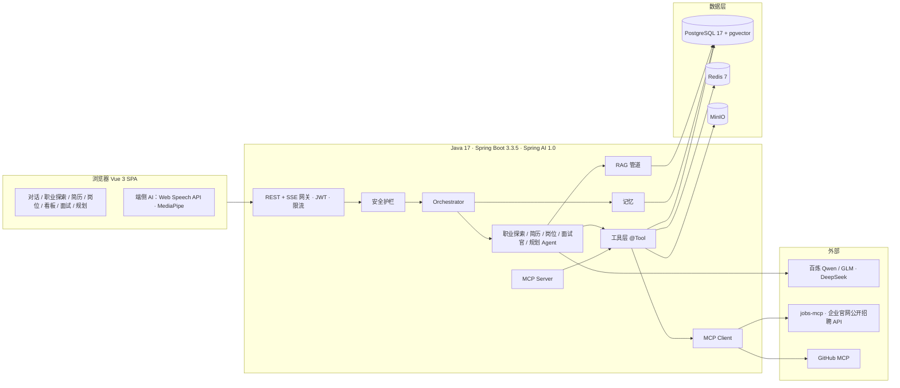

# OfferPilot（职航）— 应届生求职全流程 AI Agent 助手

> 传智杯 · 全国高校 AI Web 开发挑战赛 · 「AI Agent 智能助手」方向参赛项目
>
> 一个懂你简历、盯着岗位、陪你面试、帮你规划的求职 Agent。

   

---

## 1. 项目简介

OfferPilot 面向高校应届生与实习生，用多 Agent 协作把「我适合做什么 → 简历 → 岗位 → 面试 → 规划 → 复盘」的求职全流程串成一个闭环：

- **职业探索 Agent**：通过对话式测评（而非死板问卷）收集并推断用户的专业、兴趣爱好、性格特质（Holland 兴趣代码、可选 MBTI）、价值观与约束条件，结合职业知识库匹配出适合的职业方向，每个推荐都附带「为什么适合你」的证据链，并可一键设为目标职业，联动岗位搜索与学习路线。
- **简历 Agent**：解析 PDF / Word / 图片简历为结构化数据，按 rubric 诊断评分，针对目标岗位定向改写，并以 diff 形式让用户逐条采纳。
- **岗位 Agent**：通过 MCP 直连数十家企业官网公开招聘 API，自然语言搜索岗位，基于向量召回 + LLM 重排给出匹配度与证据链，一键加入求职看板。
- **面试官 Agent**：按岗位与简历生成题目，支持文字与语音两种模式，实时追问、STAR 评价，结束后输出多维评分报告；浏览器端 MediaPipe 分析眼神接触与姿态（仅上传聚合指标）。
- **职业规划 Agent**：基于职业知识库（RAG）做技能差距分析与学习路线规划，联动校招日历与 DDL 提醒。
- **Orchestrator**：Supervisor 模式的规划 - 执行 - 反思循环，计划、工具调用、引用来源、审批请求全部实时可视化；敏感操作必须经用户确认（Human-in-the-loop）。

## 2. 核心特性一览

| 能力 | 说明 |
| --- | --- |
| 多 Agent 编排 | Orchestrator + 5 个专家 Agent（职业探索 / 简历 / 岗位 / 面试官 / 规划），显式 Plan / Step / Tool 事件流 |
| 职业探索 | 对话式性格与兴趣测评、专业 + 兴趣 + 性格三维画像、职业知识库匹配与证据链推荐 |
| 工具调用 | Spring AI `@Tool` 本地工具 + MCP 外部工具（jobs-mcp、GitHub MCP、搜索 MCP） |
| MCP 双向 | 既是 MCP Client，也以 MCP Server 形式对外暴露简历诊断、岗位搜索、匹配工具 |
| RAG | pgvector 向量检索 + PostgreSQL 全文检索 RRF 融合 + 重排 + 引用溯源 |
| 多模态 | 图片/扫描简历视觉理解、语音面试（ASR/TTS）、端侧表情与姿态分析 |
| 生成式 UI | 后端下发结构化卡片（职业推荐、画像确认、岗位、匹配报告、简历 diff、技能雷达、路线图、面试报告），前端按类型注册组件渲染 |
| 安全可控 | 注入检测、工具分级与审批、输出审核、PII 脱敏、兜底话术、全链路可解释 |
| 记忆 | 短期会话窗口 + 长期用户画像事实（向量检索召回） |
| 流式体验 | SSE 事件流、可中断、可重连（Last-Event-ID）、可回放 |

## 3. 技术架构



详细设计见 [docs/03-系统架构设计.md](docs/03-系统架构设计.md)。

## 4. 技术栈

### 前端

| 类别 | 选型 |
| --- | --- |
| 框架 | Vue 3.5（`<script setup>` + Composition API）、TypeScript 5（strict）、Vite 7、pnpm |
| 路由与状态 | Vue Router 4、Pinia 3、TanStack Query Vue |
| UI | Tailwind CSS 4.1、shadcn-vue 2.7（Reka UI）、lucide-vue-next、@vueuse/core、@vueuse/motion |
| AI 交互 | 自研 `useAgentStream`（SSE 解析、中断、重连、审批回传）、markdown-it + shiki 流式渲染 |
| 可视化 | vue-echarts（技能雷达、面试评分）、diff（简历改写对比） |
| 多媒体 | Web Speech API（ASR/TTS）、MediaRecorder、MediaPipe Tasks Vision（Web Worker） |
| 工程 | ESLint 9、Prettier、Vitest、Playwright、Husky + lint-staged、openapi-typescript |

### 后端

| 类别 | 选型 |
| --- | --- |
| 运行时与框架 | Java 17 LTS、Spring Boot 3.3.5、Spring Web MVC |
| AI | Spring AI 1.0.0（OpenAI 兼容 / DeepSeek starter、pgvector store、MCP client & server、Advisors） |
| 数据 | PostgreSQL 17 + pgvector、Redis 7、MinIO（S3 兼容） |
| 持久层 | Spring Data JPA、Flyway |
| 安全 | Spring Security 6 + JWT、Bucket4j、Resilience4j |
| 文件解析 | Apache Tika、PDFBox |
| 文档与可观测 | SpringDoc OpenAPI、Actuator、Micrometer、Spring AI Observability |
| 测试 | JUnit 5、Testcontainers、Spring AI Evaluators |

### 模型

| 用途 | 模型 |
| --- | --- |
| 主对话 / 规划 / 视觉 | `qwen3.8-flash`（阿里云百炼，OpenAI 兼容） |
| 长文本 / 低成本批处理 | `deepseek-v4-flash` |
| 视觉备选 | `glm-5.3-flash` |
| 高质量场景 | `qwen3.8-max` / `deepseek-v4-pro`（按需开关） |
| Embedding / Rerank | `text-embedding-v4` / `gte-rerank` |

## 5. 仓库结构（规划）

```text
.
├── README.md
├── .env.example                 # Docker Compose 与后端环境变量模板
├── docs/                        # 计划书与设计文档（见第 8 节索引）
├── backend/                     # Maven 多模块后端（单一 Spring Boot 运行入口）
│   ├── offerpilot-bootstrap/    # 唯一启动类、配置、Flyway、Prompt
│   ├── offerpilot-platform/     # 通用能力、配置、模型/MCP 适配器
│   ├── offerpilot-agent/        # 编排、事件、会话、审批
│   └── offerpilot-{identity,resume,job,career,interview}/ # 业务域模块
├── frontend/                    # Vue 3 + Vite + TypeScript 前端
│   ├── .env.example
│   └── src/{app,shared,features,widgets}
├── mcp-servers/
│   └── jobs-mcp/                # Node.js MCP Server：包装企业官网公开招聘 API
└── deploy/
    ├── docker-compose.yml
    ├── Caddyfile                # 自动 HTTPS、静态前端、/api 反代（SSE 不缓冲）
    ├── nginx/default.conf       # 备用反代配置
    └── scripts/                 # backup.sh、reset-demo.sh
```

## 6. 快速开始

### 6.1 一键启动（Docker Compose）

```bash
git clone <repo-url> offerpilot && cd offerpilot
cp .env.example .env            # 填入模型 API Key 等
docker compose -f deploy/docker-compose.yml up -d
# 前端: https://localhost（Caddy，本地为自签名证书）   后端 Swagger: https://localhost/swagger-ui.html
# 首次启动后灌入种子数据（职业库、问卷、面经、体验账号）：
docker compose -f deploy/docker-compose.yml exec backend java -jar app.jar --seed=all
```

### 6.2 本地开发

Windows 统一入口是根目录 [OfferPilot.cmd](OfferPilot.cmd)：双击打开菜单，先选「8 配置 DeepSeek」，再选「1 启动全部」。菜单包含启停、状态检查、更新、打包与日志。需要先安装并打开 Docker Desktop。详细步骤见 [backend/README.md](backend/README.md)。以下工程级命令中，后端应先打包再运行 bootstrap JAR。

```bash
# 依赖：JDK 17、Node.js 22+、pnpm 9+、Docker（用于 Postgres/Redis/MinIO）
docker compose -f deploy/docker-compose.yml up -d postgres redis minio jobs-mcp

# 后端
cd backend
mvn -q -B -pl offerpilot-bootstrap -am package
java -jar offerpilot-bootstrap/target/offerpilot-bootstrap-0.1.0-SNAPSHOT.jar --spring.profiles.active=dev

# 前端
cd frontend && pnpm install && pnpm dev
```

### 6.3 评审体验账号

在线演示地址与体验账号将在提交材料中提供；本地启动后可通过登录页「体验账号一键登录」进入（由 `DEMO_ACCOUNT_ENABLED=true` 控制）。

## 7. 环境变量

所有密钥仅通过环境变量注入，**不得**提交到仓库。模板见 [.env.example](.env.example) 与 [frontend/.env.example](frontend/.env.example)，完整说明见 [docs/09-部署与运维.md](docs/09-部署与运维.md)。

## 8. 文档索引

第一次阅读代码建议先看 [docs/README.md](docs/README.md) 和 [docs/12-项目架构与源码导读.md](docs/12-项目架构与源码导读.md)。前者按使用场景组织文档，后者以当前源码为准说明模块、文件和调用关系。

| 编号 | 文档 | 内容 |
| --- | --- | --- |
| 00 | [赛题分析与评分对照](docs/00-赛题分析与评分对照.md) | 赛道要求、时间线、评分细则与本项目逐项应对 |
| 01 | [项目计划书](docs/01-项目计划书.md) | 定位、用户、核心闭环、创新点、商业与社会价值、团队、里程碑、风险 |
| 02 | [需求分析与功能清单](docs/02-需求分析与功能清单.md) | 用户故事、P0/P1/P2 功能清单、验收标准、非功能需求 |
| 03 | [系统架构设计](docs/03-系统架构设计.md) | 总体架构、模块划分、关键流程、选型理由、架构决策记录 |
| 04 | [AI 技术方案](docs/04-AI技术方案.md) | 模型路由、Agent 架构、Prompt 规范、工具与 MCP、RAG、多模态、安全、评测 |
| 05 | [接口文档](docs/05-接口文档.md) | REST 端点、SSE 事件协议、卡片 schema、错误码 |
| 06 | [数据库设计](docs/06-数据库设计.md) | ER 图、DDL、索引、迁移规划 |
| 07 | [前端设计规范](docs/07-前端设计规范.md) | 路由、目录、组件、状态、SSE 消费、设计系统、性能 |
| 08 | [开发计划与分工](docs/08-开发计划与分工.md) | 周计划、里程碑、分工、协作规范 |
| 09 | [部署与运维](docs/09-部署与运维.md) | Docker Compose、Nginx/Caddy、CI、环境变量、监控 |
| 10 | [测试与评估方案](docs/10-测试与评估方案.md) | 单测、E2E、RAG/Agent 评测集、安全红队、性能 |
| 11 | [提交材料清单](docs/11-提交材料清单.md) | 材料检查表、技术文档大纲、视频脚本、答辩准备 |
| 12 | [项目架构与源码导读](docs/12-项目架构与源码导读.md) | 当前实现状态、模块边界、逐文件职责、真实调用链与目标调用链 |

## 9. 数据来源与合规声明

- 岗位数据仅来自**企业官网公开招聘接口**（通过开源工具 `jobhunt-cli` 的适配器访问）与**公开聚合的校招信息**（如 GitHub 公开仓库维护的秋招时间表），不爬取任何需登录或明确禁止抓取的平台。
- 职业探索所用的职业条目与兴趣量表基于 **O*NET（美国劳工部，公共领域）** 的职业兴趣代码体系中文化映射、《中华人民共和国职业分类大典（2022）》公开目录以及团队自建的互联网岗位族谱；推荐结果基于用户自陈信息，仅作参考，不构成职业测评结论。
- 用户简历、面试录音等个人数据仅用于向用户提供服务；提供 PII 脱敏开关（送模型前替换手机号 / 身份证 / 邮箱）与一键删除全部数据功能。
- 端侧视觉分析在浏览器内完成，**不会上传视频画面**，仅上传聚合后的数值指标。
- 演示与测试使用虚构简历与账号。

## 10. 团队信息

| 角色 | 成员 | 职责 |
| --- | --- | --- |
| 队长 / 后端与 Agent | 待填写 | Orchestrator、工具层、MCP、RAG、部署 |
| 前端 | 待填写 | Vue 应用、流式渲染、生成式 UI、面试室、端侧 AI |
| AI 与全栈 | 待填写 | 模型评测、Prompt、知识库、文档与演示视频 |
| 指导老师 | 待填写 | — |

## 11. License

MIT
