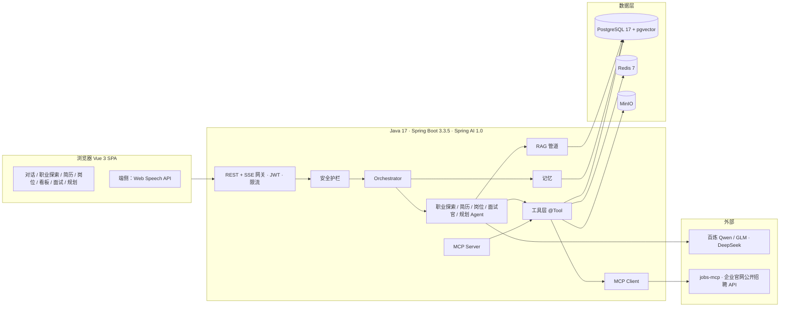

# OfferPilot（职航）— 应届生求职全流程 AI Agent 助手

> 传智杯 · 全国高校 AI Web 开发挑战赛 · 「AI Agent 智能助手」方向参赛项目
>
> 一个懂你简历、盯着岗位、陪你面试、帮你规划的求职 Agent。

   

---

## 1. 项目简介

OfferPilot 面向高校应届生与实习生，用多 Agent 协作把「我适合做什么 → 简历 → 岗位 → 面试 → 规划 → 复盘」的求职全流程串成一个闭环：

- **职业探索 Agent**：通过对话式测评（而非死板问卷）收集并推断用户的专业、兴趣爱好（Holland 兴趣代码）、价值观与约束条件，结合职业知识库匹配出适合的职业方向，每个推荐都附带「为什么适合你」的证据链，并可一键设为目标职业，联动岗位搜索与学习路线。
- **简历 Agent**：解析 PDF / Word / 图片简历为结构化数据，按内容规则提供有原文依据的诊断（无总分，部分省略会说明），针对目标岗位定向改写，并以 diff 形式让用户逐条采纳。
- **岗位 Agent**：通过 MCP 直连数十家企业官网公开招聘 API，自然语言搜索岗位（官网不可用时回退离线快照）；模型逐条引用 JD 与简历原文，服务端校验证据后按确定公式给出匹配度与 A–F 六维评估，一键加入求职看板。
- **面试官 Agent**：固定五题文字练习，支持浏览器 Web Speech 听写 / 读题、STAR 追问与规则评分；可导出复盘 Markdown、确认保存 STAR≥3 的回答，后续评分与只读追问引用已入库故事。
- **成长教练 Agent**：结合职业库要求、简历技能、最新完成匹配的 MISSING/PARTIAL 与 A–F 弱项、最近完成面试的弱维度与低 STAR 回答，确定性生成差距与四周路线；来源可打开报告/复盘，确认已完成任务后经审批同步。
- **Orchestrator**：Supervisor 模式的规划 - 执行 - 反思循环，计划、工具调用、引用来源、审批请求全部实时可视化；敏感操作必须经用户确认（Human-in-the-loop）。

## 2. 核心特性一览

| 能力 | 说明 |
| --- | --- |
| 多 Agent 编排 | Orchestrator + 5 个专家 Agent（职业探索 / 简历 / 岗位 / 面试官 / 规划），显式 Plan / Step / Tool 事件流 |
| 职业探索 | 对话式性格与兴趣测评、专业 + 兴趣 + 性格三维画像、职业知识库匹配与证据链推荐 |
| 工具调用 | 专家内领域工具（写操作走审批）+ MCP 外部工具（自建 jobs-mcp） |
| MCP 双向 | 既是 MCP Client，也以 MCP Server 形式对外暴露简历诊断、岗位搜索、匹配工具 |
| RAG | 职业库与私有知识笔记：pgvector 向量检索 + PostgreSQL 全文检索 RRF 融合 + 引用溯源；无向量 Key 时降级规则/全文 |
| 多模态 | 图片/扫描简历视觉理解、语音面试（浏览器 ASR/TTS，拒权退回文字） |
| 生成式 UI | 后端下发结构化卡片（职业推荐、画像确认、岗位、匹配报告、简历 diff、技能差距、路线图、面试报告），前端按类型注册组件渲染 |
| 安全可控 | 不可信资料隔离、写操作审批、证据/数字校验；模型文字入口默认脱敏手机号/有效18位身份证/邮箱，流式回显还原；[红队回归与实测限制](docs/research/2026-10-10-红队回归.md)；设置页输入 DELETE 一键删除在线私有数据 |
| 记忆 | 10轮短期窗口；跨会话事实全文召回（≤5条），聊天保存/建议必经确认；设置页可查看、添加、编辑、删除/清空和关闭；[验证与限制](docs/research/2026-10-10-长期记忆.md) |
| 流式体验 | SSE 事件流、可中断、可重连（Last-Event-ID）、可回放 |
| 投递工作区 | 看板详情抽屉聚合 A–F 报告、明确岗位来源的改写/面试/STAR、跟进时间线与下一步行动；首页列出今天到期/逾期且未关闭的行动（最多 5 条）；旧材料无岗位来源不自动关联，PDF 导出当前保存版本 |

## 3. 技术架构



详细设计见 [docs/03-系统架构设计.md](docs/03-系统架构设计.md)。

## 4. 技术栈

### 前端

| 类别 | 选型 |
| --- | --- |
| 框架 | Vue 3.5（`<script setup>` + Composition API）、TypeScript 6（strict）、Vite 8、pnpm |
| 路由与状态 | Vue Router 5、Pinia 4、TanStack Query Vue |
| UI | Tailwind CSS 4（tailwind-merge、clsx）、自研组件与设计令牌 |
| AI 交互 | 自研 `useAgentStream`（SSE 解析、中断、重连、审批回传）、markdown-it + shiki 流式渲染、DOMPurify 清洗 |
| 多媒体 | Web Speech API（ASR/TTS） |
| 工程 | ESLint 10、Prettier、Vitest + jsdom + MSW、openapi-typescript；CI 跑 format/lint/typecheck/test/build |

### 后端

| 类别 | 选型 |
| --- | --- |
| 运行时与框架 | Java 17 LTS、Spring Boot 3.3.5、Spring Web MVC |
| AI | Spring AI 1.0.0（OpenAI 兼容 / DeepSeek starter、pgvector store、MCP client & server） |
| 数据 | PostgreSQL 17 + pgvector、Redis 7、S3 兼容对象存储（MinIO SDK；Compose 默认 S3Mock） |
| 持久层 | Spring Data JPA、Flyway |
| 安全 | Spring Security 6 + JWT、Bucket4j、Resilience4j |
| 文件解析与导出 | Apache Tika、PDFBox（解析与简历 PDF 模板导出） |
| 文档与可观测 | SpringDoc OpenAPI、Actuator |
| 测试 | JUnit 5、Testcontainers、Reactor Test；真实模型评测按环境开关运行（默认 CI 跳过） |

### 模型

| 用途 | 模型 |
| --- | --- |
| 快速 FLASH（默认）/ 规划 / 图片 | `deepseek-flash`（DeepSeek） |
| 深度 PRO（仅文字） | `deepseek-v4-pro`（DeepSeek） |
| 内部视觉备选 VISION_ALT | `deepseek-flash` |
| Embedding | 本地 Ollama `bge-m3`（1024 维，OpenAI 兼容 `/v1/embeddings`） |

聊天仅「快速 / 深度」两档；旧 CHEAP 自动映射为 FLASH，供应商可通过环境变量覆盖。

## 5. 仓库结构（规划）

```text
.
├── README.md
├── .env.example                 # Docker Compose 与后端环境变量模板
├── docs/                        # 计划书与设计文档（见第 8 节索引）
├── backend/                     # Maven 多模块后端（单一 Spring Boot 运行入口）
│   ├── offerpilot-bootstrap/    # 唯一启动类、配置、Flyway、Prompt
│   ├── offerpilot-platform/     # 通用能力、配置、模型/MCP 适配器
│   ├── offerpilot-agent/        # 编排、事件、会话、审批
│   └── offerpilot-{identity,resume,job,career,interview}/ # 业务域模块
├── frontend/                    # Vue 3 + Vite + TypeScript 前端
│   ├── .env.example
│   └── src/{app,shared,features,widgets}
├── mcp-servers/
│   └── jobs-mcp/                # Node.js MCP Server：包装企业官网公开招聘 API
└── deploy/
    ├── docker-compose.yml
    ├── Caddyfile                # 自动 HTTPS、静态前端、/api 反代（SSE 不缓冲）
    ├── nginx/default.conf       # 备用反代配置
    └── scripts/                 # backup.sh、reset-demo.sh
```

## 6. 快速开始

### 6.1 一键启动（Docker Compose）

完整本地应用需要 Docker Compose v2、可用的模型 API Key 和足够内存。首次构建及下载 bge-m3 权重需要网络；离线启动必须预载镜像、构建产物及 Ollama 模型卷。新机器 10 分钟目标待实测，下载时间不作保证。

```bash
cp .env.example .env
# 编辑 .env：填写 DEEPSEEK_API_KEY；替换数据库、Redis、JWT 和加密密钥占位值。
# JWT_SECRET 使用 openssl rand -base64 64；DATA_ENCRYPTION_KEY 使用 openssl rand -base64 32。
python3 deploy/scripts/check_compose.py   # 无 Docker、无网络的静态配置检查
# --env-file 供 Compose 插值；backend.env_file 默认读取同一根目录 .env。
docker compose --env-file .env -f deploy/docker-compose.yml --profile full config --quiet
docker compose --env-file .env -f deploy/docker-compose.yml --profile full up -d --build
docker compose --env-file .env -f deploy/docker-compose.yml --profile full ps -a
# ollama-init / frontend 应 exit 0，长期服务应 healthy；首次拉权重可能较慢。
# 前端及健康检查：https://localhost（本地自签名证书，浏览器需信任本地 Caddy CA）
# 信任 CA 后执行，TLS 校验保持开启：
sh deploy/scripts/healthcheck.sh https://localhost
# Swagger：https://localhost/swagger-ui.html
```

未指定 `--profile full` 只启动基础依赖。默认 embedding 在容器内走 `http://ollama:11434/v1/embeddings`，模型 `bge-m3`；无需百炼 Key。查看失败原因可用相同参数执行 `logs backend ollama-init caddy`。健康检查只证明服务就绪，模型聊天及解析质量另行 live 验证。职业库启动时自动灌入；体验旅程需配置 `DEMO_ACCOUNT_*`。

默认 S3Mock 仅供本地演示且不认证。共享或公网部署须按 [部署文档](docs/09-部署与运维.md) 替换为认证存储。

### 6.2 本地开发

Windows 统一入口是根目录 [OfferPilot.cmd](OfferPilot.cmd)：双击打开菜单，先选「8 配置 DeepSeek」，再选「1 启动全部」。菜单包含启停、状态检查、更新、打包与日志。需要先安装并打开 Docker Desktop。详细步骤见 [backend/README.md](backend/README.md)。以下工程级命令中，后端应先打包再运行 bootstrap JAR。

```bash
# 依赖：JDK 17、Node.js 22+、pnpm 9+、Docker（用于 Postgres/Redis/MinIO）
docker compose -f deploy/docker-compose.yml up -d postgres redis minio jobs-mcp

# 后端
cd backend
mvn -q -B -pl offerpilot-bootstrap -am package
java -jar offerpilot-bootstrap/target/offerpilot-bootstrap-0.1.0-SNAPSHOT.jar --spring.profiles.active=dev

# 前端
cd frontend && pnpm install && pnpm dev
```

常规测试：在 `backend/` 运行 `SPRING_PROFILES_ACTIVE=test bash ./mvnw -q -pl offerpilot-bootstrap -am test`，在 `frontend/` 运行 `pnpm test -- --run`。后端默认不编译或发现 `*LiveEvaluation*`，保留 PII、离线红队、安全与关键 HTTP 集成测试；需要真实模型时加 `-Plive`，再设置目标套件原有的 `OFFERPILOT_RUN_LIVE_*` 开关和非空 `DEEPSEEK_API_KEY`（例如 `OFFERPILOT_RUN_LIVE_INTENT=true bash ./mvnw -q -Plive -pl offerpilot-bootstrap -am -Dtest=IntentLiveEvaluationTest -Dsurefire.failIfNoSpecifiedTests=false test`）。`-Plive` 本身不会启用收费调用。

### 6.3 评审体验账号

登录页点击「体验账号一键登录」，无需填写邮箱或密码即可进入共享的虚构 USER 旅程：2 份 READY 简历（附 DOCX 原件）、10 个虚构岗位、6 条投递看板记录、2 场文字面试、1 份职业画像和 3 项已完成成长任务。岗位仅供演示，不能实际投递；请勿填入个人信息。

演示路径：体验登录 → 职业探索并批准设目标 → 岗位匹配 A–F →「按此岗位改写」逐条采纳并导出 PDF → 收藏到看板，打开机会抽屉查看报告/改写/面试/时间线并安排下一步 → 针对该岗位模拟面试、复盘入库与 STAR 引用 → 从机会聊天切换成长教练，查看匹配缺口与面试弱项驱动的四周计划。教练的面试证据取当前用户最近完成场次，不自动推断与所选岗位的关联。七分钟分镜见 [视频脚本](docs/submission/视频脚本.md)。

在部署环境或未提交的 `.env` 中设置 `DEMO_ACCOUNT_ENABLED=true`、`DEMO_ACCOUNT_EMAIL=demo@offerpilot.local` 和 `DEMO_ACCOUNT_PASSWORD`（至少 6 位、UTF-8 最多 72 字节）。密码默认空白，空白或无效配置会跳过初始化，体验登录返回 403/20007。`DemoAccountBootstrap` 启动时创建或更新体验账号的 BCrypt 密码；同邮箱的真实账号不会被改为体验账号。共享体验密码应定期轮换，不能复用用户或客服密码；仓库不保存体验凭据。

首次启动无简历时自动灌入旅程；已有试用改动保留到重置。`DEMO_RESET_CRON` 默认 `0 0 4 * * *`（后端服务器时区；`-` 禁用定时重置）。手动重置先通过 `/api/v1/auth/staff/login` 获取有效 STAFF JWT，在环境中设置 `STAFF_TOKEN` 后运行：

```bash
API_BASE_URL=https://<domain>/api/v1 bash deploy/scripts/reset-demo.sh
```

脚本调用 `POST /api/v1/admin/demo/reset`，返回时间与各类种子数量。重置只清理配置的 `is_demo=true` 用户，保留其他用户、职业库和真实岗位缓存；其他用户引用的虚构岗位也保留。模型档位与删除操作仍沿用现有用户规则，未新增锁定。

## 7. 环境变量

所有密钥仅通过环境变量注入，**不得**提交到仓库。模板见 [.env.example](.env.example) 与 [frontend/.env.example](frontend/.env.example)，完整说明见 [docs/09-部署与运维.md](docs/09-部署与运维.md)。

## 8. 文档索引

第一次阅读代码建议先看 [docs/README.md](docs/README.md) 和 [docs/12-项目架构与源码导读.md](docs/12-项目架构与源码导读.md)。前者按使用场景组织文档，后者以当前源码为准说明模块、文件和调用关系。

| 编号 | 文档 | 内容 |
| --- | --- | --- |
| 00 | [赛题分析与评分对照](docs/00-赛题分析与评分对照.md) | 赛道要求、时间线、评分细则与本项目逐项应对 |
| 01 | [项目计划书](docs/01-项目计划书.md) | 定位、用户、核心闭环、创新点、商业与社会价值、团队、里程碑、风险 |
| 02 | [需求分析与功能清单](docs/02-需求分析与功能清单.md) | 用户故事、P0/P1/P2 功能清单、验收标准、非功能需求 |
| 03 | [系统架构设计](docs/03-系统架构设计.md) | 总体架构、模块划分、关键流程、选型理由、架构决策记录 |
| 04 | [AI 技术方案](docs/04-AI技术方案.md) | 模型路由、Agent 架构、Prompt 规范、工具与 MCP、RAG、多模态、安全、评测 |
| 05 | [接口文档](docs/05-接口文档.md) | REST 端点、SSE 事件协议、卡片 schema、错误码 |
| 06 | [数据库设计](docs/06-数据库设计.md) | ER 图、DDL、索引、迁移规划 |
| 07 | [前端设计规范](docs/07-前端设计规范.md) | 路由、目录、组件、状态、SSE 消费、设计系统、性能 |
| 08 | [开发计划与分工](docs/08-开发计划与分工.md) | 周计划、里程碑、分工、协作规范 |
| 09 | [部署与运维](docs/09-部署与运维.md) | Docker Compose、Nginx/Caddy、CI、环境变量、监控 |
| 10 | [测试与评估方案](docs/10-测试与评估方案.md) | 单测、E2E、RAG/Agent 评测集、安全红队、性能 |
| 11 | [提交材料清单](docs/11-提交材料清单.md) | 材料检查表、技术文档大纲、视频脚本、答辩准备 |
| 12 | [项目架构与源码导读](docs/12-项目架构与源码导读.md) | 当前实现状态、模块边界、逐文件职责、真实调用链与目标调用链 |

## 9. 数据来源与合规声明

- 岗位数据仅来自**企业官网公开招聘接口**（通过开源工具 `jobhunt-cli` 的适配器访问）与**公开聚合的校招信息**（如 GitHub 公开仓库维护的秋招时间表），不爬取任何需登录或明确禁止抓取的平台。
- 职业探索所用的职业条目与兴趣量表基于 **O*NET（美国劳工部，公共领域）** 的职业兴趣代码体系中文化映射、《中华人民共和国职业分类大典（2022）》公开目录以及团队自建的互联网岗位族谱；推荐结果基于用户自陈信息，仅作参考，不构成职业测评结论。
- 用户简历、面试回答等个人数据仅用于向用户提供服务；设置页提供默认开启的文本 PII 脱敏开关（送模型前替换大陆手机号 / 有效18位身份证 / 邮箱，回显还原）；关闭时检测到相关文本会提示风险。姓名、地址和图片像素暂不遮盖；原件和服务端数据保留原文。
- 设置 → 数据与隐私支持输入 `DELETE` 永久删除当前注册账号/访客及全部在线私有数据、文件和当前浏览器此身份工作区，旧令牌失效；文件清理失败后台重试。共享 demo 与 STAFF 不可自助删除。此操作不清除其他设备本地副本、下载件、离线备份或供应商已接收内容。
- 语音面试听写使用浏览器 Web Speech（部分浏览器会交由其厂商语音服务识别）；OfferPilot 后端只接收识别后的文字，不接收音频或视频。
- 演示与测试使用虚构简历与账号。

## 10. 团队信息

| 角色 | 成员 | 职责 |
| --- | --- | --- |
| 队长 / 后端与 Agent | 待填写 | Orchestrator、工具层、MCP、RAG、部署 |
| 前端 | 待填写 | Vue 应用、流式渲染、生成式 UI、面试室、端侧 AI |
| AI 与全栈 | 待填写 | 模型评测、Prompt、知识库、文档与演示视频 |
| 指导老师 | 待填写 | — |

## 11. License

MIT
