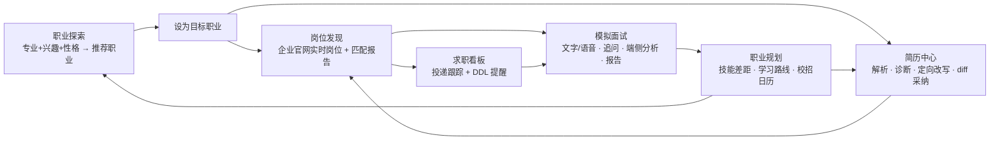

# 01 · 项目计划书

> 项目名称：OfferPilot（职航）
> 参赛方向：AI Agent 智能助手
> 文档状态：**持续迭代**。功能范围以 P0 为底线，P1/P2 与「想法池」允许在开发过程中调整；任何新增功能先进想法池，再按评分收益与工时评估进入 P 级。

---

## 1. 项目概述

### 1.1 一句话

OfferPilot 是一个面向高校应届生的求职全流程 AI Agent：先帮你搞清楚「我适合做什么」，再帮你把简历改好、把岗位找到、把面试练熟、把差距补上，并在整个过程中盯着每一个截止日期。

### 1.2 背景与痛点

| 阶段 | 应届生真实痛点 | 现有工具的不足 |
| --- | --- | --- |
| 方向选择 | 不知道自己适合什么职业；专业与兴趣错位；性格测试结果与真实岗位脱节 | 性格测试网站只给类型标签，不连接岗位；学校职业规划课泛泛而谈 |
| 简历 | 不知道怎么写、写了不知道哪里不好、投不同岗位不会针对性修改 | 模板站只管排版；AI 改简历一把改完，不可控、不可追溯 |
| 岗位 | 信息散落在几十个企业官网与群聊；不知道哪些岗位真的匹配自己 | 招聘平台以推荐流为主，匹配逻辑不透明；校招时间线靠人肉整理 |
| 面试 | 没有练习对象；不知道自己答得如何；紧张时的表现无人反馈 | 题库只能背；模拟面试服务昂贵 |
| 规划 | 知道有差距但不知道怎么补；投递进度靠 Excel | 学习路线千篇一律；进度管理与求职内容割裂 |

### 1.3 项目目标

- **产品目标**：在 11 周内交付一个可公网访问、可稳定演示的 Web 应用，覆盖「职业探索 → 简历 → 岗位 → 面试 → 规划」闭环。
- **技术目标**：在 Java 17（Spring Boot 3.3.5 + Spring AI 1.0）后端上实现可视化的多 Agent 编排、RAG、MCP 双向、多模态、安全护栏；前端以 Vue 3 + TypeScript 达到 Lighthouse ≥ 90。
- **竞赛目标**：省赛一等奖并晋级国赛；评分表六个 AI 子项全部有可演示的证据。

### 1.4 团队与分工（3 人假设）

| 角色 | 主要职责 | 兼顾 |
| --- | --- | --- |
| 队长 · 后端与 Agent | Orchestrator、专家 Agent、工具层、MCP、RAG、数据库、部署 | 技术文档架构与 AI 章节 |
| 前端 | Vue 应用、流式渲染、生成式 UI、面试室与端侧 AI、设计系统 | 视频录制 |
| AI 与全栈 | 模型评测与选型、Prompt 工程、知识库建设、评测集、jobs-mcp | 需求文档、视频脚本、PDF 排版 |

若为 2 人团队：前端保持独立，后端与 AI 合并，P1 中的 GitHub MCP、MediaPipe 端侧分析降为 P2。

## 2. 目标用户

### 2.1 主要用户画像

| 画像 | 描述 | 核心诉求 | 典型触发场景 |
| --- | --- | --- | --- |
| 小北 · 大三迷茫型 | 计算机相关专业，成绩中等，喜欢做东西但不知道该走开发、产品还是数据 | 搞清楚适合什么方向，尽早准备 | 暑期实习季前 |
| 小林 · 秋招冲刺型 | 大四 / 研二，目标明确（后端开发），简历有项目但表达平淡 | 简历针对岗位优化、快速找到匹配岗位、高频模拟面试 | 8-11 月秋招 |
| 小周 · 跨专业转型型 | 非计算机专业，自学编程 / 数据分析，缺乏行业认知 | 评估可行的职业路径，知道差距怎么补 | 春招前 |

### 2.2 次要用户

- 高校就业指导老师：希望了解班级整体求职进度与常见短板（P2 B 端视图）。
- 培训机构 / 学生社团：批量组织模拟面试与简历诊断。

## 3. 核心价值与差异化

### 3.1 竞品对照

| 类型 | 代表 | 能做什么 | 做不到 / 不足 | OfferPilot 的差异 |
| --- | --- | --- | --- | --- |
| 性格 / 职业测评站 | MBTI 测试站、霍兰德测评小程序 | 给出类型标签与笼统职业列表 | 不结合专业与技能；不连接真实岗位；一次性 | 对话式测评 + 三维画像 + 证据链推荐 + 直接联动岗位与路线 |
| 简历工具 | 超级简历、WonderCV、AI 改简历类插件 | 模板、排版、整体 AI 改写 | 改写不可控、不针对具体岗位、无法追溯 | 结构化诊断 rubric、岗位定向改写、diff 逐条采纳、版本管理 |
| 招聘平台 | BOSS 直聘、牛客、实习僧 | 岗位聚合、投递 | 匹配黑盒；数据封闭；校招时间线分散 | 企业官网实时公开 API + 可解释匹配报告 + 校招日历 + 看板由 Agent 操作 |
| 面试练习 | 面试鸭、题库 App、付费模拟面试 | 背题、人工模拟 | 无个性化、反馈慢、贵 | 基于岗位 + 简历出题、语音实时追问、STAR 评价、端侧表现分析、报告可复盘 |
| 通用 AI 助手 | ChatGPT / 豆包 / Kimi | 什么都能聊 | 无记忆、无工具、无数据、无流程 | 领域 Agent + 工具 + 数据 + 记忆 + 流程闭环 |

### 3.2 核心价值主张

1. **从「我是谁」开始**：不是先让用户上传简历，而是先帮用户搞清楚方向，推荐可解释、可落地的职业。
2. **一切可追溯**：每条简历修改、每个匹配分数、每个面试评价都有理由与来源。
3. **Agent 帮你干活而不是替你做决定**：写操作与敏感操作必须经用户确认（HITL）。
4. **闭环**：任何一步的结果都能流向下一步（推荐职业 → 搜岗位 → 改简历 → 练面试 → 补差距 → 提醒 DDL）。

## 4. 产品核心闭环与场景故事

### 场景故事一：小北的迷茫（职业探索）

1. 小北打开 OfferPilot，说「我是软件工程大三的，喜欢画画和打游戏，性格比较内向，不知道以后干什么」。
2. 职业探索 Agent 不发问卷，而是像朋友一样聊：喜欢画画是喜欢创作过程还是喜欢作品被人看到？做小组作业时更愿意写代码还是协调分工？在对话中逐步推断 Holland 兴趣代码（如 A-I-R），并把推断结果以卡片形式向小北确认。
3. Agent 结合专业课程、兴趣与性格，从职业知识库中检索并推理，给出 6 个方向：游戏客户端开发、前端 / 交互开发、技术美术、UI/UX 设计、独立游戏开发者、数据可视化工程师。每张卡片写明「为什么适合你」（引用小北说过的话与专业背景）、典型岗位、所需技能、成长路径、薪资区间、代表企业。
4. 小北点「设为目标」选择「前端 / 交互开发」，Agent 立刻规划下一步：搜索前端实习岗位、生成技能差距、建议先做一个作品集项目。

### 场景故事二：小林的秋招（简历 + 岗位 + 面试）

1. 小林上传 PDF 简历，Agent 解析为结构化数据并诊断：项目经历缺量化结果、技能与目标岗位关键词覆盖率 60%、排版缺少统一时间格式。
2. 小林说「帮我找字节和美团的后端校招岗，然后按字节的 JD 改简历」。Orchestrator 生成 3 步计划：搜索岗位 → 匹配评分 → 定向改写。前端实时显示每一步与工具调用。
3. 岗位 Agent 通过 jobs-mcp 直连企业官网接口拿到实时岗位，给出匹配报告（匹配点、缺口、建议），小林一键加入看板。
4. 简历 Agent 输出 12 条修改建议的 diff，小林采纳 9 条、拒绝 3 条，生成新版本并导出 PDF。
5. 晚上小林打开面试室，选择「字节后端 · 技术面 · 语音模式」。面试官 Agent 结合简历里的项目追问 Redis 缓存一致性，实时字幕显示小林的回答，MediaPipe 在浏览器里记录眼神接触与身体稳定度。
6. 面试结束生成报告：专业能力 78、表达 70、逻辑 82、岗位匹配 75，逐题点评，并把「分布式事务理解薄弱」自动推给规划 Agent 生成两周学习计划。

## 5. 功能总览（模块地图）

| 模块 | P0 | P1 | P2 |
| --- | --- | --- | --- |
| 账号与偏好 | 注册登录、体验账号、模型偏好、隐私开关 | — | 第三方登录 |
| Agent 对话 | 流式多轮、计划可视化、工具时间线、引用、审批、中断重试、会话历史 | 长期记忆、主动提醒 | @ai-sdk/vue 协议兼容 |
| 职业探索 | 对话式测评（Holland 兴趣 + 性格特质 + 价值观）、三维画像、职业推荐卡片（证据链）、设为目标 | 快速问卷模式（60 题 O*NET 兴趣量表中文化）、职业对比、画像随对话持续更新 | 与 GitHub / 简历技能交叉验证、职业路径图谱可视化 |
| 简历中心 | 上传解析（文本 + 视觉）、rubric 诊断、岗位定向改写 diff、版本、导出 PDF | GitHub 技能实证反哺 | 中英双语 |
| 岗位探索 | jobs-mcp 实时搜索、本地岗位库、匹配报告、校招日历 | 推荐流、新岗位推送 | 海外岗位 |
| 求职看板 | Kanban、拖拽、Agent 工具操作、状态历史 | DDL 提醒 | B 端班级视图 |
| 模拟面试 | 文字 + 语音、按岗位与简历出题、追问、STAR 评价、报告 | MediaPipe 端侧分析并入报告 | 面试官形象、情绪化 TTS |
| 职业规划 | RAG 问答、技能差距、学习路线时间轴 | 与面试报告联动自动生成计划 | 学习进度打卡 |
| 知识库 | 内置职业知识库、个人资料上传 | 管理页与检索调试 | 团队共享知识库 |
| MCP | Client：jobs-mcp、搜索 | Client：GitHub MCP；Server 对外暴露 3 个工具 | MCP 市场式管理 |
| 安全 | 注入检测、工具分级、HITL、输出审核、PII 脱敏、兜底 | 可观测面板 | 第三方内容安全 API |
| 部署 | Docker Compose、公网 HTTPS、体验账号 | 监控告警 | 多实例 |

## 6. 创新点清单（技术文档「创新点说明」章节直接引用）

### 6.1 应用创新

1. **从职业探索开始的全流程闭环**：市面工具从简历或岗位切入，本项目从「我适合做什么」切入，测评结果直接连接真实岗位与学习路线，而非停留在类型标签。
2. **对话式测评**：把 Holland 兴趣代码、性格特质、价值观的采集融入自然对话，Agent 自主决定何时追问、何时收敛，并向用户确认推断结果，避免 60 题问卷的流失。
3. **Agent 可操作的求职看板**：用户用自然语言即可增删改投递记录，Agent 主动提醒截止日期与新匹配岗位。
4. **真实、实时、合规的岗位数据**：通过 MCP 直连企业官网公开招聘接口，而非静态题库或爬取封闭平台。

### 6.2 技术创新

1. **三层职业匹配**：Holland 代码规则相似度（可解释、零成本）+ 职业知识库向量检索（覆盖长尾职业）+ LLM 推理（结合专业与用户原话形成证据链）。
2. **可视化的 Plan-Execute-Reflect 多 Agent 编排**：结构化计划、步骤状态、工具调用、引用、审批以统一 SSE 事件协议下发，前端实时渲染并可回放。
3. **简历 ↔ JD 双向匹配与 JSON Patch 改写**：改写结果以补丁形式输出，前端 diff 展示、逐条采纳，天然支持版本管理。
4. **MCP 双向**：既消费外部 MCP（岗位、GitHub、搜索），也把自身能力以 MCP Server 暴露给 Cursor / Claude Desktop 等宿主。
5. **端云协同多模态**：浏览器端 Web Speech 与 MediaPipe 负责实时、隐私敏感的感知，云端 LLM 负责理解与生成；视频永不离开浏览器。
6. **生成式 UI 卡片协议**：后端下发类型化卡片（职业推荐、岗位、匹配报告、简历 diff、技能雷达、路线图、面试评分），前端按类型注册组件渲染，扩展新卡片无需改协议。
7. **安全护栏内建于工具循环**：读写分级、审批点、参数校验、输出审核与兜底作为 Advisor 嵌入 Spring AI 的工具调用链，而非事后补丁。

### 6.3 交互创新

1. 简历修改 diff 逐条采纳 / 拒绝 / 编辑。
2. 语音面试实时字幕 + 面试官状态（倾听 / 思考 / 提问）+ 端侧表现仪表。
3. Agent 思考侧栏：计划、工具时间线、引用来源、审批请求、模型与 token。
4. 职业推荐卡片上的「为什么适合你」引用用户原话，可点击追问「如果我不喜欢加班呢」实时重排。

## 7. 社会价值与商业潜力

### 7.1 社会价值

- **缩小信息差**：让缺乏校友资源与职业指导的学生获得个性化辅导，尤其惠及非重点院校与跨专业学生。
- **理性择业**：把性格与兴趣测评从「娱乐化标签」变成「可验证的职业假设」，减少盲投与频繁跳槽。
- **可解释、可控的 AI**：所有建议有理由、有来源、可拒绝，示范负责任 AI 的产品设计。
- **开源**：核心 Agent 编排与 MCP 服务开源，供高校就业指导中心二次开发。

### 7.2 商业模式（潜力论证，不作为竞赛期实现目标）

| 模式 | 对象 | 内容 | 依据 |
| --- | --- | --- | --- |
| Freemium | 学生 | 基础功能免费；高级模型面试、精修简历、无限语音时长订阅 | 每年千万级毕业生，付费意愿集中在秋招 3 个月 |
| B 端 SaaS | 高校就业指导中心、二级学院 | 班级看板、共性短板分析、批量模拟面试 | 高校有就业率考核与经费 |
| 生态 | 培训机构、企业 HR | MCP Server 输出能力（简历诊断、岗位匹配）、校招活动接入 | MCP 正在成为行业标准 |

## 8. 里程碑

| 里程碑 | 日期 | 交付物 | 验收标准 |
| --- | --- | --- | --- |
| M0 立项 | 09-20 | 需求与原型定稿、仓库与 CI、Docker 环境、模型账号、jobs-mcp 可行性验证 | 全员能一键启动依赖；jobs-mcp 能搜到真实岗位 |
| M1 骨架 | 10-04 | 认证、会话、SSE 流式对话、前端布局与聊天、简历上传解析 | 端到端流式对话 + 简历解析可演示 |
| M2 Agent 核心 | 10-18 | Orchestrator、工具层、HITL、职业探索（对话式测评 + 推荐卡片）、简历诊断与 diff、岗位搜索与匹配、看板 | 场景故事一与二的前 4 步可演示 |
| M3 RAG 与面试 | 11-01 | RAG 管道、职业规划、模拟面试（文字→语音）、记忆、MCP Server | 场景故事二全流程可演示 |
| M4 增强与加固 | 11-15 | MediaPipe、GitHub MCP、主动提醒、安全护栏、性能优化、测试、公网部署 | P0 冻结（11-16）；Lighthouse ≥ 90；评测集通过 |
| M5 材料 | 11-22 | 技术文档 PDF、演示视频、README、体验账号 | 通过 [11-提交材料清单](11-提交材料清单.md) 全部检查项 |
| M6 提交 | 11-23 / 11-29 | 指导提交 / 最终提交 | — |
| M7 国赛 | 12-27 | P2 功能、答辩 PPT、现场演示预案 | — |

## 9. 风险与对策

| 风险 | 概率 | 影响 | 对策 |
| --- | --- | --- | --- |
| 企业官网招聘接口变更或限流 | 中 | 高 | 本地岗位库缓存与定时同步；多来源（jobs-mcp、公开聚合数据、手动导入）；演示前预热数据 |
| 模型服务限流 / 费用超预算 | 中 | 中 | 多模型回退链；Redis 结果缓存；上下文压缩；开发期统一 Flash 档；每日用量告警 |
| 多 Agent 输出不稳定 | 高 | 高 | 结构化输出 + 校验重试；每步超时与迭代上限；评测集回归；关键路径提供「简化模式」直连专家 Agent |
| 对话式测评收敛慢或推断不准 | 中 | 中 | 设定最大轮次后切换快速问卷卡片；推断结果必须用户确认；保留可编辑画像页 |
| SSE 被代理缓冲或断连 | 中 | 中 | Nginx `proxy_buffering off`；15s 心跳；`Last-Event-ID` 续传；事件落库可回放 |
| 语音与摄像头浏览器兼容 | 中 | 低 | 优先 Chrome / Edge；文字模式与无摄像头模式降级 |
| 隐私与合规 | 低 | 高 | PII 脱敏开关；数据删除；演示用虚构数据；不爬取封闭平台 |
| 工期不足 | 高 | 高 | P0 于 11-16 冻结；每周里程碑评审；P1/P2 随时可砍 |
| 团队成员时间冲突（课程、考试） | 中 | 中 | 周计划留 20% 缓冲；关键模块两人知情 |

## 10. 成功指标

| 类别 | 指标 | 目标 |
| --- | --- | --- |
| 功能 | P0 完成率 | 100%（11-16） |
| 质量 | 评测集：Agent 任务成功率 / RAG 相关性 / 安全红队拦截率 | ≥ 85% / ≥ 0.8 / ≥ 95% |
| 性能 | 首 token 延迟 / 首屏加载（4G）/ Lighthouse | < 2s / < 2s / ≥ 90 |
| 稳定 | 评审期可用率 | ≥ 99.5% |
| 用户 | 试用同学数 / NPS | ≥ 10 / ≥ 40 |
| 竞赛 | 评分表六个 AI 子项均有可演示证据 | 6/6 |

## 11. 想法池（未排期，欢迎随时补充）

| 想法 | 价值 | 预估工时 | 备注 |
| --- | --- | --- | --- |
| 根据用户性格、爱好、专业生成适合的职业 | 高（选题创新、RAG、Agent） | 已纳入 P0/P1「职业探索」模块 | 2026-09-11 提出 |
| 职业「体验日」：用 Agent 模拟一天的工作内容让用户感受岗位 | 中 | 3 天 | 可与职业探索卡片联动 |
| 学长学姐经验库：公开面经与经验帖入 RAG，按目标职业推送 | 中 | 3 天 | 需注意版权，只用授权 / 公开许可内容 |
| Offer 比较器：多 Offer 按薪资、城市、成长性、价值观打分 | 中 | 2 天 | 复用价值观画像 |
| 群面 / 多人模拟：多 Agent 扮演面试官与其他候选人 | 高（Agent 亮点） | 5 天 | 国赛可考虑 |
| 简历一键多版本：同一简历针对 N 个目标岗位批量生成 | 中 | 2 天 | 依赖 diff 改写 |
| 每周求职周报：Agent 汇总投递、面试、学习进度 | 中 | 2 天 | 依赖看板与规划数据 |
| 浏览器插件：在企业官网页面上一键导入 JD | 中 | 3 天 | 与 Web 主体分离，需评估是否符合 Web 形态要求 |
