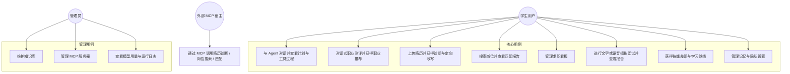

# 02 · 需求分析与功能清单

> 文档状态：**活文档**。P0 为省赛底线；P1 / P2 与想法池按周评审调整。新增需求先写入 [01-项目计划书 §11 想法池](01-项目计划书.md#11-想法池未排期欢迎随时补充)，评估后再进入本清单。
> 编号规则：`模块缩写-序号`，如 `CD-03`（Career Discovery）、`RS-02`（Resume）。

---

## 1. 角色与用例总览

### 1.1 角色

| 角色 | 说明 |
| --- | --- |
| 学生用户 | 主要用户，拥有全部 C 端功能 |
| 评审体验账号 | 预置数据的学生用户，只读部分敏感设置（不能改模型 Key），每日重置 |
| 管理员 | 管理内置知识库、MCP 服务器、查看用量（竞赛期由团队成员担任） |
| 外部 MCP 宿主 | Cursor / Claude Desktop 等，通过 MCP Server 调用本系统工具 |

### 1.2 用例图

## 2. 用户故事

### 2.1 职业探索（CD）

| 编号 | 用户故事 | 优先级 |
| --- | --- | --- |
| CD-US1 | 作为大三学生，我想通过聊天而不是做 60 道题来了解自己适合的职业方向，以便低门槛地开始规划。 | P0 |
| CD-US2 | 作为用户，我希望 Agent 在推断我的性格与兴趣后向我确认，并允许我修正，以便结果可信。 | P0 |
| CD-US3 | 作为用户，我想看到每个推荐职业「为什么适合我」的具体理由（引用我的专业、爱好、原话），以便判断是否认同。 | P0 |
| CD-US4 | 作为用户，我想把某个职业设为目标，让系统自动帮我找岗位、算差距，以便顺畅进入下一步。 | P0 |
| CD-US5 | 作为时间紧张的用户，我想有一个快速问卷模式（约 5 分钟）直接得到兴趣代码。 | P1 |
| CD-US6 | 作为用户，我想对比 2-3 个候选职业在薪资、成长性、与我匹配度等维度的差异。 | P1 |
| CD-US7 | 作为用户，我希望画像随着后续对话（如面试表现、简历技能）持续更新，推荐随之变化。 | P1 |
| CD-US8 | 作为用户，我想追问「如果我不想加班 / 想留在成都呢」，推荐能实时重排。 | P1 |

### 2.2 Agent 对话（AG）

| 编号 | 用户故事 | 优先级 |
| --- | --- | --- |
| AG-US1 | 作为用户，我想用自然语言下达复合任务（找岗位 + 改简历 + 安排面试），Agent 自动拆解并执行。 | P0 |
| AG-US2 | 作为用户，我想实时看到 Agent 的计划、每一步在做什么、调用了哪些工具，以便信任并干预。 | P0 |
| AG-US3 | 作为用户，我希望涉及写入（如修改看板、覆盖简历）的操作先征求我同意。 | P0 |
| AG-US4 | 作为用户，我想随时中断生成、重试失败步骤、在断网后恢复流。 | P0 |
| AG-US5 | 作为用户，我希望 Agent 记住我的目标城市、期望岗位等偏好，下次不用重复说。 | P1 |
| AG-US6 | 作为用户，我想收到截止日期临近与新匹配岗位的提醒。 | P1 |

### 2.3 简历中心（RS）

| 编号 | 用户故事 | 优先级 |
| --- | --- | --- |
| RS-US1 | 作为用户，我想上传 PDF / Word / 图片简历，系统解析为结构化内容供我核对与编辑。 | P0 |
| RS-US2 | 作为用户，我想得到一份带评分与具体问题定位的诊断报告。 | P0 |
| RS-US3 | 作为用户，我想针对某个具体岗位改写简历，并逐条决定是否采纳修改。 | P0 |
| RS-US4 | 作为用户，我想保留多个版本并导出 PDF。 | P0 |
| RS-US5 | 作为用户，我想用 GitHub 仓库证明我的技能，让简历与匹配更有说服力。 | P1 |

### 2.4 岗位探索（JB）

| 编号 | 用户故事 | 优先级 |
| --- | --- | --- |
| JB-US1 | 作为用户，我想用一句话搜索「北京 后端 校招 字节 美团」，得到来自企业官网的实时岗位。 | P0 |
| JB-US2 | 作为用户，我想看到岗位与我简历的匹配度、匹配点与缺口。 | P0 |
| JB-US3 | 作为用户，我想把岗位一键加入看板。 | P0 |
| JB-US4 | 作为用户，我想看到 2027 届秋招 / 春招的校招日历与截止日期。 | P0 |
| JB-US5 | 作为用户，我想粘贴 JD 文本、URL 或截图导入岗位。 | P0 |
| JB-US6 | 作为用户，我想每天收到基于画像与简历的岗位推荐。 | P1 |

### 2.5 求职看板（BD）

| 编号 | 用户故事 | 优先级 |
| --- | --- | --- |
| BD-US1 | 作为用户，我想以看板管理投递状态（待投递 / 已投递 / 笔试 / 面试 / Offer / 结束）。 | P0 |
| BD-US2 | 作为用户，我想对 Agent 说「把美团那个改成面试中，下周三下午两点」，它帮我更新。 | P0 |
| BD-US3 | 作为用户，我想看到每条投递的状态历史与备注。 | P0 |

### 2.6 模拟面试（IV）

| 编号 | 用户故事 | 优先级 |
| --- | --- | --- |
| IV-US1 | 作为用户，我想选择岗位、简历、面试类型与难度，开始一场文字模拟面试。 | P0 |
| IV-US2 | 作为用户，我想用语音回答，看到实时字幕，并听到面试官语音提问。 | P0 |
| IV-US3 | 作为用户，我希望面试官会根据我的回答追问，而不是念题。 | P0 |
| IV-US4 | 作为用户，我想在面试后得到多维评分、逐题点评与改进建议。 | P0 |
| IV-US5 | 作为用户，我想知道自己在镜头前的眼神接触与姿态表现，但不希望视频被上传。 | P1 |
| IV-US6 | 作为用户，我想把面试暴露的短板自动变成学习计划。 | P1 |

### 2.7 职业规划（CP）

| 编号 | 用户故事 | 优先级 |
| --- | --- | --- |
| CP-US1 | 作为用户，我想知道我与目标岗位之间的技能差距，并得到带来源的解释。 | P0 |
| CP-US2 | 作为用户，我想得到按周排布的学习路线时间轴。 | P0 |
| CP-US3 | 作为用户，我想问「秋招一般什么时候开始，我现在该做什么」并得到可信答案与引用。 | P0 |

### 2.8 设置、隐私与管理（ST）

| 编号 | 用户故事 | 优先级 |
| --- | --- | --- |
| ST-US1 | 作为用户，我想开启 PII 脱敏，让手机号、身份证、邮箱不被发送给模型。 | P0 |
| ST-US2 | 作为用户，我想查看并删除 Agent 对我的记忆，或一键删除全部数据。 | P0 |
| ST-US3 | 作为管理员，我想上传知识库文档并查看索引状态。 | P0 |
| ST-US4 | 作为管理员，我想添加 / 启停 MCP 服务器并查看其工具列表。 | P1 |
| ST-US5 | 作为外部宿主，我想通过 MCP 调用简历诊断、岗位搜索与匹配工具。 | P1 |

## 3. 功能清单与验收标准

状态列：`计划` / `进行中` / `完成` / `搁置`，随开发更新。`进行中` 表示已有部分实现，但该行完整验收标准尚未满足；不能仅凭页面存在标记为完成。

### 截至 2026-09-28 的进度快照

本次以当前工作区源码、测试和隔离浏览器验收核对：18 个模块中，6 个处于“工程闭环已形成但质量/范围待验收”（3/4 阶段），7 个为部分功能可用（2/4），5 个仍以页面或占位为主（1/4）；没有模块达到完整目标及质量验收（4/4）。阶段是成熟度描述，不是工作量百分比。后端 89/90 项通过（1 项真实模型评测跳过）、前端 55 项、jobs-mcp 16 项通过；构建、类型检查及 lint 通过。真实模型语义质量、生产部署和性能目标未验证。

当前已核实的主链路包括持久化聊天与计划执行、简历上传解析/版本/基础诊断、真实岗位搜索/详情/匹配，以及本地求职看板和固定题库自练。优先未完成项包括写操作审批与事件续传、简历定向改写落库和服务端 PDF、职业探索 Agent、AI 面试、RAG/个性化路线、服务端看板与统一身份体系。逐模块证据、范围和建议顺序见[2026-09-28 完成度审计](research/2026-09-28-项目完成度审计.md)；后续更新以新验证为准。

### 3.1 账号与偏好（AC）

| 编号 | 功能 | 优先级 | 验收标准 | 状态 |
| --- | --- | --- | --- | --- |
| AC-01 | 邮箱 + 密码注册登录，JWT access（15 分钟）+ refresh（7 天，HttpOnly Cookie） | P0 | 登录后刷新页面保持登录；refresh 过期跳转登录页 | 计划 |
| AC-02 | 体验账号一键登录 | P0 | 登录页按钮一键进入预置数据账号；每日 04:00 重置数据 | 计划 |
| AC-03 | 用户偏好：默认模型档位、语言、主题、PII 脱敏开关 | P0 | 偏好持久化并即时生效 | 进行中 |
| AC-04 | 第三方登录（GitHub OAuth） | P2 | — | 搁置 |

### 3.2 Agent 对话（AG）

| 编号 | 功能 | 优先级 | 验收标准 | 状态 |
| --- | --- | --- | --- | --- |
| AG-01 | 会话列表：新建、重命名、删除、按时间分组 | P0 | 操作乐观更新，失败回滚 | 进行中 |
| AG-02 | 流式对话：Markdown 渐进渲染、代码高亮、表格、图片附件 | P0 | 首 token < 2s（P95）；渲染无闪烁 | 进行中 |
| AG-03 | 计划可视化：步骤列表、状态（等待 / 进行 / 完成 / 失败 / 跳过）、当前步骤高亮 | P0 | 与 SSE `plan.created` / `step.updated` 同步 | 进行中 |
| AG-04 | 工具调用时间线：名称、入参摘要、结果摘要、耗时、来源（本地 / MCP） | P0 | 可展开查看完整 JSON | 进行中 |
| AG-05 | 引用面板：来源标题、片段、分数、链接 | P0 | 正文引用编号可点击定位 | 进行中 |
| AG-06 | 审批卡片：展示工具与参数，支持批准 / 拒绝 / 编辑参数后批准；超时自动拒绝 | P0 | 审批前工具不执行；拒绝后 Agent 给出替代方案 | 进行中 |
| AG-07 | 中断、重试、断线重连（Last-Event-ID） | P0 | 中断 1s 内停止；重连不丢事件 | 进行中 |
| AG-08 | 生成式 UI 卡片渲染（职业推荐、岗位、匹配报告、简历 diff、技能雷达、路线图、面试评分、日历） | P0 | 每种卡片有独立组件与空态 / 错误态 | 进行中 |
| AG-09 | 模式切换：自动 / 职业探索 / 简历 / 岗位 / 面试 / 规划 | P0 | 指定模式时直连对应专家 Agent | 进行中 |
| AG-10 | 长期记忆：自动抽取事实、查看、删除 | P1 | 新会话中能引用旧偏好 | 计划 |
| AG-11 | 主动提醒：站内通知（DDL、新岗位、面试计划） | P1 | 通知中心未读计数 | 计划 |
| AG-12 | 运行回放：按事件重放某次运行 | P1 | 与实时渲染一致 | 计划 |
| AG-13 | 可观测面板：每条消息的模型、token、耗时、成本估算 | P1 | 数据来自 `llm_usage_logs` | 计划 |

### 3.3 职业探索（CD）

| 编号 | 功能 | 优先级 | 验收标准 | 状态 |
| --- | --- | --- | --- | --- |
| CD-01 | 对话式测评：Agent 以对话状态机收集专业、年级、兴趣爱好、性格特质、价值观、约束（城市、薪资、加班接受度） | P0 | 不超过 12 轮完成首次画像；每轮最多一个问题 | 计划 |
| CD-02 | 特质推断与确认：Agent 推断 Holland 兴趣代码（RIASEC 前三码）与 5-8 个性格特质，以确认卡片呈现，用户可修正 | P0 | 推断带置信度与依据（引用用户原话）；修正后立即生效 | 计划 |
| CD-03 | 三维画像页：专业与课程、兴趣与技能、性格与价值观；可手动编辑 | P0 | 画像持久化；与长期记忆双向同步 | 进行中 |
| CD-04 | 职业推荐：输出 5-8 个职业方向卡片，含匹配度、为什么适合你（证据链）、典型岗位、核心技能、成长路径、薪资区间、代表企业、可能的顾虑 | P0 | 匹配理由至少引用 2 条用户信息；来源可追溯到职业库条目 | 计划 |
| CD-05 | 设为目标职业：触发联动（岗位搜索、技能差距、学习路线建议） | P0 | 设为目标后 Orchestrator 自动生成后续计划并征求确认 | 计划 |
| CD-06 | 追问重排：用户补充约束后推荐实时重排并解释变化 | P1 | 重排耗时 < 8s | 计划 |
| CD-07 | 快速问卷模式：O*NET 兴趣量表中文化 60 题（或 30 题短版）卡片式答题 | P1 | 5 分钟内完成；结果写入画像 | 计划 |
| CD-08 | 职业对比：2-3 个职业多维对比雷达 | P1 | — | 计划 |
| CD-09 | 画像持续更新：从面试报告、简历技能、GitHub 分析中自动更新画像并提示 | P1 | 更新需用户确认 | 计划 |
| CD-10 | 职业路径图谱：从当前专业到目标职业的典型路径可视化 | P2 | — | 搁置 |

### 3.4 简历中心（RS）

| 编号 | 功能 | 优先级 | 验收标准 | 状态 |
| --- | --- | --- | --- | --- |
| RS-01 | 上传 PDF / DOCX / PNG / JPG（≤ 10MB），异步解析，进度反馈 | P0 | 文本版 PDF 10s 内完成；图片版 30s 内完成 | 进行中 |
| RS-02 | 结构化解析：基本信息、教育、实习 / 工作、项目、技能、证书、自我评价；文本 + 视觉双通道融合 | P0 | 字段召回率 ≥ 90%（测试集 20 份） | 进行中 |
| RS-03 | 结构化编辑器：分节编辑、拖拽排序 | P0 | 编辑生成新版本 | 进行中 |
| RS-04 | 基础内容诊断：优点、逐条问题、原文定位与追问；报告绑定保存版本。首版不提供未经校准的总分、排版或岗位匹配评分 | P0 | 问题引用必须来自对应版本；支持历史报告与继续讨论 | 进行中（基础功能已实现，真实模型语义质量待评测；岗位定向待实现） |
| RS-05 | 岗位定向改写：输出 JSON Patch 列表，diff 展示，逐条采纳 / 拒绝 / 编辑，生成新版本 | P0 | 采纳后文本与结构一致；改写不得编造经历（有校验提示） | 进行中（2026-10-09：JD生成、聊天及逐条采纳链路已实现；10组真实模型基准及Agent审阅已执行，最终10/10生成通过，首次7/10；双人无编造/采纳评分与结构化稳定性达标仍待完成，见真实评测报告） |
| RS-06 | 版本管理：版本树、对比、回滚 | P0 | — | 进行中 |
| RS-07 | 导出 PDF：2 套模板 | P0 | A4 单页 / 双页排版正确 | 计划 |
| RS-08 | GitHub 技能实证：读取公开仓库语言、Star、提交活跃度、README 提炼项目亮点 | P1 | 需用户提供 Token 或公开用户名 | 计划 |
| RS-09 | 中英双语简历 | P2 | — | 搁置 |

### 3.5 岗位探索（JB）

| 编号 | 功能 | 优先级 | 验收标准 | 状态 |
| --- | --- | --- | --- | --- |
| JB-01 | 自然语言搜索：解析为公司 / 城市 / 类型 / 关键词，调用 jobs-mcp 与本地库 | P0 | 返回 ≤ 8s；结果去重并标注来源与更新时间 | 进行中（聊天 JOB/AUTO 搜索、结果卡片及详情匹配入口已实现，真实模型小样本链路通过；本地库召回、质量基准与时延目标待完成） |
| JB-02 | 岗位详情：职责、要求、城市、部门、截止日、官网链接 | P0 | — | 进行中 |
| JB-03 | 匹配报告：总分、匹配点、缺口、建议、依据（简历片段 ↔ JD 片段） | P0 | 生成 < 10s；依据可点击定位 | 进行中 |
| JB-04 | 一键加入看板 | P0 | — | 进行中 |
| JB-05 | 校招日历：来自公开聚合数据的公司 / 批次 / 截止日；按行业筛选；临期高亮 | P0 | 每日同步 | 计划 |
| JB-06 | 导入岗位：文本 / URL / 截图（视觉解析） | P0 | 截图解析准确率 ≥ 85% | 计划 |
| JB-07 | 推荐流：基于画像、目标职业与简历的每日推荐 | P1 | — | 计划 |
| JB-08 | 海外岗位 | P2 | — | 搁置 |

### 3.6 求职看板（BD）

| 编号 | 功能 | 优先级 | 验收标准 | 状态 |
| --- | --- | --- | --- | --- |
| BD-01 | Kanban 六列、拖拽、卡片详情（岗位、备注、下一步时间） | P0 | 拖拽乐观更新 | 进行中 |
| BD-02 | Agent 工具操作看板（新增 / 改状态 / 加备注），写操作走审批 | P0 | 审批通过后 UI 实时刷新 | 计划 |
| BD-03 | 状态历史时间线 | P0 | — | 计划 |
| BD-04 | DDL 提醒（提前 3 天 / 1 天） | P1 | 站内通知 | 计划 |
| BD-05 | B 端班级视图 | P2 | — | 搁置 |

### 3.7 模拟面试（IV）

| 编号 | 功能 | 优先级 | 验收标准 | 状态 |
| --- | --- | --- | --- | --- |
| IV-01 | 创建面试：选择岗位（可无）、简历版本、类型（技术 / 行为 / HR / 综合）、难度、模式（文字 / 语音）、时长 | P0 | — | 进行中 |
| IV-02 | 面试流程状态机：开场 → 分轮提问 → 追问 → 收尾 | P0 | 每题至少 1 次基于回答的追问 | 计划 |
| IV-03 | 语音模式：浏览器 ASR 实时字幕、TTS 朗读、麦克风状态、面试官状态（倾听 / 思考 / 提问） | P0 | Chrome / Edge 可用；不支持时降级为文字 | 计划 |
| IV-04 | 逐题评价：STAR 结构、要点覆盖、表达清晰度，结构化评分 | P0 | — | 计划 |
| IV-05 | 面试报告：多维评分雷达、逐题点评、亮点与短板、改进建议、推荐学习项 | P0 | 生成 < 20s | 计划 |
| IV-06 | 端侧表现分析：MediaPipe 眼神接触比例、微笑频率、头部 / 身体稳定度；仅上传聚合指标 | P1 | 无摄像头时自动跳过 | 计划 |
| IV-07 | 短板 → 学习计划联动 | P1 | 报告页一键生成 | 计划 |
| IV-08 | 面试官形象与情绪化 TTS | P2 | — | 搁置 |

### 3.8 职业规划（CP）

| 编号 | 功能 | 优先级 | 验收标准 | 状态 |
| --- | --- | --- | --- | --- |
| CP-01 | RAG 问答：带引用编号与来源面板 | P0 | 引用与正文对应 | 计划 |
| CP-02 | 技能差距分析：目标岗位 / 职业所需技能 vs 简历与画像已有技能，输出差距等级与依据 | P0 | — | 计划 |
| CP-03 | 学习路线：按周时间轴，含资源建议与里程碑，可加入日程 | P0 | — | 进行中 |
| CP-04 | 校招时间线建议：结合日历给出「现在该做什么」 | P0 | — | 计划 |
| CP-05 | 与面试报告联动自动更新计划 | P1 | — | 计划 |
| CP-06 | 学习打卡 | P2 | — | 搁置 |

### 3.9 知识库、MCP、安全与系统（KB / MC / SC / SY）

| 编号 | 功能 | 优先级 | 验收标准 | 状态 |
| --- | --- | --- | --- | --- |
| KB-01 | 内置知识库：职业条目库（含兴趣代码、技能、薪资、路径）、岗位能力模型、面经题库、校招流程、行业报告 | P0 | 首批 ≥ 300 个职业条目、≥ 500 道面经 | 进行中 |
| KB-02 | 个人资料上传入库（PDF / MD / TXT） | P0 | 状态：排队 / 索引中 / 完成 / 失败 | 计划 |
| KB-03 | 检索调试页（管理员） | P1 | 显示召回、重排分数 | 计划 |
| MC-01 | MCP Client：jobs-mcp（Streamable HTTP）、搜索 MCP | P0 | 工具在 Agent 面板可见 | 进行中 |
| MC-02 | MCP Client：GitHub MCP | P1 | — | 计划 |
| MC-03 | MCP 管理页：添加 / 启停 / 刷新工具 | P1 | — | 计划 |
| MC-04 | MCP Server：`diagnose_resume`、`search_jobs`、`match_job` | P1 | 在 Cursor 中可调用 | 计划 |
| SC-01 | 输入注入检测（规则 + 分类）与文档隔离 | P0 | 红队用例拦截率 ≥ 95% | 进行中 |
| SC-02 | 工具读写分级与审批；参数 JSON Schema 校验；迭代上限 | P0 | — | 进行中 |
| SC-03 | 输出审核与兜底话术 | P0 | — | 计划 |
| SC-04 | PII 脱敏（手机号、身份证、邮箱、住址）可开关 | P0 | 脱敏后模型输出中占位符还原 | 计划 |
| SC-05 | 数据删除：删除记忆、删除全部数据 | P0 | 30s 内完成并注销登录 | 计划 |
| SY-01 | Docker Compose 一键启动 | P0 | 新机器 10 分钟内跑通 | 进行中 |
| SY-02 | 公网 HTTPS 部署与体验账号 | P0 | 可用率 ≥ 99.5% | 计划 |
| SY-03 | 监控告警（Uptime、错误率、模型用量） | P1 | — | 计划 |

## 4. 非功能需求

| 类别 | 需求 | 指标 |
| --- | --- | --- |
| 性能 | 首 token 延迟 | P95 < 2s（Flash 档） |
| 性能 | 简单查询 API | P95 < 300ms |
| 性能 | 首屏加载 | 4G 网络 < 2s；Lighthouse 性能 ≥ 90 |
| 并发 | 演示与评审期 | 50 并发会话无错误 |
| 可用性 | 评审期 | ≥ 99.5%，故障 10 分钟内自动恢复 |
| 安全 | 传输 / 存储 | 全站 HTTPS；密码 BCrypt；Token 加密存储；密钥仅环境变量 |
| 安全 | 限流 | 每用户 60 请求 / 分钟；Agent 运行每用户同时 ≤ 2 |
| 隐私 | 数据最小化 | 视频不上传；PII 脱敏可选；用户可删除全部数据 |
| 兼容 | 浏览器 | Chrome / Edge 最新两个版本完整功能；Safari / Firefox 文字功能 |
| 兼容 | 设备 | 桌面优先；平板与手机响应式可用 |
| 可维护 | 代码质量 | TS strict；后端 Checkstyle；单测覆盖核心逻辑 ≥ 60% |
| 可观测 | 日志与指标 | 每次模型与工具调用有 traceId、耗时、token |
| 国际化 | 语言 | 中文优先，UI 文案集中管理便于后续英文化 |

## 5. 页面清单

| 路由 | 页面 | 主要内容 | 优先级 |
| --- | --- | --- | --- |
| `/login` | 登录 / 注册 | 表单、体验账号一键登录 | P0 |
| `/` | 工作台 | 求职进度概览、今日待办、DDL、技能雷达、目标职业、快捷入口 | P0 |
| `/chat/:id?` | Agent 对话 | 会话列表、消息流、Agent 面板（计划 / 工具 / 引用 / 审批）、模式切换、附件 | P0 |
| `/discover` | 职业探索 | 对话式测评入口、画像页、职业推荐卡片墙、设为目标、对比 | P0 |
| `/resumes` `/resumes/:id` | 简历中心 | 列表、上传、结构化编辑、诊断报告、定向改写 diff、版本、导出 | P0 |
| `/jobs` `/jobs/:id` | 岗位探索 | 搜索、筛选、卡片、详情、匹配报告、导入、校招日历 | P0 |
| `/board` | 求职看板 | Kanban、详情抽屉、历史 | P0 |
| `/interviews` `/interviews/:id` | 模拟面试 | 创建向导、面试室（字幕 / 录音 / 面试官状态 / 端侧指标）、报告 | P0 |
| `/career` | 职业规划 | 技能差距、学习路线时间轴、RAG 问答 | P0 |
| `/kb` | 知识库 | 文档列表、上传、状态、检索调试 | P0 / P1 |
| `/settings` | 设置 | 偏好、隐私（PII、删除数据）、记忆管理、MCP 服务器、用量 | P0 / P1 |
| `/notifications` | 通知中心 | 提醒列表 | P1 |

## 6. 数据需求

| 数据 | 来源 | 获取方式 | 更新频率 | 合规说明 |
| --- | --- | --- | --- | --- |
| 职业条目库 | O*NET 职业与兴趣代码（美国劳工部，公共领域）中文化映射 + 《中华人民共和国职业分类大典（2022）》公开目录 + 自建互联网岗位族谱 | 脚本导入 + 人工校对 | 一次性 + 按需 | 公共领域 / 公开目录 |
| 兴趣量表 | O*NET Interest Profiler 60 题（公共领域）中文化 | 人工翻译校对 | 一次性 | 公共领域 |
| 岗位数据 | 企业官网公开招聘接口（经 `jobhunt-cli` 适配器） | jobs-mcp 实时查询 + 本地缓存 | 实时 / 每日 | 仅公开接口，README 声明 |
| 校招日历 | 公开聚合仓库 `jobs.json` | 定时拉取 | 每日 | 公开数据，注明来源 |
| 面经题库 | 公开许可的面试题整理 + 团队自编 | 人工整理 | 一次性 | 仅使用允许再分发的内容 |
| 岗位能力模型 | 从公开 JD 抽取 + 行业公开报告摘要 | LLM 抽取 + 校对 | 一次性 | — |
| 用户数据 | 用户上传与对话 | — | — | 隐私声明、脱敏、可删除 |

## 7. 需求变更流程

1. 任何人可在想法池新增条目（价值、工时、备注）。
2. 每周一评审：按「评分收益 × 演示价值 ÷ 工时」排序，决定进入 P1 / P2 或保留。
3. P0 范围在 10-18（M2）后冻结，之后只减不加。
4. 变更需同步更新本文件、接口文档与数据库设计中的相关章节。
