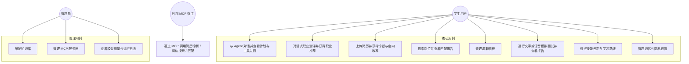

# 02 · 需求分析与功能清单

> 文档状态：**活文档**。P0 为省赛底线；P1 / P2 与想法池按周评审调整。新增需求先写入 [01-项目计划书 §11 想法池](01-项目计划书.md#11-想法池未排期欢迎随时补充)，评估后再进入本清单。
> 编号规则：`模块缩写-序号`，如 `CD-03`（Career Discovery）、`RS-02`（Resume）。

---

## 1. 角色与用例总览

### 1.1 角色

| 角色 | 说明 |
| --- | --- |
| 学生用户 | 主要用户，拥有全部 C 端功能 |
| 评审体验账号 | 预置数据的学生用户，只读部分敏感设置（不能改模型 Key），每日重置 |
| 管理员 | 管理内置知识库、MCP 服务器、查看用量（竞赛期由团队成员担任） |
| 外部 MCP 宿主 | Cursor / Claude Desktop 等，通过 MCP Server 调用本系统工具 |

### 1.2 用例图

## 2. 用户故事

### 2.1 职业探索（CD）

| 编号 | 用户故事 | 优先级 |
| --- | --- | --- |
| CD-US1 | 作为大三学生，我想通过聊天而不是做 60 道题来了解自己适合的职业方向，以便低门槛地开始规划。 | P0 |
| CD-US2 | 作为用户，我希望 Agent 在推断我的性格与兴趣后向我确认，并允许我修正，以便结果可信。 | P0 |
| CD-US3 | 作为用户，我想看到每个推荐职业「为什么适合我」的具体理由（引用我的专业、爱好、原话），以便判断是否认同。 | P0 |
| CD-US4 | 作为用户，我想把某个职业设为目标，让系统自动帮我找岗位、算差距，以便顺畅进入下一步。 | P0 |
| CD-US5 | 作为时间紧张的用户，我想有一个快速问卷模式（约 5 分钟）直接得到兴趣代码。 | P1 |
| CD-US6 | 作为用户，我想对比 2-3 个候选职业在薪资、成长性、与我匹配度等维度的差异。 | P1 |
| CD-US7 | 作为用户，我希望画像随着后续对话（如面试表现、简历技能）持续更新，推荐随之变化。 | P1 |
| CD-US8 | 作为用户，我想追问「如果我不想加班 / 想留在成都呢」，推荐能实时重排。 | P1 |

### 2.2 Agent 对话（AG）

| 编号 | 用户故事 | 优先级 |
| --- | --- | --- |
| AG-US1 | 作为用户，我想用自然语言下达复合任务（找岗位 + 改简历 + 安排面试），Agent 自动拆解并执行。 | P0 |
| AG-US2 | 作为用户，我想实时看到 Agent 的计划、每一步在做什么、调用了哪些工具，以便信任并干预。 | P0 |
| AG-US3 | 作为用户，我希望涉及写入（如修改看板、覆盖简历）的操作先征求我同意。 | P0 |
| AG-US4 | 作为用户，我想随时中断生成、重试失败步骤、在断网后恢复流。 | P0 |
| AG-US5 | 作为用户，我希望 Agent 记住我的目标城市、期望岗位等偏好，下次不用重复说。 | P1 |
| AG-US6 | 作为用户，我想收到截止日期临近与新匹配岗位的提醒。 | P1 |

### 2.3 简历中心（RS）

| 编号 | 用户故事 | 优先级 |
| --- | --- | --- |
| RS-US1 | 作为用户，我想上传 PDF / Word / 图片简历，系统解析为结构化内容供我核对与编辑。 | P0 |
| RS-US2 | 作为用户，我想得到有原文依据与具体问题定位的诊断报告，了解缺少哪些事实；首版不提供未经校准的总分。 | P0 |
| RS-US3 | 作为用户，我想针对某个具体岗位改写简历，并逐条决定是否采纳修改。 | P0 |
| RS-US4 | 作为用户，我想保留多个版本并导出 PDF。 | P0 |
| RS-US5 | 作为用户，我想用 GitHub 仓库证明我的技能，让简历与匹配更有说服力。 | P1 |

### 2.4 岗位探索（JB）

| 编号 | 用户故事 | 优先级 |
| --- | --- | --- |
| JB-US1 | 作为用户，我想用一句话搜索「北京 后端 校招 字节 美团」，得到来自企业官网的实时岗位。 | P0 |
| JB-US2 | 作为用户，我想看到岗位与我简历的匹配度、匹配点与缺口。 | P0 |
| JB-US3 | 作为用户，我想把岗位一键加入看板。 | P0 |
| JB-US4 | 作为用户，我想看到 2027 届秋招 / 春招的校招日历与截止日期。 | P0 |
| JB-US5 | 作为用户，我想粘贴 JD 文本、URL 或截图导入岗位。 | P0 |
| JB-US6 | 作为用户，我想每天收到基于画像与简历的岗位推荐。 | P1 |

### 2.5 求职看板（BD）

| 编号 | 用户故事 | 优先级 |
| --- | --- | --- |
| BD-US1 | 作为用户，我想以看板管理投递状态（待投递 / 已投递 / 笔试 / 面试 / Offer / 结束）。 | P0 |
| BD-US2 | 作为用户，我想对 Agent 说「把美团那个改成面试中，下周三下午两点」，它帮我更新。 | P0 |
| BD-US3 | 作为用户，我想看到每条投递的状态历史与备注。 | P0 |

### 2.6 模拟面试（IV）

| 编号 | 用户故事 | 优先级 |
| --- | --- | --- |
| IV-US1 | 作为用户，我想选择岗位、简历、面试类型与难度，开始一场文字模拟面试。 | P0 |
| IV-US2 | 作为用户，我想用语音回答，看到实时字幕，并听到面试官语音提问。 | P0 |
| IV-US3 | 作为用户，我希望面试官会根据我的回答追问，而不是念题。 | P0 |
| IV-US4 | 作为用户，我想在面试后得到多维评分、逐题点评与改进建议。 | P0 |
| IV-US5 | 作为用户，我想知道自己在镜头前的眼神接触与姿态表现，但不希望视频被上传。 | P1 |
| IV-US6 | 作为用户，我想把面试暴露的短板自动变成学习计划。 | P1 |

### 2.7 职业规划（CP）

| 编号 | 用户故事 | 优先级 |
| --- | --- | --- |
| CP-US1 | 作为用户，我想知道我与目标岗位之间的技能差距，并得到带来源的解释。 | P0 |
| CP-US2 | 作为用户，我想得到按周排布的学习路线时间轴。 | P0 |
| CP-US3 | 作为用户，我想问「秋招一般什么时候开始，我现在该做什么」并得到可信答案与引用。 | P0 |

### 2.8 设置、隐私与管理（ST）

| 编号 | 用户故事 | 优先级 |
| --- | --- | --- |
| ST-US1 | 作为用户，我想开启 PII 脱敏，让手机号、身份证、邮箱不被发送给模型。 | P0 |
| ST-US2 | 作为用户，我想查看并删除 Agent 对我的记忆，或一键删除全部数据。 | P0 |
| ST-US3 | 作为管理员，我想上传知识库文档并查看索引状态。 | P0 |
| ST-US4 | 作为管理员，我想添加 / 启停 MCP 服务器并查看其工具列表。 | P1 |
| ST-US5 | 作为外部宿主，我想通过 MCP 调用简历诊断、岗位搜索与匹配工具。 | P1 |

## 3. 功能清单与验收标准

状态列：`计划` / `进行中` / `完成` / `搁置`，随开发更新。`进行中` 表示已有部分实现，但该行完整验收标准尚未满足；不能仅凭页面存在标记为完成。

### 截至 2026-10-12 的进度快照

基线为 main `4d4e147` 加本轮本地验收修复。职业推荐、简历诊断/改写/采纳/PDF、岗位匹配、服务端投递工作区、面试/STAR/复盘、教练路线、长期事实记忆与私有知识笔记已经落地。公开体验使用独立沙箱，写入经审批；不能把“存在实现”当成该行全部质量指标已经达标，也不按旧状态列计算完成百分比。

本轮基线检查：后端548项（547通过、1条件跳过）、前端203项及格式/lint/类型/构建、jobs-mcp11项通过。真实 FLASH 七条方法分段复测全部通过，包括改写→拒绝/批准→保存/PDF→机会匹配/面试/STAR/复盘/教练和跨访客隔离；曾有两条失败，原因与修复保留在[本地验收与发布准备](research/2026-10-12-本地验收与发布准备.md)。修复后规划/审批/HTTP/来源/红队97项通过。认证存储和只读代理已在隔离 MinIO/Caddy 验证；公网域名、真实 embedding、真人评分、实际语音及演示视频仍未验收。9月28日审计保留为[历史记录](research/2026-09-28-项目完成度审计.md)。

### 3.1 账号与偏好（AC）

| 编号 | 功能 | 优先级 | 验收标准 | 状态 |
| --- | --- | --- | --- | --- |
| AC-01 | 邮箱 + 密码注册登录，JWT access（15 分钟）+ refresh（7 天，HttpOnly Cookie） | P0 | 登录后刷新页面保持登录；refresh 过期跳转登录页 | 完成（夜1016：15 分钟 access + 7 天 HttpOnly refresh Cookie 轮换；体验沙箱 JWT 仍为 ≤12 小时、无 refresh） |
| AC-02 | 体验账号一键登录 | P0 | 登录页按钮一键进入预置数据账号；每日 04:00 重置数据 | 进行中（独立沙箱一键体验/预置数据/到期清理已实现；公网验收待完成，共享模式另有04:00重置） |
| AC-03 | 用户偏好：默认模型档位、语言、主题、PII 脱敏开关 | P0 | 偏好持久化并即时生效 | 完成（2026-10-23 live@main 23b0b0a：en-US 13 页×1280/390 overflow 全 0；业务 UI 英文；职业库/内置 KB 目录中文按范围保留；设置页语言选项「简体中文」为 zh-CN 标签本身；首页演示种子 target/岗位中文按「演示种子不翻译」保留。证据 docs-eval-local/acceptance-1023/AC-03） |
| AC-04 | 第三方登录（GitHub OAuth） | P2 | — | 搁置 |

### 3.2 Agent 对话（AG）

| 编号 | 功能 | 优先级 | 验收标准 | 状态 |
| --- | --- | --- | --- | --- |
| AG-01 | 会话列表：新建、重命名、删除、按时间分组 | P0 | 操作乐观更新，失败回滚 | 完成（夜1016：重命名、置顶、删除先在列表生效，服务端失败时恢复原标题/置顶/位置并提示，成功后以服务端结果为准；会话按置顶、今天、昨天、近 7 天、更早分组。单测覆盖回滚，浏览器实测删除接口返回 500 时会话恢复原位） |
| AG-02 | 流式对话：Markdown 渐进渲染、代码高亮、表格、图片附件 | P0 | 首 token < 2s（P95）；渲染无闪烁 | 已完成（夜1016：回复中的代码块按需加载 shiki 语法高亮，使用 JS 正则引擎、不加载 wasm，支持 18 种常用语言；深浅主题跟随切换，代码块带语言标签和复制按钮；语法加载完成前先显示纯文本，流式输出不会因此出错；代码里的 [KB-…] 不渲染成引用标签。首 token 实测：指定模式 P95 1.29s 达标，自动模式先做意图规划，原 P95 3.21s；现在规划期间同时预取普通回复，规划结果为闲聊/常识问答时直接用预取结果，P50 1.85s→0.94s，P95 3.21s→2.81s，转交专家的问题仍串行，P95 未达标。2026-10-19：对无历史/无资源选择的整句简历写法问题直接走 RESUME/advice，省去规划与简历动作识别，并跳过必然作废的普通预取；保留网关安全、配额及专家笔记检索。默认 SC-01 分类器开启的定向实测：快速路由 12 次首 token P50/P95 2.516s/3.386s，同配置关闭快速路由 4 次为 6.631s/6.709s；P95 仍高于 2s 目标 1.386s，其他专家/历史/资源选择仍需后续优化（见 docs/10；不能与夜1016数据直接比较）。2026-10-19本切片：SC-01与生成并行并门控放行，命中丢弃候选后沿用原类别告警路径；直接工具/审批/记忆等待输入gate；规划路由字段完整时提前解析唯一RESUME/JOB动作。SC-01开启的交错混合实测每组20轮（五类各4轮）：默认并行首token P50/P95 1.879s/3.068s，关闭并行对照2.778s/7.021s；40/40完成，仍高于2s目标1.068s，保持进行中。最终专家叙述仍依赖工具和笔记结果，后续需继续缩短该串联路径（详见docs/10和原始JSON）。图片附件已接入：输入框可添加 PNG/JPG/WebP 图片（每条最多 3 张，≤5MB，选图后立即上传并预览），本轮图片随用户消息发给支持图片的模型，专家模式下最终回复也会结合图片；历史轮次只保留文字；已发送消息显示缩略图。图片按 ATTACHMENT 文件保存，仅本人可读，删除会话时一并释放）2026-10-20：AUTO 单领域岗位搜索在规划调用中直接解析参数（`AGENT_JOINT_JOB_SEARCH_PLANNING`，默认开），省去独立岗位动作模型调用。交错实测每组20轮（五类各4轮，SC-01开）：开启首 token P50/P95 2.073s/2.831s，关闭对照 2.086s/4.100s；岗位搜索类 P95 4.100s→2.255s；40/40完成。P95 仍高于2s目标0.831s，尾部转为职业探索/简历/教练（2.3–2.8s，主要是规划+专家生成串联与模型抖动），保持进行中（见 docs/10 与原始JSON）。 2026-10-20 晚：笔记检索与规划/专家读取并行、DeepSeek 共享连接池、checkpoint 后置并加首 token 前各阶段计时。同一隔离 PostgreSQL、SC-01 开，新构建与 bd72548 基线交错各20轮（五类各4轮）：新构建首 token P50/P95 2.065s/2.542s，基线 1.954s/2.423s，40/40完成、0错误，差异在模型抖动范围内，无可测收益。阶段计时显示关键路径为规划模型约1.2s + 专家首块约0.9–1.0s 串联，后续需让最终回复与规划重叠才可能 <2s；保持进行中。 2026-10-21：规则先行路由 + 只读专家提前生成；规则岗位搜索提前检索与叙述，jobs 快照在 SC-01 放行后才落库。live（DeepSeek，SC-01 开，同库）fb95c06 与 3295799 交错两轮：fb95c06 共 60/60 完成，第二轮 40 次首 token P50/P95 1.101s/1.619s，岗位搜索 8 次 P95 1.787s（第一轮 20 次整体 1.626s、岗位 1.626s）；3295799 岗位搜索在实时来源全不可用时整轮报错（12/12），fb95c06 已修。首 token P95 < 2s 达标（单机单时段、每类 4–8 次、新访客无历史；见 docs/10 与原始JSON） |
| AG-03 | 计划可视化：步骤列表、状态（等待 / 进行 / 完成 / 失败 / 跳过）、当前步骤高亮 | P0 | 与 SSE `plan.created` / `step.updated` 同步 | 已完成（2026-10-19：五态同步、当前高亮与新运行持久化恢复，后端/前端及桌面/窄屏验证通过） |
| AG-04 | 工具调用时间线：名称、入参摘要、结果摘要、耗时、来源（本地 / MCP） | P0 | 可展开查看完整 JSON | 已完成（2026-10-19：摘要/耗时、LOCAL/MCP 服务器来源、脱敏限长完整 JSON 展开，回归与浏览器验证通过） |
| AG-05 | 引用面板：来源标题、片段、分数、链接 | P0 | 正文引用编号可点击定位 | 已完成（2026-10-21 live 复验 main 22f478d，DeepSeek + 本地 bge-m3 + PG17，新测试账号经测评与笔记真实流程：职业推荐 8 条 citation 编号与正文 [n] 对应，source.score 为兴趣 similarity 0.873–0.575 且与推荐卡一致；笔记问答 AUTO/COACH 各 1 条 collection=notes 引用，score 0.0328/0.0164 与笔记检索同口径；此前 score 恒为 null 已于 #162 修复。点击定位由前端组件测试覆盖，真实浏览器点击走查未单列） |
| AG-06 | 审批卡片：展示工具与参数，支持批准 / 拒绝 / 编辑参数后批准；超时自动拒绝 | P0 | 审批前工具不执行；拒绝后 Agent 给出替代方案 | 已完成（2026-10-19：全工具有意义字段编辑与服务端重验/审计、live/detached 超时拒绝及只读替代建议，审批前零执行回归通过） |
| AG-07 | 中断、重试、断线重连（Last-Event-ID） | P0 | 中断 1s 内停止；重连不丢事件 | 完成（2026-10-21 live 验收：4aeb822+真实 PostgreSQL17+DeepSeek，5 次长回答在首个增量后取消，9–13ms 内收到 run.completed(CANCELLED)；断开 6 个事件后带 Last-Event-ID 续传 732 个，id 1..738 连续、0 重复、以 run.completed 结束；RunRelayPersistenceIntegrationTest 在真实 PG 覆盖换实例/缓冲过期续传。公网多实例断网未测，见 docs/10） |
| AG-08 | 生成式 UI 卡片渲染（职业推荐、岗位、匹配报告、简历 diff、技能雷达、路线图、面试评分、日历） | P0 | 每种卡片有独立组件与空态 / 错误态 | 完成（2026-10-23 live@4968640/main=1ee8dd6：主清单卡种均已抽样——career_recommendation/job_card/campus_calendar(空 items)/skill_gap/roadmap/skill_radar/resume_diagnosis/resume_diff/job_match/job_eval_report/job_evidence_match(岗位页 GET match 完整报告，聊天故意发 job_match)/board_update/interviewer_state/interview_turn_score/interview_report/knowledge_note_citations/star_story_candidates/star_story_citations(scoreInterview 召回已存 STAR)；CardRenderer 注册齐全。错误态为组件级 CardFallback/CardSkeleton，未做 1280/390 错误注入截图。证据 docs-eval-local/acceptance-1023/AG-08） |
| AG-09 | 模式切换：自动 / 职业探索 / 简历 / 岗位 / 面试 / 规划 | P0 | 指定模式时直连对应专家 Agent | 完成（2026-10-23 live：显式五模式此前已过；AUTO「帮我规划下学期的学习」现路由 COACH/planLearning，2.9s。证据 docs-eval-local/acceptance-1023/AG-09） |
| AG-10 | 长期记忆：自动抽取事实、查看、删除 | P1 | 新会话中能引用旧偏好 | 完成（2026-10-21 live 主路径；2026-10-23 #192 补句式：TextA「我想在杭州做后端开发，偏好中型互联网公司」→ LOCATION+PREFERENCE；TextB「我以后想在杭州工作，不考虑北京，比较偏好中型互联网公司。」→ LOCATION+CONSTRAINT+PREFERENCE；确认后新会话 memory.used 引用两偏好。证据 acceptance-1023/AG-10） |
| AG-11 | 主动提醒：站内通知（DDL、新岗位、面试计划） | P1 | 通知中心未读计数 | 完成（2026-10-21：NotificationCareerHttpIntegrationTest 5/0 在真实 pgvector/pg17 Testcontainers 上执行通过：送达/未读计数/分页/owner 隔离，DDL 重复与并发扫描幂等，真实岗位推荐与面试计划去重送达） |
| AG-12 | 运行回放：按事件重放某次运行 | P1 | 与实时渲染一致 | 完成（2026-10-21 live：真实 PostgreSQL17+DeepSeek，3 次运行（职业推荐、含 2 张卡的岗位搜索、983 事件长文）workbench 历史事件与实时 SSE 去掉 ts 后逐条一致；1280/390 刷新后历史对话与卡片恢复、无横向溢出，见 docs/10） |
| AG-13 | 可观测面板：每条消息的模型、token、耗时、成本估算 | P1 | 数据来自 `llm_usage_logs` | 完成（2026-10-21 live：消息用量等于该运行 llm_usage_logs 各行之和（2060/294、2012/299、1765/776 token 均对上），source=llm_usage_logs；1280/390 真实浏览器「模型与用量」面板显示模型、输入/输出 token、累计耗时，未配单价时成本显示「未配置」，无横向溢出） |

### 3.3 职业探索（CD）

| 编号 | 功能 | 优先级 | 验收标准 | 状态 |
| --- | --- | --- | --- | --- |
| CD-01 | 对话式测评：Agent 以对话状态机收集专业、年级、兴趣爱好、性格特质、价值观、约束（城市、薪资、加班接受度） | P0 | 不超过 12 轮完成首次画像；每轮最多一个问题 | 完成（2026-10-23 live #169 后：模糊 12 轮/详细 7 轮均 ≤12；全程 maxQmarks=1，Q4 团队角色题已改为单问；详细路径 infer 含 riasec。证据 acceptance-1023/CD-01；PostgreSQL 集成用例历史未跑不影响本条验收） |
| CD-02 | 特质推断与确认：Agent 推断 Holland 兴趣代码（RIASEC 前三码）与 5-8 个性格特质，以确认卡片呈现，用户可修正 | P0 | 推断带置信度与依据（引用用户原话）；修正后立即生效 | 完成（2026-10-23 live@18090：7 题答完 infer 得 RIASEC+依据均引用原话；confirm traits 为短字符串后写入画像 city=杭州。证据 acceptance-1023/CD-02） |
| CD-03 | 三维画像页：专业与课程、兴趣与技能、性格与价值观；可手动编辑 | P0 | 画像持久化；与长期记忆双向同步 | 完成（2026-10-23 live@18090：记忆「目标职业/意向城市/专业」前缀写入后 GET /career/profile 仅补空白；PUT 画像回写同前缀记忆；已填字段不被更新记忆覆盖；画像清空目标会同步清前缀记忆，再写入记忆后可回填；memoryEnabled=false 时不导入。三面板 courses/valuesText/major 持久化。简历/面试持续更新见 CD-09。证据 acceptance-1023/CD-03） |
| CD-04 | 职业推荐：输出 5-8 个职业方向卡片，含匹配度、为什么适合你（证据链）、典型岗位、核心技能、成长路径、薪资区间、代表企业、可能的顾虑 | P0 | 匹配理由至少引用 2 条用户信息；来源可追溯到职业库条目 | 完成（2026-10-23 live #173：计算机大三+目标后端+兴趣技术研发/数据分析，8 卡 Top1 后端开发工程师 0.933，前 8 均为软件研发相关，不再先推研究/光子学。证据 acceptance-1023/CD-04） |
| CD-05 | 设为目标职业：触发联动（岗位搜索、技能差距、学习路线建议） | P0 | 设为目标后 Orchestrator 自动生成后续计划并征求确认 | 完成（2026-10-23 live：LOCAL SUGGESTED→CONFIRMED；#188 后 AUTO+partial=true 亦 SUGGESTED（jobs=2+skillGap+learning，notice「岗位搜索仅返回部分结果，可重试。」）→confirm CONFIRMED。空结果+partial/硬失败仍 FAILED。证据 acceptance-1023/CD-05） |
| CD-06 | 追问重排：用户补充约束后推荐实时重排并解释变化 | P1 | 重排耗时 < 8s | 完成（2026-10-23 live@18090：POST recommendations/{id}/rerank ×5 max 18.9ms ≪8s，含名次变化与约束解释；CareerRerankHttpIntegrationTest 2/0。证据 acceptance-1023/CD-06） |
| CD-07 | 快速问卷模式：O*NET 兴趣量表中文化 60 题（或 30 题短版）卡片式答题 | P1 | 5 分钟内完成；结果写入画像 | 完成（2026-10-23 live：30 题 RIASEC×5；API 答完+确认 0.14s，兴趣码 ICS，画像 city「上海或杭州」保留；Playwright /discover 问卷 UI 含每题 1.5s 阅读间隔共 57.1s（<5min）确认成功。自写中文活动题、非官方常模。证据 acceptance-1023/CD-07） |
| CD-08 | 职业对比：2-3 个职业多维对比雷达 | P1 | — | 完成（2026-10-23 live@18090：GET /career/compare?ids=… 返回 axes=RIASEC 与 occupations 含 coreSkills/growthPath/salaryRange；缺失薪资为 null 不编造。证据 acceptance-1023/CD-08） |
| CD-09 | 画像持续更新：从面试报告、简历技能、GitHub 分析中自动更新画像并提示 | P1 | 更新需用户确认 | 完成（2026-10-23：NotificationCareerHttpIntegrationTest 5/0 含 proposalsAreSourcePinnedConfirmedExplicitlyAndPreserveOtherProfileFields；ProfileSuggestionsTest 4/0。证据 acceptance-1023/CD-09；本机 jar 简历上传曾 500，未阻塞 IT 路径） |
| CD-10 | 职业路径图谱：从当前专业到目标职业的典型路径可视化 | P2 | — | 搁置 |

### 3.4 简历中心（RS）

| 编号 | 功能 | 优先级 | 验收标准 | 状态 |
| --- | --- | --- | --- | --- |
| RS-01 | 上传 PDF / DOCX / PNG / JPG（≤ 10MB），异步解析，进度反馈 | P0 | 文本版 PDF 10s 内完成；图片版 30s 内完成 | 完成（2026-10-23 live@18090：授权真实文本 PDF READY 5.95s（<10）；同页 pdftoppm PNG 6.48s / JPG 7.80s（<30）；workers=3 含排队仍全 READY 且未超预算。进度 QUEUED→PARSING→READY。样本非相机实拍/扫描件；授权 DOCX 未纳入本轮。证据 acceptance-1023/RS-01；PII 未入库） |
| RS-02 | 结构化解析：基本信息、教育、实习 / 工作、项目、技能、证书、自我评价；文本 + 视觉双通道融合 | P0 | 字段召回率 ≥ 90%（测试集 20 份） | 进行中（2026-10-23 live@main 1dacc46：generated_synthetic 24 独立/36 样本（含图文派生）deepseek-flash 默认图文通道 overall=1.000、全字段召回 1.000、failures=0、passesFieldRecallGate=true；passesLiveGate=null（虚构集不能代替真实分布）。证据 acceptance-1023/RS-02。真实授权简历 ≥20 份及 consented_real 门禁仍待实测；英文公开基准见 docs/10，不作为中文验收） |
| RS-03 | 结构化编辑器：分节编辑、拖拽排序 | P0 | 编辑生成新版本 | 完成（2026-10-23 live：S3@9000 上传解析 READY 后 structured PUT 生成 MANUAL_EDIT 新版本，parent/versionNo/项目拖拽排序正确；组件单测与确定性回归见 docs/10。2026-10-23：1280/390 简历详情走查；初测 390 宽 heading-actions 溢出 163px，#185 换行修复后 overflow=0。证据 acceptance-1023/RS-03） |
| RS-04 | 基础内容诊断：优点、逐条问题、原文定位与追问；报告绑定保存版本。首版不提供未经校准的总分、排版或岗位匹配评分 | P0 | 问题引用必须来自对应版本；支持历史报告与继续讨论 | 完成（2026-10-23 live #174+#176：诊断 findings/strengths 绑定版本；RESUME+diagnosisReportId 与 AUTO+diagnosisReportId 均强制 RESUME、调用 diagnoseResume 并引用原文（例「引入 Redis 缓存热门商品列表」）。证据 acceptance-1023/RS-04） |
| RS-05 | 岗位定向改写：输出 JSON Patch 列表，diff 展示，逐条采纳 / 拒绝 / 编辑，生成新版本 | P0 | 采纳后文本与结构一致；改写不得编造经历（有校验提示） | 进行中（2026-10-09：JD生成、聊天及逐条采纳链路已实现；C2 强化数字来源提示词后 live 首次 10/10，见 research/2026-10-09-summary-numeric-provenance.md；日1019 在 main `d05e66f` 复测 deepseek-flash 仍首次 10/10，三例空建议保持为空；双人无编造/采纳评分仍待完成）；2026-10-20：定向改写已接入V41后台任务，离页后继续，恢复建议仍需逐条采纳 |
| RS-06 | 版本管理：版本树、对比、回滚 | P0 | — | 完成（夜1016：版本记录按 parentVersionId 显示分支树；任选两版逐行文本对比；回滚在当前版本之上新建版本并记录来源，历史不改写） |
| RS-07 | 导出 PDF：2 套模板 | P0 | A4 单页 / 双页排版正确 | 已完成（服务端 `classic` 与 `compact` 两套模板；compact 为紧凑单页校招版式，技能前置、强调色章节条；测试校验 12 条经历要点时 compact 单页、classic 跨页，字段全保留） |
| RS-08 | GitHub 技能实证：读取公开仓库语言、Star、提交活跃度、README 提炼项目亮点 | P1 | 公开用户名，Token可选且加密 | 已完成（2026-10-21 live 复验 main 22f478d，DeepSeek，匿名无 Token：真实用户名 status=READY，2 个公开仓库（未截断）语言/Star/近 90 天提交齐全；README 亮点 1 个仓库 2 条原文摘录（75/153 字），超 280 字的第三段被逐条丢弃（#162，原先任一摘录不合规即整体降级），无 README 仓库 0 条；GitHub 额度不足时以 STATISTICS_ONLY + notice 降级亦已实测。Token 加密存储由单测/IT 覆盖，真实 Token 路径未 live 测） |
| RS-09 | 中英双语简历 | P2 | — | 搁置 |

### 3.5 岗位探索（JB）

| 编号 | 功能 | 优先级 | 验收标准 | 状态 |
| --- | --- | --- | --- | --- |
| JB-01 | 自然语言搜索：解析为公司 / 城市 / 类型 / 关键词，调用 jobs-mcp 与本地库 | P0 | 返回 ≤ 8s；结果去重并标注来源与更新时间 | 完成（2026-10-21 live，#168 后：本地 jobs-mcp 36 站+DeepSeek，同 8 条自然语言搜索跑 2 轮，有卡片的 14 次岗位卡均 ≤7.76s 返回（原全来源超时 9.95s 一例改为 7.4–7.6s 返回本地库结果），0 重复，来源与更新时间齐；含后续叙述的整轮最长 10.54s，见 docs/10） |
| JB-02 | 岗位详情：职责、要求、城市、部门、截止日、官网链接 | P0 | — | 完成（2026-10-23 live：用户导入岗 title/company/locations/department/url/description/requirement 齐；ImportRequest 无 deadline 字段时为空=前端「未提供」；JobsVerticalIntegrationTest 3/0 含截止日透传与 owner 隔离。证据 acceptance-1023/JB-02） |
| JB-03 | 匹配报告：总分、匹配点、缺口、建议、依据（简历片段 ↔ JD 片段） | P0 | 生成 < 10s；依据可点击定位 | 完成（2026-10-23 live@18090：导入岗+READY 简历 POST /jobs/{id}/matches ×3，dt=5.508/4.022/4.641s 均 <10s，score=75；报告含 requirements/evaluation/jobSnapshot/resumeSnapshot；evidence 路径字段存在。证据 acceptance-1023/JB-03） |
| JB-04 | 一键加入看板 | P0 | — | 完成（2026-10-21：BoardConcurrencyIntegrationTest 在真实 pgvector/pg17 Testcontainers 上执行通过，N=8 同步并发加入同用户只一条记录/一条创建事件、跨用户隔离；后端全量 verify 1050/0） |
| JB-05 | 校招日历：来自公开聚合数据的公司 / 批次 / 截止日；按行业筛选；临期高亮 | P0 | 每日同步 | 搁置（2026-10-21：无许可清晰的公开截止日数据源，用户决定不做） |
| JB-06 | 导入岗位：文本 / URL / 截图（视觉解析） | P0 | 截图解析准确率 ≥ 85% | 进行中（文本/网址导入+截图 VISION_ALT 已实现。2026-10-23 live@18090：种子 JD 渲染 20 条截图 paced 评测 macroAccuracy=1.000、failures=0、passesLiveGate；文本粘贴导入冒烟字段齐全。样本仍为干净渲染件非真实用户/拍照截图，真实截图准确率未测。证据 acceptance-1023/JB-06；首轮无间隔曾因访客 RPM「过于频繁」失败 14/20） |
| JB-07 | 推荐流：基于画像、目标职业与简历的每日推荐 | P1 | — | 完成（2026-10-23 live@18090：画像+目标后 GET /jobs/recommendations 20 条含 score/reasons，二次 cached=true；JobsVerticalIntegrationTest 每日缓存/次日刷新/用户隔离。证据 acceptance-1023/JB-07） |
| JB-08 | 海外岗位 | P2 | — | 搁置 |

### 3.6 求职看板（BD）

| 编号 | 功能 | 优先级 | 验收标准 | 状态 |
| --- | --- | --- | --- | --- |
| BD-01 | Kanban 六列、拖拽、卡片详情（岗位、备注、下一步时间） | P0 | 拖拽乐观更新 | 完成（服务端阶段、机会抽屉、行动及日期已实现；桌面端可把卡片拖到其他列，卡片立即移动，保存失败则退回原列并提示，阶段变化照常写入时间线；有未保存备注的卡片不可拖动；触屏和键盘使用卡片内的阶段选择） |
| BD-02 | Agent 工具操作看板（新增 / 改状态 / 加备注），写操作走审批 | P0 | 审批通过后 UI 实时刷新 | 完成（夜1016：看板写审批持久化到 approvals 表；对话中断/刷新/重启后在看板「待你确认的 Agent 看板操作」批准或拒绝，原十分钟期限不变，恰好执行一次；职业目标、成长任务、简历补丁、STAR 入库、模拟面试与长期记忆的写审批同样持久化，在工作台「待你确认的 Agent 操作」处理） |
| BD-03 | 状态历史时间线 | P0 | — | 完成（服务端事务时间线；本地HTTP验收） |
| BD-04 | DDL 提醒（提前 3 天 / 1 天） | P1 | 站内通知 | 完成（2026-10-23：NotificationCareerHttpIntegrationTest 5/0 含 DDL 3天/1天提醒幂等与并发扫描；DeadlineRemindersTest 2/0；Asia/Shanghai cron。证据 acceptance-1023/BD-04） |
| BD-05 | B 端班级视图 | P2 | — | 搁置 |

### 3.7 模拟面试（IV）

2026-10-12：固定五题练习、保存/完成、Web Speech听写/朗读、规则评分卡、STAR故事、复盘导出及教练读取面试证据已实现。模型可组织追问/评分说明，但分数来自文本规则；完整自适应面试状态机、真实语音质量和真人效果仍待验收。旧本机记录保留。

| 编号 | 功能 | 优先级 | 验收标准 | 状态 |
| --- | --- | --- | --- | --- |
| IV-01 | 创建面试：选择岗位（可无）、简历版本、类型（技术 / 行为 / HR / 综合）、难度、模式（文字 / 语音）、时长 | P0 | — | 已实现（2026-10-20：任意岗位/行业、JD/所属简历版本、3–15题/三档难度/自动或显式四题型配比；模型题集后台生成、规则降级来源明确；保留旧会话；box 实测 DeepSeek 六岗位（新媒体运营/护士/销售/财务/人力资源/幼师）33题出题6/6，数量/配比6/6符合、技术模板泄漏0/33、关键词相关32/33，出题2.1–3.0s） |
| IV-02 | 面试流程状态机：开场 → 分轮提问 → 追问 → 收尾 | P0 | 每题至少 1 次基于回答的追问 | 已实现文字流程（2026-10-20：逐题进度/本题计时/按需追问/跳过/重答/即时或延迟反馈/结束报告；题集、评分、报告与追问均后台持久任务，可离页恢复；box 真实跨行业链路完整交付6/6（修复前5/6）） |
| IV-03 | 语音模式：浏览器 ASR 实时字幕、TTS 朗读、麦克风状态、面试官状态（倾听 / 思考 / 提问） | P0 | Chrome / Edge 可用；不支持时降级为文字 | 已实现（Web Speech lite；MediaPipe 仍规划中） |
| IV-04 | 逐题评价：STAR 结构、要点覆盖、表达清晰度，结构化评分 | P0 | — | 已实现（2026-10-20：模型四维评分、原文依据/短评、原文摘录重组的改进答案和占位符；服务端结构/证据校验与修复重试；模型不可用不伪造评分，旧规则报告兼容；box 修后实测逐题评分66/66有效（好答均分44–66、差答10–18，区分明确）；修复占位提示【从…】被误拒导致的 PARTIAL） |
| IV-05 | 面试报告：多维评分雷达、逐题点评、亮点与短板、改进建议、推荐学习项 | P0 | 生成 < 20s | 已实现文字报告（2026-10-20：结束后页面内直接渲染持久总分/维度/逐题得分与理由/改进答案/优势短板/下一步；导出为报告附加按钮；后台进度自动切换报告，错误可重试，历史「查看报告」进入只读态；只汇总有效模型评分并报告覆盖题数；box 修后实测总结12/12，报告2.97–4.44s；逐题评分串行约4–6s/题，产品侧缺失评分最多并发3题；端到端<20秒按并发估算8题约15s，未做 HTTP 端到端压测，无端侧表现分析） |
| IV-06 | 端侧表现分析：MediaPipe 眼神接触比例、微笑频率、头部 / 身体稳定度；仅上传聚合指标 | P1 | 无摄像头时自动跳过 | 计划 |
| IV-07 | 短板 → 学习计划联动 | P1 | 报告页一键生成 | 完成（2026-10-23 live@18090：弱答完成规则报告后 POST /career/learning-plans/from-interview/{reportId} 生成 4 周计划（含短板主题与资源）；同报告二次点击幂等返回同一 planId；无短板不编造由既有校验覆盖。证据 acceptance-1023/IV-07） |
| IV-08 | 面试官形象与情绪化 TTS | P2 | — | 搁置 |

本次页面内报告验收（2026-10-20）：前端 lint/typecheck、67文件306项 Vitest、build 通过，包含真实共享任务状态的进度→失败重试→报告→历史重读/刷新恢复；后端面试模块72项单测通过，新增持久报告/任务状态HTTP集成测试已编译。用户指定完整 verify 在本机因 socket/Mockito attach 权限失败；带本地 javaagent 的面试HTTP集成测试因 Docker 不可用未执行断言。已提供 `frontend/e2e/interview-report-inline.mjs` 双视口确定性脚本，但本机截图目录不可创建、Vite listen EPERM、Chromium启动被拒绝，尚无双端截图，不宣称 e2e 或完整后端门禁通过。仍待雷达图及原端到端性能验收；本次不测真实模型质量。详见 docs/10。

### 3.8 职业规划（CP）

| 编号 | 功能 | 优先级 | 验收标准 | 状态 |
| --- | --- | --- | --- | --- |
| CP-01 | RAG 问答：带引用编号与来源面板 | P0 | 引用与正文对应 | 完成（2026-10-21 live：本地 bge-m3 + 真实 PostgreSQL17，backend/eval/private-notes 合成夹具 10 个有答案问题 Hit@1/Hit@3/Recall@3/MRR@3 均 1.0，owner 泄漏 0；2 个无答案问题 top3 仍有返回（negativeEmpty@3=0/2，检索不拒答）；正文引用编号与来源对应已在 AG-05 live 复验通过，见 docs/10） |
| CP-02 | 技能差距分析：目标岗位 / 职业所需技能 vs 简历与画像已有技能，输出差距等级与依据 | P0 | — | 完成（2026-10-23：#179 原子词+有限别名；live 画像 Java/Spring Boot/MySQL/Redis →「Java / Go / Python 等后端语言」「关系型数据库与 SQL 调优」「缓存、消息队列等中间件」均为 PARTIAL，软技能「并发…」仍 MISSING 合理。证据 acceptance-1023/CP-02；#179+#180 已合 main） |
| CP-03 | 学习路线：按周时间轴，含资源建议与里程碑，可加入日程 | P0 | — | 完成（2026-10-23 live@18090：IV-07 生成计划 weeks=4、items=5，theme+resources 齐；GET .../calendar.ics 含 VTIMEZONE Asia/Shanghai 与 VEVENT（2522 bytes）；无外部日历 API。证据 acceptance-1023/CP-03） |
| CP-04 | 校招时间线建议：结合日历给出「现在该做什么」 | P0 | — | 搁置（2026-10-21：无许可清晰的公开截止日数据源，用户决定不做） |
| CP-05 | 与面试报告联动自动更新计划 | P1 | — | 完成（2026-10-23 live@211b1d5：同角色二次报告 GET updates 预览零写入→confirm 改 roadmap 且新增 done=false；坏 fingerprint/改答后旧 fingerprint 409；异角色空预览；InterviewPlanUpdates IT+单测 EXIT0；e2e 1280/390 预览/确认截图通过。证据 acceptance-1023/CP-05） |
| CP-06 | 学习打卡 | P2 | — | 搁置 |

### 3.9 知识库、MCP、安全与系统（KB / MC / SC / SY）

| 编号 | 功能 | 优先级 | 验收标准 | 状态 |
| --- | --- | --- | --- | --- |
| KB-01 | 内置知识库：职业条目库（含兴趣代码、技能、薪资、路径）、岗位能力模型、通用面试题库、校招流程、行业报告入口 | P0 | 首批 ≥ 300 个可信来源职业条目、≥ 500 道标注来源的通用练习题（非真实面经） | 主体已实现，验收有边界（2026-10-20：378条直接O*NET职业+24中文映射ID；576道curated题/24岗位，含非技术岗、四题型三难度，AI辅助编辑、非真实面经、未逐题专家校审；24能力框架、6通用流程、10个PLANNED报告结构入口。V45/JDBC/认证分页筛选/职业详情/本地bge-m3索引与全文降级/面试参考/前端路由导航已实现；薪资全部暂无数据、直接O*NET路径暂无数据，行业报告数据源仍计划。离线实跑及数据库/浏览器验证限制见docs/10，不宣称真实向量质量或行业数据接入完成） |
| KB-02 | 个人资料上传入库（PDF / MD / TXT） | P0 | 状态：排队 / 索引中 / 完成 / 失败 | 完成（≤10MB、PDF 文本层 ≤10 页、UTF-8 MD/TXT；owner 原件下载/清理、状态轮询、全文与可选向量；无 OCR，容器回归待 CI） |
| KB-03 | 检索调试页（管理员） | P1 | 显示召回、重排分数 | 完成（2026-10-21 live #172：STAFF_BOOTSTRAP 建管理员后检索调试页可用，本地 bge-m3 1024 维，RRF/词覆盖/全文/向量分逐条显示，「喜欢写代码做后端开发」Top1 后端开发工程师。证据 acceptance-1021/KB-03） |
| MC-01 | MCP Client：jobs-mcp（Streamable HTTP）、搜索 MCP | P0 | 工具在 Agent 面板可见 | 进行中（jobs Streamable HTTP、搜索工具发现与Agent可用工具/运行状态已接入；搜索可在管理页显式只读调用，未加入自动规划；离线协议测试见docs/10，真实服务未实测） |
| MC-02 | MCP Client：GitHub MCP | P1 | — | 进行中（GitHub Streamable HTTP工具发现与显式只读客户端已接入；token仅环境注入，缺失显示未配置；真实GitHub鉴权/连通未实测） |
| MC-03 | MCP 管理页：添加 / 启停 / 刷新工具 | P1 | — | 完成（2026-10-21：McpManagementHttpIntegrationTest 2/0 与 BranchMigrationIntegrationTest V44 升级在真实 pgvector/pg17 Testcontainers 上执行通过：偏好重载后保留、按用户隔离、随用户级联删除，检索调试页要求当前库内员工角色） |
| MC-04 | MCP Server：`diagnose_resume`、`search_jobs`、`match_job` | P1 | 在 Cursor 中可调用 | 进行中（新增diagnose_resume/search_jobs/match_job并保留旧名，复用只读实现及API-key鉴权；补Cursor环境引用配置文档；离线测试通过情况见docs/10，Cursor真实调用未实测） |
| SC-01 | 输入注入检测（规则 + 分类）与文档隔离 | P0 | 红队用例拦截率 ≥ 95% | 已实现（夜1016：规则层 PromptInjectionDetector 覆盖“忽略规则/改身份/索取提示词或密钥/伪造角色标记/要求满分/冒充批准”六类；网关对用户输入、历史与工具结果逐条检测，命中时在系统提示中点名类别并要求按数据处理，日志只记类别；岗位导入解析返回 securityNotices 并在界面提示。夜1016 补充“绕过审核/校验/脱敏”、跳过审批、冒充开发者或系统、访问其他用户数据、批量删除或外发等类别；规则层在 redteam-v1 的 38 条攻击样本（不含 2 条纯 PII）上检出 36 条（94.7%），漏掉的 RT-14、RT-20 只含联系方式或身份证号，由 SC-04 脱敏处理；40 条普通求职问题误报 0 条（PromptInjectionCoverageTest）。该攻击集也用于调规则，不是独立测试集；普通问题集为自编。另建留出集 heldout-v2（40 条新写法攻击，含空格/全角混淆、“写给 AI 的备注”式间接注入；40 条带“忽略、管理员、开发者模式、删除、密钥”等触发词的普通问题），写完后未据此调规则：规则层只检出 13/40（32.5%），误报 1/40（“开发者模式是什么意思”）。说明规则对换一种说法的攻击泛化很差，离 95% 目标差距大，需要模型分类器或更泛化的规则。随后先封存 heldout-v3（40 攻击/40 普通，按 v2 的类别换说法重写，commit 早于改规则），再用 v1+v2 泛化规则：检测前做 NFKC 折叠全角、去掉汉字间空格；新增“写给 AI 的隐藏指令”类别，“开发者模式”需配合“进入/开启”等动词。结果：v1 仍 36/38，v2 38/40（已成调参集），封存的 v3 从 7/40 升到 27/40（67.5%），v3 普通问题误报 0/40。v3 与 v2 类别相同，只能说明对换说法更稳，不代表能防新型攻击；该轮仍未达 95%。2026-10-19 先在分支首个提交 `4462ad8` 封存 v4（40 攻击/40 普通），再加入 FLASH 二阶段分类器：仅规则未命中时调用，温度 0、160 tokens、2.5 秒，类别白名单 JSON；缺 Key/超时/解析失败不追加标记，沿用用户配额与脱敏，网关和岗位导入提示共用检测。规则未改，离线 safe JSON 桩回放：v1 36/38、v3 27/40、v4 0/40；三个普通集均 0/40，组合与规则相同。桩只验证接线/降级，不代表真实分类准确率。同日首次真实 FLASH 测 v4：37/40（92.5%），普通误报 0/40，80 次调用、无重试，未达到 ≥95%；漏检第16/33/36行。v1/v3 未做真实组合评测，不能据桩分数推断召回。真实测量与限制见 [SC-01 记录](research/2026-10-19-sc01-classifier.md)。2026-10-20（live 已测）：先封存 v5 新写法攻击/普通各40条及 SHA-256，再依据 v4 第16/33/36行补充整批销毁、转译索取内部消息、XML授权的 few-shot；v4现为开发集，v5不用于调参。新增每次调用 SAFE/FLAGGED/INVALID_OUTPUT/TIMEOUT/UNAVAILABLE 元数据，仅非法输出重试一次、两次共享2.5秒，保持 fail-open。v4/v5 独立 live harness 默认排除、显式环境门禁，证据只写仓库外；该段写于实测前，实测结果见下句。检测只做标记，端到端写安全仍由审批和 RedteamRegressionTest 保证）。box 真实 FLASH 实测（2026-10-20）：封存 v5 攻击 40/40（规则 5 + 分类器 35），普通 0/40 误报，75 次调用；v4（已成调参集）40/40、0/40 误报，80 次调用；v5 封存早于实测且未据此调参，仍是自编集，不代表独立盲测；检测只做标记，写安全仍靠审批与 RedteamRegressionTest） |
| SC-02 | 工具读写分级与审批；参数 JSON Schema 校验；迭代上限 | P0 | — | 完成（2026-10-23 live@18090：JOB+jobId「加入看板」→ approval.required(createApplication)，批准前 applications=0；非法可编辑参数 APPROVE→400「审批包含不允许编辑的参数」仍 0 条；合法 APPROVE 后 1 条；第二岗 REJECT 保持 1 条。离线契约/预算/Schema 桩测仍有效。证据 acceptance-1023/SC-02） |
| SC-03 | 输出审核与兜底话术 | P0 | — | 已实现并离线验证（同步规则与兜底不变；流式逐 generation 仅保留尾部 N=max(156, 配置密钥最大字符数, 政策标记最大字符数)，其余安全文字按帧立即释放，结束时审核尾部，不再等待整次生成。跨块违规前缀不泄露，命中取消上游并仅追加统一兜底；流式对无界 JWT/空白候选增加保守长度保护，明确正则上界及误报边界见 docs/04。累计输出上限、分类计数与管理员查询保持。逐拆块/最大规则长度/生成结束前首帧/取消/元数据桩测试覆盖；非通用有害分类器，真实模型效果及首 token P95 待 live 实测） |
| SC-04 | PII 脱敏（手机号、身份证、邮箱、住址）可开关 | P0 | 脱敏后模型输出中占位符还原 | 完成（手机号/邮箱/身份证已实现；夜1016 增加带门牌号的街道住址 `[ADDRESS_n]`；用户设置可关闭；日志不记录模型文本） |
| SC-05 | 数据删除：删除记忆、删除全部数据 | P0 | 30s 内完成并注销登录 | 完成（2026-10-21 live 验收：真实 PostgreSQL17，3 个访客账号各有会话/消息/运行/笔记/用量/记忆候选后 DELETE /users/me/data 6–15ms 返回 200，40 张 user_id 表行数全 0、users 行删除，旧令牌再访问 401；AccountDataDeletionIntegrationTest 7/0 覆盖对象存储与并发写入。生产 S3 未测，见 docs/10） |
| SY-01 | Docker Compose 一键启动 | P0 | 新机器 10 分钟内跑通 | 完成（2026-10-23 冷启动：空 Docker 守护进程→pull pgvector/redis/s3mock/ollama + 建 op-* + backend@18090 + vite@6201 + jobs-mcp@7001，总耗时约 228s <10min；非 compose --profile full --build。证据 acceptance-1023/SY-01） |
| SY-02 | 公网 HTTPS 部署与体验账号 | P0 | 可用率 ≥ 99.5% | 计划 |
| SY-03 | 监控告警（Uptime、错误率、模型用量） | P1 | — | 已实现并离线验证（进程 uptime、5 分钟 HTTP 5xx/异常比例、V48 llm_usage_logs 小时聚合、审核命中计数；独立定时检查与可配阈值、触发/恢复日志及通知接口，外部推送默认关闭；STAFF 状态/清理 API 与控制台。阈值、角色门禁、调度及前端关键路径测试通过；真实运行、数据库 HTTP 集成和浏览器视口待 live 实测） |

## 4. 非功能需求

| 类别 | 需求 | 指标 |
| --- | --- | --- |
| 性能 | 首 token 延迟 | P95 < 2s（Flash 档） |
| 性能 | 简单查询 API | P95 < 300ms |
| 性能 | 首屏加载 | 4G 网络 < 2s；Lighthouse 性能 ≥ 90 |
| 并发 | 演示与评审期 | 50 并发会话无错误 |
| 可用性 | 评审期 | ≥ 99.5%，故障 10 分钟内自动恢复 |
| 安全 | 传输 / 存储 | 全站 HTTPS；密码 BCrypt；Token 加密存储；密钥仅环境变量 |
| 安全 | 限流 | 每用户 60 请求 / 分钟；Agent 运行每用户同时 ≤ 2 |
| 隐私 | 数据最小化 | 视频不上传；PII 脱敏可选；用户可删除全部数据 |
| 兼容 | 浏览器 | Chrome / Edge 最新两个版本完整功能；Safari / Firefox 文字功能 |
| 兼容 | 设备 | 桌面优先；平板与手机响应式可用 |
| 可维护 | 代码质量 | TS strict；后端 Checkstyle；单测覆盖核心逻辑 ≥ 60% |
| 可观测 | 日志与指标 | 每次模型与工具调用有 traceId、耗时、token |
| 国际化 | 语言 | 中文优先，UI 文案集中管理便于后续英文化 |

## 5. 页面清单

| 路由 | 页面 | 主要内容 | 优先级 |
| --- | --- | --- | --- |
| `/login` | 登录 / 注册 | 表单、体验账号一键登录 | P0 |
| `/` | 工作台 | 求职进度概览、今日待办、DDL、技能雷达、目标职业、快捷入口 | P0 |
| `/chat/:id?` | Agent 对话 | 会话列表、消息流、Agent 面板（计划 / 工具 / 引用 / 审批）、模式切换、附件 | P0 |
| `/discover` | 职业探索 | 对话式测评入口、画像页、职业推荐卡片墙、设为目标、对比 | P0 |
| `/resumes` `/resumes/:id` | 简历中心 | 列表、上传、结构化编辑、诊断报告、定向改写 diff、版本、导出 | P0 |
| `/jobs` `/jobs/:id` | 岗位探索 | 搜索、筛选、卡片、详情、匹配报告、导入、校招日历 | P0 |
| `/board` | 求职看板 | Kanban、详情抽屉、历史 | P0 |
| `/interviews` `/interviews/:id` | 模拟面试 | 创建向导、面试室（字幕 / 录音 / 面试官状态 / 端侧指标）、报告 | P0 |
| `/career` | 职业规划 | 技能差距、学习路线时间轴、RAG 问答 | P0 |
| `/kb` | 知识库 | 文档列表、上传、状态、检索调试 | P0 / P1 |
| `/settings` | 设置 | 偏好、隐私（PII、删除数据）、记忆管理、MCP 服务器、用量 | P0 / P1 |
| `/notifications` | 通知中心 | 提醒列表 | P1 |

## 6. 数据需求

| 数据 | 来源 | 获取方式 | 更新频率 | 合规说明 |
| --- | --- | --- | --- | --- |
| 职业条目库 | O*NET 职业与兴趣代码（美国劳工部，公共领域）中文化映射 + 《中华人民共和国职业分类大典（2022）》公开目录 + 自建互联网岗位族谱 | 脚本导入 + 人工校对 | 一次性 + 按需 | 公共领域 / 公开目录 |
| 兴趣量表 | O*NET Interest Profiler 60 题（公共领域）中文化 | 人工翻译校对 | 一次性 | 公共领域 |
| 岗位数据 | 企业官网公开招聘接口（经 `jobhunt-cli` 适配器） | jobs-mcp 实时查询 + 本地缓存 | 实时 / 每日 | 仅公开接口，README 声明 |
| 校招日历 | 公开聚合仓库 `jobs.json` | 定时拉取 | 每日 | 公开数据，注明来源 |
| 通用面试题库 | 576道curated岗位情境与通用题型组合（含AI辅助编辑） | 内置物化JSON | 随版本维护 | 非真实候选人面经、未逐题专家校审；来源标记与许可随条目返回 |
| 岗位能力模型 | 从公开 JD 抽取 + 行业公开报告摘要 | LLM 抽取 + 校对 | 一次性 | — |
| 用户数据 | 用户上传与对话 | — | — | 隐私声明、脱敏、可删除 |

## 7. 需求变更流程

1. 任何人可在想法池新增条目（价值、工时、备注）。
2. 每周一评审：按「评分收益 × 演示价值 ÷ 工时」排序，决定进入 P1 / P2 或保留。
3. P0 范围在 10-18（M2）后冻结，之后只减不加。
4. 变更需同步更新本文件、接口文档与数据库设计中的相关章节。

P1-4 增量（2026-10-09）：BD-02 / AG-06 已接入看板新增、阶段更新、备注写入的人工审批链路：WRITE 工具事件 → 十分钟审批 → 应用服务 → board_update。前端支持状态/备注编辑、批准/拒绝、提交错误与超时禁用，并刷新看板查询。2026-10-16 起看板写审批同时写入 `approvals` 表：对话流断开（刷新、断网、后端重启）时不再按超时处理，而是留在看板待确认，期限仍为原十分钟；用户主动中断运行则撤回。同日稍后扩展到全部 Agent 写工具（职业、成长、简历补丁、STAR、面试、记忆），工作台统一列出待确认项。2026-10-19 的 AG-03/04/06 切片进一步补齐全工具编辑白名单与服务端重验、原/编辑参数审计、断开后的到期落库、倒计时及拒绝替代建议，并验证计划恢复和脱敏工具 JSON。回归证据见 docs/10 的 P1-4 与执行工作台验收说明。
