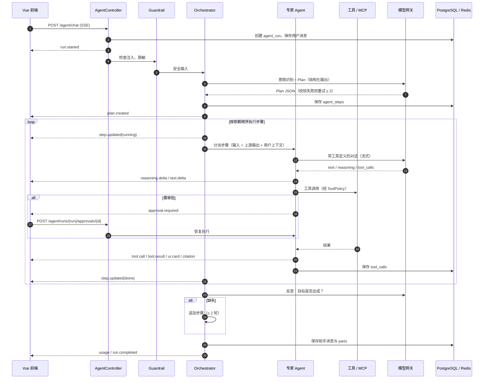
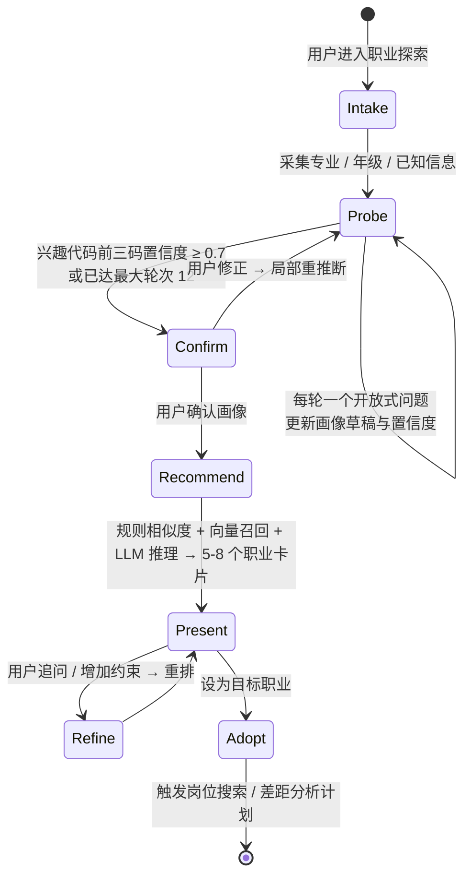
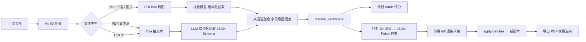
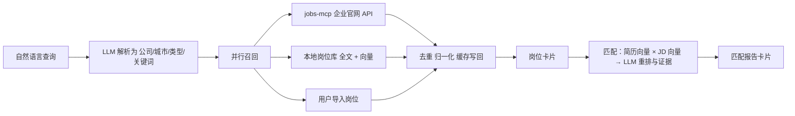
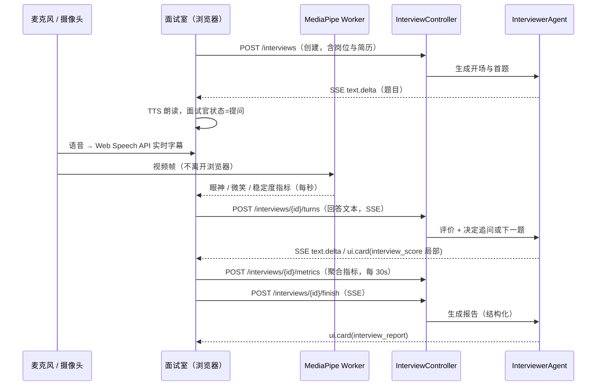
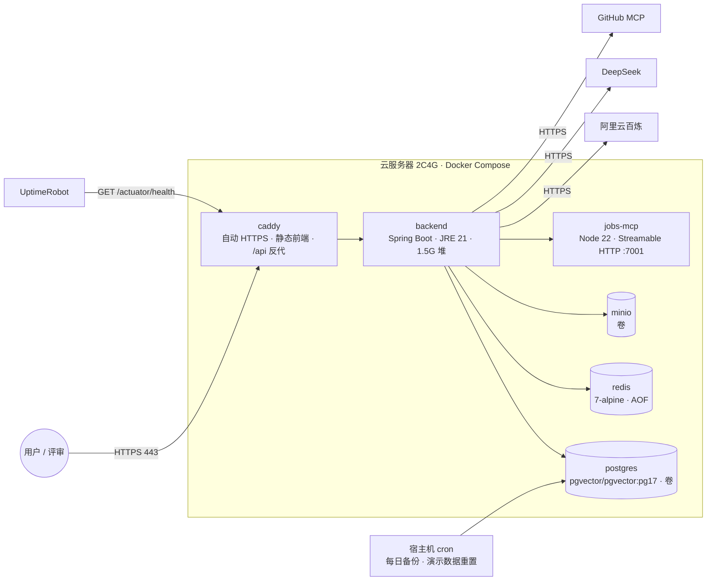

# 03 · 系统架构设计

> 后端：Java 21 · Spring Boot 4.0.x · Spring AI 2.0.x
> 前端：Vue 3.5 · Vite 7 · TypeScript 5
> 数据：PostgreSQL 17 + pgvector · Redis 7 · MinIO
> 状态：设计基线，随实现演进；重大变更以「架构决策记录（ADR）」形式追加于 §7。

---

## 1. 架构原则

1. **前端是产品，后端是 AI 能力接入层**：契合赛方定位。后端职责收敛为认证、Agent 编排、模型与工具接入、数据持久化；所有用户可感知的智能体过程都以事件形式推送到前端渲染。
2. **一切可流式、可中断、可回放**：Agent 运行以事件流（SSE）为一等公民，事件同时落库。
3. **安全内建于工具循环**：读写分级、审批、参数校验、输出审核作为 Advisor 嵌入 Spring AI 的调用链。
4. **数据最小化与端侧优先**：隐私敏感的实时感知（语音识别、表情姿态）在浏览器完成，只上传结果。
5. **单机可跑、集群可扩**：Docker Compose 一键启动；无状态后端可横向扩展（SSE 会话状态放 Redis）。
6. **协议先行**：REST + SSE 事件 + 卡片 schema 先定义，前后端并行开发，OpenAPI 生成 TS 类型。

## 2. 总体架构

```mermaid
flowchart TB
  subgraph client [浏览器 · Vue 3 SPA]
    direction LR
    Pages[页面层<br/>工作台 · 对话 · 职业探索 · 简历 · 岗位 · 看板 · 面试 · 规划 · 设置]
    Widgets[组合层<br/>AgentPanel · MessageStream · 卡片渲染器]
    Stores[状态层<br/>Pinia · TanStack Query]
    Stream[useAgentStream<br/>SSE 解析 · 重连 · 审批回传]
    EdgeAI[端侧 AI<br/>Web Speech API · MediaPipe Worker]
    Pages --> Widgets --> Stores
    Widgets --> Stream
    Pages --> EdgeAI
  end

  subgraph edge [接入层]
    Caddy[Caddy / Nginx<br/>HTTPS · 静态资源 · /api 反代 · SSE 不缓冲]
  end

  subgraph app [应用层 · Spring Boot 4]
    direction TB
    Web[Web 层<br/>REST Controller · SSE Emitter · JWT Filter · 限流]
    subgraph agentcore [Agent 内核]
      Orch[Orchestrator<br/>意图识别 · 规划 · 执行 · 反思]
      Experts[专家 Agent<br/>职业探索 · 简历 · 岗位 · 面试官 · 规划]
      Advisors[Advisor 链<br/>安全护栏 · 记忆 · RAG · 工具循环 · 观测]
      ToolReg[工具注册表<br/>@Tool 本地工具 · MCP 工具 · 分级策略]
    end
    Domain[领域服务<br/>简历 · 岗位 · 看板 · 面试 · 规划 · 知识库 · 记忆 · 通知]
    Infra[基础设施<br/>模型网关 · 向量库 · 文件 · 缓存 · 事件总线 · 调度]
    Web --> Orch --> Experts --> Advisors --> ToolReg
    Experts --> Domain
    ToolReg --> Domain
    Domain --> Infra
    Advisors --> Infra
  end

  subgraph mcp [MCP]
    McpClient[MCP Client<br/>Streamable HTTP / stdio]
    McpServer[MCP Server<br/>@McpTool 对外暴露]
  end

  subgraph data [数据层]
    PG[(PostgreSQL 17<br/>业务表 + pgvector 向量 + 全文检索)]
    Redis[(Redis 7<br/>会话 · 限流 · SSE 缓冲 · 队列)]
    MinIO[(MinIO<br/>简历文件 · 音频 · 导出 PDF)]
  end

  subgraph external [外部服务]
    Bailian[阿里云百炼<br/>qwen3.8-flash / max · glm-5.3-flash<br/>text-embedding-v4 · gte-rerank]
    DeepSeek[DeepSeek API<br/>deepseek-v4-flash / pro]
    JobsMCP[jobs-mcp<br/>Node · 企业官网公开招聘 API]
    GitHubMCP[GitHub MCP]
    SearchMCP[搜索 MCP]
  end

  client -->|HTTPS| Caddy -->|/api| Web
  Web -.->|SSE 事件流| client
  ToolReg --> McpClient
  McpClient --> JobsMCP & GitHubMCP & SearchMCP
  McpServer --> ToolReg
  Infra --> Bailian & DeepSeek
  Infra --> PG & Redis & MinIO
```

### 2.1 分层职责

| 层 | 职责 | 关键约束 |
| --- | --- | --- |
| 页面 / 组合 / 状态（前端） | 交互、渲染、客户端状态、服务端缓存 | 无业务规则重复实现；所有 AI 结果来自事件流 |
| 接入层 | HTTPS、静态托管、反向代理、SSE 透传 | `proxy_buffering off`、`read_timeout ≥ 300s` |
| Web 层 | 参数校验、认证授权、限流、SSE 生命周期 | 不含业务逻辑；统一响应包裹与错误码 |
| Agent 内核 | 规划、分派、工具循环、反思、事件发布 | 无直接 SQL；通过领域服务与工具访问数据 |
| 领域服务 | 简历、岗位、看板、面试、规划、知识库、记忆、通知的业务规则 | 可被 Controller、工具、调度任务复用 |
| 基础设施 | 模型网关（路由 / 回退 / 观测）、向量库、文件、缓存、事件总线、调度 | 对外部依赖的唯一出口 |

## 3. 后端模块划分

采用 Maven 多模块的模块化单体：业务域各自拥有构建模块，但只有 `offerpilot-bootstrap` 提供 Spring Boot 启动入口，竞赛期不拆业务微服务。

```text
backend/
├── pom.xml                    # 聚合父工程与统一依赖版本
├── offerpilot-bootstrap/      # 唯一启动类、运行配置、Flyway、Prompt
├── offerpilot-platform/       # common、config、llm、mcp 等技术适配器
├── offerpilot-agent/          # agent、conversation：编排、事件、会话、审批
├── offerpilot-identity/       # auth、user：认证与用户
├── offerpilot-resume/         # resume：简历与文件
├── offerpilot-job/            # job、board：岗位与求职看板
├── offerpilot-career/         # discovery、career、knowledge：职业探索、规划与知识库
└── offerpilot-interview/      # interview：模拟面试
```

跨模块只通过 application 层定义的 interface 与契约协作；不得直接依赖其他模块的 Controller、Repository 或持久化实体。`offerpilot-platform` 只承载技术横切能力，不承载业务规则。

### 3.1 Agent 内核核心类型

```java
// 计划（结构化输出）
public record Plan(String goal, List<PlanStep> steps) {}
public record PlanStep(String id, String title, ExpertType agent,
                       Map<String, Object> inputs, List<String> dependsOn) {}

public enum ExpertType { CAREER_DISCOVERY, RESUME, JOB, INTERVIEWER, COACH }

// 事件（可辨识联合，前端一一对应）
public sealed interface AgentEvent permits RunStarted, PlanCreated, StepUpdated,
        ReasoningDelta, TextDelta, ToolCall, ToolResult, UiCard, ApprovalRequired,
        Citation, Usage, ErrorEvent, RunCompleted {}

// 工具策略
public enum ToolAccess { READ, WRITE, EXTERNAL_SIDE_EFFECT }
public record ToolPolicy(String toolName, ToolAccess access, boolean requiresApproval,
                         Duration timeout, int maxCallsPerRun) {}
```

### 3.2 专家 Agent 的组装方式

每个专家 Agent 是一个 `ChatClient`，通过工厂按需装配：

```java
ChatClient client = ChatClient.builder(modelGateway.chatModel(ModelTier.FLASH))
    .defaultSystem(promptRepository.load("career_discovery/system.st", version))
    .defaultAdvisors(
        guardrailAdvisor,                      // 输入注入检测、文档隔离
        piiMaskingAdvisor,                     // 可选脱敏（按用户偏好）
        MessageChatMemoryAdvisor.builder(jdbcChatMemory).build(),
        retrievalAdvisor.forCollection("occupations"),   // 仅需要 RAG 的 Agent 装配
        usageLoggingAdvisor)                   // token / 耗时落库并发 usage 事件
    .defaultTools(discoveryTools, memoryTools)  // @Tool 本地工具
    .defaultToolCallbacks(mcpToolProvider.callbacksFor(userId))  // MCP 工具（按用户启停）
    .build();
```

工具循环由 Spring AI 2.0 的 `ToolCallingAdvisor` 承担；`ApprovalService` 在工具执行前检查 `ToolPolicy`，需要审批时发布 `ApprovalRequired` 事件并挂起当前步骤（`CompletableFuture` + Redis 超时），用户决策通过 REST 回传后继续。

## 4. 关键流程

### 4.1 复合任务的一次运行



### 4.2 职业探索（对话式测评 → 推荐）



匹配计算（详见 [04-AI技术方案 §2.3](04-AI技术方案.md)）：

- 规则层：Holland 三码与职业条目兴趣代码的位置加权相似度（可解释、零成本）。
- 检索层：画像文本（专业 + 兴趣 + 技能 + 价值观）向量检索职业条目 Top 30。
- 推理层：LLM 在候选集内结合用户原话给出排序、匹配理由、顾虑与典型岗位，输出结构化 `CareerRecommendation[]`。

### 4.3 简历解析与定向改写



### 4.4 岗位搜索与匹配



### 4.5 语音模拟面试（端云协同）



## 5. 技术选型与理由

### 5.1 后端

| 领域 | 选型 | 备选 | 选择理由 |
| --- | --- | --- | --- |
| 语言 / 运行时 | Java 21 LTS | Java 25 LTS | 虚拟线程 GA、生态兼容性最好（Tika、PDFBox、Testcontainers 等）；Spring Boot 4 支持 17-25，可无痛升级 |
| 应用框架 | Spring Boot 4.0.x + Spring MVC + 虚拟线程 | WebFlux | MVC 心智简单、JPA 阻塞 IO 与虚拟线程配合良好；SSE 用 `SseEmitter` / `Flux<ServerSentEvent>` 均可；避免全响应式带来的调试成本 |
| AI 框架 | Spring AI 2.0.x | LangChain4j 1.19 | 与 Boot 4 同代；工具循环可组合（`ToolCallingAdvisor`）便于嵌入审批与护栏；MCP Java SDK 由 Spring 团队维护，Client / Server / 注解齐全；pgvector、结构化输出、观测开箱即用。LangChain4j 的 agentic 模块仍为实验性 |
| 向量库 | PostgreSQL + pgvector | Milvus / Qdrant | 业务库与向量库合一，减少一个运维组件；HNSW 满足十万级向量；全文检索 `tsvector` 可做混合召回 |
| 缓存 / 队列 | Redis 7 | RabbitMQ | 限流、SSE 事件缓冲、审批等待、轻量任务队列一站解决 |
| 文件存储 | MinIO | 本地磁盘 / OSS | S3 兼容，本地与云一致；签名 URL 直传 |
| 持久层 | Spring Data JPA + Flyway | MyBatis-Plus | 与 Boot 4 / Hibernate 7 集成顺畅；JSONB 与向量列通过自定义类型映射；迁移脚本受控 |
| 认证 | Spring Security 7 + JWT | Session | 前后端分离、无状态、便于横向扩展 |
| 弹性 | Resilience4j + Bucket4j | 自研 | 模型调用重试 / 熔断 / 超时；用户级限流 |
| 文件解析 | Apache Tika + PDFBox | 纯视觉 | 文本层优先成本低；扫描件走视觉 |
| API 文档 | SpringDoc OpenAPI | 手写 | 自动生成，前端 `openapi-typescript` 生成类型 |

### 5.2 前端

| 领域 | 选型 | 备选 | 选择理由 |
| --- | --- | --- | --- |
| 框架 | Vue 3.5 + TypeScript | React + Next.js | 团队熟悉；Java 承担全部 API，无需 SSR；Vite 开发体验好 |
| 构建 | Vite 7 | Vite 8 | Vite 8 与 `@tailwindcss/vite` peer 依赖存在兼容问题，待稳定后升级 |
| 样式 / 组件 | Tailwind CSS 4 + shadcn-vue（Reka UI） | Element Plus | 赛方强烈推荐 Tailwind；shadcn-vue 可完全定制、代码归项目所有，体现组件化能力 |
| 状态 | Pinia + TanStack Query | 仅 Pinia | 客户端状态与服务端缓存分离，减少手写 loading / error / 失效逻辑 |
| 流式 | 自研 `useAgentStream` | `@ai-sdk/vue` | 事件协议为自定义（计划 / 审批 / 卡片），自研更可控；P2 提供 AI SDK UI Message Stream 兼容层 |
| Markdown | markdown-it + shiki | marked | 插件生态与增量渲染友好；shiki 高亮质量高，按需加载语言 |
| 图表 | vue-echarts | Chart.js | 雷达图、时间轴、对比图表现力强 |
| 端侧 AI | Web Speech API + MediaPipe Tasks Vision | 服务端 ASR | 零成本、低延迟、隐私友好，体现端云协同 |

### 5.3 模型

| 用途 | 选型 | 理由 |
| --- | --- | --- |
| 主力（规划、对话、视觉、结构化输出） | `qwen3.8-flash` | 多模态、Function Calling、结构化输出、1M 上下文、价格低、国内访问稳定 |
| 低成本长文本（批量解析、摘要） | `deepseek-v4-flash` | 极低单价、高并发限额、Spring AI 原生 starter |
| 视觉备选 | `glm-5.3-flash` | 原生图片 / 视频 / 文件输入，作为视觉回退 |
| 高质量（面试终评、简历重写） | `qwen3.8-max` / `deepseek-v4-pro` | 按需启用，用户偏好可选 |
| Embedding / Rerank | `text-embedding-v4` / `gte-rerank` | 与主力同平台，中文效果好 |

统一通过 OpenAI 兼容协议接入（百炼 `compatible-mode/v1`），Spring AI 中以多个 `OpenAiChatModel` 实例 + 自研 `ModelGateway` 做路由与回退。

## 6. 部署架构



- 单机资源分配：backend 1.5G、postgres 768M、redis 128M、minio 256M、jobs-mcp 256M、caddy 64M；4G 机器留 1G 余量。
- 前端可额外部署到 Vercel / Cloudflare Pages 作为镜像（`VITE_API_BASE_URL` 指向后端域名，CORS 白名单）。
- 详细配置见 [09-部署与运维](09-部署与运维.md)。

## 7. 架构决策记录（ADR）

| 编号 | 决策 | 背景 | 选项 | 结论与理由 | 日期 |
| --- | --- | --- | --- | --- | --- |
| ADR-001 | 实时通道用 SSE 而非 WebSocket | 需要服务端 → 客户端流式事件；客户端 → 服务端仅偶发（审批、中断） | SSE / WebSocket | SSE：HTTP 语义简单、经代理友好、天然支持 `Last-Event-ID` 续传；审批与中断走普通 REST。语音不做服务端实时流，避免 WebSocket 需求 | 09-11 |
| ADR-002 | 向量库用 pgvector | 向量规模 < 50 万；团队运维精力有限 | pgvector / Milvus / Qdrant | pgvector：一库两用，混合检索（向量 + `tsvector`）在 SQL 内完成；Spring AI 原生支持 | 09-11 |
| ADR-003 | AI 框架用 Spring AI 2.0 | 需要工具循环可插拔以嵌入审批与护栏；需要 MCP 双向 | Spring AI / LangChain4j | Spring AI 2.0：`ToolCallingAdvisor` 可组合；MCP Client / Server / 注解完整；与 Boot 4 同代。LangChain4j agentic 仍实验 | 09-11 |
| ADR-004 | Spring MVC + 虚拟线程而非 WebFlux | JPA 阻塞；团队对 Reactor 不熟 | MVC / WebFlux | MVC + 虚拟线程：阻塞代码可扩展；SSE 通过 `SseEmitter` 输出；Spring AI 流式 `Flux` 在边界桥接 | 09-11 |
| ADR-005 | 自定义 SSE 事件协议，P2 兼容 AI SDK | 事件包含计划、审批、卡片等自定义语义 | 自定义 / AI SDK UI Message Stream v1 | 先自定义保证可控与表达力；协议字段命名向 AI SDK parts 靠拢（text-delta、tool-*、data-*），便于 P2 写适配器 | 09-11 |
| ADR-006 | Java 21 而非 25 | 生态兼容与团队环境 | 21 / 25 | 21；Boot 4 支持 25，国赛前评估升级 | 09-11 |
| ADR-007 | JPA + Flyway 而非 MyBatis-Plus | 需要 JSONB、向量列、迁移受控 | JPA / MyBatis-Plus | JPA；复杂检索用原生 SQL（`@Query(nativeQuery)`）或 `JdbcClient` | 09-11 |
| ADR-008 | Monorepo | 三个可部署单元协同频繁 | Monorepo / 多仓 | Monorepo：一次提交跨前后端；CI 路径过滤分别构建 | 09-11 |
| ADR-009 | 语音识别 / 合成在浏览器端 | 成本、延迟、隐私 | Web Speech API / 服务端 ASR+TTS | 浏览器端为主；服务端能力作为 P2 增强（更好音色） | 09-11 |
| ADR-010 | 职业探索采用「对话式测评 + 可选快速问卷」双模式 | 用户提出按性格 / 爱好 / 专业推荐职业；问卷流失率高 | 纯问卷 / 纯对话 / 双模式 | 双模式：对话为主（创新与 Agent 亮点），问卷兜底（可靠、可控） | 09-11 |

## 8. 非功能设计

### 8.1 性能

- 模型：默认 Flash 档；规划与意图识别用短 Prompt 与低 `max_tokens`；结构化输出使用 JSON Schema 模式减少重试。
- 缓存：岗位搜索结果按归一化查询缓存 30 分钟；JD 与简历向量缓存；知识库检索结果缓存 10 分钟；Redis 存 SSE 事件缓冲 5 分钟。
- 并发：虚拟线程处理 SSE 长连接；模型调用设置 60s 超时；每用户同时运行 ≤ 2 个 Agent Run。
- 前端：路由懒加载；重型依赖（ECharts、shiki 语言包、MediaPipe wasm）按需加载；消息虚拟滚动；构建产物长缓存 + 内容哈希。

### 8.2 可扩展性

- 后端无状态：审批等待、SSE 缓冲、限流计数全部在 Redis；可水平扩展多实例（Caddy 负载均衡；SSE 事件通过 Redis Pub/Sub 广播）。
- 新专家 Agent：实现 `ExpertAgent` 接口 + Prompt 模板 + 工具类，注册到 `ExpertRegistry` 即可被 Orchestrator 分派。
- 新卡片类型：后端新增 `cardType` 与 payload record，前端在卡片注册表添加组件；协议无需变更。
- 新 MCP 服务器：设置页添加连接，工具自动进入注册表并受 `ToolPolicy` 默认策略（外部工具默认 READ，写类名称匹配规则需审批）。

### 8.3 可观测性

- `traceId` 贯穿 HTTP → Agent Run → 模型调用 → 工具调用，写入日志 MDC 与响应头。
- Spring AI Observability 指标（`gen_ai.*`）经 Micrometer 暴露；每次调用的模型、token、耗时、成本估算写 `llm_usage_logs`。
- Actuator：`health`（含 DB、Redis、MinIO、模型可达性）、`metrics`、`prometheus`（可选接 Grafana）。
- 前端：错误边界上报（简易 `POST /client-logs`，P1）。

### 8.4 安全

- 认证：JWT access 15 分钟 + refresh 7 天（HttpOnly、Secure、SameSite=Lax）；密码 BCrypt(12)。
- 授权：所有资源按 `user_id` 隔离；管理员接口 `ROLE_ADMIN`。
- 输入：Bean Validation；文件类型白名单与魔数校验；大小限制 10MB；上传扫描（ClamAV 可选）。
- AI 安全：见 [04-AI技术方案 §10](04-AI技术方案.md)。
- 传输与存储：全站 HTTPS；MinIO 私有桶 + 签名 URL；第三方 Token（GitHub）AES-GCM 加密存储。
- 限流：Bucket4j 每用户 60 req/min，模型调用每用户每日 token 上限可配置。
- 供应链：Dependabot；`gitleaks` pre-commit；CI OWASP Dependency-Check（P1）。

## 9. 仓库目录结构

```text
offerpilot/
├── backend/                                     # Maven 聚合父工程（packaging=pom）
│   ├── offerpilot-bootstrap/                    # 唯一 Spring Boot 启动入口、配置、Flyway、Prompt
│   ├── offerpilot-platform/                     # 通用错误、ID、Web、模型/MCP 等技术适配器
│   ├── offerpilot-agent/                        # 编排、事件、会话与审批
│   ├── offerpilot-identity/                     # 认证与用户
│   ├── offerpilot-resume/                       # 简历与文件
│   ├── offerpilot-job/                          # 岗位与求职看板
│   ├── offerpilot-career/                       # 职业探索、规划与知识库
│   └── offerpilot-interview/                    # 模拟面试
├── frontend/
│   ├── package.json  vite.config.ts  tsconfig*.json  eslint.config.js
│   ├── Dockerfile  nginx.conf
│   ├── .env.example
│   └── src/
│       ├── app/            # main.ts、router、layouts、guards、providers
│       ├── shared/         # ui（shadcn-vue）、composables、api、types、utils、styles
│       ├── features/       # auth chat discovery resume job board interview career kb settings
│       └── widgets/        # AgentPanel、MessageStream、CardRenderer、Kanban 等
├── mcp-servers/
│   └── jobs-mcp/           # Node 22 + @modelcontextprotocol/sdk，包装 jobhunt-cli
├── deploy/
│   ├── docker-compose.yml
│   ├── Caddyfile
│   ├── nginx/default.conf
│   └── scripts/{backup.sh,reset-demo.sh}
├── docs/
├── .github/workflows/{backend.yml,frontend.yml,deploy.yml}
├── .env.example
└── README.md
```
