# 06 · 数据库设计

## P0-2 每日用量实现（2026-10-09）

当前迁移尚未创建下文设计的 llm_usage_logs / v_daily_user_usage；P0-2 不新增 SQL 表。identity 查询 users LEFT JOIN user_preferences，登录用户优先使用 daily_token_limit（含 0，表示禁止模型调用），缺行回退 200000 配置值。guest_sessions 存在该 user_id 即视为访客（不依赖令牌是否过期），访客固定使用配置额度 50000，不因产生偏好行而提升额度。

Redis 键 offerpilot:llm:{userId}:rpm:{UTC分钟序号} 与 :tokens:{UTC日期} 使用同一 hash slot；Lua 原子检查 RPM/日用量并消耗请求数。成功响应有 usage 时 INCRBY token；跨日完成归入调用开始日。RPM 键下一分钟过期，日键下一 UTC 零点后 1 小时过期以容纳迟到响应。测试 profile 缺 Redis 使用单进程内存；生产故障返回 CACHE_UNAVAILABLE，不重置为内存配额。消息/报告原有 usage 继续用于展示，不重复汇总进配额；Redis 计数是短期额度状态，持久化可靠性依赖部署 Redis 的 AOF/RDB 策略。

## 分支整合迁移契约（2026-10-08）

合并后的唯一迁移为 V1–V15：V11 auth_test_accounts、V12 disable_public_auth_test_accounts、V13 resume_patch_batches、V14 resume_optimizations、V15 applications。main 已共享 V11 的内容和校验和不变；功能分支原 V11/V12/V13 只调整文件版本，SQL 内容和校验和不变。下文 2026-10-02 至 10-04 的旧编号对应当时功能分支，现以本节为准。新库及 main 数据库正常升级；已应用旧功能分支迁移的数据库使用 deploy/migrations/README.md 的精确历史校验、事务内备份/对齐和一次性 out-of-order 补齐流程，不重建业务表、不删除数据。不自动在开发或线上库执行此流程。

## 认证账号安全增量（2026-10-08）

认证修复阶段实施至 V12；整合后 V1–V15 及旧分支升级以本页上节为准。V11__auth_test_accounts.sql 已共享，保持其内容及校验和；V12__disable_public_auth_test_accounts.sql 将固定 ID/邮箱且密码哈希仍为原公开测试值、状态为 ACTIVE 的两个账号改为 DISABLED。已修改密码/邮箱或已停用/删除的账号不覆盖；不删除 users、会话、简历或关联记录。新库依次执行 V11、V12，升级库仅执行尚未应用的 V12。正式客服由受控流程配置，不重新启用公开密码。下文未实现模块的迁移编号仅为早期规划，实际版本以 migration 目录为准。

## 看板已实现数据库增量（2026-10-04）
V13__applications.sql 是 §9 看板规划的首期实现，已有 V1–V12 保持不变。applications 字段为 id、user_id（users 外键，删除用户级联）、job_id（jobs 外键）、status、note、created_at、updated_at。UNIQUE(user_id, job_id) 防止并发重复收藏；idx_applications_owner(user_id, created_at DESC, id) 支持用户列表。status CHECK 限制 TODO/APPLIED/INTERVIEW/OFFER/CLOSED；note 非空默认空字符串，CHECK 长度不超过 2000。阶段/备注在同一条 UPDATE 中按 owner 隔离；独立字段更新避免互相覆盖，同字段并发采用最后一次提交。岗位展示信息来自 jobs，无客户端快照重复存储。本次不创建 application_events、排序或下一步时间字段。数据持续保留至用户生命周期结束；没有新增过期清理。


## 聊天改写结果保留（2026-10-03）

本增量复用 V12 resume_optimizations、V11 resume_patch_batches 与消息 parts，不新增迁移。聊天生成的 request_id 为 runId+stepId 的稳定UUID，JD原文保存到任务；版本采纳仍是独立事务。终态消息保存 resume_diff，cardId=reportId，payload含报告/简历/版本/批次标识；报告最多30000字符，沿用单卡32768及每消息8张限制。无建议的 batchId=null 卡片也可恢复。讨论读取原任务并再次校验用户、简历与版本，消息快照不赋予额外权限。RUNNING卡片不承诺刷新恢复；即使聊天最后回复失败，已提交的建议仍可从改写记录读取。URL上下文由前端保留，不新增会话默认资源列；切换会话不跨会话借用卡片。

## 聊天岗位快照（2026-09-28）

本增量不新增迁移。岗位搜索仍按 V8 的 jobs 唯一键去重写入公开快照。聊天 job_card v2 使用一张列表卡片保存前5条精简岗位、实际搜索条件、返回数量和站点元信息，避免每岗位占一张卡片超过每消息8张限制；cardId 为 runId+stepId 的稳定UUID。完整JD保留在 jobs，不复制进消息。卡片沿用终态消息 parts 原子写入、32,768字符单卡上限及访客所有者校验；RUNNING 不保证刷新恢复。重新按条件搜索会获取新结果，不代表历史快照分页。

## V10 简历诊断（2026-09-26）

`V10__resume_diagnoses.sql` 新建 resume_diagnoses，既有迁移不修改。字段 id、user_id、resume_id、version_id、request_id、status、model_tier、report(jsonb，可空)、error、created_at、updated_at。用户/简历/版本外键级联删除，UNIQUE(user_id,request_id) 实现请求幂等；RUNNING 的 user_id 部分唯一索引限制每人一个诊断。报告查询按用户与简历倒序索引，最多返回30条；原始联系方式不额外复制进报告。

状态 RUNNING → SUCCEEDED/FAILED/CANCELLED，唯一任务ID不复用，条件更新 status=RUNNING 阻止取消/过期后的写回。超过3分钟未终止的任务在查询或创建诊断时标记 FAILED；模型总预算90秒，不跨网络持有事务。成功报告绑定不可变版本，简历保存新版本不覆盖旧报告；报告保存模型、提示词及规则版本、时间和已报告 token 用量。不承诺独立诊断事件回放。

> PostgreSQL 17 + 扩展 `vector`（pgvector）、`pg_trgm`；可选 `zhparser` 中文分词。
> 迁移工具：Flyway（`backend/src/main/resources/db/migration`）。
> 约定：表名与列名 `snake_case`；主键 `id text`（业务前缀 + ULID，与接口文档一致）；所有表含 `created_at timestamptz not null default now()`，可变表含 `updated_at`；用户私有数据表含 `user_id` 并建索引；JSON 结构用 `jsonb`。

---

## 1. ER 总览

当前迁移已实施 V1–V7，路径为 `backend/offerpilot-bootstrap/src/main/resources/db/migration`。V5__persistent_chat.sql 新增 guest_sessions（token_hash 主键、user_id 外键、expires_at、created_at）；users 的访客使用不可登录的 password_hash 标记，不复用公共体验账户。新增 messages.ordinal（bigserial，会话内稳定顺序唯一索引）、messages.status（默认 COMPLETED，兼容旧行），agent_runs.lease_expires_at，以及每会话最多一个活动运行的部分唯一索引。V6__resume.sql 实现简历解析任务与结构化版本（详见 §7）；V7__resume_model_preferences.sql 新增访客模型偏好和任务档位快照；V1–V6 保持不变。

会话开始在短事务中锁定用户和会话，写入用户消息、RUNNING 助手占位与运行；完成/失败/取消在运行行锁下原子更新正文、parts、usage 与状态。模型调用在事务外。删除会话使用既有外键级联，运行中拒绝删除。失效访客令牌不会自动清除历史数据，历史仍由原 user_id 拥有；身份恢复和到期数据清理策略待账号体系实现。

助手消息里的卡片不单独建表，也不新增迁移，仍写在 `messages.parts`。`ui.card` 在运行过程中只进入 SSE；RUNNING 检查点只更新正文，避免流式覆盖把尚未结束的卡片写进去。运行进入 `COMPLETED`、`FAILED` 或 `CANCELLED` 时，与 `plain_text`、`usage`、状态在同一次消息更新中写入卡片。顺序是文本 part，再按发出顺序追加 `{type:'card', cardId, cardType, payload}`。没有卡片时 `parts` 仍是单个 text part，已有行保持可读。用户消息不写卡片。

上限按 Java 字符数计算：正文沿用 64,000；每条助手消息最多 8 张卡片；`cardId` 为 1–80 位，以字母或数字开头，其余为字母、数字、下划线或连字符，同一消息内不可重复；`cardType` 取 [05 §17](05-接口文档.md) 的 CardType，并包含 §7 已落地的 `job_evidence_match`；`payload` 必须是 JSON 对象，序列化后不超过 32,768 字符；整段 `parts` JSON 不超过 400,000 字符。不合规、重复、超过张数或单卡大小的卡片不发送也不写入。若正文转义后使 `parts` 超过总上限，跳过放不下的卡片，正文仍完整保存。

聊天成功调用 `matchJobToResume` 时，写入的 `job_match.cardId` 就是 `job_matches.id`（`match_` 前缀加 ULID）。`parts` 里的 payload 去掉 `jobSnapshot` 和 `resumeSnapshot`，避免快照撑过单卡上限；这两份快照仍只保存在 `job_matches.report`。投影出的 `matched`、`gaps`、`advice` 与保留的 `requirements` 一起进入 payload，不另建卡片表。

```mermaid
erDiagram
  users ||--o| user_preferences : has
  users ||--o{ refresh_tokens : has
  users ||--o{ user_integrations : has
  users ||--o{ conversations : owns
  conversations ||--o{ messages : contains
  conversations ||--o{ agent_runs : has
  agent_runs ||--o{ agent_steps : has
  agent_runs ||--o{ tool_calls : has
  agent_runs ||--o{ approvals : has
  agent_runs ||--o{ agent_events : logs
  agent_runs ||--o{ llm_usage_logs : logs
  users ||--o{ files : uploads

  users ||--o| career_profiles : has
  career_profiles ||--o{ career_profile_versions : versions
  users ||--o{ discovery_sessions : has
  users ||--o{ career_recommendations : has
  career_recommendations ||--o{ career_recommendation_items : contains
  occupations ||--o{ career_recommendation_items : referenced

  users ||--o{ resumes : owns
  resumes ||--o{ resume_versions : versions
  files ||--o{ resumes : source
  resume_versions ||--o{ resume_analyses : has
  resume_versions ||--o{ resume_patch_batches : has

  jobs ||--o{ job_matches : has
  resume_versions ||--o{ job_matches : has
  users ||--o{ applications : owns
  jobs ||--o{ applications : references
  applications ||--o{ application_events : history

  users ||--o{ interview_sessions : has
  interview_sessions ||--o{ interview_turns : has
  interview_sessions ||--o{ interview_metrics : has
  interview_sessions ||--o| interview_reports : has

  users ||--o{ skill_gap_reports : has
  skill_gap_reports ||--o{ roadmaps : generates
  roadmaps ||--o{ roadmap_items : contains

  kb_documents ||--o{ kb_chunks : split
  users ||--o{ memories : has
  users ||--o{ mcp_servers : configures
  users ||--o{ mcp_api_keys : owns
  users ||--o{ notifications : receives
  users ||--o{ reminders : sets
```



## 2. 扩展与公共对象

```sql
-- V1__extensions.sql
CREATE EXTENSION IF NOT EXISTS vector;
CREATE EXTENSION IF NOT EXISTS pg_trgm;
-- 可选：中文分词（镜像需预装）；不可用时应用侧分词后写入 tsv
-- CREATE EXTENSION IF NOT EXISTS zhparser;
-- CREATE TEXT SEARCH CONFIGURATION zh (PARSER = zhparser);
-- ALTER TEXT SEARCH CONFIGURATION zh ADD MAPPING FOR n,v,a,i,e,l WITH simple;

CREATE OR REPLACE FUNCTION set_updated_at() RETURNS trigger AS $$
BEGIN NEW.updated_at = now(); RETURN NEW; END $$ LANGUAGE plpgsql;
```

每个含 `updated_at` 的表创建触发器：`CREATE TRIGGER trg_<table>_updated BEFORE UPDATE ON <table> FOR EACH ROW EXECUTE FUNCTION set_updated_at();`（下文省略）。

## 3. 用户与认证

```sql
CREATE TABLE users (
  id            text PRIMARY KEY,
  email         citext UNIQUE NOT NULL,
  password_hash text NOT NULL,
  nickname      text NOT NULL,
  avatar_file_id text,
  school        text,
  school_type   text CHECK (school_type IN ('KEY_985_211','REGULAR_UNDERGRAD','VOCATIONAL','GRADUATE')),
  major         text,
  grade         text,
  roles         text[] NOT NULL DEFAULT '{USER}',
  is_demo       boolean NOT NULL DEFAULT false,
  status        text NOT NULL DEFAULT 'ACTIVE' CHECK (status IN ('ACTIVE','DISABLED','DELETED')),
  created_at    timestamptz NOT NULL DEFAULT now(),
  updated_at    timestamptz NOT NULL DEFAULT now()
);

CREATE TABLE user_preferences (
  user_id            text PRIMARY KEY REFERENCES users(id) ON DELETE CASCADE,
  default_model_tier text NOT NULL DEFAULT 'FLASH' CHECK (default_model_tier IN ('FLASH','CHEAP','PRO')),
  language           text NOT NULL DEFAULT 'zh-CN',
  theme              text NOT NULL DEFAULT 'system',
  pii_masking        boolean NOT NULL DEFAULT true,
  voice_auto_play    boolean NOT NULL DEFAULT true,
  camera_analysis    boolean NOT NULL DEFAULT true,
  daily_token_limit  integer NOT NULL DEFAULT 200000,
  updated_at         timestamptz NOT NULL DEFAULT now()
);

CREATE TABLE refresh_tokens (
  id         text PRIMARY KEY,
  user_id    text NOT NULL REFERENCES users(id) ON DELETE CASCADE,
  token_hash text NOT NULL UNIQUE,
  expires_at timestamptz NOT NULL,
  revoked_at timestamptz,
  user_agent text,
  ip         inet,
  created_at timestamptz NOT NULL DEFAULT now()
);
CREATE INDEX idx_refresh_tokens_user ON refresh_tokens(user_id);

CREATE TABLE user_integrations (          -- 第三方凭据（加密）
  id           text PRIMARY KEY,
  user_id      text NOT NULL REFERENCES users(id) ON DELETE CASCADE,
  provider     text NOT NULL CHECK (provider IN ('GITHUB')),
  secret_enc   bytea NOT NULL,             -- AES-GCM
  meta         jsonb NOT NULL DEFAULT '{}',
  created_at   timestamptz NOT NULL DEFAULT now(),
  updated_at   timestamptz NOT NULL DEFAULT now(),
  UNIQUE (user_id, provider)
);
```

## 4. 会话、消息与 Agent 运行

```sql
CREATE TABLE conversations (
  id         text PRIMARY KEY,
  user_id    text NOT NULL REFERENCES users(id) ON DELETE CASCADE,
  title      text NOT NULL DEFAULT '新对话',
  mode       text NOT NULL DEFAULT 'AUTO',
  pinned     boolean NOT NULL DEFAULT false,
  summary    text,                         -- 滚动摘要（长对话压缩）
  created_at timestamptz NOT NULL DEFAULT now(),
  updated_at timestamptz NOT NULL DEFAULT now()
);
CREATE INDEX idx_conversations_user_updated ON conversations(user_id, updated_at DESC);

CREATE TABLE messages (
  id              text PRIMARY KEY,
  conversation_id text NOT NULL REFERENCES conversations(id) ON DELETE CASCADE,
  user_id         text NOT NULL,
  role            text NOT NULL CHECK (role IN ('USER','ASSISTANT','SYSTEM','TOOL')),
  parts           jsonb NOT NULL,          -- [{type:'text'|'card'|'citation'|'attachment'|'tool', ...}]
  plain_text      text,                    -- 便于检索与摘要
  run_id          text,
  model           text,
  usage           jsonb,
  created_at      timestamptz NOT NULL DEFAULT now()
);
CREATE INDEX idx_messages_conv_created ON messages(conversation_id, created_at);

CREATE TABLE agent_runs (
  id              text PRIMARY KEY,
  user_id         text NOT NULL REFERENCES users(id) ON DELETE CASCADE,
  conversation_id text NOT NULL REFERENCES conversations(id) ON DELETE CASCADE,
  user_message_id text,
  assistant_message_id text,
  mode            text NOT NULL,
  goal            text,
  status          text NOT NULL CHECK (status IN ('RUNNING','WAITING_APPROVAL','COMPLETED','CANCELLED','FAILED')),
  intent          jsonb,                   -- 意图识别结果
  plan            jsonb,                   -- 结构化 Plan 快照
  context         jsonb NOT NULL DEFAULT '{}',
  model           text,
  error           jsonb,
  started_at      timestamptz NOT NULL DEFAULT now(),
  finished_at     timestamptz,
  created_at      timestamptz NOT NULL DEFAULT now()
);
CREATE INDEX idx_agent_runs_user_started ON agent_runs(user_id, started_at DESC);
CREATE INDEX idx_agent_runs_status ON agent_runs(status) WHERE status IN ('RUNNING','WAITING_APPROVAL');

CREATE TABLE agent_steps (
  id          text PRIMARY KEY,            -- run 内唯一，如 run_id || ':' || 's1'
  run_id      text NOT NULL REFERENCES agent_runs(id) ON DELETE CASCADE,
  step_key    text NOT NULL,               -- s1, s2 ...
  title       text NOT NULL,
  agent       text NOT NULL,
  inputs      jsonb,
  depends_on  text[] NOT NULL DEFAULT '{}',
  status      text NOT NULL CHECK (status IN ('PENDING','RUNNING','DONE','FAILED','SKIPPED')),
  summary     text,
  output      jsonb,
  attempt     smallint NOT NULL DEFAULT 1,
  started_at  timestamptz,
  finished_at timestamptz,
  ordinal     smallint NOT NULL
);
CREATE INDEX idx_agent_steps_run ON agent_steps(run_id, ordinal);

CREATE TABLE tool_calls (
  id             text PRIMARY KEY,
  run_id         text NOT NULL REFERENCES agent_runs(id) ON DELETE CASCADE,
  step_id        text REFERENCES agent_steps(id) ON DELETE CASCADE,
  name           text NOT NULL,
  source         text NOT NULL,            -- local | mcp:<server>
  access         text NOT NULL CHECK (access IN ('READ','WRITE','EXTERNAL_SIDE_EFFECT')),
  args           jsonb,
  result         jsonb,                    -- 截断后的结果
  ok             boolean,
  error          text,
  approval_id    text,
  duration_ms    integer,
  created_at     timestamptz NOT NULL DEFAULT now()
);
CREATE INDEX idx_tool_calls_run ON tool_calls(run_id, created_at);

CREATE TABLE approvals (
  id            text PRIMARY KEY,
  run_id        text NOT NULL REFERENCES agent_runs(id) ON DELETE CASCADE,
  user_id       text NOT NULL,
  tool_call_id  text,
  tool_name     text NOT NULL,
  args          jsonb NOT NULL,
  reason        text,
  status        text NOT NULL CHECK (status IN ('PENDING','APPROVED','REJECTED','TIMEOUT')),
  edited_args   jsonb,
  decision_note text,
  expires_at    timestamptz NOT NULL,
  decided_at    timestamptz,
  created_at    timestamptz NOT NULL DEFAULT now()
);
CREATE INDEX idx_approvals_run ON approvals(run_id);
CREATE INDEX idx_approvals_pending ON approvals(user_id) WHERE status = 'PENDING';

CREATE TABLE agent_events (                -- 事件存储（回放、续传）
  run_id   text NOT NULL REFERENCES agent_runs(id) ON DELETE CASCADE,
  seq      integer NOT NULL,
  type     text NOT NULL,
  step_id  text,
  payload  jsonb NOT NULL,
  ts       timestamptz NOT NULL DEFAULT now(),
  PRIMARY KEY (run_id, seq)
);
```

`text.delta` / `reasoning.delta` 高频事件在写入 `agent_events` 前按步骤合并（每 500ms 或 200 字符一条），避免行数膨胀；完整文本仍在 `messages.parts` 中。当前实现尚未把 Plan、工具调用或 `ui.card` 写入 `agent_events`；已接受的卡片只在运行结束时进入 `messages.parts`，上限见本节开头。

## 5. 文件

```sql
CREATE TABLE files (
  id          text PRIMARY KEY,
  user_id     text NOT NULL REFERENCES users(id) ON DELETE CASCADE,
  purpose     text NOT NULL CHECK (purpose IN ('ATTACHMENT','RESUME','AUDIO','SCREENSHOT','EXPORT','KB')),
  bucket      text NOT NULL,
  object_key  text NOT NULL,
  name        text NOT NULL,
  mime        text NOT NULL,
  size        bigint NOT NULL,
  sha256      text NOT NULL,
  created_at  timestamptz NOT NULL DEFAULT now(),
  UNIQUE (bucket, object_key)
);
CREATE INDEX idx_files_user ON files(user_id, created_at DESC);
```

## 6. 职业探索

```sql
CREATE TABLE occupations (                 -- 职业条目库（内置）
  id             text PRIMARY KEY,         -- occ_...
  code           text UNIQUE,              -- O*NET-SOC 或职业分类大典编码
  name           text NOT NULL,
  aliases        text[] NOT NULL DEFAULT '{}',
  family         text NOT NULL,            -- 岗位族：软件研发 / 产品 / 数据 / 设计 ...
  description    text NOT NULL,
  holland_code   char(3),                  -- 如 'IRC'
  holland_scores jsonb,                    -- {R:..,I:..,A:..,S:..,E:..,C:..}
  core_skills    jsonb NOT NULL DEFAULT '[]',   -- [{name, level, category}]
  typical_titles text[] NOT NULL DEFAULT '{}',
  growth_path    text,
  salary_range   jsonb,                    -- {campus:"12-25k", mid:"25-40k", source:"..."}
  outlook        text,
  companies      text[] NOT NULL DEFAULT '{}',
  related_majors text[] NOT NULL DEFAULT '{}',
  source         text NOT NULL,            -- onet | occupation_dict | custom
  embedding      vector(1024),
  tsv            tsvector,
  updated_at     timestamptz NOT NULL DEFAULT now()
);
CREATE INDEX idx_occupations_family ON occupations(family);
CREATE INDEX idx_occupations_holland ON occupations(holland_code);
CREATE INDEX idx_occupations_embedding ON occupations USING hnsw (embedding vector_cosine_ops);
CREATE INDEX idx_occupations_tsv ON occupations USING gin (tsv);
CREATE INDEX idx_occupations_name_trgm ON occupations USING gin (name gin_trgm_ops);

CREATE TABLE career_profiles (
  user_id      text PRIMARY KEY REFERENCES users(id) ON DELETE CASCADE,
  major        text,
  grade        text,
  school_type  text,
  interests    jsonb NOT NULL DEFAULT '[]',
  skills       jsonb NOT NULL DEFAULT '[]',
  personality  jsonb NOT NULL DEFAULT '{}',   -- {holland:{codes,scores,confidence}, traits:[{name,confidence,evidence}], mbti_self_reported}
  values       jsonb NOT NULL DEFAULT '[]',
  constraints  jsonb NOT NULL DEFAULT '{}',   -- {cities, overtime_tolerance, salary_expectation, ...}
  target_occupation_id text REFERENCES occupations(id),
  source       text NOT NULL DEFAULT 'conversation',
  version      integer NOT NULL DEFAULT 1,
  updated_at   timestamptz NOT NULL DEFAULT now()
);

CREATE TABLE career_profile_versions (
  id          text PRIMARY KEY,
  user_id     text NOT NULL REFERENCES users(id) ON DELETE CASCADE,
  version     integer NOT NULL,
  snapshot    jsonb NOT NULL,
  change_note text,
  created_at  timestamptz NOT NULL DEFAULT now(),
  UNIQUE (user_id, version)
);

CREATE TABLE discovery_sessions (
  id              text PRIMARY KEY,
  user_id         text NOT NULL REFERENCES users(id) ON DELETE CASCADE,
  conversation_id text REFERENCES conversations(id) ON DELETE SET NULL,
  mode            text NOT NULL CHECK (mode IN ('CONVERSATION','QUICK_SURVEY')),
  status          text NOT NULL CHECK (status IN ('INTAKE','PROBING','CONFIRMING','CONFIRMED','RECOMMENDED','ABANDONED')),
  turns           smallint NOT NULL DEFAULT 0,
  max_turns       smallint NOT NULL DEFAULT 12,
  answers         jsonb,                   -- 快速问卷答案
  inference       jsonb,                   -- 当前推断（holland、traits、values、confidence）
  confirmed       jsonb,                   -- 用户确认/修正后的结果
  created_at      timestamptz NOT NULL DEFAULT now(),
  updated_at      timestamptz NOT NULL DEFAULT now()
);
CREATE INDEX idx_discovery_sessions_user ON discovery_sessions(user_id, created_at DESC);

CREATE TABLE career_recommendations (
  id                  text PRIMARY KEY,
  user_id             text NOT NULL REFERENCES users(id) ON DELETE CASCADE,
  profile_version     integer NOT NULL,
  constraints         jsonb NOT NULL DEFAULT '{}',
  candidate_ids       text[] NOT NULL,     -- 进入推理层的候选
  model               text,
  run_id              text,
  previous_id         text REFERENCES career_recommendations(id),
  changes_note        text,                -- 相对上一次的变化说明
  created_at          timestamptz NOT NULL DEFAULT now()
);
CREATE INDEX idx_career_recommendations_user ON career_recommendations(user_id, created_at DESC);

CREATE TABLE career_recommendation_items (
  id                text PRIMARY KEY,
  recommendation_id text NOT NULL REFERENCES career_recommendations(id) ON DELETE CASCADE,
  occupation_id     text NOT NULL REFERENCES occupations(id),
  rank              smallint NOT NULL,
  score             numeric(4,3) NOT NULL,
  rule_score        numeric(4,3),
  vector_score      numeric(4,3),
  why_fit           jsonb NOT NULL,        -- [{dimension, reason, evidence}]
  concerns          jsonb NOT NULL DEFAULT '[]',
  payload           jsonb NOT NULL,        -- 完整卡片 payload
  adopted           boolean NOT NULL DEFAULT false,
  adopted_at        timestamptz
);
CREATE INDEX idx_cri_rec ON career_recommendation_items(recommendation_id, rank);

CREATE TABLE survey_items (                -- 快速问卷题库（O*NET 兴趣量表中文化）
  id        text PRIMARY KEY,              -- q01..q60
  text      text NOT NULL,
  dimension char(1) NOT NULL CHECK (dimension IN ('R','I','A','S','E','C')),
  short_set boolean NOT NULL DEFAULT false,
  ordinal   smallint NOT NULL
);
```

## 7. 简历

2026-09-19：V6__resume.sql 已实现 resumes / resume_versions，以下 DDL 仍包含未来诊断/改写字段。实际 V6：resumes 包含 source_file_id（必填）、current_version_id（FK）、状态/进度/错误和 parse_token/parse_started_at；暂不含 is_default。resume_versions 包含 user_id、version_no、parent_version_id、source（UPLOAD/MANUAL_EDIT）、structured、plain_text、parse_meta、created_at，暂不包含向量、岗位和补丁字段。分析/改写表仍未创建。

2026-09-20：仅扩展既有 parse_meta JSON（model、tier、durationMs、imageCount、可选 inputTokens/outputTokens/totalTokens），无需修改 V6；旧行保持可读。V7__resume_model_preferences.sql 新增 resume_model_preferences（user_id 主键/外键、text_tier、vision_tier、updated_at），resumes 新增可空 text_model_tier / vision_model_tier，在上传或重试时快照当前选择。旧任务的 null 路由使用默认档位。网页偏好按用户隔离；更改部署配置并重启会按新档位映射运行尚未执行的任务。

队列以 `FOR UPDATE SKIP LOCKED` 领取；模型/文件读取在事务外；版本插入与 READY 在同一个事务提交。parse_token 用于任务栅栏，10分钟过期任务标记 FAILED 后可人工重试。手动编辑锁定简历并校验 current_version_id，拒绝过时版本的覆盖。文件上传失败不创建简历；上传成功而数据库事务失败时，补偿移除该次单个对象。原件保持私有，files 保存 SHA-256、类型、大小、所有者和对象位置；没有新增自动批量删除任务。

```sql
CREATE TABLE resumes (
  id                 text PRIMARY KEY,
  user_id            text NOT NULL REFERENCES users(id) ON DELETE CASCADE,
  title              text NOT NULL,
  source_file_id     text REFERENCES files(id),
  current_version_id text,
  is_default         boolean NOT NULL DEFAULT false,
  parse_status       text NOT NULL DEFAULT 'QUEUED' CHECK (parse_status IN ('QUEUED','PARSING','READY','FAILED')),
  parse_progress     smallint NOT NULL DEFAULT 0,
  parse_error        text,
  created_at         timestamptz NOT NULL DEFAULT now(),
  updated_at         timestamptz NOT NULL DEFAULT now()
);
CREATE INDEX idx_resumes_user ON resumes(user_id, updated_at DESC);
CREATE UNIQUE INDEX uq_resumes_default ON resumes(user_id) WHERE is_default;

CREATE TABLE resume_versions (
  id                text PRIMARY KEY,
  resume_id         text NOT NULL REFERENCES resumes(id) ON DELETE CASCADE,
  user_id           text NOT NULL,
  version_no        integer NOT NULL,
  parent_version_id text REFERENCES resume_versions(id),
  source            text NOT NULL CHECK (source IN ('UPLOAD','MANUAL_EDIT','OPTIMIZED','IMPORTED')),
  structured        jsonb NOT NULL,
  plain_text        text NOT NULL,
  target_job_id     text,
  patch_batch_id    text,
  embedding         vector(1024),
  parse_meta        jsonb,                 -- {channels:['tika','vision'], confidence:{...}}
  created_at        timestamptz NOT NULL DEFAULT now(),
  UNIQUE (resume_id, version_no)
);
CREATE INDEX idx_resume_versions_resume ON resume_versions(resume_id, version_no DESC);
CREATE INDEX idx_resume_versions_embedding ON resume_versions USING hnsw (embedding vector_cosine_ops);

CREATE TABLE resume_analyses (
  id                text PRIMARY KEY,
  resume_version_id text NOT NULL REFERENCES resume_versions(id) ON DELETE CASCADE,
  target_job_id     text,
  overall           smallint NOT NULL,
  dimensions        jsonb NOT NULL,
  issues            jsonb NOT NULL,
  model             text,
  run_id            text,
  created_at        timestamptz NOT NULL DEFAULT now()
);
CREATE INDEX idx_resume_analyses_version ON resume_analyses(resume_version_id, created_at DESC);

CREATE TABLE resume_patch_batches (
  id                text PRIMARY KEY,
  resume_version_id text NOT NULL REFERENCES resume_versions(id) ON DELETE CASCADE,
  job_id            text,
  job_description   text,
  patches           jsonb NOT NULL,        -- [{id, op, path, from, value, reason, jdEvidence, needsUserConfirmation}]
  applied_version_id text,
  accepted_ids      text[],
  model             text,
  run_id            text,
  created_at        timestamptz NOT NULL DEFAULT now()
);
```

2026-10-02 实际实现以新增 `V11__resume_patch_batches.sql` 为准（上面 DDL 仍含目标态字段）：resume_versions 的 source 约束兼容新增 OPTIMIZED，未修改 V6。resume_patch_batches 保存 id、user_id、resume_id、resume_version_id、patches(jsonb)、applied_version_id(FK)、decision(jsonb)、created_at；按 user_id+基准版本+时间索引，建议数组限制1–50项。decision 与 applied_version_id 同为 null 或同为非 null；规范化的 decision 包含 batchId、排序后的 accepted/confirmed 和 edited 文本值，用于同批幂等重试。新版本 parent_version_id 指向基准版本，parse_meta 保存 channel=patch、batchId；尚无 target_job_id、模型元数据或自动到期清理。每次采纳锁定 resumes 行，再以一个事务插入版本、移动 current_version_id、记录批次决策，失败整体回滚。批次保存不改变 current_version_id，所有查询带用户/简历/版本条件；批次按用户、简历或基准版本删除级联清理，当前无公开删除端点。

## 8. 岗位、匹配与校招日历

当前实现以 `V8__jobs_and_matches.sql` 为准：jobs保存 `id/site/external_id/nature/payload(jsonb)/detail_fetched_at/created_at/updated_at`，站点+外部ID+招聘类型唯一。公开岗位是跨访客共享快照，不存私有简历；搜索不覆盖已获取详情，详情可显式刷新，自动匹配复用10分钟以内详情。

job_matches保存 `id/user_id/job_id/resume_version_id/request_id/status/report(jsonb)/created_at/updated_at`，用户+请求标识唯一，状态RUNNING/COMPLETED/FAILED。报告包含分析时的岗位及脱去basics的简历版本快照，编辑原简历或更新岗位不改写历史报告。用户和简历版本外键删除级联清理报告；尚未增加自动到期清理。按用户+岗位+时间、进行中用户建立索引，所有报告读取附加user_id条件。完成结果仅允许覆盖RUNNING状态，防止过期任务迟到写入。

以下DDL为后续完整领域设计，与已迁移表的字段差异不得直接当成当前实现。

```sql
CREATE TABLE jobs (
  id             text PRIMARY KEY,
  source         text NOT NULL CHECK (source IN ('LIVE','IMPORT','SEED')),
  site           text,                     -- jobs-mcp 站点 id
  external_id    text,
  user_id        text REFERENCES users(id) ON DELETE CASCADE,   -- IMPORT 时为私有
  company        text NOT NULL,
  title          text NOT NULL,
  category       text,
  nature         text CHECK (nature IN ('CAMPUS','INTERN','SOCIAL')),
  cities         text[] NOT NULL DEFAULT '{}',
  department     text,
  description    text,
  requirement    text,
  url            text,
  deadline       date,
  published_at   timestamptz,
  fetched_at     timestamptz NOT NULL DEFAULT now(),
  raw            jsonb,
  embedding      vector(1024),
  tsv            tsvector,
  created_at     timestamptz NOT NULL DEFAULT now(),
  updated_at     timestamptz NOT NULL DEFAULT now()
);
CREATE UNIQUE INDEX uq_jobs_site_external ON jobs(site, external_id) WHERE site IS NOT NULL;
CREATE INDEX idx_jobs_company ON jobs(company);
CREATE INDEX idx_jobs_nature_cities ON jobs(nature) INCLUDE (cities);
CREATE INDEX idx_jobs_user ON jobs(user_id) WHERE user_id IS NOT NULL;
CREATE INDEX idx_jobs_embedding ON jobs USING hnsw (embedding vector_cosine_ops);
CREATE INDEX idx_jobs_tsv ON jobs USING gin (tsv);

CREATE TABLE job_matches (
  id                text PRIMARY KEY,
  user_id           text NOT NULL REFERENCES users(id) ON DELETE CASCADE,
  job_id            text NOT NULL REFERENCES jobs(id) ON DELETE CASCADE,
  resume_version_id text NOT NULL REFERENCES resume_versions(id) ON DELETE CASCADE,
  score             smallint NOT NULL,
  dimensions        jsonb NOT NULL,
  matched           jsonb NOT NULL,
  gaps              jsonb NOT NULL,
  advice            jsonb NOT NULL DEFAULT '[]',
  vector_similarity numeric(4,3),
  model             text,
  run_id            text,
  created_at        timestamptz NOT NULL DEFAULT now(),
  UNIQUE (job_id, resume_version_id)
);
CREATE INDEX idx_job_matches_user ON job_matches(user_id, created_at DESC);

CREATE TABLE campus_calendar (
  id           text PRIMARY KEY,
  company      text NOT NULL,
  industry     text,
  batch        text,                       -- 提前批 / 正式批 / 补录
  graduation_year smallint,                -- 2027
  positions    text,
  cities       text,
  deadline     date,
  apply_url    text,
  source       text NOT NULL,              -- 公开聚合仓库标识
  source_hash  text NOT NULL,
  synced_at    timestamptz NOT NULL DEFAULT now(),
  UNIQUE (source, source_hash)
);
CREATE INDEX idx_campus_calendar_deadline ON campus_calendar(deadline);
CREATE INDEX idx_campus_calendar_industry ON campus_calendar(industry);
```

## 9. 求职看板

```sql
CREATE TABLE applications (
  id             text PRIMARY KEY,
  user_id        text NOT NULL REFERENCES users(id) ON DELETE CASCADE,
  job_id         text REFERENCES jobs(id) ON DELETE SET NULL,
  company        text NOT NULL,
  title          text NOT NULL,
  status         text NOT NULL CHECK (status IN ('TODO','APPLIED','WRITTEN_TEST','INTERVIEW','OFFER','CLOSED')),
  note           text,
  next_action_at timestamptz,
  sort_order     integer NOT NULL DEFAULT 0,
  created_at     timestamptz NOT NULL DEFAULT now(),
  updated_at     timestamptz NOT NULL DEFAULT now()
);
CREATE INDEX idx_applications_user_status ON applications(user_id, status, sort_order);
CREATE INDEX idx_applications_next_action ON applications(next_action_at) WHERE next_action_at IS NOT NULL;

CREATE TABLE application_events (
  id             text PRIMARY KEY,
  application_id text NOT NULL REFERENCES applications(id) ON DELETE CASCADE,
  from_status    text,
  to_status      text NOT NULL,
  note           text,
  actor          text NOT NULL CHECK (actor IN ('USER','AGENT')),
  run_id         text,
  created_at     timestamptz NOT NULL DEFAULT now()
);
CREATE INDEX idx_application_events_app ON application_events(application_id, created_at);
```

## 10. 模拟面试

```sql
CREATE TABLE interview_sessions (
  id                text PRIMARY KEY,
  user_id           text NOT NULL REFERENCES users(id) ON DELETE CASCADE,
  job_id            text REFERENCES jobs(id) ON DELETE SET NULL,
  resume_version_id text REFERENCES resume_versions(id) ON DELETE SET NULL,
  type              text NOT NULL CHECK (type IN ('TECH','BEHAVIORAL','HR','MIXED')),
  difficulty        text NOT NULL CHECK (difficulty IN ('EASY','MEDIUM','HARD')),
  mode              text NOT NULL CHECK (mode IN ('TEXT','VOICE')),
  status            text NOT NULL CHECK (status IN ('CREATED','IN_PROGRESS','FINISHED','ABANDONED')),
  planned_questions smallint NOT NULL DEFAULT 6,
  duration_minutes  smallint NOT NULL DEFAULT 20,
  state             jsonb NOT NULL DEFAULT '{}',   -- 状态机：当前阶段、题号、已问考点
  started_at        timestamptz,
  finished_at       timestamptz,
  created_at        timestamptz NOT NULL DEFAULT now(),
  updated_at        timestamptz NOT NULL DEFAULT now()
);
CREATE INDEX idx_interview_sessions_user ON interview_sessions(user_id, created_at DESC);

CREATE TABLE interview_turns (
  id             text PRIMARY KEY,
  session_id     text NOT NULL REFERENCES interview_sessions(id) ON DELETE CASCADE,
  turn_index     smallint NOT NULL,
  kind           text NOT NULL CHECK (kind IN ('QUESTION','FOLLOW_UP','CLOSING')),
  question       text NOT NULL,
  topic          text,
  answer_text    text,
  answer_audio_file_id text,
  answer_duration_ms integer,
  evaluation     jsonb,                    -- TurnEvaluation
  created_at     timestamptz NOT NULL DEFAULT now(),
  UNIQUE (session_id, turn_index)
);

CREATE TABLE interview_metrics (           -- 端侧聚合指标
  id                 text PRIMARY KEY,
  session_id         text NOT NULL REFERENCES interview_sessions(id) ON DELETE CASCADE,
  window_start       timestamptz NOT NULL,
  window_end         timestamptz NOT NULL,
  eye_contact        numeric(4,3),
  smile              numeric(4,3),
  head_stability     numeric(4,3),
  posture_stability  numeric(4,3),
  samples            smallint NOT NULL
);
CREATE INDEX idx_interview_metrics_session ON interview_metrics(session_id, window_start);

CREATE TABLE interview_reports (
  session_id   text PRIMARY KEY REFERENCES interview_sessions(id) ON DELETE CASCADE,
  overall      smallint NOT NULL,
  dimensions   jsonb NOT NULL,
  strengths    jsonb NOT NULL,
  weaknesses   jsonb NOT NULL,
  advice       jsonb NOT NULL,
  presence     jsonb,
  recommended_learning jsonb NOT NULL DEFAULT '[]',
  payload      jsonb NOT NULL,             -- 完整报告
  model        text,
  run_id       text,
  created_at   timestamptz NOT NULL DEFAULT now()
);
```

## 11. 职业规划

```sql
CREATE TABLE skill_gap_reports (
  id                text PRIMARY KEY,
  user_id           text NOT NULL REFERENCES users(id) ON DELETE CASCADE,
  resume_version_id text REFERENCES resume_versions(id) ON DELETE SET NULL,
  target_type       text NOT NULL CHECK (target_type IN ('JOB','OCCUPATION')),
  target_id         text NOT NULL,
  skills            jsonb NOT NULL,        -- [{name, required, current, gap, evidence, learnFirst}]
  summary           text,
  citations         jsonb NOT NULL DEFAULT '[]',
  model             text,
  run_id            text,
  created_at        timestamptz NOT NULL DEFAULT now()
);
CREATE INDEX idx_skill_gap_user ON skill_gap_reports(user_id, created_at DESC);

CREATE TABLE roadmaps (
  id             text PRIMARY KEY,
  user_id        text NOT NULL REFERENCES users(id) ON DELETE CASCADE,
  gap_report_id  text REFERENCES skill_gap_reports(id) ON DELETE SET NULL,
  title          text NOT NULL,
  weeks          smallint NOT NULL,
  hours_per_week smallint NOT NULL,
  milestones     jsonb NOT NULL DEFAULT '[]',
  status         text NOT NULL DEFAULT 'ACTIVE' CHECK (status IN ('ACTIVE','COMPLETED','ARCHIVED')),
  created_at     timestamptz NOT NULL DEFAULT now(),
  updated_at     timestamptz NOT NULL DEFAULT now()
);

CREATE TABLE roadmap_items (
  id          text PRIMARY KEY,
  roadmap_id  text NOT NULL REFERENCES roadmaps(id) ON DELETE CASCADE,
  week_index  smallint NOT NULL,
  title       text NOT NULL,
  hours       numeric(4,1),
  resources   jsonb NOT NULL DEFAULT '[]',
  due_at      date,
  done        boolean NOT NULL DEFAULT false,
  done_at     timestamptz,
  ordinal     smallint NOT NULL
);
CREATE INDEX idx_roadmap_items_roadmap ON roadmap_items(roadmap_id, week_index, ordinal);
```

## 12. 知识库与记忆

```sql
CREATE TABLE kb_documents (
  id           text PRIMARY KEY,
  user_id      text REFERENCES users(id) ON DELETE CASCADE,   -- NULL = 内置
  collection   text NOT NULL CHECK (collection IN ('occupations','job_competency','interview_qa','career_kb','user_docs')),
  title        text NOT NULL,
  source_type  text NOT NULL CHECK (source_type IN ('FILE','SEED','URL')),
  file_id      text REFERENCES files(id) ON DELETE SET NULL,
  source_url   text,
  status       text NOT NULL DEFAULT 'QUEUED' CHECK (status IN ('QUEUED','INDEXING','READY','FAILED')),
  chunk_count  integer NOT NULL DEFAULT 0,
  error        text,
  meta         jsonb NOT NULL DEFAULT '{}',
  created_at   timestamptz NOT NULL DEFAULT now(),
  updated_at   timestamptz NOT NULL DEFAULT now()
);
CREATE INDEX idx_kb_documents_collection ON kb_documents(collection);
CREATE INDEX idx_kb_documents_user ON kb_documents(user_id) WHERE user_id IS NOT NULL;

CREATE TABLE kb_chunks (
  id           text PRIMARY KEY,
  document_id  text NOT NULL REFERENCES kb_documents(id) ON DELETE CASCADE,
  user_id      text,
  collection   text NOT NULL,
  chunk_index  integer NOT NULL,
  content      text NOT NULL,
  metadata     jsonb NOT NULL DEFAULT '{}',   -- title, section, occupation_family, published_at, hypothetical_questions
  embedding    vector(1024) NOT NULL,
  tsv          tsvector,
  created_at   timestamptz NOT NULL DEFAULT now()
);
CREATE INDEX idx_kb_chunks_doc ON kb_chunks(document_id, chunk_index);
CREATE INDEX idx_kb_chunks_collection_user ON kb_chunks(collection, user_id);
CREATE INDEX idx_kb_chunks_embedding ON kb_chunks USING hnsw (embedding vector_cosine_ops) WITH (m = 16, ef_construction = 64);
CREATE INDEX idx_kb_chunks_tsv ON kb_chunks USING gin (tsv);

CREATE TABLE memories (
  id                text PRIMARY KEY,
  user_id           text NOT NULL REFERENCES users(id) ON DELETE CASCADE,
  kind              text NOT NULL CHECK (kind IN ('PREFERENCE','FACT','GOAL','TRAIT')),
  fact              text NOT NULL,
  confidence        numeric(3,2) NOT NULL,
  source_message_id text,
  source_run_id     text,
  embedding         vector(1024) NOT NULL,
  last_used_at      timestamptz,
  use_count         integer NOT NULL DEFAULT 0,
  created_at        timestamptz NOT NULL DEFAULT now(),
  updated_at        timestamptz NOT NULL DEFAULT now()
);
CREATE INDEX idx_memories_user ON memories(user_id, kind);
CREATE INDEX idx_memories_embedding ON memories USING hnsw (embedding vector_cosine_ops);
```

Spring AI `PgVectorStore` 默认表结构为 `vector_store(id uuid, content, metadata jsonb, embedding)`；本项目使用自定义 `HybridDocumentRetriever` 直接查询 `kb_chunks`，写入侧亦自定义（不启用 `initialize-schema`）。

## 13. MCP、通知、日志

```sql
CREATE TABLE mcp_servers (
  id          text PRIMARY KEY,
  user_id     text REFERENCES users(id) ON DELETE CASCADE,   -- NULL = 系统级
  name        text NOT NULL,
  transport   text NOT NULL CHECK (transport IN ('STREAMABLE_HTTP','SSE','STDIO')),
  url         text,
  command     text,
  args        text[],
  headers_enc bytea,                      -- 加密的自定义头
  enabled     boolean NOT NULL DEFAULT true,
  status      text NOT NULL DEFAULT 'UNKNOWN' CHECK (status IN ('UNKNOWN','CONNECTED','ERROR')),
  tools       jsonb NOT NULL DEFAULT '[]',   -- 缓存的工具列表 + 策略
  last_error  text,
  created_at  timestamptz NOT NULL DEFAULT now(),
  updated_at  timestamptz NOT NULL DEFAULT now()
);
CREATE INDEX idx_mcp_servers_user ON mcp_servers(user_id);

CREATE TABLE mcp_api_keys (
  id          text PRIMARY KEY,
  user_id     text NOT NULL REFERENCES users(id) ON DELETE CASCADE,
  name        text NOT NULL,
  key_hash    text NOT NULL UNIQUE,
  prefix      text NOT NULL,
  last_used_at timestamptz,
  revoked_at  timestamptz,
  created_at  timestamptz NOT NULL DEFAULT now()
);

CREATE TABLE notifications (
  id           text PRIMARY KEY,
  user_id      text NOT NULL REFERENCES users(id) ON DELETE CASCADE,
  kind         text NOT NULL CHECK (kind IN ('DEADLINE','NEW_JOBS','INTERVIEW','ROADMAP','SYSTEM')),
  title        text NOT NULL,
  body         text,
  related_type text,
  related_id   text,
  read_at      timestamptz,
  created_at   timestamptz NOT NULL DEFAULT now()
);
CREATE INDEX idx_notifications_user_unread ON notifications(user_id, created_at DESC) WHERE read_at IS NULL;

CREATE TABLE reminders (
  id           text PRIMARY KEY,
  user_id      text NOT NULL REFERENCES users(id) ON DELETE CASCADE,
  title        text NOT NULL,
  due_at       timestamptz NOT NULL,
  related_type text,
  related_id   text,
  fired_at     timestamptz,
  created_by   text NOT NULL CHECK (created_by IN ('USER','AGENT')),
  created_at   timestamptz NOT NULL DEFAULT now()
);
CREATE INDEX idx_reminders_due ON reminders(due_at) WHERE fired_at IS NULL;

CREATE TABLE llm_usage_logs (
  id                text PRIMARY KEY,
  user_id           text,
  run_id            text,
  step_id           text,
  agent             text,
  purpose           text,                  -- intent | plan | chat | extract | embed | rerank | eval
  provider          text NOT NULL,
  model             text NOT NULL,
  tier              text,
  prompt_tokens     integer NOT NULL DEFAULT 0,
  completion_tokens integer NOT NULL DEFAULT 0,
  latency_ms        integer,
  cost_estimate     numeric(10,6),
  success           boolean NOT NULL,
  fallback_used     boolean NOT NULL DEFAULT false,
  error_code        text,
  trace_id          text,
  created_at        timestamptz NOT NULL DEFAULT now()
);
CREATE INDEX idx_llm_usage_user_day ON llm_usage_logs(user_id, created_at);
CREATE INDEX idx_llm_usage_model_day ON llm_usage_logs(model, created_at);

CREATE TABLE audit_logs (
  id         bigserial PRIMARY KEY,
  user_id    text,
  action     text NOT NULL,                -- LOGIN, DELETE_ALL_DATA, APPROVE_TOOL, ...
  target     text,
  detail     jsonb,
  ip         inet,
  trace_id   text,
  created_at timestamptz NOT NULL DEFAULT now()
);
CREATE INDEX idx_audit_logs_user ON audit_logs(user_id, created_at DESC);
```

## 14. 每日用量视图与配额

```sql
CREATE VIEW v_daily_user_usage AS
SELECT user_id, date_trunc('day', created_at AT TIME ZONE 'Asia/Shanghai') AS day,
       SUM(prompt_tokens + completion_tokens) AS tokens, SUM(cost_estimate) AS cost
FROM llm_usage_logs GROUP BY user_id, day;
```

该视图为后续持久化审计设计；当前配额在 ModelGateway 比较 Redis 当日 tokens 与 identity 提供的日上限，详见本文 P0-2 实现段落。

## 15. Flyway 迁移规划

2026-10-02：新增 `V12__resume_optimizations.sql` 保存私有改写任务：id、user_id、resume_id、version_id、request_id、status、model_tier、job_description、report(jsonb)、error、created_at、updated_at。UNIQUE(user_id,request_id)实现请求幂等，user_id在RUNNING上的部分唯一索引限制并发；用户+简历+时间索引支撑最近30次记录。SUCCEEDED当且仅当report非空；用户、简历、版本外键删除级联清理，没有自动到期清理数据。超过3分钟的RUNNING仅改为FAILED，不删除历史；完成事务锁定任务，拒绝已取消/过期结果，将合法建议批次和成功报告一起提交，失败不得留下孤立批次。JD和报告仅归所有者，不把联系方式复制到任务或建议。V1–V11不修改。

| 版本 | 内容 |
| --- | --- |
| V1__extensions.sql | 扩展、公共函数 |
| V2__users.sql | users、user_preferences、refresh_tokens、user_integrations |
| V3__conversation_agent.sql | conversations、messages、agent_runs、agent_steps、tool_calls、approvals、agent_events |
| V4__files.sql | files |
| V5__persistent_chat.sql（已实现） | guest_sessions、消息顺序/状态、运行租约、会话并发唯一约束 |
| discovery（待分配新版本，原 V5 规划） | occupations、career_profiles、career_profile_versions、discovery_sessions、career_recommendations、career_recommendation_items、survey_items |
| V6__resume.sql（已实现） | resumes、resume_versions、解析任务状态/租约 |
| V10__resume_diagnoses.sql（已实现） | resume_diagnoses，基础内容诊断记录 |
| V11__resume_patch_batches.sql（已实现） | resume_patch_batches、OPTIMIZED 版本来源，补丁采纳决策与结果 |
| V12__resume_optimizations.sql（已实现） | resume_optimizations，JD定向改写任务、历史结果与状态 |
| resume analysis（待分配新版本） | resume_analyses、匹配向量等扩展 |
| V7__jobs.sql | jobs、job_matches、campus_calendar |
| V8__board.sql | applications、application_events |
| V9__interview.sql | interview_sessions、interview_turns、interview_metrics、interview_reports |
| V10__career.sql | skill_gap_reports、roadmaps、roadmap_items |
| V11__knowledge_memory.sql | kb_documents、kb_chunks、memories |
| V12__mcp_notify_logs.sql | mcp_servers、mcp_api_keys、notifications、reminders、llm_usage_logs、audit_logs、视图 |
| R__seed_occupations.sql（可重复） | 职业条目、问卷题目种子（幂等 upsert） |
| V13+ | 迭代变更（禁止修改已发布版本） |

## 16. 数据保留与删除

| 数据 | 策略 |
| --- | --- |
| 用户一键删除 | 事务内删除 `users` 行，依赖 `ON DELETE CASCADE` 级联；MinIO 对象异步清理；`audit_logs` 保留脱敏记录 |
| `agent_events` | 保留 30 天（定时任务清理），`agent_runs` 摘要长期保留 |
| `refresh_tokens` | 过期 7 天后清理 |
| `llm_usage_logs` | 保留 180 天；聚合到月表（P2） |
| 体验账号 | 每日 04:00 重置：删除该用户业务数据并重新灌入种子 |
| 备份 | 每日 `pg_dump` 到对象存储，保留 7 天（见 [09-部署与运维](09-部署与运维.md)） |

## 17. 容量估算（评审期）

| 表 | 行数估算 | 说明 |
| --- | --- | --- |
| kb_chunks | 20k-50k | 内置知识库 ≈ 1000 文档 × 30 块；向量 1024 维 float ≈ 4KB/行 → 200MB |
| occupations | 300-600 | 含向量 |
| jobs | 5k-20k | 实时搜索缓存写回 + 导入 |
| messages / agent_events | 5 万 / 50 万 | 事件按步骤合并后写入 |
| 其余 | < 1 万 | — |

2C4G 单机足够；`shared_buffers=512MB`、`maintenance_work_mem=256MB`（HNSW 建索引）、`hnsw.ef_search=64`。
