# 06 · 数据库设计

## AG-02 规则岗位搜索延迟保存（2026-10-21）

无表结构、索引或迁移变更。只有确定性规则单步岗位搜索可提前执行本地/MCP 召回，jobs 快照仅暂存本次请求内存；原输入 beforeEffects 完成且 SC-01 干净后才执行原 INSERT/ON CONFLICT(site,external_id,nature) upsert，每个返回快照身份一次。仍保留已有 detail_fetched_at 非空时不覆盖详情的规则。临时 ID 仅供内存合并；正式 ID 取得后才下发完整卡片。输入命中或 gate 前取消时零 jobs 写入；超时后的迟到结果不追加提交。模型规划搜索、看板、匹配、分析保存等路径顺序保持。

## AG-02 checkpoint 顺序（2026-10-20）

无结构变更或迁移。messages 的节流 checkpoint 由首块交付下游前移到该块交付后，仍逐块串行检查到期、锁 agent_runs 并核对 RUNNING，仍等待写入后才完成本轮。finish/cancel 的终态 CAS、最终正文与卡片持久化保留。跨实例取消仍由节流 checkpoint 发现；应做 checkpoint 的当前块可能已交付到下游，已取消行不会被迟到写覆盖。agent_events 仍在 SSE 交付前持久化，events_finished 标记仍在最后事件写入后设置。相关延迟须结合 event-persist/checkpoint 日志及客户端首 token 观察，不能仅把 ChatService 交付时间作为 HTTP TTFT。
## V50 面试计划目标快照与确认摘要（2026-10-21）

仅扩展 interview_learning_plans：`target_role text NOT NULL DEFAULT ''`、`target_job_id text NULL`、`applied_updates jsonb NOT NULL DEFAULT '{}'`，CHECK jsonb对象。迁移按已有owner+report外键从真实interview_sessions回填角色和实际job_id，不新增任务、不补造完成记录，roadmap/start_date保留；未修改旧迁移。target_job_id是来源标识快照，不建立随岗位删除置空的外键，避免目标身份被改写为角色匹配。

applied_updates以来源reportId为键，值为 `{reportDigest,fingerprint}`，只保存来源内容摘要和已确认建议指纹，不存答案缓存。确认与roadmap合并同事务完成，用户/来源会话/计划行锁保证并发幂等。roadmap继续兼容原DTO，额外任务ID含报告摘要以区分修订；新增项done=false，既有完成表不写入。继承计划owner与初始报告级联；摘要不增加私有表或账号删除清单条目。BranchMigrationIntegrationTest扩展V49→V50回填/原计划保留，最新迁移45条；真实SQL/并发与级联待Docker实测。


## JB-06 截图原件与草稿（2026-10-21，无迁移）

复用 files：purpose=SCREENSHOT，user_id 为可信当前用户，object_key=`job-screenshots/<owner>/<fileId>`，登记 mime/size/SHA-256。上传沿用 users KEY SHARE 锁和失败后单对象补偿，原图只由认证 owner API 读取，无公开 URL。上传原件按现有账号删除/体验重置链路清理，不新增自动批量删除或 TTL。JOB_IMPORT 请求用有序 fileIds 关联原件；V41 generation_tasks.result 保存 ParseResult（含 fileIds 与待核对 draft），结果仍按 user_id 读取，取消和重启语义不变。用户核对前不写 jobs，保存复用已有私有岗位及幂等逻辑。


## V49 记忆候选、追问与问卷（2026-10-20）

在V48之后新增V49，不改已发布迁移。memory_candidates 保存owner、kind、逐字fact及normalized_fact、confidence(0..1)、extractor(model/rule)、来源conversation/message、状态PENDING/ACCEPTED/DELETED与创建时间；unique(owner,normalized_fact)使抽取重试/重复消息幂等，已拒绝保留标记防重复建议。候选按owner最多50条待确认，确认仍受user_memories的50条容量与owner锁约束；确认写记忆与候选状态同事务。账号删除级联，来源对话/消息删除级联候选（已确认user_memories继续原SET NULL来源策略）。demo reset包含候选与问卷。

career_assessments 增加 followups JSON数组（parent基础题索引/question/answer），默认[]兼容旧行，原answers仍只存7项基础回答；API投影拼接数组，总计≤12项，旧inference/confirmed保持。推断条件写比较基础答案和追问题目/答案快照，避免改答后的迟到推断覆盖。

career_questionnaires 按user_id唯一，answers为稳定题目ID到1–5整数的JSON对象、revision递增、completed_revision标记最近确认版本、updated_at；部分回答不修改画像。每题保存/确认都先锁ACTIVE users再锁领域行；确认与既有career_assessments/profile/记忆同步同事务。账号删除级联，demo reset清除。

agent_runs 新增 reconnect_until timestamptz及events_finished布尔标记；生产实例在事件源完成/取消后标记已排空，远端不因业务状态先提交而丢掉迟到的尾部事件。历史已结束运行回填events_finished=true；远端续传每批续租5秒，原生产实例的无人连接取消逻辑检查此共享租约。复用agent_events的(run_id,seq)唯一键、原始完整payload和原账号/会话级联，不建立第二套事件编号，不改历史事件。没有向量列或embedding模型变化。


## V47 通知与画像后续工作（2026-10-20）

新增 `V47__notifications_and_career_updates.sql`，旧迁移不改，现42个迁移文件。`notifications` 使用 user_id→users ON DELETE CASCADE，kind白名单、文案长度与站内路径约束，unique(user_id,dedupe_key)承担多实例幂等；owner/时间倒序索引及未读部分索引服务分页/计数，read_at首次标记保留。

`career_target_plans` 每用户一条，保存revision、target/city、状态、可空result jsonb、notice及updated_at。career_profiles同域触发器在target/city实际变化时与原写入同事务排队；普通技能/任务更新不重放，清空目标删除联动，升级不回填旧目标；用户显式再次采纳旧目标时由同域saveTarget补建首条联动，重复采纳不重放。待处理/运行中状态使用部分索引。RUNNING通过updated_at承担10分钟租约；认领和条件完成核对revision，网络/模型调用在事务外，旧revision无法覆盖新结果。

`career_profile_suggestions` 保存owner、来源类型/ID、SHA-256来源指纹、候选skills/facts JSON数组、状态与创建/处理时间；unique(user_id,source_type,source_id,fingerprint)去重，owner/时间索引支持最多50条历史读取。PENDING可确认/忽略，材料改变标STALE；确认时再次从应用端口读取当前来源并校验指纹，原子合并技能和状态，确认历史作为profile.evidence最多20条展示。仅保存必要材料观察，不保存Token、简历联系方式或GitHub README。

三张表均随账号删除级联；DemoResetService显式清理，并在种子加载后清除种子目标触发的队列，不把虚构旅程变成真实自动搜索。UserDirectory后台枚举排除demo；DDL/新岗位通知排除demo与离线快照来源。新表纳入账号删除测试盘点和夹具，BranchMigrationIntegrationTest新增V46→V47无伪造回填/目标去重/改城市/清空失效用例；执行结果见10，编译不等于迁移实测。

## V48 · Agent 消息用量与完整回放（2026-10-20）

本分支使用 V48__agent_usage_logs.sql；V47 留给其他分支，未修改既有迁移。新增 llm_usage_logs：id(text PK)、user_id/run_id/message_id（分别引用 users/agent_runs/messages，ON DELETE CASCADE）、model、prompt_tokens/completion_tokens（非负 integer）、duration_ms（非负 bigint）、cost_estimate（可空 numeric(24,10)，人民币）、usage_reported(boolean)、status（COMPLETED/FAILED/CANCELLED）、created_at。索引 (user_id,message_id) 与 (run_id)。每行是本次聊天的一次实际网关供应商调用，不保存提示词、正文、密钥。消息聚合先以 owner+message 查询；任一调用成本未知则总成本保持 null。

旧版 messages.usage 继续兼容读取并标记 source=legacy_message，界面明确“旧版消息记录（无调用日志）”；新日志聚合 source=llm_usage_logs。不将旧值回填或冒称为新调用日志。

消息读取优先从该表获取用量；不回填历史估算。会话/用户删除依靠外键级联清除。与用户消息同生命周期保存，尚无独立180天聚合/清理任务（下文长期规划不代表已实现）。Redis LlmUsageStore 继续负责额度，与消息审计职责不同。

agent_events 沿用 V3 的主键(run_id,seq)和级联；新运行现在保存全部已发出的事件，包括 text.delta/reasoning.delta/ui.card/memory.used。消息正文/卡片仍写入 messages.parts，事件存储用于忠实回放；保存按 seq 幂等，不改变旧事件。旧运行未记录的正文/卡片不能按事件回放，前端显示局限；不按最终正文伪造历史 chunk。已有 64K 正文与卡片大小/数量边界继续生效；按 token 写事件会增加写入量，尚未做生产吞吐验收。

## RS-08 V46（2026-10-20）

新增 `V46__github_evidence.sql`，接当前最大V45之后，既有迁移不改（现41个迁移文件）。github_evidence以user_id为主键，users外键ON DELETE CASCADE；保存username、可空token_ciphertext、revision、可空snapshot jsonb/fetched_at、last_attempt_at、status和notice。CHECK保证用户名长度、状态枚举、快照对象及快照/时间同时为空。API只暴露tokenConfigured，密文带版本/随机IV/认证tag，AES-256-GCM以owner为AAD；明文PAT、README全文不入库。

快照6小时有效，不自动联网；刷新在出网前以last_attempt_at原子限频，远端/模型调用不持事务；返回以owner+revision条件写。设置保存/删除及项目采纳持owner锁；更换用户名清除旧凭据，任何设置保存清除快照；失败保留旧快照/时间并标历史不可用于等级提升。用户可随时移除连接，账号删除级联，demo reset显式清理；数据库备份中的凭据也仅为密文，密钥不放数据库。

CP-02报告按当前材料计算，无新持久表；项目采纳沿用resume_versions和基准版本冲突契约，不覆盖历史版本。新增HTTP/PostgreSQL IT与迁移/隐私盘点已覆盖源码；实际Docker执行结果见10，不将test-compile视为迁移验证。

## KB-01 V45（2026-10-20）

新增迁移 `V45__builtin_knowledge.sql`，保留V1–V44不变（当前共40个迁移文件）。occupations新增可空onet_code/source_url/license/attribution/content_notice/skills_source/growth_path_source，非唯一onet_code以兼容多个中文岗位映射同一O*NET编码；原唯一code列保持。迁移先清空source=“自建岗位族谱估算”的salary_range；更新种子后402条均为SQL NULL。OccupationSeeder仍保留旧ID并按原规则失效文档索引，不改任何用户面试历史快照。

新增公开共享 `builtin_knowledge_entries`：text主键id，kind=QUESTION/COMPETENCY/CAMPUS/REPORT，title/content/industry/role、question_type、difficulty、source/source_url/license/notice/status、payload jsonb、tsv、vector(1024)、embedding_fingerprint、revision bigint和updated_at。QUESTION强制source=curated、有行业岗位及有效题型/难度；REPORT当前强制PLANNED。复合分类分页索引、GIN全文和HNSW cosine索引。无user_id/个人信息，删除账号不删除共享职业/内置资料。

616条真实JSON种子（576题/24能力/6流程/10报告）在OccupationSeeder之后事务upsert：未变零更新；任何源字段变化递增revision、失效向量，重新同步tsv。BuiltinKnowledgeIndex仅索引READY、本地bge-m3；行内fingerprint隔离模型空间。远端调用不持事务，UPDATE按id/revision防迟到；索引写入不改变源时间/revision，失败每分钟有界重试。PLANNED报告不做向量，不参与检索。手工改库不是持久编辑入口，下次启动仍以seed为准。

## V44：用户 MCP 连接（2026-10-20）

新增 user_mcp_servers，复合主键(user_id,provider)，user_id 引用 users(id) ON DELETE CASCADE；provider CHECK 只允许 jobs/search/github。enabled 默认true；tools 为数组 JSONB（默认[]）保存有界脱敏工具描述/schema/callable；status CHECK 为 NOT_REFRESHED/READY/UNAVAILABLE/NOT_CONFIGURED，refreshed_at 可空。NOT_ADDED/DISABLED 是展示层推导状态，不写入 status。

仅添加、切换或刷新时创建记录，GET 不写库；无 jobs 行视为默认启用，其他连接无行视为未添加。所有 SELECT/UPDATE 带当前已验证 user_id，刷新保存额外要求 enabled=true，避免网络返回覆盖同时停用的选择。远端调用期间不持数据库事务。表中不保存 URL、token、API key、调用参数或调用结果。账号删除沿外键级联清理；历史迁移保持原样。V44 已编写并测试编译，本次无 Docker，未实际执行 PostgreSQL/Flyway 迁移。

检索调试复用 occupations 与 embedding_index_state，不新增知识库表、不读取其他用户 knowledge_notes、不改写职业向量或推荐结果。

## V42 模拟面试快照（2026-10-20）

页面报告切片确认：现有 report JSONB 已包含总分、维度、逐题反馈/评分理由/改进答案、短板与学习项，V41 已持久化任务状态和结果；历史读取复用这些字段。本次检查到的最高迁移为 V46，无缺失字段，因此不增加迁移，也不占用另一分支的 V47；后续有需要从 V48 起新增。

仅新增迁移 `V42__interview_redesign.sql`，不修改 V40/V41。`interview_sessions` 新增 `generation_source text NULL`（pending/model/rule；NULL保留旧规则语义）、`resume_context text`、`job_context text`（创建时已验证的所属版本及岗位快照）、`report jsonb NULL`、`revision bigint NOT NULL DEFAULT 0`。上下文不含简历 basics 联系方式，随所属会话/账号级联清理，不作为跨用户缓存。

`interview_answers` 新增 `question_type text`、`difficulty text`、`question_source text`、`evaluation jsonb`。评价包含来源、可空分数、四维分数/理由/逐字回答依据、原文摘录重组答案和来源说明。sessions/options 保存题数/配比/行业/反馈时机。`report` 保存完整整体与逐题报告、短板及学习项。答案变更使对应评价及报告失效；会话 revision 在答案/追问答案/进度/题集/评分变化时递增，短事务锁行后比较版本才能提交后台结果。

报告补评分最多并发3题，模型计算不持事务；待同一快照的缺失评价全部返回后，在一个短事务中锁定所属会话并核对revision，按题号保存整个批次、清空旧report、revision只递增一次。已存在的评价不重评；编辑/取消后的过期批次不写入。随后重新读取快照汇总，总结保存前再次核对revision。沿用已有表和JSON结构，无新迁移。

会话、答案和 `star_stories.source_question_index` 检查范围扩展至0..14。原记录、复合 owner 外键及唯一约束保留。三种新增任务使用 V41 generation_tasks，interview_id 关联会话并级联清理，result 可保存所属 Session/Report。沿用 #139 的单实例、服务重启标失败和提交结果/取消竞态限制；已落库结果由领域读取恢复，不因浏览器关闭删除。


## AG-03/04/06 过程与审批持久化（2026-10-19）

复用 V3 approvals 的 args（原始）/edited_args（批准或拒绝时的最终参数）/decision_note/decided_at，编辑职业名称时 edited_args 包含目录解析后的规范 id/name。到期 PENDING 每30秒及读取时条件更新为 TIMEOUT，不写业务数据；保留既有超时枚举和索引，无迁移。agent_events 保存 RunRelay 收到的非正文过程事件（plan/step/tool/approval/run/error/usage），同一 run_id+seq 幂等，tool args/result 是脱敏、限长副本；不重复保存 text.delta/reasoning.delta/ui.card/memory.used，正文与卡片仍在 messages.parts。事件和审批随运行/用户现有级联删除，账号清理策略不变。GET /runs/{id}/workbench 先校验 owner，再按 seq 读取，用于刷新还原执行过程。

## V40 面试选项与报告学习计划（2026-10-19）

迁移版本选择前通过 `git ls-remote origin refs/heads/main` 确认远端为 d6a96d4，与本地 origin/main 一致，最新迁移 V34。V40 特意高于 V34，为并行 career 分支留出版本空间；未修改已共享迁移，后续合并仍需检查并行迁移顺序。

interview_sessions 增加可空 `options jsonb`，保存显式 resumeId/versionId、difficulty、mode、durationMinutes；null 表示旧五题会话。服务端校验简历/版本所属、选项枚举和时长。kind CHECK 追加技术/行为/HR/综合，question_index（会话及答案）放宽到0–9；应用层按该会话答案快照收紧上限。创建选项不提供修改入口，答案题目仍持久化，不因题库更新或简历后续修改重算。简历删除后保留历史版本标识及题目快照，不用外键级联删除面试。

新增 `interview_learning_plans(id text PK,user_id users FK CASCADE,report_id interview_sessions FK CASCADE,roadmap jsonb,start_date date,created_at timestamptz)`。UNIQUE(user_id,report_id) 支撑报告幂等，索引(user_id,created_at DESC)支撑列表；会话增加 UNIQUE(user_id,id)，计划复合外键(user_id,report_id)防止跨owner来源。登记前锁定所属已完成会话，再使用 CoachPlanForChat 构建不可变四周快照。roadmap为建议任务，既有 growth_task_completions 完成记录不变。用户删除、会话删除和体验重置均级联删除计划，账号删除盘点测试包含该表。没有日程表或外部日历令牌。


## 访客沙箱生命周期（2026-10-11）

V26 新增 users.demo_expires_at timestamptz（普通/共享用户 NULL），到期索引仅包含非空值；CHECK 限定沙箱必须 is_demo=true、roles 恰为 {USER}。demo_sandbox_admissions(day date PK, created_count integer ≥0) 保存 UTC 每日 aggregate，独立于 users 删除级联且不含访客标识/IP，清理两天以前的记录。准入事务在固定 advisory lock 下同时计数存量与每日累计，建号、偏好预算、每日计数一同提交，再持 owner 锁播种；失败删除沙箱但不返还名额。DOCX上传前在V20登记到期凭据，提交后移除；失败立即重试，进程退出留下凭据仍可到期清理，仍有files引用的对象只移除凭据。过期/停用沙箱复用 V20 隐私删除与对象/Redis 重试凭据，普通用户和共享体验账号不进入过期任务；自助删除允许独立沙箱、仍拒绝共享 demo/STAFF。

V27 新增 embedding_index_state(id=1, fingerprint, updated_at)，记录生成现有职业与笔记向量的「模型@主机」。启动索引任务发现配置变化时先清空 occupations.embedding 与 knowledge_notes.embedding（笔记重新入队）再写入新指纹，避免百炼与本地 bge-m3 等不同向量空间混用；首次升级的部署会重建一次。

V28__interview_follow_ups.sql 给 interview_answers 增加 follow_up_question、follow_up_source（model/rule）、follow_up_answer，均可空。每题至多一次追问，评分、STAR 故事和复盘导出读取「回答 + 追问 + 追问回答」。

V29__career_assessments.sql 新增 career_assessments，user_id 为主键并在用户删除时级联删除；answers 为 jsonb 数组，存 7 题回答；inference 存最近一次推断，confirmed 存用户确认的画像（六维分数、兴趣码、特质、约束），另有 confirmed_at；updated_at 由触发器维护。每个用户一行，重置即删除该行。

V30__job_imports.sql 给 jobs 增加 user_id（可空，REFERENCES users ON DELETE CASCADE），并加 CHECK 约束：site='imported' 当且仅当 user_id 非空。共享搜索快照的 user_id 为 NULL，导入岗位为私有行。部分索引 idx_jobs_imported_owner(user_id, created_at DESC) 服务「我导入的岗位」列表。删除账户时级联删除其导入岗位；演示账户重置时，先删除引用这些岗位的投递和匹配，再删除岗位本身。


## 已实现：投递工作区 V24 / V25（2026-10-11）

V24__application_workspace.sql 给 applications 增加 next_action（非空默认空串，≤1000字符）与 next_action_at（可空 date），按 owner+日期为未 CLOSED 记录建立部分索引。application_events 记录 application_id、kind、from_status/to_status、detail、artifact_type/artifact_id、actor、可空 run_id 与 created_at；application_id FK ON DELETE CASCADE，账号删除沿用 V20 / AccountDataDeletionService 的 users→applications→events 同事务级联。删除盘点夹具覆盖新子表；demo 重置显式清理、重建阶段与行动事件并安排今天到期行动。

事件与写入同事务，应用行锁串行化阶段/备注/行动变化。JOB_MATCH 关联事件按 application+artifact 唯一：收藏时连接已有成功匹配，匹配完成时连接已有投递；迁移也为已有成功匹配回填关联。只补当前阶段基线（注明迁移快照），不编造迁移前历史。GET 详情不新增事件。V25__application_artifact_jobs.sql 为 resume_optimizations / interview_sessions 增加可空 job_id → jobs(id) ON DELETE SET NULL 及 (user_id,job_id) 索引，不回填旧 JD / role。STAR 沿 source_session_id → interview_sessions.job_id，且双方 owner 必须相同；无新增列。application_events 的 artifact_type 扩展为 JOB_MATCH / RESUME_OPTIMIZATION / INTERVIEW / STAR_STORY。创建材料与收藏共用 users 行锁，任一顺序都能关联一次；STAR 保存也在原用户锁事务内关联。详情仅按同 user_id+job_id 聚合，无推测。账号删除仍沿原 owner 表清理和级联，岗位保留；删除夹具含 job_id，demo 重置/新种子带明确 jobIndex、未采纳的虚构改写批次、关联面试及事件。下文早期 application_events 草案字段不代表当前部署结构，以 V24 / V25 为准。

## STAR 会话召回（2026-10-11）

沿用 V22 star_stories 的 owner、source_session_id、role、tsv 和现有索引，无结构迁移。面试召回先读取所属 interview_sessions/answers 的快照，再按 owner 过滤，并以来源会话、岗位、全文排名、更新时间/ID 排序；返回最多3条240字引用。只读引用仍随现有 messages.parts 保存，不改变会话答案或评分。保存来源/正文去重和每用户30条上限不变。

## V20 用户全部数据删除（2026-10-10）

V1–V19 全量盘点：实际私有表如下；全部由删除 users 级联覆盖。V20 为 messages.user_id / approvals.user_id 补直接级联外键（既有会话/运行级联保留），其余用户外键已有 CASCADE。版本 parent/current/applied 引用在同一用户删除事务中一起消失，无需逐表手动删。解析等子行锁与用户锁可能形成死锁；删除事务最多重试 3 次，每次重建盘点/凭据，回滚尝试不留下凭据；仍冲突返回 503/50001。

| 范围 | 已实施表 | 删除路径 |
| --- | --- | --- |
| 身份 | users、user_preferences、refresh_tokens、user_integrations、guest_sessions | users 物理删除；user_id CASCADE |
| 对话 / Agent | conversations、messages、agent_runs、approvals | user_id CASCADE；messages 同时经 conversation，approvals 经 run |
| 运行明细 | agent_steps、tool_calls、agent_events | run CASCADE；tool_calls 也经 step |
| 文件 / 简历 | files、resumes、resume_versions、resume_model_preferences、resume_diagnoses、resume_patch_batches、resume_optimizations | user_id CASCADE，简历/版本子引用同步删除 |
| 求职 | job_matches、applications（含收藏） | user_id CASCADE；jobs 是共享公开目录，保留 |
| 面试 | interview_sessions、interview_answers | user_id → session → answers CASCADE |
| 职业 / 成长 / 知识 | career_profiles、career_assessments（V29）、career_recommendation_revisions（V34）、growth_task_completions、knowledge_notes（含 embedding）、knowledge_note_imports、user_memories（V21） | user_id CASCADE；occupations 是共享目录，保留 |

匹配要求缓存（2026-10-11）：既有 Redis 的 `offerpilot:job-requirements:{sha256}`，SHA-256 输入为 JD 全文、抽取版本、提示词内容和 FLASH 模型名。值是已核实的岗位要求/固定ID/原文引文及未核实项标记；不含简历、用户身份或匹配状态/分数。SET NX 确定同快照首个列表，TTL 30天，不因命中延长；JD或抽取配置变化换键，不覆写旧键。未配置Redis的测试使用上限256项、同TTL的进程缓存；配置了Redis时读写故障不回退重抽。报告JSON新增可选 requirementSnapshotHash/requirementExtractionVersion、verifiedCount/unverifiedCount/unverifiedRequirements，旧报告无需迁移、不重算。

旧 memories 方案、独立 kb_documents、reminders 等仍为规划（llm_usage_logs 已由 V48 实现，见本页增量），V1–V19 未建表。实际长期事实使用V21 user_memories（见末节），已有owner级持久化与删除能力。实际 LLM 用量在 Redis；认证限流按 IP/route，不绑定用户，保留一分钟到期窗口。访客会话与 refresh_tokens 在 PostgreSQL，当前无 Redis 登录会话。

`account_data_cleanup`：id、kind（OBJECT/QUOTA）、bucket（对象任务）、object_key（对象键/额度任务随机 owner）、attempts、next_attempt_at、created_at；不引用 users，确保删除提交后失败可重试。账号删除只登记，由后台轮询执行（其它资源删除可立即尝试），失败一分钟后重试，每批最多 100，FOR UPDATE SKIP LOCKED 防多实例重复领取；外部删除幂等，成功即删凭据。这里的对象定位符是临时运维数据，可能含随机用户 ID，不是审计；不保留邮箱、原件名、正文、模型输出或密钥。文件上传在用户 KEY SHARE 锁内写对象并登记 files，删除锁等待已开始的上传，防漏盘点；上传事务失败清理对象，失败仅日志记录孤儿 bucket/key 供人工重试。

Redis `offerpilot:llm:{owner}:rpm:*` / `tokens:*` 用 SCAN 清除；先设同槽 `revoked` 标记（26 小时 TTL、值 1，无内容/计数），Lua 拒绝迟到 admission、忽略迟到用量，避免清理后重建。标记过期后 DB 身份复核仍拒绝旧令牌。SSE checkpoint/finish 对消失运行返回 false/CANCELLED；解析按任务令牌和行锁、向量按笔记 revision 条件写回，迟到结果不创建私有行；FK 防止其他已认证请求在删除后插入。

范围为在线数据库、已登记对象与当前浏览器此身份工作区；不主动清除其他设备本地副本、下载件、模型供应商内容或离线备份。若部署启用离线备份，应按备份保留策略到期并在恢复前重放删除，不能承诺即刻删除备份。参考显式确认/不可恢复交互：[GitHub 账号删除](https://docs.github.com/en/account-and-profile/how-tos/account-management/deleting-your-personal-account)。

## V32 个人资料上传入库（2026-10-19）

扩展 knowledge_notes：source_file_id nullable FK files(id) ON DELETE SET NULL（非空唯一索引）、source_filename nullable、source_truncated boolean NOT NULL DEFAULT false；index_status text NOT NULL DEFAULT READY，CHECK QUEUED/INDEXING/READY/FAILED；index_error nullable text CHECK ≤200 字；embedding_attempts integer NOT NULL DEFAULT 0 CHECK ≥0。files.purpose 原有值保留并增加 KB_DOCUMENT。原件只由 owner-scoped 笔记下载接口读取，不公开对象地址。

新建/编辑按 embedding 配置设 QUEUED 或 READY；历史行默认 READY，保留全文可用性。worker 原子领取将状态设 INDEXING、attempts+1、五分钟租约，写回按 revision、attempts、embedding IS NULL 校验；成功 READY，三次失败/最终租约过期 FAILED。保存编辑清空错误和次数，模型切换清空已有向量、递增 revision 并重新排队。无 embedding 时把待处理状态置 READY，不阻塞全文搜索。

上传前独立提交 account_data_cleanup OBJECT 预留凭据（延迟一小时，上传事务锁定该凭据），提交 files/笔记时移除；失败尽力立即删对象，失败或进程退出保留凭据供既有幂等清理任务重试。提取失败没有数据行或对象。删除笔记锁定 owner/笔记，同事务登记原件 OBJECT 清理并删除 files/笔记。账号删除盘点全部 files；体验重置清空全部知识笔记、导入凭据与 files，并持久登记旧对象清理，覆盖 KB_DOCUMENT。无需新建隐私表。

## V19 私有知识笔记（2026-10-10）

`knowledge_notes`：text id、user_id FK users ON DELETE CASCADE、title（1–120 字）、content（1–30000 字）、category（面试复盘 / 技术积累 / 项目经历 / 求职心得）、created_at / updated_at、递增 revision、tsv、可空 vector(1024)、embedding_next_attempt_at。服务原子维护 tsv，复用 occupations 的 simple + 通用汉字 bigram，不增同义词。owner/更新时间索引、GIN tsv、pending 索引；私有语料精确向量排序，先过滤 owner，避免 HNSW 全库过滤导致漏召回。

每次编辑使向量失效、revision 递增、重新入队；worker 每批最多 8 条，领取时把重试时间推迟 5 分钟，FOR UPDATE SKIP LOCKED 避免实例重复领取。模型调用不持锁/事务；最多 6000 字输入 embedding，更新按源 revision 和 embedding IS NULL 防止迟到覆盖。缺 key 不领取；失败重试与终态以 V32 契约为准。删除用户级联删除笔记及导入凭据。

`knowledge_note_imports` 按 (user_id, source_id) 唯一保存原始内容 SHA-256 与可空 note_id（删除笔记 SET NULL）。导入锁定 owner 行、整批事务提交；相同原件重试不覆盖服务端编辑、不复活删除笔记。相同 source_id 不同原件返回 409/30802，保留本地数据；凭据仅在账号删除或体验重置时清除。既有 kb_documents/kb_chunks 是另一个尚未实现的通用文档方案。


## 成长教练完成记录合并（2026-10-10）

聊天 planLearning 只读 career_profiles、occupations.core_skills 与所有者 resume_versions，双卡快照存于既有助手 messages.parts；未创建 skill_gap_reports/roadmaps/roadmap_items 或新增迁移。adoptGrowthPlan 经 ApprovalService 批准后调用 CareerProfileService.mergeTasks：事务内 upsert/锁定同一用户档案行，在锁内读取当前完成项并与选择目录标题合并，再复用 replaceTasks。保留并发编辑和既有 completed_at，档案 target/city/skills/interests 不覆盖；拒绝、超时和取消不写。路线图建议与完成记录分开，只有用户确认已完成的标题被同步。

## V9 职业索引生命周期（2026-10-10）

复用 occupations.embedding vector(1024)、HNSW cosine 与 tsv GIN，无新增迁移。JSON seeder 继续以文件为准 upsert；文档字段变更失效 embedding/tsv，独立 OccupationEmbeddingJob 在后置启动阶段维护。tsv 使用纯 SQL to_tsvector('simple', canonical document + 通用汉字双字/拉丁词词元)，无需 zhparser；查询用相同词元 OR 检索，向量写入 CAST(? AS vector)。索引写入不改变 updated_at，按源 updated_at 条件更新防止模型返回后覆盖更新版本；不存在额外 embed watermark 列。未变文档保留旧向量；更换模型需 force 重建。库外仅标点/顺序变化需清空索引或 force（tsv 不是原文指纹）。


## 共享体验数据生命周期（2026-10-09）

2026-10-10：journey.json 的初始 target 使用职业库规范名称「后端开发工程师」，便于教练精确关联核心技能。只影响新种子/显式或定时重置，不迁移或覆盖已有用户目标。

复用 users.is_demo 和现有 V1–V17，不改共享迁移、不写入固定密码哈希。账户由环境配置在 users 表锁下创建/更新，真实同邮箱账户不接管。重置在体验用户行锁与单一事务内清理 interview_sessions（answers 级联）、applications、job_matches、growth_task_completions、career_profiles、resume_optimizations/patch_batches/diagnoses、conversations（messages/agent 行级联）；先置空 resumes.current_version_id，再删 resumes（versions 级联）与 files。写入 2 份经 ResumeStructure 校验的简历及源文件、10 个 site=demo 岗位、6 条投递、2 场面试/10 条题目快照、1 份画像、3 项成长记录。用户私有稳定 ID 带 user_id；岗位按 site/external_id/nature 唯一键更新，保留其他用户引用，不删除真实岗位或职业库。已有体验改动在零简历以外的启动中保留；显式与定时重置总是替换。对象存储源件写入后存真实大小/SHA-256，旧文件删除在数据库提交后，清理失败会 WARN。

## 职业推荐采纳写入（2026-10-09）

复用 V9 occupations 与 V17 career_profiles，无新迁移或 career_recommendations 表。推荐快照存于已有助手消息 parts；六维 RIASEC 强度由 interests 标签临时推导并保留用于 Pearson 排序，Holland 码仅展示；V9 已有 holland_scores jsonb，Seeder 已幂等写入全部402条完整六维数据，无需迁移或持久化用户画像向量，不新增 personality 列。批准目标后按可信 user_id 插入缺失档案并锁定该用户档案行，再读取当前 city/skills/interests，经 CareerProfileService.save 仅替换 target 为职业库正式名称，保留任务记录；事务内完成，审批等待不占数据库事务。下文完整 discovery schema 仍为目标设计。


## V17 职业档案与成长清单（2026-10-09，P1-6）

`V17__career_growth.sql` 在已共享 V1–V15 后新增两张用户私有表；V16 留给独立面试切片，本分支不包含 V16，也不修改已共享迁移。

`career_profiles` 以 user_id 为主键及 users 外键，每用户最多一行，保存 target/city/skills（非空、默认空字符串）、interests（jsonb、默认空数组）及 updated_at。CHECK 限制 target/city 各 100 字符、skills 3000 字符；不可变 SQL 函数 `career_interests_valid` 限制兴趣为最多 20 项的字符串数组，每项最多 50 字符，拒绝对象、数字和 null 元素。长度与 API 均按 Unicode 字符计数。更新时间复用 V1 的 `set_updated_at()` 及 V2 的触发器模式。

`growth_task_completions` 保存 user_id、task_title、completed_at，联合主键消除重复，`idx_growth_task_completions_owner(user_id, completed_at DESC)` 支持所有者查询。API 按 Java 固定目录校验标题。替换清单时在短事务内 upsert/锁定相同用户的档案行，再按 user_id 删除取消的任务并幂等新增完成任务；保留仍完成任务的原 completed_at，档案 updated_at 同时刷新。档案与清单读取用一条 SQL 获得同一快照。两个外键均 ON DELETE CASCADE，数据保留到用户生命周期结束，不新增过期清理或浏览器数据自动迁移。

## P0-2 每日用量实现（2026-10-09）

P0-2 当时未创建用量 SQL 表；当前 llm_usage_logs 以 V48 增量为准，v_daily_user_usage 仍未实现。identity 查询 users LEFT JOIN user_preferences，登录用户优先使用 daily_token_limit（含 0，表示禁止模型调用），缺行回退 200000 配置值。guest_sessions 存在该 user_id 即视为访客（不依赖令牌是否过期），访客固定使用配置额度 50000，不因产生偏好行而提升额度。

Redis 键 offerpilot:llm:{userId}:rpm:{UTC分钟序号} 与 :tokens:{UTC日期} 使用同一 hash slot；Lua 原子检查 RPM/日用量并消耗请求数。成功响应有 usage 时 INCRBY token；跨日完成归入调用开始日。RPM 键下一分钟过期，日键下一 UTC 零点后 1 小时过期以容纳迟到响应。测试 profile 缺 Redis 使用单进程内存；生产故障返回 CACHE_UNAVAILABLE，不重置为内存配额。消息/报告原有 usage 继续用于展示，不重复汇总进配额；Redis 计数是短期额度状态，持久化可靠性依赖部署 Redis 的 AOF/RDB 策略。

## 分支整合迁移契约（2026-10-08）

合并后的唯一迁移为 V1–V15：V11 auth_test_accounts、V12 disable_public_auth_test_accounts、V13 resume_patch_batches、V14 resume_optimizations、V15 applications。main 已共享 V11 的内容和校验和不变；功能分支原 V11/V12/V13 只调整文件版本，SQL 内容和校验和不变。下文 2026-10-02 至 10-04 的旧编号对应当时功能分支，现以本节为准。新库及 main 数据库正常升级；已应用旧功能分支迁移的数据库使用 deploy/migrations/README.md 的精确历史校验、事务内备份/对齐和一次性 out-of-order 补齐流程，不重建业务表、不删除数据。不自动在开发或线上库执行此流程。

## 认证账号安全增量（2026-10-08）

认证修复阶段实施至 V12；整合后 V1–V15 及旧分支升级以本页上节为准。V11__auth_test_accounts.sql 已共享，保持其内容及校验和；V12__disable_public_auth_test_accounts.sql 将固定 ID/邮箱且密码哈希仍为原公开测试值、状态为 ACTIVE 的两个账号改为 DISABLED。已修改密码/邮箱或已停用/删除的账号不覆盖；不删除 users、会话、简历或关联记录。新库依次执行 V11、V12，升级库仅执行尚未应用的 V12。正式客服由受控流程配置，不重新启用公开密码。下文未实现模块的迁移编号仅为早期规划，实际版本以 migration 目录为准。

## 看板已实现数据库增量（2026-10-04）
V13__applications.sql 是 §9 看板规划的首期实现，已有 V1–V12 保持不变。applications 字段为 id、user_id（users 外键，删除用户级联）、job_id（jobs 外键）、status、note、created_at、updated_at。UNIQUE(user_id, job_id) 防止并发重复收藏；idx_applications_owner(user_id, created_at DESC, id) 支持用户列表。status CHECK 限制 TODO/APPLIED/INTERVIEW/OFFER/CLOSED；note 非空默认空字符串，CHECK 长度不超过 2000。阶段/备注在同一条 UPDATE 中按 owner 隔离；独立字段更新避免互相覆盖，同字段并发采用最后一次提交。岗位展示信息来自 jobs，无客户端快照重复存储。本次不创建 application_events、排序或下一步时间字段。数据持续保留至用户生命周期结束；没有新增过期清理。


## 聊天改写结果保留（2026-10-03）

本增量复用 V12 resume_optimizations、V11 resume_patch_batches 与消息 parts，不新增迁移。聊天生成的 request_id 为 runId+stepId 的稳定UUID，JD原文保存到任务；版本采纳仍是独立事务。终态消息保存 resume_diff，cardId=reportId，payload含报告/简历/版本/批次标识；报告最多30000字符，沿用单卡32768及每消息8张限制。无建议的 batchId=null 卡片也可恢复。讨论读取原任务并再次校验用户、简历与版本，消息快照不赋予额外权限。RUNNING卡片不承诺刷新恢复；即使聊天最后回复失败，已提交的建议仍可从改写记录读取。URL上下文由前端保留，不新增会话默认资源列；切换会话不跨会话借用卡片。

## 聊天岗位快照（2026-09-28）

本增量不新增迁移。岗位搜索仍按 V8 的 jobs 唯一键去重写入公开快照。聊天 job_card v2 使用一张列表卡片保存前5条精简岗位、实际搜索条件、返回数量和站点元信息，避免每岗位占一张卡片超过每消息8张限制；cardId 为 runId+stepId 的稳定UUID。完整JD保留在 jobs，不复制进消息。卡片沿用终态消息 parts 原子写入、32,768字符单卡上限及访客所有者校验；RUNNING 不保证刷新恢复。重新按条件搜索会获取新结果，不代表历史快照分页。

## V10 简历诊断（2026-09-26）

`V10__resume_diagnoses.sql` 新建 resume_diagnoses，既有迁移不修改。字段 id、user_id、resume_id、version_id、request_id、status、model_tier、report(jsonb，可空)、error、created_at、updated_at。用户/简历/版本外键级联删除，UNIQUE(user_id,request_id) 实现请求幂等；RUNNING 的 user_id 部分唯一索引限制每人一个诊断。报告查询按用户与简历倒序索引，最多返回30条；原始联系方式不额外复制进报告。

状态 RUNNING → SUCCEEDED/FAILED/CANCELLED，唯一任务ID不复用，条件更新 status=RUNNING 阻止取消/过期后的写回。超过3分钟未终止的任务在查询或创建诊断时标记 FAILED；模型总预算90秒，不跨网络持有事务。成功报告绑定不可变版本，简历保存新版本不覆盖旧报告；报告保存模型、提示词及规则版本、时间和已报告 token 用量。不承诺独立诊断事件回放。

> PostgreSQL 17 + 扩展 `vector`（pgvector）、`pg_trgm`；可选 `zhparser` 中文分词。
> 迁移工具：Flyway（`backend/src/main/resources/db/migration`）。
> 约定：表名与列名 `snake_case`；主键 `id text`（业务前缀 + ULID，与接口文档一致）；所有表含 `created_at timestamptz not null default now()`，可变表含 `updated_at`；用户私有数据表含 `user_id` 并建索引；JSON 结构用 `jsonb`。

---

## 1. ER 总览

当前迁移已实施 V1–V7，路径为 `backend/offerpilot-bootstrap/src/main/resources/db/migration`。V5__persistent_chat.sql 新增 guest_sessions（token_hash 主键、user_id 外键、expires_at、created_at）；users 的访客使用不可登录的 password_hash 标记，不复用公共体验账户。新增 messages.ordinal（bigserial，会话内稳定顺序唯一索引）、messages.status（默认 COMPLETED，兼容旧行），agent_runs.lease_expires_at，以及每会话最多一个活动运行的部分唯一索引。V6__resume.sql 实现简历解析任务与结构化版本（详见 §7）；V7__resume_model_preferences.sql 新增访客模型偏好和任务档位快照；V1–V6 保持不变。

会话开始在短事务中锁定用户和会话，写入用户消息、RUNNING 助手占位与运行；完成/失败/取消在运行行锁下原子更新正文、parts、usage 与状态。模型调用在事务外。删除会话使用既有外键级联，运行中拒绝删除。失效访客令牌不会自动清除历史数据，历史仍由原 user_id 拥有；身份恢复和到期数据清理策略待账号体系实现。

助手消息里的卡片不单独建表，也不新增迁移，仍写在 `messages.parts`。`ui.card` 在运行过程中只进入 SSE；RUNNING 检查点只更新正文，避免流式覆盖把尚未结束的卡片写进去。运行进入 `COMPLETED`、`FAILED` 或 `CANCELLED` 时，与 `plain_text`、`usage`、状态在同一次消息更新中写入卡片。顺序是文本 part，再按发出顺序追加 `{type:'card', cardId, cardType, payload}`。没有卡片时 `parts` 仍是单个 text part，已有行保持可读。用户消息不写卡片。

上限按 Java 字符数计算：正文沿用 64,000；每条助手消息最多 8 张卡片；`cardId` 为 1–80 位，以字母或数字开头，其余为字母、数字、下划线或连字符，同一消息内不可重复；`cardType` 取 [05 §17](05-接口文档.md) 的 CardType，并包含 §7 已落地的 `job_evidence_match`；`payload` 必须是 JSON 对象，序列化后不超过 32,768 字符；整段 `parts` JSON 不超过 400,000 字符。不合规、重复、超过张数或单卡大小的卡片不发送也不写入。若正文转义后使 `parts` 超过总上限，跳过放不下的卡片，正文仍完整保存。

聊天成功调用 `matchJobToResume` 时，写入的 `job_match.cardId` 就是 `job_matches.id`（`match_` 前缀加 ULID）。`parts` 里的 payload 去掉 `jobSnapshot` 和 `resumeSnapshot`，避免快照撑过单卡上限；这两份快照仍只保存在 `job_matches.report`。投影出的 `matched`、`gaps`、`advice` 与保留的 `requirements` 一起进入 payload，不另建卡片表。

```mermaid
erDiagram
  users ||--o| user_preferences : has
  users ||--o{ refresh_tokens : has
  users ||--o{ user_integrations : has
  users ||--o{ conversations : owns
  conversations ||--o{ messages : contains
  conversations ||--o{ agent_runs : has
  agent_runs ||--o{ agent_steps : has
  agent_runs ||--o{ tool_calls : has
  agent_runs ||--o{ approvals : has
  agent_runs ||--o{ agent_events : logs
  agent_runs ||--o{ llm_usage_logs : logs
  users ||--o{ files : uploads

  users ||--o| career_profiles : has
  career_profiles ||--o{ career_profile_versions : versions
  users ||--o{ discovery_sessions : has
  users ||--o{ career_recommendations : has
  career_recommendations ||--o{ career_recommendation_items : contains
  occupations ||--o{ career_recommendation_items : referenced

  users ||--o{ resumes : owns
  resumes ||--o{ resume_versions : versions
  files ||--o{ resumes : source
  resume_versions ||--o{ resume_analyses : has
  resume_versions ||--o{ resume_patch_batches : has

  jobs ||--o{ job_matches : has
  resume_versions ||--o{ job_matches : has
  users ||--o{ applications : owns
  jobs ||--o{ applications : references
  applications ||--o{ application_events : history

  users ||--o{ interview_sessions : has
  interview_sessions ||--o{ interview_turns : has
  interview_sessions ||--o{ interview_metrics : has
  interview_sessions ||--o| interview_reports : has

  users ||--o{ skill_gap_reports : has
  skill_gap_reports ||--o{ roadmaps : generates
  roadmaps ||--o{ roadmap_items : contains

  kb_documents ||--o{ kb_chunks : split
  users ||--o{ memories : has
  users ||--o{ mcp_servers : configures
  users ||--o{ mcp_api_keys : owns
  users ||--o{ notifications : receives
  users ||--o{ reminders : sets
```



## 2. 扩展与公共对象

```sql
-- V1__extensions.sql
CREATE EXTENSION IF NOT EXISTS vector;
CREATE EXTENSION IF NOT EXISTS pg_trgm;
-- 可选：中文分词（镜像需预装）；不可用时应用侧分词后写入 tsv
-- CREATE EXTENSION IF NOT EXISTS zhparser;
-- CREATE TEXT SEARCH CONFIGURATION zh (PARSER = zhparser);
-- ALTER TEXT SEARCH CONFIGURATION zh ADD MAPPING FOR n,v,a,i,e,l WITH simple;

CREATE OR REPLACE FUNCTION set_updated_at() RETURNS trigger AS $$
BEGIN NEW.updated_at = now(); RETURN NEW; END $$ LANGUAGE plpgsql;
```

每个含 `updated_at` 的表创建触发器：`CREATE TRIGGER trg_<table>_updated BEFORE UPDATE ON <table> FOR EACH ROW EXECUTE FUNCTION set_updated_at();`（下文省略）。

## 3. 用户与认证

```sql
CREATE TABLE users (
  id            text PRIMARY KEY,
  email         citext UNIQUE NOT NULL,
  password_hash text NOT NULL,
  nickname      text NOT NULL,
  avatar_file_id text,
  school        text,
  school_type   text CHECK (school_type IN ('KEY_985_211','REGULAR_UNDERGRAD','VOCATIONAL','GRADUATE')),
  major         text,
  grade         text,
  roles         text[] NOT NULL DEFAULT '{USER}',
  is_demo       boolean NOT NULL DEFAULT false,
  status        text NOT NULL DEFAULT 'ACTIVE' CHECK (status IN ('ACTIVE','DISABLED','DELETED')),
  created_at    timestamptz NOT NULL DEFAULT now(),
  updated_at    timestamptz NOT NULL DEFAULT now()
);

CREATE TABLE user_preferences (
  user_id            text PRIMARY KEY REFERENCES users(id) ON DELETE CASCADE,
  default_model_tier text NOT NULL DEFAULT 'FLASH' CHECK (default_model_tier IN ('FLASH','CHEAP','PRO')),
  language           text NOT NULL DEFAULT 'zh-CN',
  theme              text NOT NULL DEFAULT 'system',
  pii_masking        boolean NOT NULL DEFAULT true,
  voice_auto_play    boolean NOT NULL DEFAULT true,
  camera_analysis    boolean NOT NULL DEFAULT true,
  daily_token_limit  integer NOT NULL DEFAULT 200000,
  updated_at         timestamptz NOT NULL DEFAULT now()
);

CREATE TABLE refresh_tokens (
  id         text PRIMARY KEY,
  user_id    text NOT NULL REFERENCES users(id) ON DELETE CASCADE,
  token_hash text NOT NULL UNIQUE,
  expires_at timestamptz NOT NULL,
  revoked_at timestamptz,
  user_agent text,
  ip         inet,
  created_at timestamptz NOT NULL DEFAULT now()
);
CREATE INDEX idx_refresh_tokens_user ON refresh_tokens(user_id);

CREATE TABLE user_integrations (          -- 第三方凭据（加密）
  id           text PRIMARY KEY,
  user_id      text NOT NULL REFERENCES users(id) ON DELETE CASCADE,
  provider     text NOT NULL CHECK (provider IN ('GITHUB')),
  secret_enc   bytea NOT NULL,             -- AES-GCM
  meta         jsonb NOT NULL DEFAULT '{}',
  created_at   timestamptz NOT NULL DEFAULT now(),
  updated_at   timestamptz NOT NULL DEFAULT now(),
  UNIQUE (user_id, provider)
);
```

## 4. 会话、消息与 Agent 运行

```sql
CREATE TABLE conversations (
  id         text PRIMARY KEY,
  user_id    text NOT NULL REFERENCES users(id) ON DELETE CASCADE,
  title      text NOT NULL DEFAULT '新对话',
  mode       text NOT NULL DEFAULT 'AUTO',
  pinned     boolean NOT NULL DEFAULT false,
  summary    text,                         -- 滚动摘要（长对话压缩）
  created_at timestamptz NOT NULL DEFAULT now(),
  updated_at timestamptz NOT NULL DEFAULT now()
);
CREATE INDEX idx_conversations_user_updated ON conversations(user_id, updated_at DESC);

CREATE TABLE messages (
  id              text PRIMARY KEY,
  conversation_id text NOT NULL REFERENCES conversations(id) ON DELETE CASCADE,
  user_id         text NOT NULL,
  role            text NOT NULL CHECK (role IN ('USER','ASSISTANT','SYSTEM','TOOL')),
  parts           jsonb NOT NULL,          -- [{type:'text'|'card'|'citation'|'attachment'|'tool', ...}]
  plain_text      text,                    -- 便于检索与摘要
  run_id          text,
  model           text,
  usage           jsonb,
  created_at      timestamptz NOT NULL DEFAULT now()
);
CREATE INDEX idx_messages_conv_created ON messages(conversation_id, created_at);

CREATE TABLE agent_runs (
  id              text PRIMARY KEY,
  user_id         text NOT NULL REFERENCES users(id) ON DELETE CASCADE,
  conversation_id text NOT NULL REFERENCES conversations(id) ON DELETE CASCADE,
  user_message_id text,
  assistant_message_id text,
  mode            text NOT NULL,
  goal            text,
  status          text NOT NULL CHECK (status IN ('RUNNING','WAITING_APPROVAL','COMPLETED','CANCELLED','FAILED')),
  intent          jsonb,                   -- 意图识别结果
  plan            jsonb,                   -- 结构化 Plan 快照
  context         jsonb NOT NULL DEFAULT '{}',
  model           text,
  error           jsonb,
  started_at      timestamptz NOT NULL DEFAULT now(),
  finished_at     timestamptz,
  created_at      timestamptz NOT NULL DEFAULT now()
);
CREATE INDEX idx_agent_runs_user_started ON agent_runs(user_id, started_at DESC);
CREATE INDEX idx_agent_runs_status ON agent_runs(status) WHERE status IN ('RUNNING','WAITING_APPROVAL');

CREATE TABLE agent_steps (
  id          text PRIMARY KEY,            -- run 内唯一，如 run_id || ':' || 's1'
  run_id      text NOT NULL REFERENCES agent_runs(id) ON DELETE CASCADE,
  step_key    text NOT NULL,               -- s1, s2 ...
  title       text NOT NULL,
  agent       text NOT NULL,
  inputs      jsonb,
  depends_on  text[] NOT NULL DEFAULT '{}',
  status      text NOT NULL CHECK (status IN ('PENDING','RUNNING','DONE','FAILED','SKIPPED')),
  summary     text,
  output      jsonb,
  attempt     smallint NOT NULL DEFAULT 1,
  started_at  timestamptz,
  finished_at timestamptz,
  ordinal     smallint NOT NULL
);
CREATE INDEX idx_agent_steps_run ON agent_steps(run_id, ordinal);

CREATE TABLE tool_calls (
  id             text PRIMARY KEY,
  run_id         text NOT NULL REFERENCES agent_runs(id) ON DELETE CASCADE,
  step_id        text REFERENCES agent_steps(id) ON DELETE CASCADE,
  name           text NOT NULL,
  source         text NOT NULL,            -- local | mcp:<server>
  access         text NOT NULL CHECK (access IN ('READ','WRITE','EXTERNAL_SIDE_EFFECT')),
  args           jsonb,
  result         jsonb,                    -- 截断后的结果
  ok             boolean,
  error          text,
  approval_id    text,
  duration_ms    integer,
  created_at     timestamptz NOT NULL DEFAULT now()
);
CREATE INDEX idx_tool_calls_run ON tool_calls(run_id, created_at);

CREATE TABLE approvals (
  id            text PRIMARY KEY,
  run_id        text NOT NULL REFERENCES agent_runs(id) ON DELETE CASCADE,
  user_id       text NOT NULL,
  tool_call_id  text,
  tool_name     text NOT NULL,
  args          jsonb NOT NULL,
  reason        text,
  status        text NOT NULL CHECK (status IN ('PENDING','APPROVED','REJECTED','TIMEOUT')),
  edited_args   jsonb,
  decision_note text,
  expires_at    timestamptz NOT NULL,
  decided_at    timestamptz,
  created_at    timestamptz NOT NULL DEFAULT now()
);
CREATE INDEX idx_approvals_run ON approvals(run_id);
CREATE INDEX idx_approvals_pending ON approvals(user_id) WHERE status = 'PENDING';

CREATE TABLE agent_events (                -- 事件存储（回放、续传）
  run_id   text NOT NULL REFERENCES agent_runs(id) ON DELETE CASCADE,
  seq      integer NOT NULL,
  type     text NOT NULL,
  step_id  text,
  payload  jsonb NOT NULL,
  ts       timestamptz NOT NULL DEFAULT now(),
  PRIMARY KEY (run_id, seq)
);
```

`text.delta` / `reasoning.delta` 高频事件在写入 `agent_events` 前按步骤合并（每 500ms 或 200 字符一条），避免行数膨胀；完整文本仍在 `messages.parts` 中。当前实现尚未把 Plan、工具调用或 `ui.card` 写入 `agent_events`；已接受的卡片只在运行结束时进入 `messages.parts`，上限见本节开头。

## 5. 文件

```sql
CREATE TABLE files (
  id          text PRIMARY KEY,
  user_id     text NOT NULL REFERENCES users(id) ON DELETE CASCADE,
  purpose     text NOT NULL CHECK (purpose IN ('ATTACHMENT','RESUME','AUDIO','SCREENSHOT','EXPORT','KB')),
  bucket      text NOT NULL,
  object_key  text NOT NULL,
  name        text NOT NULL,
  mime        text NOT NULL,
  size        bigint NOT NULL,
  sha256      text NOT NULL,
  created_at  timestamptz NOT NULL DEFAULT now(),
  UNIQUE (bucket, object_key)
);
CREATE INDEX idx_files_user ON files(user_id, created_at DESC);
```

## 6. 职业探索

```sql
CREATE TABLE occupations (                 -- 职业条目库（内置）
  id             text PRIMARY KEY,         -- occ_...
  code           text UNIQUE,              -- O*NET-SOC 或职业分类大典编码
  name           text NOT NULL,
  aliases        text[] NOT NULL DEFAULT '{}',
  family         text NOT NULL,            -- 岗位族：软件研发 / 产品 / 数据 / 设计 ...
  description    text NOT NULL,
  holland_code   char(3),                  -- 如 'IRC'
  holland_scores jsonb,                    -- {R:..,I:..,A:..,S:..,E:..,C:..}
  core_skills    jsonb NOT NULL DEFAULT '[]',   -- [{name, level, category}]
  typical_titles text[] NOT NULL DEFAULT '{}',
  growth_path    text,
  salary_range   jsonb,                    -- {campus:"12-25k", mid:"25-40k", source:"..."}
  outlook        text,
  companies      text[] NOT NULL DEFAULT '{}',
  related_majors text[] NOT NULL DEFAULT '{}',
  source         text NOT NULL,            -- onet | occupation_dict | custom
  embedding      vector(1024),
  tsv            tsvector,
  updated_at     timestamptz NOT NULL DEFAULT now()
);
CREATE INDEX idx_occupations_family ON occupations(family);
CREATE INDEX idx_occupations_holland ON occupations(holland_code);
CREATE INDEX idx_occupations_embedding ON occupations USING hnsw (embedding vector_cosine_ops);
CREATE INDEX idx_occupations_tsv ON occupations USING gin (tsv);
CREATE INDEX idx_occupations_name_trgm ON occupations USING gin (name gin_trgm_ops);

CREATE TABLE career_profiles (
  user_id      text PRIMARY KEY REFERENCES users(id) ON DELETE CASCADE,
  major        text,
  grade        text,
  school_type  text,
  interests    jsonb NOT NULL DEFAULT '[]',
  skills       jsonb NOT NULL DEFAULT '[]',
  personality  jsonb NOT NULL DEFAULT '{}',   -- {holland:{codes,scores,confidence}, traits:[{name,confidence,evidence}], mbti_self_reported}
  values       jsonb NOT NULL DEFAULT '[]',
  constraints  jsonb NOT NULL DEFAULT '{}',   -- {cities, overtime_tolerance, salary_expectation, ...}
  target_occupation_id text REFERENCES occupations(id),
  source       text NOT NULL DEFAULT 'conversation',
  version      integer NOT NULL DEFAULT 1,
  updated_at   timestamptz NOT NULL DEFAULT now()
);

CREATE TABLE career_profile_versions (
  id          text PRIMARY KEY,
  user_id     text NOT NULL REFERENCES users(id) ON DELETE CASCADE,
  version     integer NOT NULL,
  snapshot    jsonb NOT NULL,
  change_note text,
  created_at  timestamptz NOT NULL DEFAULT now(),
  UNIQUE (user_id, version)
);

CREATE TABLE discovery_sessions (
  id              text PRIMARY KEY,
  user_id         text NOT NULL REFERENCES users(id) ON DELETE CASCADE,
  conversation_id text REFERENCES conversations(id) ON DELETE SET NULL,
  mode            text NOT NULL CHECK (mode IN ('CONVERSATION','QUICK_SURVEY')),
  status          text NOT NULL CHECK (status IN ('INTAKE','PROBING','CONFIRMING','CONFIRMED','RECOMMENDED','ABANDONED')),
  turns           smallint NOT NULL DEFAULT 0,
  max_turns       smallint NOT NULL DEFAULT 12,
  answers         jsonb,                   -- 快速问卷答案
  inference       jsonb,                   -- 当前推断（holland、traits、values、confidence）
  confirmed       jsonb,                   -- 用户确认/修正后的结果
  created_at      timestamptz NOT NULL DEFAULT now(),
  updated_at      timestamptz NOT NULL DEFAULT now()
);
CREATE INDEX idx_discovery_sessions_user ON discovery_sessions(user_id, created_at DESC);

CREATE TABLE career_recommendations (
  id                  text PRIMARY KEY,
  user_id             text NOT NULL REFERENCES users(id) ON DELETE CASCADE,
  profile_version     integer NOT NULL,
  constraints         jsonb NOT NULL DEFAULT '{}',
  candidate_ids       text[] NOT NULL,     -- 进入推理层的候选
  model               text,
  run_id              text,
  previous_id         text REFERENCES career_recommendations(id),
  changes_note        text,                -- 相对上一次的变化说明
  created_at          timestamptz NOT NULL DEFAULT now()
);
CREATE INDEX idx_career_recommendations_user ON career_recommendations(user_id, created_at DESC);

CREATE TABLE career_recommendation_items (
  id                text PRIMARY KEY,
  recommendation_id text NOT NULL REFERENCES career_recommendations(id) ON DELETE CASCADE,
  occupation_id     text NOT NULL REFERENCES occupations(id),
  rank              smallint NOT NULL,
  score             numeric(4,3) NOT NULL,
  rule_score        numeric(4,3),
  vector_score      numeric(4,3),
  why_fit           jsonb NOT NULL,        -- [{dimension, reason, evidence}]
  concerns          jsonb NOT NULL DEFAULT '[]',
  payload           jsonb NOT NULL,        -- 完整卡片 payload
  adopted           boolean NOT NULL DEFAULT false,
  adopted_at        timestamptz
);
CREATE INDEX idx_cri_rec ON career_recommendation_items(recommendation_id, rank);

CREATE TABLE survey_items (                -- 快速问卷题库（O*NET 兴趣量表中文化）
  id        text PRIMARY KEY,              -- q01..q60
  text      text NOT NULL,
  dimension char(1) NOT NULL CHECK (dimension IN ('R','I','A','S','E','C')),
  short_set boolean NOT NULL DEFAULT false,
  ordinal   smallint NOT NULL
);
```

## 7. 简历

2026-09-19：V6__resume.sql 已实现 resumes / resume_versions，以下 DDL 仍包含未来诊断/改写字段。实际 V6：resumes 包含 source_file_id（必填）、current_version_id（FK）、状态/进度/错误和 parse_token/parse_started_at；暂不含 is_default。resume_versions 包含 user_id、version_no、parent_version_id、source（UPLOAD/MANUAL_EDIT）、structured、plain_text、parse_meta、created_at，暂不包含向量、岗位和补丁字段。分析/改写表仍未创建。

2026-09-20：仅扩展既有 parse_meta JSON（model、tier、durationMs、imageCount、可选 inputTokens/outputTokens/totalTokens），无需修改 V6；旧行保持可读。V7__resume_model_preferences.sql 新增 resume_model_preferences（user_id 主键/外键、text_tier、vision_tier、updated_at），resumes 新增可空 text_model_tier / vision_model_tier，在上传或重试时快照当前选择。旧任务的 null 路由使用默认档位。网页偏好按用户隔离；更改部署配置并重启会按新档位映射运行尚未执行的任务。

队列以 `FOR UPDATE SKIP LOCKED` 领取；模型/文件读取在事务外；版本插入与 READY 在同一个事务提交。parse_token 用于任务栅栏，10分钟过期任务标记 FAILED 后可人工重试。手动编辑锁定简历并校验 current_version_id，拒绝过时版本的覆盖。文件上传失败不创建简历；上传成功而数据库事务失败时，补偿移除该次单个对象。原件保持私有，files 保存 SHA-256、类型、大小、所有者和对象位置；没有新增自动批量删除任务。

```sql
CREATE TABLE resumes (
  id                 text PRIMARY KEY,
  user_id            text NOT NULL REFERENCES users(id) ON DELETE CASCADE,
  title              text NOT NULL,
  source_file_id     text REFERENCES files(id),
  current_version_id text,
  is_default         boolean NOT NULL DEFAULT false,
  parse_status       text NOT NULL DEFAULT 'QUEUED' CHECK (parse_status IN ('QUEUED','PARSING','READY','FAILED')),
  parse_progress     smallint NOT NULL DEFAULT 0,
  parse_error        text,
  created_at         timestamptz NOT NULL DEFAULT now(),
  updated_at         timestamptz NOT NULL DEFAULT now()
);
CREATE INDEX idx_resumes_user ON resumes(user_id, updated_at DESC);
CREATE UNIQUE INDEX uq_resumes_default ON resumes(user_id) WHERE is_default;

CREATE TABLE resume_versions (
  id                text PRIMARY KEY,
  resume_id         text NOT NULL REFERENCES resumes(id) ON DELETE CASCADE,
  user_id           text NOT NULL,
  version_no        integer NOT NULL,
  parent_version_id text REFERENCES resume_versions(id),
  source            text NOT NULL CHECK (source IN ('UPLOAD','MANUAL_EDIT','OPTIMIZED','IMPORTED')),
  structured        jsonb NOT NULL,
  plain_text        text NOT NULL,
  target_job_id     text,
  patch_batch_id    text,
  embedding         vector(1024),
  parse_meta        jsonb,                 -- {channels:['tika','vision'], confidence:{...}}
  created_at        timestamptz NOT NULL DEFAULT now(),
  UNIQUE (resume_id, version_no)
);
CREATE INDEX idx_resume_versions_resume ON resume_versions(resume_id, version_no DESC);
CREATE INDEX idx_resume_versions_embedding ON resume_versions USING hnsw (embedding vector_cosine_ops);

CREATE TABLE resume_analyses (
  id                text PRIMARY KEY,
  resume_version_id text NOT NULL REFERENCES resume_versions(id) ON DELETE CASCADE,
  target_job_id     text,
  overall           smallint NOT NULL,
  dimensions        jsonb NOT NULL,
  issues            jsonb NOT NULL,
  model             text,
  run_id            text,
  created_at        timestamptz NOT NULL DEFAULT now()
);
CREATE INDEX idx_resume_analyses_version ON resume_analyses(resume_version_id, created_at DESC);

CREATE TABLE resume_patch_batches (
  id                text PRIMARY KEY,
  resume_version_id text NOT NULL REFERENCES resume_versions(id) ON DELETE CASCADE,
  job_id            text,
  job_description   text,
  patches           jsonb NOT NULL,        -- [{id, op, path, from, value, reason, jdEvidence, needsUserConfirmation}]
  applied_version_id text,
  accepted_ids      text[],
  model             text,
  run_id            text,
  created_at        timestamptz NOT NULL DEFAULT now()
);
```

2026-10-02 实际实现以新增 `V11__resume_patch_batches.sql` 为准（上面 DDL 仍含目标态字段）：resume_versions 的 source 约束兼容新增 OPTIMIZED，未修改 V6。resume_patch_batches 保存 id、user_id、resume_id、resume_version_id、patches(jsonb)、applied_version_id(FK)、decision(jsonb)、created_at；按 user_id+基准版本+时间索引，建议数组限制1–50项。decision 与 applied_version_id 同为 null 或同为非 null；规范化的 decision 包含 batchId、排序后的 accepted/confirmed 和 edited 文本值，用于同批幂等重试。新版本 parent_version_id 指向基准版本，parse_meta 保存 channel=patch、batchId；尚无 target_job_id、模型元数据或自动到期清理。每次采纳锁定 resumes 行，再以一个事务插入版本、移动 current_version_id、记录批次决策，失败整体回滚。批次保存不改变 current_version_id，所有查询带用户/简历/版本条件；批次按用户、简历或基准版本删除级联清理，当前无公开删除端点。

## 8. 岗位、匹配与校招日历

当前实现以 `V8__jobs_and_matches.sql` 为准：jobs保存 `id/site/external_id/nature/payload(jsonb)/detail_fetched_at/created_at/updated_at`，站点+外部ID+招聘类型唯一。公开岗位是跨访客共享快照，不存私有简历；搜索不覆盖已获取详情，详情可显式刷新，自动匹配复用10分钟以内详情。

job_matches保存 `id/user_id/job_id/resume_version_id/request_id/status/report(jsonb)/created_at/updated_at`，用户+请求标识唯一，状态RUNNING/COMPLETED/FAILED。报告包含分析时的岗位及脱去basics的简历版本快照，编辑原简历或更新岗位不改写历史报告。用户和简历版本外键删除级联清理报告；尚未增加自动到期清理。按用户+岗位+时间、进行中用户建立索引，所有报告读取附加user_id条件。完成结果仅允许覆盖RUNNING状态，防止过期任务迟到写入。岗位匹配的RUNNING在创建/列表查询时超过5分钟才标FAILED，覆盖PRO生成与修复总预算180秒及详情/保存余量。成功report新增modelTier元数据，旧report不补写；不新增任务表或迁移。

以下DDL为后续完整领域设计，与已迁移表的字段差异不得直接当成当前实现。

```sql
CREATE TABLE jobs (
  id             text PRIMARY KEY,
  source         text NOT NULL CHECK (source IN ('LIVE','IMPORT','SEED')),
  site           text,                     -- jobs-mcp 站点 id
  external_id    text,
  user_id        text REFERENCES users(id) ON DELETE CASCADE,   -- IMPORT 时为私有
  company        text NOT NULL,
  title          text NOT NULL,
  category       text,
  nature         text CHECK (nature IN ('CAMPUS','INTERN','SOCIAL')),
  cities         text[] NOT NULL DEFAULT '{}',
  department     text,
  description    text,
  requirement    text,
  url            text,
  deadline       date,
  published_at   timestamptz,
  fetched_at     timestamptz NOT NULL DEFAULT now(),
  raw            jsonb,
  embedding      vector(1024),
  tsv            tsvector,
  created_at     timestamptz NOT NULL DEFAULT now(),
  updated_at     timestamptz NOT NULL DEFAULT now()
);
CREATE UNIQUE INDEX uq_jobs_site_external ON jobs(site, external_id) WHERE site IS NOT NULL;
CREATE INDEX idx_jobs_company ON jobs(company);
CREATE INDEX idx_jobs_nature_cities ON jobs(nature) INCLUDE (cities);
CREATE INDEX idx_jobs_user ON jobs(user_id) WHERE user_id IS NOT NULL;
CREATE INDEX idx_jobs_embedding ON jobs USING hnsw (embedding vector_cosine_ops);
CREATE INDEX idx_jobs_tsv ON jobs USING gin (tsv);

CREATE TABLE job_matches (
  id                text PRIMARY KEY,
  user_id           text NOT NULL REFERENCES users(id) ON DELETE CASCADE,
  job_id            text NOT NULL REFERENCES jobs(id) ON DELETE CASCADE,
  resume_version_id text NOT NULL REFERENCES resume_versions(id) ON DELETE CASCADE,
  score             smallint NOT NULL,
  dimensions        jsonb NOT NULL,
  matched           jsonb NOT NULL,
  gaps              jsonb NOT NULL,
  advice            jsonb NOT NULL DEFAULT '[]',
  vector_similarity numeric(4,3),
  model             text,
  run_id            text,
  created_at        timestamptz NOT NULL DEFAULT now(),
  UNIQUE (job_id, resume_version_id)
);
CREATE INDEX idx_job_matches_user ON job_matches(user_id, created_at DESC);

CREATE TABLE campus_calendar (
  id           text PRIMARY KEY,
  company      text NOT NULL,
  industry     text,
  batch        text,                       -- 提前批 / 正式批 / 补录
  graduation_year smallint,                -- 2027
  positions    text,
  cities       text,
  deadline     date,
  apply_url    text,
  source       text NOT NULL,              -- 公开聚合仓库标识
  source_hash  text NOT NULL,
  synced_at    timestamptz NOT NULL DEFAULT now(),
  UNIQUE (source, source_hash)
);
CREATE INDEX idx_campus_calendar_deadline ON campus_calendar(deadline);
CREATE INDEX idx_campus_calendar_industry ON campus_calendar(industry);
```

## 9. 求职看板

```sql
CREATE TABLE applications (
  id             text PRIMARY KEY,
  user_id        text NOT NULL REFERENCES users(id) ON DELETE CASCADE,
  job_id         text REFERENCES jobs(id) ON DELETE SET NULL,
  company        text NOT NULL,
  title          text NOT NULL,
  status         text NOT NULL CHECK (status IN ('TODO','APPLIED','WRITTEN_TEST','INTERVIEW','OFFER','CLOSED')),
  note           text,
  next_action_at timestamptz,
  sort_order     integer NOT NULL DEFAULT 0,
  created_at     timestamptz NOT NULL DEFAULT now(),
  updated_at     timestamptz NOT NULL DEFAULT now()
);
CREATE INDEX idx_applications_user_status ON applications(user_id, status, sort_order);
CREATE INDEX idx_applications_next_action ON applications(next_action_at) WHERE next_action_at IS NOT NULL;

CREATE TABLE application_events (
  id             text PRIMARY KEY,
  application_id text NOT NULL REFERENCES applications(id) ON DELETE CASCADE,
  from_status    text,
  to_status      text NOT NULL,
  note           text,
  actor          text NOT NULL CHECK (actor IN ('USER','AGENT')),
  run_id         text,
  created_at     timestamptz NOT NULL DEFAULT now()
);
CREATE INDEX idx_application_events_app ON application_events(application_id, created_at);
```

## 10. 模拟面试

### 10.1 已实现：固定题库文字练习（V16，2026-10-09）

> 本节为旧类型且未传新选项时的兼容基线；新会话、题集/评价/报告持久化以本文开头2026-10-20增量及V42为准。

offerpilot-interview 使用 JdbcTemplate 与短事务。创建会话时保存五道固定问题的快照；答案/进度更新先按 id+user_id 锁定会话，所有读写均按 owner 隔离。答案主键同时保证题号唯一并支持按题号读取。长度约束使用 PostgreSQL char_length（Unicode 字符）；用户删除级联清理会话与答案。此增量长期保留练习，不新增语音、评分、指标或自动清理任务。

```sql
CREATE TABLE interview_sessions (
    id text PRIMARY KEY,
    user_id text NOT NULL REFERENCES users(id) ON DELETE CASCADE,
    role text NOT NULL CHECK (char_length(role) BETWEEN 1 AND 100),
    kind text NOT NULL CHECK (kind IN ('项目与经历', '表达与结构', '职业动机')),
    question_index integer NOT NULL DEFAULT 0 CHECK (question_index BETWEEN 0 AND 4),
    completed boolean NOT NULL DEFAULT false,
    created_at timestamptz NOT NULL DEFAULT now(),
    updated_at timestamptz NOT NULL DEFAULT now()
);
CREATE INDEX idx_interview_sessions_owner ON interview_sessions(user_id, created_at DESC, id);

CREATE TABLE interview_answers (
    session_id text NOT NULL REFERENCES interview_sessions(id) ON DELETE CASCADE,
    question_index integer NOT NULL CHECK (question_index BETWEEN 0 AND 4),
    question_text text NOT NULL,
    answer_text text NOT NULL DEFAULT '' CHECK (char_length(answer_text) <= 12000),
    PRIMARY KEY (session_id, question_index)
);
```

### 10.2 AI 面试扩展规划（未实现）

下列 schema 是未来演进草案，包含与当前 interview_sessions 不同的字段，尚未迁移；不能视为已部署结构，也不能重复创建当前表。后续需分配新迁移并兼容既有文字练习。

```sql
CREATE TABLE interview_sessions (
  id                text PRIMARY KEY,
  user_id           text NOT NULL REFERENCES users(id) ON DELETE CASCADE,
  job_id            text REFERENCES jobs(id) ON DELETE SET NULL,
  resume_version_id text REFERENCES resume_versions(id) ON DELETE SET NULL,
  type              text NOT NULL CHECK (type IN ('TECH','BEHAVIORAL','HR','MIXED')),
  difficulty        text NOT NULL CHECK (difficulty IN ('EASY','MEDIUM','HARD')),
  mode              text NOT NULL CHECK (mode IN ('TEXT','VOICE')),
  status            text NOT NULL CHECK (status IN ('CREATED','IN_PROGRESS','FINISHED','ABANDONED')),
  planned_questions smallint NOT NULL DEFAULT 6,
  duration_minutes  smallint NOT NULL DEFAULT 20,
  state             jsonb NOT NULL DEFAULT '{}',   -- 状态机：当前阶段、题号、已问考点
  started_at        timestamptz,
  finished_at       timestamptz,
  created_at        timestamptz NOT NULL DEFAULT now(),
  updated_at        timestamptz NOT NULL DEFAULT now()
);
CREATE INDEX idx_interview_sessions_user ON interview_sessions(user_id, created_at DESC);

CREATE TABLE interview_turns (
  id             text PRIMARY KEY,
  session_id     text NOT NULL REFERENCES interview_sessions(id) ON DELETE CASCADE,
  turn_index     smallint NOT NULL,
  kind           text NOT NULL CHECK (kind IN ('QUESTION','FOLLOW_UP','CLOSING')),
  question       text NOT NULL,
  topic          text,
  answer_text    text,
  answer_audio_file_id text,
  answer_duration_ms integer,
  evaluation     jsonb,                    -- TurnEvaluation
  created_at     timestamptz NOT NULL DEFAULT now(),
  UNIQUE (session_id, turn_index)
);

CREATE TABLE interview_metrics (           -- 端侧聚合指标
  id                 text PRIMARY KEY,
  session_id         text NOT NULL REFERENCES interview_sessions(id) ON DELETE CASCADE,
  window_start       timestamptz NOT NULL,
  window_end         timestamptz NOT NULL,
  eye_contact        numeric(4,3),
  smile              numeric(4,3),
  head_stability     numeric(4,3),
  posture_stability  numeric(4,3),
  samples            smallint NOT NULL
);
CREATE INDEX idx_interview_metrics_session ON interview_metrics(session_id, window_start);

CREATE TABLE interview_reports (
  session_id   text PRIMARY KEY REFERENCES interview_sessions(id) ON DELETE CASCADE,
  overall      smallint NOT NULL,
  dimensions   jsonb NOT NULL,
  strengths    jsonb NOT NULL,
  weaknesses   jsonb NOT NULL,
  advice       jsonb NOT NULL,
  presence     jsonb,
  recommended_learning jsonb NOT NULL DEFAULT '[]',
  payload      jsonb NOT NULL,             -- 完整报告
  model        text,
  run_id       text,
  created_at   timestamptz NOT NULL DEFAULT now()
);
```

## 11. 职业规划

```sql
CREATE TABLE skill_gap_reports (
  id                text PRIMARY KEY,
  user_id           text NOT NULL REFERENCES users(id) ON DELETE CASCADE,
  resume_version_id text REFERENCES resume_versions(id) ON DELETE SET NULL,
  target_type       text NOT NULL CHECK (target_type IN ('JOB','OCCUPATION')),
  target_id         text NOT NULL,
  skills            jsonb NOT NULL,        -- [{name, required, current, gap, evidence, learnFirst}]
  summary           text,
  citations         jsonb NOT NULL DEFAULT '[]',
  model             text,
  run_id            text,
  created_at        timestamptz NOT NULL DEFAULT now()
);
CREATE INDEX idx_skill_gap_user ON skill_gap_reports(user_id, created_at DESC);

CREATE TABLE roadmaps (
  id             text PRIMARY KEY,
  user_id        text NOT NULL REFERENCES users(id) ON DELETE CASCADE,
  gap_report_id  text REFERENCES skill_gap_reports(id) ON DELETE SET NULL,
  title          text NOT NULL,
  weeks          smallint NOT NULL,
  hours_per_week smallint NOT NULL,
  milestones     jsonb NOT NULL DEFAULT '[]',
  status         text NOT NULL DEFAULT 'ACTIVE' CHECK (status IN ('ACTIVE','COMPLETED','ARCHIVED')),
  created_at     timestamptz NOT NULL DEFAULT now(),
  updated_at     timestamptz NOT NULL DEFAULT now()
);

CREATE TABLE roadmap_items (
  id          text PRIMARY KEY,
  roadmap_id  text NOT NULL REFERENCES roadmaps(id) ON DELETE CASCADE,
  week_index  smallint NOT NULL,
  title       text NOT NULL,
  hours       numeric(4,1),
  resources   jsonb NOT NULL DEFAULT '[]',
  due_at      date,
  done        boolean NOT NULL DEFAULT false,
  done_at     timestamptz,
  ordinal     smallint NOT NULL
);
CREATE INDEX idx_roadmap_items_roadmap ON roadmap_items(roadmap_id, week_index, ordinal);
```

## 12. 知识库与记忆

```sql
CREATE TABLE kb_documents (
  id           text PRIMARY KEY,
  user_id      text REFERENCES users(id) ON DELETE CASCADE,   -- NULL = 内置
  collection   text NOT NULL CHECK (collection IN ('occupations','job_competency','interview_qa','career_kb','user_docs')),
  title        text NOT NULL,
  source_type  text NOT NULL CHECK (source_type IN ('FILE','SEED','URL')),
  file_id      text REFERENCES files(id) ON DELETE SET NULL,
  source_url   text,
  status       text NOT NULL DEFAULT 'QUEUED' CHECK (status IN ('QUEUED','INDEXING','READY','FAILED')),
  chunk_count  integer NOT NULL DEFAULT 0,
  error        text,
  meta         jsonb NOT NULL DEFAULT '{}',
  created_at   timestamptz NOT NULL DEFAULT now(),
  updated_at   timestamptz NOT NULL DEFAULT now()
);
CREATE INDEX idx_kb_documents_collection ON kb_documents(collection);
CREATE INDEX idx_kb_documents_user ON kb_documents(user_id) WHERE user_id IS NOT NULL;

CREATE TABLE kb_chunks (
  id           text PRIMARY KEY,
  document_id  text NOT NULL REFERENCES kb_documents(id) ON DELETE CASCADE,
  user_id      text,
  collection   text NOT NULL,
  chunk_index  integer NOT NULL,
  content      text NOT NULL,
  metadata     jsonb NOT NULL DEFAULT '{}',   -- title, section, occupation_family, published_at, hypothetical_questions
  embedding    vector(1024) NOT NULL,
  tsv          tsvector,
  created_at   timestamptz NOT NULL DEFAULT now()
);
CREATE INDEX idx_kb_chunks_doc ON kb_chunks(document_id, chunk_index);
CREATE INDEX idx_kb_chunks_collection_user ON kb_chunks(collection, user_id);
CREATE INDEX idx_kb_chunks_embedding ON kb_chunks USING hnsw (embedding vector_cosine_ops) WITH (m = 16, ef_construction = 64);
CREATE INDEX idx_kb_chunks_tsv ON kb_chunks USING gin (tsv);

CREATE TABLE memories (
  id                text PRIMARY KEY,
  user_id           text NOT NULL REFERENCES users(id) ON DELETE CASCADE,
  kind              text NOT NULL CHECK (kind IN ('PREFERENCE','FACT','GOAL','TRAIT')),
  fact              text NOT NULL,
  confidence        numeric(3,2) NOT NULL,
  source_message_id text,
  source_run_id     text,
  embedding         vector(1024) NOT NULL,
  last_used_at      timestamptz,
  use_count         integer NOT NULL DEFAULT 0,
  created_at        timestamptz NOT NULL DEFAULT now(),
  updated_at        timestamptz NOT NULL DEFAULT now()
);
CREATE INDEX idx_memories_user ON memories(user_id, kind);
CREATE INDEX idx_memories_embedding ON memories USING hnsw (embedding vector_cosine_ops);
```

Spring AI `PgVectorStore` 默认表结构为 `vector_store(id uuid, content, metadata jsonb, embedding)`；本项目使用自定义 `HybridDocumentRetriever` 直接查询 `kb_chunks`，写入侧亦自定义（不启用 `initialize-schema`）。

## 13. MCP、通知、日志

```sql
CREATE TABLE mcp_servers (
  id          text PRIMARY KEY,
  user_id     text REFERENCES users(id) ON DELETE CASCADE,   -- NULL = 系统级
  name        text NOT NULL,
  transport   text NOT NULL CHECK (transport IN ('STREAMABLE_HTTP','SSE','STDIO')),
  url         text,
  command     text,
  args        text[],
  headers_enc bytea,                      -- 加密的自定义头
  enabled     boolean NOT NULL DEFAULT true,
  status      text NOT NULL DEFAULT 'UNKNOWN' CHECK (status IN ('UNKNOWN','CONNECTED','ERROR')),
  tools       jsonb NOT NULL DEFAULT '[]',   -- 缓存的工具列表 + 策略
  last_error  text,
  created_at  timestamptz NOT NULL DEFAULT now(),
  updated_at  timestamptz NOT NULL DEFAULT now()
);
CREATE INDEX idx_mcp_servers_user ON mcp_servers(user_id);

CREATE TABLE mcp_api_keys (
  id          text PRIMARY KEY,
  user_id     text NOT NULL REFERENCES users(id) ON DELETE CASCADE,
  name        text NOT NULL,
  key_hash    text NOT NULL UNIQUE,
  prefix      text NOT NULL,
  last_used_at timestamptz,
  revoked_at  timestamptz,
  created_at  timestamptz NOT NULL DEFAULT now()
);

CREATE TABLE notifications (
  id           text PRIMARY KEY,
  user_id      text NOT NULL REFERENCES users(id) ON DELETE CASCADE,
  kind         text NOT NULL CHECK (kind IN ('DEADLINE','NEW_JOBS','INTERVIEW','ROADMAP','SYSTEM')),
  title        text NOT NULL,
  body         text,
  related_type text,
  related_id   text,
  read_at      timestamptz,
  created_at   timestamptz NOT NULL DEFAULT now()
);
CREATE INDEX idx_notifications_user_unread ON notifications(user_id, created_at DESC) WHERE read_at IS NULL;

CREATE TABLE reminders (
  id           text PRIMARY KEY,
  user_id      text NOT NULL REFERENCES users(id) ON DELETE CASCADE,
  title        text NOT NULL,
  due_at       timestamptz NOT NULL,
  related_type text,
  related_id   text,
  fired_at     timestamptz,
  created_by   text NOT NULL CHECK (created_by IN ('USER','AGENT')),
  created_at   timestamptz NOT NULL DEFAULT now()
);
CREATE INDEX idx_reminders_due ON reminders(due_at) WHERE fired_at IS NULL;

CREATE TABLE llm_usage_logs (
  id                text PRIMARY KEY,
  user_id           text,
  run_id            text,
  step_id           text,
  agent             text,
  purpose           text,                  -- intent | plan | chat | extract | embed | rerank | eval
  provider          text NOT NULL,
  model             text NOT NULL,
  tier              text,
  prompt_tokens     integer NOT NULL DEFAULT 0,
  completion_tokens integer NOT NULL DEFAULT 0,
  latency_ms        integer,
  cost_estimate     numeric(10,6),
  success           boolean NOT NULL,
  fallback_used     boolean NOT NULL DEFAULT false,
  error_code        text,
  trace_id          text,
  created_at        timestamptz NOT NULL DEFAULT now()
);
CREATE INDEX idx_llm_usage_user_day ON llm_usage_logs(user_id, created_at);
CREATE INDEX idx_llm_usage_model_day ON llm_usage_logs(model, created_at);

CREATE TABLE audit_logs (
  id         bigserial PRIMARY KEY,
  user_id    text,
  action     text NOT NULL,                -- LOGIN, DELETE_ALL_DATA, APPROVE_TOOL, ...
  target     text,
  detail     jsonb,
  ip         inet,
  trace_id   text,
  created_at timestamptz NOT NULL DEFAULT now()
);
CREATE INDEX idx_audit_logs_user ON audit_logs(user_id, created_at DESC);
```

## 14. 每日用量视图与配额

```sql
CREATE VIEW v_daily_user_usage AS
SELECT user_id, date_trunc('day', created_at AT TIME ZONE 'Asia/Shanghai') AS day,
       SUM(prompt_tokens + completion_tokens) AS tokens, SUM(cost_estimate) AS cost
FROM llm_usage_logs GROUP BY user_id, day;
```

该视图为后续持久化审计设计；当前配额在 ModelGateway 比较 Redis 当日 tokens 与 identity 提供的日上限，详见本文 P0-2 实现段落。

## 15. Flyway 迁移规划

2026-10-02：新增 `V12__resume_optimizations.sql` 保存私有改写任务：id、user_id、resume_id、version_id、request_id、status、model_tier、job_description、report(jsonb)、error、created_at、updated_at。UNIQUE(user_id,request_id)实现请求幂等，user_id在RUNNING上的部分唯一索引限制并发；用户+简历+时间索引支撑最近30次记录。SUCCEEDED当且仅当report非空；用户、简历、版本外键删除级联清理，没有自动到期清理数据。超过3分钟的RUNNING仅改为FAILED，不删除历史；完成事务锁定任务，拒绝已取消/过期结果，将合法建议批次和成功报告一起提交，失败不得留下孤立批次。JD和报告仅归所有者，不把联系方式复制到任务或建议。V1–V11不修改。

| 版本 | 内容 |
| --- | --- |
| V1__extensions.sql | 扩展、公共函数 |
| V2__users.sql | users、user_preferences、refresh_tokens、user_integrations |
| V3__conversation_agent.sql | conversations、messages、agent_runs、agent_steps、tool_calls、approvals、agent_events |
| V4__files.sql | files |
| V5__persistent_chat.sql（已实现） | guest_sessions、消息顺序/状态、运行租约、会话并发唯一约束 |
| discovery（待分配新版本，原 V5 规划） | occupations、career_profiles、career_profile_versions、discovery_sessions、career_recommendations、career_recommendation_items、survey_items |
| V6__resume.sql（已实现） | resumes、resume_versions、解析任务状态/租约 |
| V10__resume_diagnoses.sql（已实现） | resume_diagnoses，基础内容诊断记录 |
| V11__resume_patch_batches.sql（已实现） | resume_patch_batches、OPTIMIZED 版本来源，补丁采纳决策与结果 |
| V12__resume_optimizations.sql（已实现） | resume_optimizations，JD定向改写任务、历史结果与状态 |
| resume analysis（待分配新版本） | resume_analyses、匹配向量等扩展 |
| V7__jobs.sql | jobs、job_matches、campus_calendar |
| V8__board.sql | applications、application_events |
| V16__interviews.sql（已实现） | 用户私有 interview_sessions、五题快照与文字草稿 interview_answers |
| interview AI 扩展（待分配新版本） | interview_sessions 扩展、interview_turns、interview_metrics、interview_reports |
| V10__career.sql | skill_gap_reports、roadmaps、roadmap_items |
| V11__knowledge_memory.sql | kb_documents、kb_chunks、memories |
| V12__mcp_notify_logs.sql | mcp_servers、mcp_api_keys、notifications、reminders、llm_usage_logs、audit_logs、视图 |
| R__seed_occupations.sql（可重复） | 职业条目、问卷题目种子（幂等 upsert） |
| V13+ | 迭代变更（禁止修改已发布版本） |

## 16. 数据保留与删除

| 数据 | 策略 |
| --- | --- |
| 用户一键删除 | 已实现：锁定并物理删除 `users`，私有表级联；V20 外部清理凭据与删除同事务提交，文件/Redis 失败每分钟重试；无 `audit_logs` 表，日志仅保留 ID 摘要、时间、文件数 |
| `agent_events` | 保留 30 天（定时任务清理），`agent_runs` 摘要长期保留 |
| `refresh_tokens` | 过期 7 天后清理 |
| `llm_usage_logs` | 保留 180 天；聚合到月表（P2） |
| 体验账号 | 公网独立沙箱默认24h过期，每分钟复用隐私删除；共享录屏模式每日04:00重置种子 |
| 备份 | 每日 `pg_dump` 到对象存储，保留 7 天（见 [09-部署与运维](09-部署与运维.md)） |

## 17. 容量估算（评审期）

| 表 | 行数估算 | 说明 |
| --- | --- | --- |
| kb_chunks | 20k-50k | 内置知识库 ≈ 1000 文档 × 30 块；向量 1024 维 float ≈ 4KB/行 → 200MB |
| occupations | 300-600 | 含向量 |
| jobs | 5k-20k | 实时搜索缓存写回 + 导入 |
| messages / agent_events | 5 万 / 50 万 | 事件按步骤合并后写入 |
| 其余 | < 1 万 | — |

2C4G 单机足够；`shared_buffers=512MB`、`maintenance_work_mem=256MB`（HNSW 建索引）、`hnsw.ef_search=64`。

P1-4（2026-10-09）：无新增迁移。Agent 审批前不写 applications；批准后复用 ApplicationService。新增投递的初始状态/备注与创建在同一事务中提交，重复 user/job 沿用现有唯一约束并更新批准参数。该历史基线的 approval 等待/已处理状态不落库；2026-10-16 起已复用 approvals 保存并支持重启后的 detached 决策，2026-10-19 增加全工具编辑审计与到期清理（见本篇顶部）。待审批时 owner/run 限定的 RUNNING 行将 lease_expires_at 续至当前时间后 12 分钟，保留原遗留运行回收机制；owner 校验只通过应用层 ConversationService。

## DeepSeek 两档增量（2026-10-10）

V18 清理 user_preferences.default_model_tier、resume_model_preferences.text_tier/vision_tier、resumes.text_model_tier/vision_model_tier、resume_diagnoses.model_tier、resume_optimizations.model_tier 的 CHEAP（含小写）为 FLASH；保留原报告 JSON 和实际模型名。V2 CHECK 仍容许 CHEAP 以兼容滚动升级写入，读取层兼容旧值。会话仅保存模型名，Redis 用量按 owner 统计，无档位桶。

文本隐私设置（2026-10-10）：复用 V2 已有 `user_preferences.pii_masking boolean NOT NULL DEFAULT true`；不存在偏好记录同样视为开启。保存通过 user_id upsert，只更新 pii_masking；不新增迁移，不占用 V20/V21。占位符映射仅保存在单次模型调用内存，不持久化。

## 长期用户事实（2026-10-10）

V21 `user_memories` 由 agent 模块管理：id、user_id（users FK / ON DELETE CASCADE）、kind（GOAL/LOCATION/SKILL/PREFERENCE/CONSTRAINT/OTHER）、fact（1–200 Unicode字符）、normalized_fact（同owner唯一）、source（EXPLICIT/SUGGESTED_ACCEPTED/MANUAL）、可空 source_conversation_id/source_message_id（ON DELETE SET NULL）、created_at/updated_at、tsv。复用职业库 Han bigram + Latin token 全文模式，无 embedding。所有写路径先锁认证 owner，串行执行50条上限与去重，账号删除后拒绝迟到写入。`user_preferences.memory_enabled` 默认true；关闭保留数据。demo重置恢复3条虚构事实并开启。账号删除盘点包含此表。

## CD-03 三维画像（2026-10-19）

V33 扩展既有 career_profiles：major text NOT NULL DEFAULT ''（≤100字）、courses text NOT NULL DEFAULT ''（≤3000字）、values_text text NOT NULL DEFAULT ''（≤1000字）。课程与价值观按换行存储；复用原 user_id 主键、owner 隔离、updated_at trigger、users ON DELETE CASCADE。RIASEC、Holland code、特质及依据、约束仍仅保存于 career_assessments.confirmed；画像 API 同 owner 组合读取。隐私删除级联、demo reset 整行删除覆盖全部新列。旧客户端省略新字段不会清空它们。Flyway 历史总数为33。

CD-03 记忆复用 V21 user_memories，不新增列/表。四个事实前缀为目标职业、意向城市、专业、兴趣码（中文全角冒号）；MANUAL 来源，更新保留最新匹配条目的 ID，合并同前缀旧条目，清空删除该前缀。读取仅填空目标/城市/专业；SQL 条件更新使重复 GET 不触发 updated_at。已确认测评的兴趣码可作为小型记忆事实，但分数/特质不复制。画像写入、空字段导入和测评确认/重置先锁 ACTIVE users，再更新领域表与记忆；50条容量失败同事务回滚。关闭记忆不自动读写；删除记忆不删除结构化画像，后续显式保存可再次同步。隐私删除级联覆盖新列/事实，demo reset 的整行删除及原3条虚构记忆播种覆盖两侧。

## V34 推荐修订（2026-10-19）

`career_recommendation_revisions`：id text PK、user_id FK users ON DELETE CASCADE、可空 parent_id、snapshot jsonb NOT NULL、created_at 默认 clock_timestamp()。`UNIQUE(user_id,id)` 与复合自引用 FK `(user_id,parent_id)` 确保父修订属于同一owner；父删除级联子修订。`(user_id,created_at DESC,id)` 索引支撑最新读取。所有业务读取同时过滤 user_id；修订仅INSERT，不覆盖历史。snapshot保存约束、原始兴趣匹配与初始名次分、目录六维/技能/薪资来源/成长路径、重排得分、名次变化与理由，不保存提示词或密钥。

账号删除由users级联清理；demo reset显式清理全部修订。没有额外向量列、不改 occupations 或旧消息卡片。修订随用户数据保留，目前没有数量上限或自动过期策略。

## V41：generation_tasks（2026-10-20）

扩展既有 generation 服务为统一owner任务模型：`id`主键、`user_id`级联、kind/entity_id、request_id及请求参数SHA-256、五态status、stage、title/href、result_id/result、error及created/updated/started/finished时间。`(user_id,request_id)`唯一；owner按创建时间索引与活动状态部分索引。输入只在排队内存中，不保存原始提示词或凭据；`result`是成功输出快照，领域表仍是报告/版本/会话事实来源。导入解析草稿此前没有领域记录，由任务快照持久化；不能自动保存为岗位。

resume_id/version_id/interview_id外键按对应来源级联，删除简历、版本、面试或账号不会留下任务副本；demo重置也清除该owner任务。任务没有独立自动到期删除，随所属私有数据/账号删除；列表只取近期50项（优先活动），单项仍可按ID读取。终态更新用条件UPDATE防止迟到输出覆盖取消。取消与领域提交恰好竞态时，已提交的领域记录可能保留在历史中，不撤销用户此前保存的数据。

单实例启动在事务中将未完成QUEUED/RUNNING任务及关联未完成的原领域生成记录标为FAILED，说明服务重启中断、可从历史查看可能已保存结果。内存队列不重放，避免重复计费或重复写入；多实例租约/恢复不在本版范围。


## V43 岗位搜索与每日推荐（2026-10-20）

检查现有最大版本 V42 后新增 `V43__job_discovery.sql`，不改已发布迁移。jobs 新增可空 `search_embedding vector(1024),embedding_key text,embedding_hash text` 与非空向量的 HNSW cosine 索引；embedding_key 标识模型/端点空间，embedding_hash=md5(payload::text)，JD 改变后旧向量不会参与召回，后台仅对仍同 hash 的行回写。详情 deadline 继续放在兼容 JSON payload，不给旧岗位补造日期。

`job_daily_recommendations(user_id PK/FK users ON DELETE CASCADE,day date,context_hash text,snapshot jsonb)` 每个账号仅保留一份当前每日快照。snapshot 仅含岗位ID、相关度和理由，不复制JD/简历；context_hash 包含画像/简历信号及可见真实岗位库 count/max(updated_at)。生成在 user 行锁下串行，不持锁访问外部服务；按上海日期/上下文/目录变化刷新，读取重新过滤可见性。账号删除级联清理；DemoResetService 显式清理。迁移新库/历史升级计数和隐私表盘点测试已同步，容器迁移尚待 Docker 环境执行。


## SC-05 V48 删除覆盖与运维读取（2026-10-20）

无新增表或 Flyway 迁移，V49 保留给其它分支。`UserDataInventory.CASCADE_TABLES` 是 V1–V48 owner 表删除清单，含 V48 实际表 `llm_usage_logs`（迁移文件名为 agent_usage_logs）。`UserDataInventoryTest` 离线扫描 V49 前 CREATE TABLE 和 ALTER TABLE ADD user_id/owner_id，与清单相等；`AccountDataDeletionIntegrationTest` 仍检查真实数据库 owner 列、直接 FK 全为 CASCADE、递归后代，并给所有 owner 表放入 A/B 夹具逐表验证。扫描测试已实测，数据库/对象存储集成需可用 Docker，当前待 live 实测。

清理凭据与用户删除在同一有时限的事务提交，远端 IO 只由既有后台清理执行。管理员仅能读取最早 100 条待处理的回执 ID、类型、尝试次数和时间，不能读取对象定位符/用户 ID；成功清理移除凭据，不新增已删除用户的内容或历史档案。运维聚合仅读 V48 最近一小时的 calls/status/tokens/usage_reported，不读取提示词、输出或个人信息；非聊天且未关联 UsageJournal 的模型调用不在此表中。
