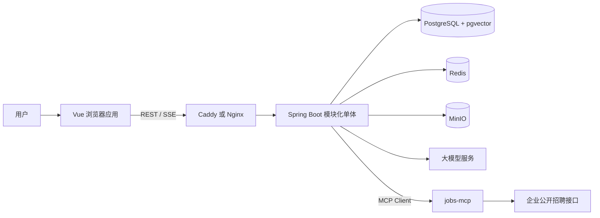
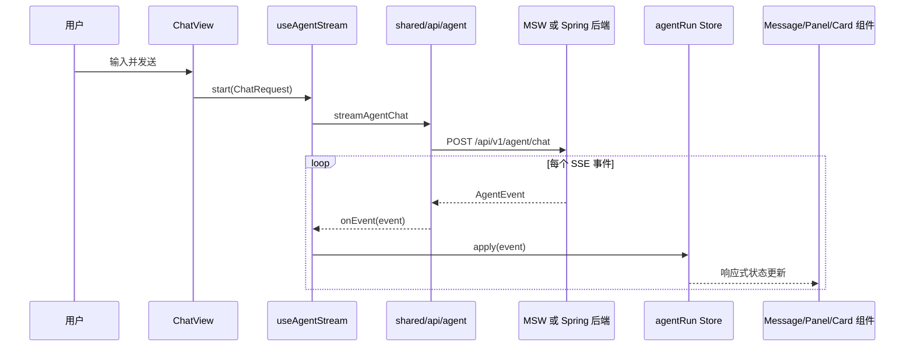

# 12 · 项目架构与源码导读

> 2026-09-14 更新：下文是 09-13 骨架快照。当前 `/agent/chat` 已由 `ChatService` 调用真实 DeepSeek 流式模型，网关区分供应商，含明确错误事件；前端已默认关闭 Mock。新增 `backend/README.md`、`backend/.env.example`；Windows 根目录统一入口为 `OfferPilot.cmd`，菜单逻辑在 `deploy/windows/console.ps1`，旧入口收纳至 `deploy/windows/legacy/`。dev 连接真实 PostgreSQL/Redis，Key 放在忽略提交的 `backend/.env.local`。会话持久化、业务 Agent、RAG/MCP 仍未实现。下文“回显”“没有真实模型调用”等描述不再代表当前聊天实现。

> 适用对象：第一次接触 OfferPilot、对 Maven 多模块、Vue 分层、SSE、Agent 或 MCP 不熟悉的开发者。
>
> 本文依据 2026-09-13 的仓库实际代码编写。本文会明确区分“当前实现”和“目标设计”，避免把设计文档中的规划误认为已经落地。

## 1. 先用一句话理解项目

OfferPilot（职航）是面向高校学生和应届生的求职 AI 助手。它想把职业探索、简历管理、岗位搜索、岗位匹配、求职看板、模拟面试和职业规划串成一个闭环，并让用户在界面上看到 Agent 的计划、步骤、工具调用、依据、用量和需要确认的操作。

它不是一个“只聊天”的机器人。设计目标是让模型负责理解和规划，让领域服务负责业务规则，让工具负责读取或修改数据，让前端把整个执行过程可视化。

## 2. 当前仓库处于什么阶段

理解本项目最重要的前提，是把三个层次分开：

1. **产品目标**：README 和需求文档描述的完整求职闭环。
2. **设计基线**：架构、AI、接口、数据库和前端文档描述的预期实现。
3. **当前代码**：已经可以编译或在浏览器中展示的实现。

当前代码属于早期骨架阶段：

- 前端已有应用壳、路由、聊天页、SSE 客户端、Agent 运行状态仓库、过程面板和三类生成式 UI 卡片。
- 前端开发模式默认启用 MSW，用脚本化事件模拟一段完整 Agent 运行，因此界面看起来比真实后端完成度更高。
- 后端已有 Maven 多模块结构、唯一启动入口、公共配置、错误处理、模型档位抽象、SSE 事件类型和一个最小聊天接口。
- 后端聊天接口目前只回显用户输入，没有调用大模型、数据库、Orchestrator、专家 Agent 或 MCP。
- identity、resume、job、career、interview 等业务模块目前主要只有 `package-info.java`，即模块边界已经命名，但业务类尚未实现。
- 数据库目前只有 V1 至 V4 迁移；数据库设计文档中 V5 以后的表是规划，不是当前数据库已有对象。

因此，调试项目时需要先确认问题位于“真实后端链路”还是“前端 Mock 链路”。

## 3. 系统全景与边界



各边界的职责：

- 浏览器负责页面、交互、流式展示、客户端状态和隐私敏感的端侧能力。
- Caddy/Nginx 负责 HTTPS、静态资源和 `/api` 反向代理，SSE 路径必须关闭缓冲。
- Spring Boot 后端负责认证、Agent 编排、业务规则、模型和工具接入、数据持久化。
- PostgreSQL 保存业务数据、Agent 事件、知识库文本和向量。
- Redis 计划用于短期会话、限流、SSE 缓冲和审批等待状态。
- MinIO 计划用于简历、录音和导出文件。
- jobs-mcp 把企业公开招聘接口包装成 Agent 能理解的 MCP 工具。

## 4. 为什么后端是“模块化单体”

后端看起来有很多模块，但不是多个独立服务。`offerpilot-bootstrap` 会把它们组装成一个 Spring Boot 进程和一个部署产物。

```text
offerpilot-bootstrap
├── offerpilot-platform
├── offerpilot-agent
├── offerpilot-identity
├── offerpilot-resume
├── offerpilot-job
├── offerpilot-career
└── offerpilot-interview
```

这样做兼顾两点：代码可以按业务边界隔离，部署时又不必处理微服务注册、跨服务事务、链路治理和多个部署单元。

依赖规则是：

- `bootstrap` 可以依赖所有模块，因为它负责最终装配。
- `agent` 当前依赖 `platform`，用它提供的 ID、模型和公共配置。
- 业务模块之间不应直接访问彼此的 Controller、Repository 或 JPA Entity。
- 跨业务模块调用应通过拥有方暴露的小型 application 接口和 DTO。
- `platform` 只能提供技术能力，不能逐渐变成存放所有业务代码的“公共垃圾桶”。

## 5. 仓库根目录文件

### `README.md`

项目入口说明，回答产品是什么、核心能力是什么、技术栈是什么、仓库怎样组织以及如何启动。README 中部分内容描述的是目标架构，不能仅凭 README 判断功能已经实现。

### `CONTEXT.md`

项目领域词汇表。它规定 `User`、`Career Profile`、`Resume`、`Job`、`Application`、`Agent Run`、`Interview Session` 等术语的准确含义，减少同一概念在代码和文档中被不同名称表达的问题。

例如 `Job` 是职位信息，`Application` 是用户针对某个职位建立的求职跟踪记录。二者不能混用，否则数据库、接口和前端类型会逐渐失去一致性。

### `AGENTS.md`

给参与本仓库开发的 AI 编程助手使用的根规则。它只保留完成标准、事实来源路由和跨域护栏；进入 `backend/` 或 `frontend/` 后，再由对应目录的 `AGENTS.md` 提供模块边界与验证策略。这样的渐进披露避免无关前后端规则同时占用上下文。它不是应用运行时配置，但应与实际目录和开发流程保持一致。

### `.env.example`

后端、Docker Compose 和外部服务的环境变量模板。真正的密码和 API Key 应放在未提交的 `.env` 或部署平台密钥中，不能写进模板或源码。

### `.editorconfig`

统一不同编辑器中的缩进、换行符、文件编码和文件末尾换行，减少与业务无关的格式差异。

### `.gitattributes`

告诉 Git 如何处理行尾和特定文件类型，尤其用于降低 Windows 与 Linux 之间 CRLF/LF 差异造成的无意义变更。

### `.gitignore`

排除构建产物、IDE 临时文件、本地环境变量、依赖目录等不应提交的文件。

### `.nvmrc`

声明前端使用的 Node.js 主版本。支持 nvm 的开发者可以用它快速切换一致的 Node 环境。

### `.github/`

保存 GitHub 工作流或仓库协作配置。它属于持续集成和协作层，不参与应用业务运行。

### `.idea/`

IntelliJ IDEA 项目配置目录。里面可能包含模块识别、代码风格和运行配置。是否提交应按团队约定决定，不能把整个目录简单视为无用文件。

### `.corepack/`

当前工作区中的未跟踪目录，不属于已提交源码。它通常与 Node 包管理器 Corepack 的本地状态有关。删除前应先确认其中是否保存了项目专用配置；本导读不对它做任何修改。

## 6. 后端父工程与构建入口

### `backend/pom.xml`

这是 Maven reactor 的父 POM，自己不产生可运行应用。它统一定义：

- Java 21；
- Spring Boot、Spring AI 和测试容器等版本；
- 子模块列表；
- 共享的依赖版本；
- Spring Boot Maven 插件管理。

从 `backend` 执行 Maven 命令时，Maven 先读取这个文件，再按 `<modules>` 找到所有子模块。

### `backend/mvnw` 与 `backend/mvnw.cmd`

二者是 Maven Wrapper 启动脚本：

- `mvnw` 给 Linux、macOS 和类 Unix shell 使用；
- `mvnw.cmd` 给 Windows 命令提示符和 PowerShell 使用。

它们读取 `.mvn/wrapper/maven-wrapper.properties` 中的 Maven 下载地址，使没有全局安装 Maven 的开发机和 CI 也能构建项目。删除后，如果机器上没有可用的 `mvn`，README 中的可复现构建会失效。通常应将这三个文件作为一个整体保留或整体替换，而不应只删除其中一个平台的脚本。

### `backend/.mvn/wrapper/maven-wrapper.properties`

声明 Wrapper 版本、Maven 分发类型和下载地址。当前配置使用阿里云 Maven 镜像下载 Maven，适合国内网络环境。

### `backend/Dockerfile`

定义如何在容器中构建和运行后端。它与 `deploy/docker-compose.yml` 配合：Compose 负责组合服务，Dockerfile 负责制造后端镜像。

## 7. `offerpilot-bootstrap`：最终装配模块

### `offerpilot-bootstrap/pom.xml`

依赖其他所有后端模块，并启用 Spring Boot Maven 插件。业务模块像零件，bootstrap 像装配这些零件并提供电源开关的机箱。

### `OfferPilotApplication.java`

唯一的 `@SpringBootApplication`。`main` 方法调用 `SpringApplication.run` 后，Spring 扫描 `com.offerpilot` 下所有模块中的组件，将 Controller、配置和服务装配进同一个容器。

它还启用 `OfferPilotProperties`，让 `application*.yml` 中 `offerpilot.*` 配置绑定为强类型 Java 对象。

### `application.yml`

公共运行配置。应放所有环境共享的默认值和结构，不应放真实密钥。

### `application-dev.yml`

开发环境覆盖项，例如本地数据库、Redis、MinIO、开发日志和本地 MCP 地址。

### `application-test.yml`

自动化测试使用的覆盖项，目的是让测试隔离外部服务、稳定复现，并避免误连生产资源。

### `application-prod.yml`

生产环境覆盖项。敏感值应通过环境变量注入；这个文件只保留变量引用、超时、连接池和日志等级等配置结构。

### `prompts/orchestrator/intent.st`

Orchestrator 的意图识别 Prompt 模板。`.st` 表示模板资源，而不是 Java 类。未来 Prompt Repository 会读取它、填充上下文并交给模型，用于判断用户请求属于哪个 Agent 模式。修改它会改变 AI 行为，因此需要同步 `04-AI技术方案.md` 中的 Prompt 契约。

### Flyway 迁移

- `V1__extensions.sql`：启用 PostgreSQL 扩展和公共数据库能力，尤其是 pgvector。
- `V2__users.sql`：创建用户、偏好、刷新令牌和集成信息相关表。
- `V3__conversation_agent.sql`：创建会话、消息、Agent Run、步骤、工具调用、审批和事件相关表。
- `V4__files.sql`：创建文件元数据表，为 MinIO 对象、简历和录音建立数据库索引。

Flyway 按版本顺序执行迁移。已经共享或在环境中执行过的迁移不能直接改写；数据库变化要新增 `V5__...sql`、`V6__...sql` 等文件。

## 8. `offerpilot-platform`：公共技术能力

`platform` 是 Agent 和业务模块使用的基础设施适配层，不拥有简历、岗位或面试等业务规则。

### `offerpilot-platform/pom.xml`

引入 Web MVC、Security、Validation、Actuator、REST Client、JPA、Redis、Flyway、Spring AI、MCP、MinIO、Tika、PDFBox、JWT、限流、熔断、OpenAPI、ULID 和测试依赖。依赖存在只表示模块具备开发这些能力的条件，不表示每项能力已经实现。

### `config/OfferPilotProperties.java`

把 `offerpilot.*` 配置绑定为嵌套 record，集中描述：

- JWT 密钥和访问/刷新令牌寿命；
- CORS 来源；
- Demo 账号和重置周期；
- MinIO 地址、密钥和 bucket；
- 应用层加密密钥；
- 用户请求频率和并发 Agent Run 限制；
- 模型档位、供应商、模型名、超时和回退链；
- jobs/search MCP 地址。

调用关系为 `application*.yml → OfferPilotProperties → ModelGateway/SecurityConfig/未来的存储和 MCP 组件`。

### `config/JacksonConfig.java`

创建统一 `ObjectMapper`，处理 Java 时间类型、未知 JSON 字段和时间序列化。`AgentController` 使用它把 `AgentEvent` 转成 SSE 的 JSON data。

### `config/SecurityConfig.java`

建立 Spring Security 过滤链，决定哪些接口公开、哪些需要认证，以及 CORS/CSRF 等策略。当前仍是骨架安全配置；未来 JWT 过滤器和用户认证实现会接入这里。

### `config/OpenApiConfig.java`

配置 OpenAPI 元信息和 Bearer JWT 安全方案。后端生成的 `/v3/api-docs` 未来可由前端 `pnpm gen:api` 转换成 TypeScript 类型。

### `llm/ModelTier.java`

定义 `FLASH`、`CHEAP`、`PRO`、`VISION_ALT` 四个逻辑档位。业务代码依赖逻辑档位，而不是散落硬编码具体模型名，这样切换供应商时不必修改所有 Agent。

### `llm/ModelGateway.java`

根据配置解析默认档位、模型名和回退链，并从 Spring 容器取得 `ChatModel`。当前实现还没有真正按档位维护多个模型实例，也没有落实超时、熔断、用量日志和自动回退。

当前调用链是 `AgentController → ModelGateway.defaultTier/modelName → OfferPilotProperties`。注意当前 Controller 只把模型名放进 `run.started`，没有调用 `chatModel(...).call(...)`。

### `common/id/IdGenerator.java`

使用 ULID 生成带业务前缀且大致按时间有序的 ID，例如 `conv_...`、`run_...`、`msg_...`。Controller、实体和事件应复用它，避免各模块采用不同 ID 规则。

### `common/api/ApiResponse.java`

普通 REST 接口的统一响应封装，包含业务码、消息、数据、traceId 和可选字段错误。SSE 接口返回的是事件流，不套这个普通响应壳。

### `common/error/ErrorCode.java`

集中定义业务错误码、HTTP 状态和默认消息。前端可以用稳定错误码处理场景，避免依赖可能变化的中文错误文字。

### `common/error/BusinessException.java`

领域或应用服务主动抛出的可预期异常，携带 `ErrorCode`。它和数据库断线、空指针等系统异常不同。

### `common/error/GlobalExceptionHandler.java`

捕获参数校验、`BusinessException` 和未处理异常，将它们转换成 `ApiResponse`，附带 traceId 并记录日志。这样每个 Controller 不需要重复写 try/catch。

### `common/web/TraceIdFilter.java`

为每个 HTTP 请求读取或生成 traceId，把它写入日志 MDC 和响应头。一次请求经过 Controller、服务、模型和数据库时可以用同一个 traceId 串联日志。

### `mcp/package-info.java`

只声明包用途：未来放 MCP Client 连接管理和 MCP Server 工具暴露。`package-info.java` 可以承载包级 Javadoc，但当前没有可执行逻辑。

### 测试

`IdGeneratorTest.java` 验证生成 ID 的基本格式。它依赖 `IdGenerator`，防止前缀或格式重构时静默破坏已有契约。

## 9. `offerpilot-agent`：Agent 协议与编排入口

### `offerpilot-agent/pom.xml`

依赖 `offerpilot-platform`，并引入 Web MVC、参数校验和 Web 测试能力。依赖方向允许 Agent 使用平台技术能力，但不允许 platform 反向依赖 Agent 业务。

### `agent/web/ChatRequest.java`

定义 `/api/v1/agent/chat` 的请求体：

- `conversationId`：为空时创建新会话，有值时继续已有会话；
- `content`：用户文本，当前限制 1 至 4000 字符；
- `attachments`：附件文件 ID 和种类；
- `mode`：AUTO 或指定专家模式；
- `options`：模型档位、是否启用推理摘要和附加上下文。

`@Valid`、`@NotBlank` 和 `@Size` 会在进入业务代码前验证请求。失败后由 `GlobalExceptionHandler` 返回统一错误。

### `agent/web/AgentController.java`

当前唯一真实 Agent HTTP 入口。它创建一个十分钟超时的 `SseEmitter`，生成 conversation/run/message ID，解析模式和模型档位，然后在 Java 虚拟线程中发送事件。

当前事件序列只有：

```text
run.started → text.delta（一段或多段）→ run.completed
```

`emit(...)` 同时写入 SSE 的 `id`、`event` 和 JSON `data`。`withId(...)` 为事件对象填充递增 ID。当前只实际发送三种事件；其他分支是为了 sealed interface 的穷尽处理。

未来应由 Orchestrator 服务接管虚拟线程中的回显逻辑。Controller 应只负责请求校验、SSE 生命周期和调用应用服务，不应承载规划与业务规则。

### `agent/event/AgentEvent.java`

后端 Agent 事件协议，是前后端流式通信的核心。它使用 sealed interface 和 Jackson 多态信息，确保每个事件都有 `type`、`id`、`runId` 和 `ts`。

事件含义：

- `run.started`：运行开始，给出会话、消息、模型和模式。
- `plan.created`：Orchestrator 创建目标和步骤依赖图。
- `step.updated`：步骤进入等待、运行、完成、失败或跳过状态。
- `reasoning.delta`：面向用户的简短推理摘要增量，不应泄露内部机密推理。
- `text.delta`：最终回答正文增量。
- `tool.call`：开始调用本地或 MCP 工具，包含参数和访问级别。
- `tool.result`：工具结束，包含成功状态、结果预览、耗时和截断标记。
- `ui.card`：发送结构化卡片数据，由前端注册表选择组件渲染。
- `approval.required`：写操作或外部副作用需要用户批准。
- `approval.resolved`：批准、拒绝或超时结果。
- `citation`：RAG 或外部资料的引用来源。
- `memory.used`：本轮使用了哪些长期记忆事实。
- `usage`：模型、输入/输出 Token、成本估计和回退情况。
- `error`：可恢复或不可恢复错误。
- `run.completed`：运行最终状态、消息 ID 和耗时。

`AgentEvent.java` 与前端 `shared/types/agent-events.ts` 是同一协议的两种语言表示，修改一边必须同步另一边和 `05-接口文档.md`。

### `agent/domain/AgentMode.java`

表示用户选择的工作模式。AUTO 由 Orchestrator 判断专家；其他模式把请求限制在职业探索、简历、岗位、面试或规划上下文。

### `agent/domain/ExpertType.java`

表示计划步骤的执行者。它与 AgentMode 相似但用途不同：AgentMode 是一次请求的入口偏好，ExpertType 是计划中每个步骤实际分派给谁。

### `agent/domain/Plan.java`

包含总目标和步骤列表，是模型结构化规划结果的领域表示。

### `agent/domain/PlanStep.java`

包含步骤 ID、标题、专家类型、输入和前置依赖。`dependsOn` 允许表达有向无环图，而不只是固定顺序列表。例如“优化简历”依赖“选出目标岗位”，两个独立搜索步骤则可以并行。

### 三个 `package-info.java`

- `agent/orchestrator/package-info.java`：预留意图识别、规划、执行和反思。
- `agent/experts/package-info.java`：预留五类专家 Agent 的装配。
- `conversation/package-info.java`：预留会话、消息和消息 parts。

它们目前都没有运行时代码，只是明确未来代码应放在哪里。

### `AgentControllerTest.java`

使用 Spring MVC 测试验证聊天接口、参数校验和 SSE 基本输出。修改 Controller、Jackson 配置或事件 JSON 时，该测试应帮助发现协议回归。

## 10. 五个业务域模块

这些模块现在主要由 POM 和包说明构成。下面既说明模块职责，也说明未来跨模块应如何调用。

### `offerpilot-identity`

- `auth/package-info.java`：注册、登录、JWT、刷新令牌和体验账号。
- `user/package-info.java`：用户、偏好和 Career Profile 的用户侧基础信息。

其他模块需要当前用户时，应依赖 identity 暴露的用户上下文或查询接口，不应直接查询 identity 的 Repository。

### `offerpilot-resume`

- `resume/package-info.java`：简历上传、解析、结构化、诊断、改写、版本和导出。

典型链路是 `文件上传 → MinIO → files → 文本/视觉解析 → resume_versions → 诊断或 JSON Patch → 新版本`。岗位模块需要简历摘要时，应调用 resume 的 application 接口，而不是依赖其实体。

### `offerpilot-job`

- `job/package-info.java`：岗位来源、搜索、导入、归一化、去重、匹配和校招日历。
- `board/package-info.java`：用户针对岗位创建的 Application 及状态变化历史。

`Job` 是岗位本身，`Application` 是用户的求职跟踪记录。创建看板记录属于写操作，Agent 自动执行前应经过审批策略。

### `offerpilot-career`

- `discovery/package-info.java`：对话式测评、Career Profile、兴趣代码和职业推荐。
- `career/package-info.java`：技能差距、学习路线和职业规划问答。
- `knowledge/package-info.java`：文档入库、分块、嵌入、混合检索和引用。

知识库是基础能力但目前放在 career 业务模块，因为主要服务职业条目、岗位能力模型和规划问答。未来如果多个模块都深度依赖它，应通过稳定检索接口复用，而不是复制检索 SQL。

### `offerpilot-interview`

- `interview/package-info.java`：面试会话、题目、追问、回答、评分、报告和浏览器端聚合指标。

面试模块可通过接口读取目标 Job 和 Resume 的只读快照。历史面试不应因为用户后来修改简历而失去当时上下文，因此需要保存版本 ID 或必要快照。

## 11. 前端分层规则

前端采用 `app → widgets → features → shared` 的总体依赖方向：

- `app` 负责应用启动、路由和顶层布局。
- `widgets` 组合多个较小组件，形成跨功能区域使用的大块 UI。
- `features` 按用户功能组织页面和局部组件。
- `shared` 提供与具体业务功能弱相关的 API 基础、类型、通用组件和工具。

实际代码允许页面 feature 引用跨功能 widget，例如 ChatView 使用 AgentPanel；“feature 之间不得直接 import”是为了避免岗位功能直接侵入简历功能。跨功能组合应上移到 widget 或 app，数据契约下沉到 shared。

`@/` 在 Vite 和 TypeScript 配置中指向 `frontend/src`，所以 `@/shared/api/agent` 等价于 `frontend/src/shared/api/agent.ts`。

## 12. 前端工程与构建文件

### `frontend/package.json`

声明 Node 版本、pnpm 版本、运行脚本和依赖。常用脚本：

- `pnpm dev`：启动 Vite 开发服务器；
- `pnpm build`：先做 TypeScript/Vue 类型检查，再生产构建；
- `pnpm lint`：运行 ESLint；
- `pnpm test -- --run`：一次性运行 Vitest；
- `pnpm gen:api`：从后端 OpenAPI 生成 TypeScript 接口类型。

### `pnpm-lock.yaml`

锁定依赖的精确版本和完整依赖图，保证不同机器安装出一致依赖。它不是缓存文件，通常必须提交。

### `pnpm-workspace.yaml`

声明 pnpm 工作区范围。即使当前只有一个前端包，它也为后续共享包或组件包保留一致的包管理入口。

### `vite.config.ts`

配置 Vue 插件、Tailwind 插件、路径别名、开发服务器和构建行为。

### `vitest.config.ts`

配置测试环境、测试文件、浏览器 DOM 模拟和覆盖率等测试行为。

### `tsconfig.json`、`tsconfig.app.json`、`tsconfig.node.json`

- 根 tsconfig 组织项目引用；
- app 配置浏览器端 Vue/TS 代码；
- node 配置 Vite/Vitest 等在 Node 环境执行的配置文件。

### `eslint.config.js`

ESLint flat config，统一 Vue 和 TypeScript 静态检查规则。

### `index.html`

Vite 的 HTML 入口，提供 Vue 挂载节点 `#app` 并加载 `src/app/main.ts`。

### `frontend/.env.example`

前端公开环境变量模板，例如 API 基础地址、应用名称和 Mock 开关。只有 `VITE_` 前缀变量会注入浏览器，因此绝不能在这里放服务器密钥。

### `frontend/Dockerfile`

构建前端静态资源并放入 Web Server 镜像，供 Compose 和生产部署使用。

### `public/favicon.svg`、`public/icons.svg`

不经过模块打包直接复制到输出目录的静态图标资源。

### `public/mockServiceWorker.js`

MSW 的浏览器 Service Worker 脚本。开发环境的 `shared/mocks/browser.ts` 需要它才能拦截网络请求；如果仍使用浏览器 Mock，不应删除。

## 13. `frontend/src/app`：应用组装层

### `app/main.ts`

前端入口。执行顺序是：初始化主题 → 创建 Vue App → 注册 Pinia、Router 和 Vue Query → 开发环境按开关启动 MSW → 挂载到 `#app`。

由于挂载动作放在 `enableMocking().finally(...)` 中，Mock 启动失败也不会阻止应用显示，只会回退到真实后端请求。

### `app/App.vue`

根组件。它渲染全局 Aurora 背景、当前路由页面和页面切换幕布。这里不应放具体简历或岗位业务。

### `app/router/index.ts`

定义 URL 到页面组件的映射。页面使用动态 import，因此按路由懒加载。登录页使用 `AuthLayout`，其余主要页面使用 `AppLayout`，未知路径进入 `NotFoundView`。

### `app/router/guards.ts`

注册全局前置/后置路由守卫，配合 `usePageCurtain` 播放切页动画；未来也承载登录态与体验账号限制。

### `app/router/meta.ts`

扩展 Vue Router 的 RouteMeta TypeScript 类型，约束 `title`、`public` 等元数据字段。

### `app/layouts/AppLayout.vue`

登录后页面的外壳：左侧导航、顶部栏、通知入口和内部 `RouterView`。它根据路由名称高亮导航，根据路由 meta 显示页面标题。

### `app/layouts/AuthLayout.vue`

公开认证页面的居中玻璃卡片外壳，内部 `RouterView` 当前渲染 LoginView。

### `app/providers/query.ts`

创建 TanStack Query 的 `QueryClient`，统一服务端数据缓存、重试和失效策略。当前业务列表接口尚未全面实现，但入口已注册。

## 14. `frontend/src/shared`：共享基础层

### `shared/api/client.ts`

提供 API URL 拼接、认证请求头、traceId 和 `ApiError` 转换。业务 API 文件应复用它，避免每个 feature 重复处理 Token 和错误结构。

### `shared/api/sse.ts`

将 `ReadableStream<Uint8Array>` 解析为 SSE 帧。它先统一 CRLF/LF，再按空行切帧，解析 `id`、`event` 和多行 `data`，忽略注释心跳，并在流结束时冲刷最后一个未闭合帧。

### `shared/api/agent.ts`

实现三个 Agent 网络操作：

- `streamAgentChat`：POST 聊天请求并逐个回调 AgentEvent；
- `resumeAgentRun`：携带最后事件 ID 恢复中断的事件流；
- `cancelAgentRun`：请求后端取消运行。

它使用 fetch 而不是 EventSource，因为 EventSource 不能发送 POST JSON 和自定义认证头。

### `shared/api/sse.spec.ts`

验证切帧、字段解析、跨网络 chunk 和尾帧冲刷等边界情况。

### `shared/api/agent.spec.ts`

使用 Node 侧 MSW 测试 Agent 客户端能否消费事件、处理取消和把非 2xx 转成 ApiError。

### `shared/types/agent-events.ts`

后端 `AgentEvent.java` 的 TypeScript 对应物。它通常用辨识联合描述事件，使 `switch(event.type)` 能自动缩小类型。

### `shared/types/cards.ts`

定义每种生成式 UI 卡片的 `cardType` 与 payload，例如岗位匹配、简历差异和看板更新。它连接后端卡片协议、Store 和具体 Vue 组件。

### `shared/stores/agentRun.ts`

Pinia 运行时状态仓库。它按 `runId` 保存多次 Agent Run，把离散事件归约为页面可直接读取的状态：计划、步骤、工具、审批、引用、记忆、卡片、文本、用量和错误。

`apply(event)` 是唯一事件入口。新增事件类型后，`assertNever` 让未处理分支在编译期暴露。`lastEventId` 用于断线续传，`activeRunId` 决定当前 AgentPanel 展示哪次运行。

### `shared/stores/agentRun.spec.ts`

把 Mock scenario 中的事件依次送入 Store，验证最终状态是否正确。这是事件协议变更时非常重要的回归测试。

### `shared/composables/useAgentStream.ts`

协调网络流与 Store：`start` 创建 AbortController 并消费新运行，`stop` 先中止本地流、乐观标记取消，再通知后端，`resume` 从 Store 的最后事件 ID 继续。

### `shared/composables/usePageCurtain.ts`

管理页面切换幕布的共享响应式状态，供路由守卫触发、StageCurtain 组件读取。

### `shared/mocks/browser.ts`

创建浏览器端 MSW Worker，并注册 handlers。只在开发环境按配置动态加载，不进入正常生产请求路径。

### `shared/mocks/handlers.ts`

拦截聊天和取消 API。聊天 handler 把 scenario 中的事件编码成真实 SSE 字节流，并按事件类型加入不同延迟，从而模拟模型流式响应。

### `shared/mocks/scenario.ts`

构造当前前端演示的完整 Agent 剧本：岗位搜索、匹配、简历优化审批、简历 diff、看板写入审批、卡片、引用、记忆和用量。这里的数据都是演示数据，不来自后端、数据库或真实公司 API。

### 通用组件

- `shared/components/AuroraBackground.vue`：全局视觉背景。
- `shared/components/StageCurtain.vue`：读取页面幕布状态并渲染切换动画。
- `shared/components/MarkdownView.vue`：把文本交给 Markdown 工具处理后渲染。
- `shared/components/ComingSoon.vue`：未实现页面的统一占位，多个业务页面当前依赖它。
- `shared/views/NotFoundView.vue`：未知路由的 404 页面和返回入口。

### 工具函数

- `shared/utils/theme.ts`：初始化、读取和应用主题。
- `shared/utils/payload.ts`：在运行时把未知卡片 payload 安全收窄为对象，避免组件直接假定后端数据合法。
- `shared/utils/markdown.ts`：使用 markdown-it 解析文本并用 DOMPurify 消毒，降低模型输出注入恶意 HTML 的风险。
- `shared/utils/cn.ts`：组合条件 class，并用 tailwind-merge 解决冲突的 Tailwind 类。
- `shared/utils/assertNever.ts`：为事件和枚举 switch 提供编译期穷尽检查。

### 样式

- `shared/styles/index.css`：Tailwind、主题变量、全局基础样式和项目设计 token。
- `shared/styles/transition.css`：页面、幕布和元素进入动画。
- `shared/styles/markdown.css`：Markdown 标题、列表、代码块、引用和链接样式。

## 15. `frontend/src/features`：按用户能力拆分

### `features/auth/views/LoginView.vue`

登录页面。当前主要负责演示登录交互和路由跳转，真实认证 API 与用户 Store 尚未完成。

### `features/dashboard/views/DashboardView.vue`

工作台首页，提供各求职功能入口和项目状态概览。

### Chat 功能

- `chat/views/ChatView.vue`：聊天页面容器；创建输入值和消息视图，调用 `useAgentStream`，读取 `agentRun` Store，并组合 MessageList、Composer 与 AgentPanel。
- `chat/components/Composer.vue`：输入框、发送和停止操作，通过 emit 把用户动作交给 ChatView。
- `chat/components/MessageList.vue`：遍历消息并交给 MessageItem，保持列表组件职责简单。
- `chat/components/MessageItem.vue`：根据消息角色渲染气泡；助手消息用 MarkdownView 显示文本，用 CardRenderer 渲染结构化卡片。
- `chat/types.ts`：只属于聊天展示层的消息类型，引用 Store 中的 CardView，但不重新定义整个 Agent 协议。

### Discovery 功能

- `discovery/views/DiscoverView.vue`：职业探索入口。当前依赖 ComingSoon，说明测评、画像和推荐 UI 尚未实现。

### Resume 功能

- `resume/views/ResumeListView.vue`：简历列表入口，当前为占位。
- `resume/views/ResumeDetailView.vue`：简历详情入口，当前为占位。
- `resume/components/PatchDiffViewer.vue`：已经实现的生成式 UI 组件，读取 `resume_diff` payload，显示改写前后、理由、JD 证据和需要用户确认的示例数字，并维护逐条选择状态。

### Job 功能

- `job/views/JobSearchView.vue`：岗位搜索入口，当前为占位。
- `job/views/JobDetailView.vue`：岗位详情入口，当前为占位。
- `job/components/MatchReport.vue`：已经实现的 `job_match` 卡片组件，显示综合分、维度分、匹配证据、能力缺口和建议。

### Board 功能

- `board/views/BoardView.vue`：求职看板入口，当前为占位。
- `board/components/BoardUpdateCard.vue`：已经实现的 `board_update` 卡片，显示新增或变更的 Application，并提供进入看板的链接。

### Interview 功能

- `interview/views/InterviewListView.vue`：面试列表，当前为占位。
- `interview/views/InterviewRoomView.vue`：面试房间，当前为占位。

### 其他功能

- `career/views/CareerView.vue`：职业规划入口，当前为占位。
- `kb/views/KnowledgeView.vue`：个人知识库入口，当前为占位。
- `settings/views/SettingsView.vue`：偏好、隐私、记忆、MCP 和用量入口，当前为占位。
- `notifications/views/NotificationsView.vue`：通知列表入口，当前为占位。

## 16. `frontend/src/widgets`：跨组件组合

### AgentPanel

- `AgentPanel.vue`：右侧 Agent 过程面板，根据 RunState 组合计划、工具、审批和用量。
- `PlanSteps.vue`：显示步骤状态、依赖、摘要和耗时。
- `ToolTimeline.vue`：显示工具名、来源、访问级别、参数、结果和耗时。
- `ApprovalCard.vue`：显示待审批工具调用、原因、参数、可编辑字段、到期时间和决策状态。
- `UsageBadge.vue`：显示模型、Token、费用估算和是否发生回退。

### CardRenderer

- `CardRenderer.vue`：收到 cardType 和 payload 后，通过 registry 解析组件并动态渲染。
- `registry.ts`：维护 `job_match → MatchReport`、`resume_diff → PatchDiffViewer`、`board_update → BoardUpdateCard` 映射；使用异步组件减少首屏体积。
- `CardSkeleton.vue`：异步卡片加载时的占位。
- `CardFallback.vue`：未知 cardType 或组件加载失败时的兼容展示。
- `registry.spec.ts`：验证已知类型能找到正确组件、未知类型能回退，保护后端扩展卡片时的兼容性。

## 17. 当前前端真实调用链



开发环境默认路径中，`M` 是 MSW：`main.ts → browser.ts → handlers.ts → scenario.ts`。关闭 `VITE_ENABLE_MOCK` 后，`M` 才是 `AgentController.java`。

## 18. 计划中的后端完整调用链

```text
AgentController
  → AgentRunApplicationService
  → 输入安全与 PII 处理
  → Orchestrator 识别意图并创建 Plan
  → 按 dependsOn 调度专家 Agent
  → 专家 Agent 调用 ModelGateway
  → Tool Policy 判断 READ / WRITE / EXTERNAL_SIDE_EFFECT
  → 本地领域工具或 MCP 工具
  → application 接口
  → 领域服务
  → Repository / PostgreSQL / Redis / MinIO
  → 发布 AgentEvent
  → SSE 推给前端
```

这一链路中，Controller 不直接写数据库，Agent 不直接操作 Repository，MCP 结果也不直接渲染页面。每层通过明确契约协作，可以分别测试和替换。

## 19. `mcp-servers/jobs-mcp`

### `package.json`

定义一个 Node.js 22+ 的私有 ESM 包，提供 `start` 和 `dev` 命令。目前没有声明第三方依赖，说明实现仍很轻量。

### `src/server.js`

jobs-mcp 的服务入口。目标是把不同企业官网公开招聘接口的差异隐藏在统一工具之后，使 Java Agent 只需要调用稳定的 `search_jobs/get_job` 等工具契约。

### `Dockerfile`

把 jobs-mcp 制作为独立容器。它与 Java 后端分开，是因为 MCP 工具适配器适合独立迭代，并不代表所有业务域都要拆成微服务。

计划调用链为 `岗位专家 → Java MCP Client → jobs-mcp → 企业招聘接口 → 标准岗位 DTO → 岗位领域服务缓存/去重 → SSE 卡片`。

## 20. `deploy` 部署文件

### `deploy/docker-compose.yml`

描述本地或单机部署的服务拓扑、网络、端口、环境变量、卷和健康检查。它把前端、后端、PostgreSQL、Redis、MinIO 和 jobs-mcp 组合起来。

### `deploy/Caddyfile`

推荐的入口代理配置，处理自动 HTTPS、静态前端、SPA history 回退和 `/api` 代理。Agent SSE 路径需要关闭响应缓冲并设置足够长的读取超时。

### `deploy/nginx/default.conf`

与 Caddy 类似的备用 Nginx 配置。是否保留取决于项目是否确实需要提供两种代理方案；删除前应先确定最终部署选型。

### `deploy/scripts/backup.sh`

计划执行 PostgreSQL 备份并处理保留周期。备份脚本属于灾难恢复能力，不能仅因开发环境暂时不用就判断为无用。

### `deploy/scripts/reset-demo.sh`

计划重置比赛体验账号和演示数据。它与 Demo 环境配置配套，正式产品环境不应误执行。

## 21. 文档目录的职责

- `00-赛题分析与评分对照.md`：比赛规则、评分权重、提交要求和风险自查；开发运行不依赖。
- `01-项目计划书.md`：产品背景、用户、价值、场景、创新、里程碑和风险；偏立项与答辩。
- `02-需求分析与功能清单.md`：用户故事、功能优先级和验收标准；回答“做什么”。
- `03-系统架构设计.md`：层次、模块、流程、部署和非功能设计；回答“系统如何分解”。
- `04-AI技术方案.md`：模型、Agent、Prompt、工具、MCP、RAG、记忆、安全和评估；是 AI 行为事实来源。
- `05-接口文档.md`：REST、SSE、事件、卡片和 MCP 契约；是前后端协作事实来源。
- `06-数据库设计.md`：ER、DDL、索引、迁移、保留策略和容量；是数据库事实来源。
- `07-前端设计规范.md`：依赖方向、路由、状态、API、SSE、组件、样式、性能和测试；是前端事实来源。
- `08-开发计划与分工.md`：排期、分工、Git 节奏和风险；日期失效后适合归档而不是继续充当架构依据。
- `09-部署与运维.md`：环境、容器、代理、CI/CD、备份、监控和故障处理；是运行环境事实来源。
- `10-测试与评估方案.md`：测试分层、性能、AI 评估、安全和用户测试；是质量标准事实来源。
- `11-提交材料清单.md`：比赛 PDF、视频、在线演示和答辩检查表；比赛结束后可归档。
- `adr/0001-modular-monolith.md`：记录模块化单体决策及理由；即使很短也有长期价值。
- `README.md`：本目录导航，帮助按任务找到事实来源。
- 本文：以当前源码为准的入门导读和文件关系说明。

## 22. 哪些文件看似没用但不应轻易删除

- `backend/mvnw`、`mvnw.cmd`、`.mvn/wrapper/...`：保证可复现构建和跨平台开发。
- `package-info.java`：当前没有逻辑，但标记业务包边界并承载包级文档；在骨架阶段有导航价值。
- `public/mockServiceWorker.js`：开发 Mock 的必要运行文件。
- `pnpm-lock.yaml`：锁定依赖，不是可随意重建后忽略的缓存。
- `application-test.yml`：防止测试误连真实基础设施。
- `CardFallback.vue`：保障服务端新增卡片而前端尚未升级时不会直接崩溃。
- ADR：解释“为什么这样设计”，避免后来反复争论同一决策。

## 23. 真正可能需要整理或归档的内容

以下判断关注“是否影响运行”和“信息是否会持续有效”，不等于授权删除：

- `00`、`01`、`08`、`11` 偏比赛和项目管理；比赛结束后可以移到 `docs/archive/competition/`，通常比直接删除更安全。
- `deploy/nginx/default.conf` 与 `Caddyfile` 提供两套代理方案；确定只使用 Caddy 后，可以删除 Nginx 备用方案并同步部署文档。
- 多个 ComingSoon 页面虽然没有业务功能，但它们仍被路由直接引用，删除会导致构建失败；应在对应真实页面实现后逐个替换，而不是提前删除。
- 各业务模块的 `package-info.java` 对编译不是必需，但在模块仍为空时承担唯一边界说明，现阶段建议保留。
- `.idea` 是否提交取决于团队协作策略，应先检查其跟踪状态和具体内容，不能批量删除。

## 24. 新开发者推荐阅读和调试顺序

1. 先运行前端并确认 Mock 场景，理解预期用户体验。
2. 阅读 `agent-events.ts` 和 `AgentEvent.java`，掌握前后端核心协议。
3. 跟踪 `ChatView → useAgentStream → agent.ts → sse.ts → agentRun.ts`。
4. 关闭前端 Mock，跟踪真实 `AgentController`，观察当前只有回显事件。
5. 阅读 V1-V4 迁移，区分已存在表和数据库文档中的规划表。
6. 实现新功能前先选择业务拥有模块，再定义 application 接口，最后接 Controller、工具或 Agent。
7. 接口、数据库、Prompt 或前端结构变化时同步更新对应事实来源文档。

## 25. 判断一个新文件应该放在哪里

- HTTP 参数和 SSE 生命周期：`offerpilot-agent/.../web` 或业务拥有模块的 web 层。
- Agent 规划和调度：`offerpilot-agent/.../orchestrator`。
- 专家 Agent 装配：`offerpilot-agent/.../experts`。
- 模型供应商、MCP、文件、缓存等适配：`offerpilot-platform`。
- 简历规则：`offerpilot-resume`。
- 岗位和看板规则：`offerpilot-job`。
- 职业探索、规划和知识库：`offerpilot-career`。
- 面试规则：`offerpilot-interview`。
- 用户与认证：`offerpilot-identity`。
- 前端通用无业务组件：`frontend/src/shared`。
- 单一业务页面与局部组件：`frontend/src/features/<feature>`。
- 跨功能的大型组合 UI：`frontend/src/widgets`。
- 最终路由、Provider 和应用壳：`frontend/src/app`。

## 26. 最终心智模型

可以把 OfferPilot 记成四条主线：

1. **契约线**：`ChatRequest + AgentEvent + cards` 规定前后端怎样对话。
2. **执行线**：`Controller → Orchestrator → Expert → Tool → Domain` 规定任务怎样完成。
3. **展示线**：`SSE → useAgentStream → agentRun Store → Message/Panel/Card` 规定过程怎样显示。
4. **持久化线**：`Domain → Repository → PostgreSQL/Redis/MinIO` 规定结果怎样保存。

当前仓库已经较完整地搭起契约线和展示线，执行线只有入口骨架，持久化线主要停留在 V1-V4 迁移与设计文档阶段。后续开发的核心不是继续增加占位页面，而是沿着这四条线逐个打通真实业务闭环。

---

# 第二部分：专有名词、工具原理与逐层运行细节

前面的内容回答“项目里有什么”。这一部分进一步回答“这些名词到底是什么意思”“为什么需要这个工具”“一个文件怎样实际使用另一个文件”。即使此前没有接触过 Java 后端、Vue 前端或 AI Agent，也可以从这里建立完整心智模型。

## 27. Java 与 Spring 后端名词详解

### Java、JDK、JRE、JVM

Java 是后端主要编程语言，但“写 Java”和“运行 Java”涉及几个不同概念：

- **JDK（Java Development Kit）**：开发工具包，包含 Java 编译器、运行时、调试器和其他开发命令。本项目要求 Java 21。
- **JVM（Java Virtual Machine）**：Java 虚拟机，负责执行编译后的字节码。Linux 和 Windows 上有不同 JVM 实现，但同一份 Java 字节码通常都能运行。
- **JRE**：传统上指只用于运行 Java 的环境。现代 JDK 已经包含运行所需组件，开发项目通常直接安装 JDK。
- **字节码**：`.java` 源文件编译后得到的 `.class` 内容。它不是 CPU 直接执行的机器码，而是 JVM 的输入。

本项目的典型过程是：

```text
AgentController.java
  → javac 编译
  → AgentController.class
  → Maven 打包进 jar
  → JVM 运行 jar
```

### Java 21 为什么重要

Java 21 是长期支持版本，并正式提供虚拟线程。本项目的 SSE 接口使用 `Thread.startVirtualThread(...)`。虚拟线程仍然是线程编程模型，但创建和等待的成本远低于传统平台线程，适合“大量请求各自等待模型、数据库或外部工具”的 I/O 场景。

虚拟线程不等于自动并行，也不能让 CPU 密集计算凭空变快。它主要降低等待型任务占用线程资源的成本。

### Spring、Spring Boot 与 Spring AI

- **Spring Framework**：Java 应用框架，核心能力包括依赖注入、Web MVC、事务、数据访问和安全。
- **Spring Boot**：在 Spring 上提供自动配置、约定优于配置、内嵌服务器和生产运行能力，使项目可以直接用 `java -jar` 启动。
- **Spring AI**：给 Spring 应用提供模型、Prompt、向量检索、工具调用、记忆、Advisor 和 MCP 等 AI 抽象。

三者的关系可以理解为：

```text
Java 语言
  └─ Spring Framework：应用基础框架
      └─ Spring Boot：快速装配和运行 Spring 应用
          └─ Spring AI：在 Spring 应用中接入模型和 Agent 能力
```

### Bean、Component 与依赖注入

Spring 管理的对象叫 **Bean**。`@Component`、`@Service`、`@Repository`、`@Controller` 和 `@Configuration` 都能让相关对象进入 Spring 容器。

所谓 **依赖注入（Dependency Injection，DI）**，就是一个类不自己 `new` 依赖对象，而是声明“我需要什么”，由 Spring 创建并传进来。

`AgentController` 的构造器就是例子：

```java
public AgentController(ObjectMapper objectMapper, ModelGateway modelGateway) {
    this.objectMapper = objectMapper;
    this.modelGateway = modelGateway;
}
```

调用关系不是 `AgentController` 自己执行 `new ModelGateway(...)`，而是：

```text
Spring 启动
  → 扫描到 ModelGateway 上的 @Component
  → 创建 ModelGateway Bean
  → 扫描到 AgentController 上的 @RestController
  → 发现构造器需要 ObjectMapper 和 ModelGateway
  → 从容器取出两个 Bean
  → 创建 AgentController
```

这样做使测试可以替换依赖，也让模型网关、配置和日志等公共能力只需要装配一次。

### Controller、Service、Repository、Entity、DTO

这是 Spring 项目最常见的分层词汇：

- **Controller**：接收 HTTP 请求、校验输入、调用应用服务、返回 HTTP/SSE。它不应实现复杂业务规则。
- **Application Service**：编排一个完整用例，例如“开始一次 Agent Run”或“采纳三条简历修改”。它负责事务和多个领域对象之间的协调。
- **Domain Service / Domain Model**：表达真正的业务规则，例如哪些看板状态允许转换、简历版本怎样生成。
- **Repository**：保存和读取领域数据的接口或实现，通常基于 JPA。
- **Entity**：映射数据库表或表达具有身份和生命周期的领域对象。
- **DTO（Data Transfer Object）**：跨 HTTP、模块或工具边界传输的数据结构，不直接承担业务行为。

目标调用方式：

```text
HTTP JSON
  → Controller DTO
  → Application Service
  → Domain Model
  → Repository
  → Database
```

不推荐：

```text
Controller
  → 直接写 SQL
  → 顺便调用模型
  → 顺便拼 SSE JSON
```

后者会导致一个类同时理解网络、业务、模型和数据库，难以测试和修改。

### `record` 是什么

Java `record` 是适合表示不可变数据载体的语言结构。编译器会自动生成构造器、访问器、`equals`、`hashCode` 和 `toString`。

例如：

```java
public record Plan(String goal, List<PlanStep> steps) {}
```

访问字段使用 `plan.goal()`，而不是传统 Java Bean 的 `getGoal()`。本项目用 record 表示请求、配置、计划和事件，因为这些对象主要用于传输结构化数据。

record 的引用字段仍可能指向可变对象，因此“record”不意味着对象图绝对不可变。例如传入可修改的 `ArrayList` 后，列表内容仍可能变化。对关键领域数据应在构造时复制集合。

### sealed interface 是什么

`AgentEvent` 是 sealed interface。`sealed` 表示实现它的类型必须在 `permits` 中明确列出。

好处是编译器知道事件全集。`switch` 处理 AgentEvent 时，如果将来新增 `RunPaused` 事件但忘记处理，编译器或 `assertNever` 可以提醒开发者。

这相当于在 Java 中表达一个“可辨识联合”：AgentEvent 只能是已登记的事件之一。

### 注解是什么

Java 注解是附加在类、方法或字段上的元数据，框架会读取它并改变行为。本项目常见注解：

- `@SpringBootApplication`：启动自动配置和组件扫描。
- `@RestController`：声明 HTTP Controller，返回值直接写入响应。
- `@RequestMapping`：定义一组接口的公共路径。
- `@PostMapping`：把方法绑定到 HTTP POST 路径。
- `@RequestBody`：把 JSON 请求体反序列化为 Java 对象。
- `@Valid`：执行 Bean Validation。
- `@NotBlank`：字符串不能为 null、空串或纯空白。
- `@Size`：限制字符串或集合大小。
- `@ConfigurationProperties`：把 YAML 配置绑定到 Java 类型。
- `@JsonTypeInfo` / `@JsonSubTypes`：告诉 Jackson 如何根据 `type` 识别事件子类型。

注解本身通常不执行逻辑，真正执行的是 Spring、Jackson 或 Validation 框架。

### Spring MVC 与 WebFlux

本项目后端使用 **Spring Web MVC + 虚拟线程**，不是 WebFlux。

- Web MVC 使用命令式代码风格，普通方法、`SseEmitter`、JPA 和阻塞式客户端容易配合。
- WebFlux 使用 Reactor 的 `Mono`/`Flux` 表达异步数据流，适合端到端响应式系统，但学习和调试成本更高。

之前 IDE 推荐的 Reactive Streams 插件，是因为依赖树中可能出现 Reactor；这不代表项目业务代码已经采用 WebFlux。不要为了插件提示把 Controller 随意改成 `Mono` 或 `Flux`。

### `SseEmitter`

`SseEmitter` 是 Spring MVC 用来保持 HTTP 响应打开并不断发送 SSE 事件的对象。

在 `AgentController` 中：

```text
new SseEmitter(10 分钟)
  → emit run.started
  → emit text.delta
  → emit run.completed
  → emitter.complete()
```

必须处理三个结束场景：正常完成、客户端断开、服务器异常。如果忘记 complete 或错误清理，长时间运行后可能积累资源。

## 28. Maven 与依赖管理详解

### Maven 是什么

Maven 是 Java 的构建和依赖管理工具。它负责：

- 下载第三方 jar；
- 编译 Java；
- 运行测试；
- 打包 jar；
- 按模块依赖顺序构建；
- 执行 Spring Boot、Flyway 等插件目标。

### POM 是什么

POM 是 Project Object Model，文件名通常是 `pom.xml`。它描述项目坐标、父子关系、依赖、插件和模块。

Maven 坐标由三部分组成：

```text
groupId:    com.offerpilot
artifactId: offerpilot-agent
version:    0.1.0-SNAPSHOT
```

可以把它理解为一个包的“组织名、包名和版本”。

### 父 POM、聚合 POM 和子模块

`backend/pom.xml` 同时承担两种职责：

- 父 POM：子模块继承 Java 版本和依赖版本管理。
- 聚合 POM：通过 `<modules>` 告诉 Maven 一次构建哪些模块。

`packaging=pom` 表示父工程本身不生成业务 jar。

### `dependencyManagement` 与 `dependencies`

- `dependencyManagement` 只管理版本和默认配置，不会自动把依赖放入模块 classpath。
- `dependencies` 才表示当前模块实际使用这个依赖。

例如父 POM 导入 Spring AI BOM，只是统一 Spring AI 各组件版本；platform POM 再声明具体 starter 后，相关代码才可编译。

### Maven BOM

BOM 是 Bill of Materials。它像一张经过测试的兼容版本清单。引入 Spring AI BOM 后，各 Spring AI 子包通常不用分别写版本，避免 chat model、vector store 和 MCP 组件版本互相不兼容。

### Maven Reactor

在父目录执行多模块构建时，Maven 会建立模块依赖图并按顺序构建，这个整体叫 reactor。

命令：

```powershell
./mvnw -pl offerpilot-bootstrap -am test
```

含义：

- `-pl`：只选择指定 project list 中的模块；
- `offerpilot-bootstrap`：最终目标模块；
- `-am`（also make）：连同它依赖的模块一起构建；
- `test`：执行到 Maven test 生命周期阶段。

### Maven 生命周期

常见阶段按顺序包含：

```text
validate → compile → test → package → verify → install → deploy
```

执行 `package` 会先完成 compile 和 test；执行 `test` 不会完成 package。

这里的 Maven `deploy` 是把构件发布到 Maven 仓库，不等同于把 OfferPilot 部署到服务器。

### Maven Wrapper 为什么不是垃圾文件

Wrapper 是把构建入口固定在项目内，而不是依赖每个人电脑上碰巧安装的 Maven。`mvnw` 本身是脚本，不包含整个 Maven，因此文件不大。第一次运行时，它按 properties 中的地址下载对应 Maven。

## 29. HTTP、REST、JSON、SSE 与接口契约

### HTTP 请求由什么组成

浏览器调用后端时，一次 HTTP 请求主要包含：

- 方法：GET、POST、PUT、PATCH、DELETE；
- URL：例如 `/api/v1/agent/chat`；
- Header：例如 Authorization、Content-Type、Accept、traceId；
- Body：POST 请求中的 JSON 数据。

当前聊天请求大致为：

```json
{
  "conversationId": null,
  "content": "帮我找后端校招岗位",
  "attachments": [],
  "mode": "AUTO",
  "options": {
    "modelTier": "FLASH",
    "enableReasoning": true,
    "context": {}
  }
}
```

### REST 是什么

REST 是围绕资源设计 HTTP 接口的一种风格。例如：

- `GET /resumes`：读取简历列表；
- `POST /resumes`：创建或上传简历；
- `GET /resumes/{id}`：读取一份简历；
- `DELETE /resumes/{id}`：删除一份简历。

Agent chat 更像一个“开始运行”的命令接口，但仍使用 HTTP 和明确的资源 ID 管理运行、审批与事件回放。

### JSON 序列化与反序列化

- Java 对象变成 JSON 叫序列化；
- JSON 变成 Java 对象叫反序列化。

请求方向：`浏览器 JSON → Jackson → ChatRequest`。

响应方向：`AgentEvent → Jackson → JSON → SSE data → JSON.parse → 前端 AgentEvent`。

### HTTP 流式响应与 SSE

SSE 全称 Server-Sent Events，是服务器单向持续推送文本事件的格式。每个事件由空行分隔：

```text
id: 1
event: text.delta
data: {"type":"text.delta","text":"你好"}

id: 2
event: run.completed
data: {"type":"run.completed","status":"COMPLETED"}

```

字段意义：

- `id`：单次 Run 内递增序号，用于去重和断线续传；
- `event`：事件名字；
- `data`：实际 JSON 内容；
- 空行：表示当前事件结束。

SSE 不是 WebSocket。SSE 主要是服务器到客户端的单向流，审批和取消仍通过额外 HTTP POST 发回服务器。它更适合模型逐字输出和任务事件流，因为协议简单、能穿过普通 HTTP 代理。

### 为什么不用原生 EventSource

浏览器 EventSource 主要支持 GET，且不方便设置自定义 Authorization Header。OfferPilot 开始运行时需要 POST JSON，所以前端使用 `fetch + response.body + ReadableStream` 手动解析 SSE。

### 网络分块不等于事件分块

浏览器每次 `reader.read()` 得到的是网络 chunk，可能包含半个事件、一个事件或多个事件。`sse.ts` 必须维护 buffer：

```text
chunk 1: "id: 1\nevent: text."
chunk 2: "delta\ndata: {...}\n\nid: 2\n"
```

只有遇到完整空行分隔后才能交给 JSON.parse。这就是 `splitFrames` 存在的原因。

### 断线续传

Store 保存 `lastEventId`。断线后前端请求：

```text
GET /agent/runs/{runId}/events?after={lastEventId}&follow=true
```

服务器应先回放数据库或 Redis 中 ID 更大的历史事件，再继续跟随实时事件。当前前端接口已经预留，后端回放接口尚未落地。

### 幂等性

幂等表示同一操作重复执行不会产生额外结果。网络重试可能导致请求重复，因此写操作需要幂等键或唯一约束。

例如“批准创建看板记录”如果重复提交两次，不应创建两条 Application。可以使用 approvalId、toolCallId 或数据库唯一约束保证只执行一次。

## 30. AI Agent 专有名词详解

### 大语言模型（LLM）

LLM 根据输入上下文预测并生成 Token。它擅长理解自然语言、提取结构、生成文本和选择工具，但不是数据库，也不能天然知道用户最新简历、当前岗位或真实系统状态。

因此必须通过数据库、RAG 和工具给模型提供受控信息。

### Token

Token 是模型处理文本的基本单位，不严格等于一个汉字或一个单词。一次调用通常统计：

- Prompt Tokens：系统提示、历史消息、工具描述、检索资料和当前问题；
- Completion Tokens：模型生成的回答、结构化结果或工具调用参数。

上下文越长，成本和延迟通常越高。`usage` 事件把本轮用量展示给用户，也便于后端执行配额限制。

### 上下文窗口

模型一次调用最多能看到的 Token 数量叫上下文窗口。不能把用户所有历史消息、全部简历和整个知识库原文都塞进去，需要通过摘要、短期记忆和 RAG 选择相关内容。

### Prompt 与 System Prompt

Prompt 是发给模型的指令和上下文。System Prompt 通常定义角色、目标、约束、输出格式、工具政策和安全边界。

Prompt 文件放在 bootstrap resources，是因为它们需要随最终应用打包和版本化。Prompt 是行为契约，不只是文案；修改后应测试结构化输出、工具选择和安全回归。

### 结构化输出

模型不只返回自然语言，还可以按 JSON Schema 返回 Plan、推荐结果或报告。结构化输出使代码能可靠读取字段。

例如 Plan：

```json
{
  "goal": "找到匹配岗位并优化简历",
  "steps": [
    {"id":"s1","title":"搜索岗位","agent":"JOB","dependsOn":[]},
    {"id":"s2","title":"优化简历","agent":"RESUME","dependsOn":["s1"]}
  ]
}
```

仍需进行 Schema 校验。模型返回 JSON 不代表字段值一定合法，也不代表业务上允许执行。

### Agent

在本项目语境中，Agent 不是一个神秘独立程序，而是一组可循环执行的能力：

```text
读取目标
  → 判断下一步
  → 选择工具或生成回答
  → 观察工具结果
  → 判断目标是否完成
```

模型负责推理和选择，应用代码负责状态、边界、审批、重试和真正执行。

### Orchestrator

Orchestrator 是总编排器，负责把一个复杂请求拆成 Plan，并根据依赖将步骤分派给专家 Agent。

它不应亲自实现简历解析或岗位查询。它负责“谁在什么顺序做什么”，专家和领域服务负责“具体怎么做”。

### Expert Agent

专家 Agent 是带有特定 Prompt、工具和知识库范围的模型客户端。例如岗位 Agent 可以使用岗位搜索工具，但不应默认拥有删除用户数据的工具。

限制工具范围能降低模型选错工具、泄露数据和产生意外副作用的风险。

### 规划、执行与反思

- **规划（Plan）**：把目标分解为步骤和依赖。
- **执行（Execute）**：调用专家、模型和工具完成步骤。
- **反思（Reflect）**：检查目标是否真正满足、证据是否完整，必要时追加有限步骤。

反思不应无限循环，文档设计中需要限制轮数、工具次数、Token 和总时长。

### Tool Calling / Function Calling

工具调用表示模型输出“要调用哪个函数和参数”，应用收到后实际执行函数。

例如模型不会自己访问企业网站，而是生成：

```json
{
  "name": "jobs.search_jobs",
  "arguments": {
    "keywords": "Java 后端",
    "nature": "CAMPUS",
    "cities": ["上海", "杭州"]
  }
}
```

应用必须先验证工具名、参数、权限、调用次数和审批要求，再执行真实工具。

### 工具访问等级

本项目事件定义三个访问级别：

- `READ`：只读取数据，例如搜索岗位、读取简历摘要。
- `WRITE`：修改用户自己的系统数据，例如产生新简历版本。
- `EXTERNAL_SIDE_EFFECT`：对系统外部或用户流程产生副作用，例如发送邮件、正式提交、创建外部日历事件。

访问级别不是展示标签，而应参与后端强制策略。不能依赖模型自己承诺“我不会误操作”。

### Human-in-the-loop（人在回路）

当工具可能修改数据或产生外部副作用时，执行暂停并发送 `approval.required`。用户批准后，后端根据 approvalId 恢复对应工具调用。

完整状态应是：

```text
ToolCall CREATED
  → WAITING_APPROVAL
  → APPROVED / REJECTED / TIMEOUT
  → APPROVED 才能 EXECUTING
  → SUCCEEDED / FAILED
```

前端 Mock 直接按脚本发送审批已解决事件，真实后端未来必须持久化等待状态并防止伪造审批。

### Guardrail（护栏）

护栏是在模型输入、工具调用和输出周围的程序化安全控制，例如：

- 检测 Prompt Injection；
- 把用户上传文档视为数据而不是系统指令；
- PII 脱敏；
- 工具参数 Schema 校验；
- 工具权限和审批；
- 输出内容审核；
- 调用次数、超时和成本限制。

护栏不能只写在 Prompt 中，关键限制必须由普通代码强制执行。

### PII

PII 是 Personally Identifiable Information，即可识别个人的信息，例如姓名、手机号、邮箱、身份证号和家庭地址。简历天然包含大量 PII。脱敏模式可以在发给外部模型前把敏感值替换为占位符，模型输出后再在可信环境中恢复必要字段。

### Memory

Agent 记忆分两类：

- 短期记忆：当前会话最近消息和摘要；
- 长期记忆：跨会话保存的用户事实、偏好、目标和特质。

记忆不是直接把聊天全文永久保存。长期事实需要来源、置信度、更新时间、删除能力和召回策略。`memory.used` 事件让用户知道本轮用了哪些事实。

### Citation

Citation 是答案依据。RAG 文档或外部来源应返回文档 ID、标题、片段、分数和链接。引用可帮助用户核验，也帮助开发者判断模型是否基于检索证据回答。

## 31. MCP 详细解释

### MCP 是什么

MCP 全称 Model Context Protocol。它是一种让 AI 应用发现和调用外部工具、资源或提示模板的协议。

可以把 MCP 类比为 AI 工具世界的通用插座：Agent 不必为每个外部服务写完全不同的接线方式，只要双方遵循 MCP，就能先列出工具，再按 Schema 调用。

### MCP Client 与 MCP Server

- **MCP Client**：由 AI 应用持有，连接一个或多个 MCP Server，发现工具并发起调用。
- **MCP Server**：公开工具描述、输入 Schema，并在收到调用时执行能力。

OfferPilot 规划中的关系：

```text
Spring Boot
  └─ MCP Client
      ├─ jobs-mcp
      ├─ GitHub MCP
      └─ Search MCP
```

项目还计划作为 MCP Server，把简历诊断或岗位匹配能力提供给其他 AI 客户端。这是两个方向，不能混为一谈。

### MCP 与普通 REST API 的区别

REST API 面向普通软件客户端，接口由调用方预先阅读文档后编码。MCP 在此基础上增加面向模型的工具发现、名称、描述和输入 Schema，使 Agent 能在运行时知道“有什么工具、参数是什么”。

MCP Server 内部仍可能调用 REST API、数据库或命令行工具。MCP 不是替代所有网络协议，而是 AI 应用上层的标准工具接口。

### Transport

MCP 可以通过不同传输方式运行：

- `stdio`：客户端启动本地进程，通过标准输入输出通信，适合本机工具；
- `Streamable HTTP`：通过 HTTP 请求和流式响应连接远程服务；
- 旧式 SSE transport：部分早期实现使用 SSE 建立服务端推送通道。

传输方式只决定消息怎样送达，不改变工具本身的业务语义。

### jobs-mcp 当前状态

当前 `server.js` 是 HTTP stub，不是完整的 MCP SDK 实现。它提供 `/health`、`/list_sites` 和 `/search_jobs`，搜索返回空数组并明确提示尚未接入 jobhunt-cli。

所以目前以下说法才准确：

```text
已有 jobs-mcp 容器和接口骨架
≠ 已经能搜索真实岗位
≠ 已经完整实现标准 MCP 协议
```

未来接入真实企业数据时，需要处理限流、超时、站点字段差异、失败隔离、来源标记、去重和合规。

## 32. RAG、Embedding 与向量数据库详解

### RAG 是什么

RAG 全称 Retrieval-Augmented Generation，检索增强生成。它先从可信资料中检索与问题相关的片段，再把片段连同问题交给模型生成答案。

```text
用户问题
  → 检索相关资料
  → 得到 Top K 片段
  → 拼入 Prompt
  → 模型基于片段回答
  → 返回引用
```

RAG 不等于训练模型，也不会修改模型参数。它是在每次请求时动态提供外部知识。

### 文档分块（Chunking）

完整 PDF 或长文章通常不能直接作为一个检索单元，需要按标题、段落和长度拆成 chunk。

块太大：检索结果包含大量无关文字，占用上下文。

块太小：语义被切碎，答案缺少上下文。

因此入库时要保存 chunk 的文档 ID、顺序、章节、标题和来源，检索后也可把相邻块补回。

### Embedding

Embedding 模型把文本转换成固定维度的数字向量。语义接近的文本在向量空间中距离更近。

例如：

```text
“Java 后端开发”     → [0.12, -0.08, ...]
“Spring 服务端工程师” → [0.10, -0.05, ...]
```

它们字面不同，但向量可能相近。项目数据库设计使用 1024 维向量。

### pgvector

pgvector 是 PostgreSQL 扩展，让普通数据库列可以存储向量并进行余弦距离、内积等近邻检索。这样用户、岗位、简历和引用关系仍在 PostgreSQL 中，不必在早期项目中额外维护独立向量数据库。

### HNSW 索引

HNSW 是近似最近邻索引。它用图结构加速向量 Top K 搜索，以少量召回误差换取显著速度提升。索引参数会影响构建时间、内存、查询速度和召回率。

### 全文检索与向量检索

- 全文检索擅长精确关键词，例如 `Spring Boot 4`、公司名、证书名。
- 向量检索擅长语义相近，例如“服务端开发”与“后端工程师”。

岗位和职业知识适合同时使用两者。

### Hybrid Search 与 RRF

Hybrid Search 是混合检索：同时执行全文检索和向量检索，再融合排名。

RRF（Reciprocal Rank Fusion）根据候选在不同列表中的名次给分，而不是直接比较两个系统尺度不同的原始分数。它常用于把 BM25/全文排名和向量排名稳定合并。

### Rerank

第一阶段检索追求快速召回，例如取 30 个候选；Rerank 模型再更精确地判断问题与每个候选的相关性，选出最终 5 至 10 个片段。

典型管道：

```text
全文 Top 30 + 向量 Top 30
  → RRF 合并去重
  → Reranker 精排
  → 权限/用户过滤
  → 上下文组装
  → LLM
```

### RAG 的常见误区

- 检索到资料不代表回答一定正确，仍需引用和评测。
- 向量分数高不代表资料可信，来源质量要单独控制。
- 不做用户权限过滤可能造成跨用户知识泄露。
- Prompt Injection 可能藏在上传文档中，检索内容必须作为不可信数据隔离。
- 文档更新后必须重新分块和嵌入，否则答案仍基于旧版本。

## 33. PostgreSQL、Redis、MinIO 与数据持久化

### PostgreSQL

PostgreSQL 是关系数据库，适合保存结构化业务数据，并支持事务、约束、索引、JSONB、全文检索和扩展。OfferPilot 把它作为业务事实的主要保存位置。

### 表、行、列、主键、外键

- 表：一类数据，例如 users、jobs、applications；
- 行：一个具体对象，例如一个岗位；
- 列：对象字段，例如 company、title；
- 主键：唯一识别一行；
- 外键：引用另一张表的主键，表达关系。

例如 `applications.job_id → jobs.id` 表示一条求职记录可以关联一个岗位。

### 事务

事务保证一组数据库操作要么全部成功，要么全部回滚。例如采纳简历修改时，需要同时创建新版本、记录采纳 patch、更新当前版本指针。如果中间失败，不应留下半套数据。

### 索引

索引用额外存储换取查询速度。不是列越多索引越好：索引会占空间并拖慢写入。应根据真实查询条件、排序和数据量设计。

### JSONB

JSONB 是 PostgreSQL 的二进制 JSON 类型。适合保存结构可能演进但仍需查询的内容，例如 Agent message parts、分析维度和卡片 payload。

稳定且高频查询的核心字段仍应使用普通列，不能把所有业务数据都塞进一个 JSONB。

### Flyway

Flyway 记录并按版本执行 SQL 迁移，让不同开发机、测试环境和生产环境得到相同 Schema。

迁移文件名：

```text
V4__files.sql
│  │
│  └─ 人类可读说明
└─ 版本号
```

Flyway 会记录已执行迁移的校验和。修改已执行文件会导致校验失败，因此共享后只能新增迁移。

### Redis

Redis 是内存键值数据库，适合短生命周期、高频访问和带过期时间的数据。项目计划用于：

- 限流计数；
- 并发 Run 控制；
- SSE 短期事件缓冲；
- 审批等待状态；
- 分布式锁或短期队列。

Redis 不应成为重要业务事实的唯一存储。重启或淘汰数据后，核心状态应能从 PostgreSQL 恢复。

### MinIO 与 S3

MinIO 是兼容 Amazon S3 API 的对象存储。适合保存 PDF、Word、图片、音频和导出文件。数据库只保存对象 key、大小、MIME 类型、哈希和所有者等元数据。

```text
files 表：file_123, user_1, resumes/a.pdf, application/pdf
MinIO：bucket 中真正的二进制文件
```

删除用户数据时既要处理数据库记录，也要删除 MinIO 对象；跨系统删除通常需要事务外的可靠异步补偿。

## 34. Vue 与前端工程名词详解

### Vue

Vue 是浏览器 UI 框架。开发者描述“状态与界面的关系”，状态变化后 Vue 自动更新相关 DOM。

### 单文件组件（SFC）

`.vue` 文件叫 Single File Component，通常包含：

```vue
<script setup lang="ts">
// 状态、导入、事件
</script>

<template>
  <!-- HTML 风格界面 -->
</template>

<style scoped>
/* 可选局部样式 */
</style>
```

`<script setup>` 是 Composition API 的简化写法，导入的组件和顶层变量可直接在 template 使用。

### 响应式状态、`ref`、`computed`

- `ref`：保存可变化值，脚本中通常用 `.value` 访问；
- `computed`：根据其他响应式状态派生值，依赖变化时自动重新计算；
- 组件 props：父组件传给子组件的数据；
- emit：子组件向父组件报告用户动作。

例如 ChatView 把 `streaming` 状态传给 Composer，Composer 通过 emit 告诉 ChatView 用户点击发送或停止。

### Composable

以 `use...` 命名、封装可复用状态逻辑的函数叫 composable。`useAgentStream` 不渲染 UI，它组合 AbortController、API 客户端和 Pinia Store，让不同页面可以复用 Agent 流逻辑。

### Pinia

Pinia 是 Vue 状态管理库。适合多个组件共同读取或修改的客户端状态。

`agentRun.ts` 使用 Pinia，是因为 MessageItem、AgentPanel、审批卡片和停止按钮都需要观察同一次 Run，而不适合在多层组件之间反复传递大量 props。

### TanStack Query

TanStack Query 管理“来自服务器且可以重新获取”的状态，例如简历列表、岗位详情和历史会话。它处理缓存、过期、重试、请求去重和修改后的失效刷新。

Pinia 与 Query 的区别：

- Agent 正在流式执行的瞬时状态放 Pinia；
- 服务端持久化的列表、详情和报告放 Query；
- 不应把所有服务器数据复制到 Pinia，造成两套缓存难以同步。

### Vue Router

Vue Router 把 URL 映射到页面组件。父路由的 layout 含内部 RouterView，子路由页面会渲染到这个位置。

例如访问 `/jobs`：

```text
App.vue 的 RouterView
  → AppLayout.vue
      └─ 内部 RouterView
          → JobSearchView.vue
```

### 路由懒加载

`() => import('...')` 表示只有访问该路由时才下载对应 JavaScript chunk。这样面试、简历和岗位页面不会全部挤进首次加载包。

### Vite

Vite 是前端开发服务器和构建工具。开发时利用浏览器原生模块提供快速启动和热更新；生产时使用 Rollup 打包、压缩和分块。

### TypeScript

TypeScript 在 JavaScript 上增加静态类型。类型只在开发和编译阶段存在，浏览器最终运行的仍是 JavaScript。

`AgentEvent` 类型能帮助编译器发现字段拼错，但无法保证服务器运行时绝不返回错误 JSON，因此网络边界仍应进行必要的运行时校验。

### Pinia 事件归约

“归约”表示把旧状态和新事件组合成新状态：

```text
旧状态 + text.delta("你好") → text 追加“你好”
旧状态 + tool.result         → 对应工具改为 OK/FAILED
旧状态 + run.completed       → Run 改为最终状态
```

事件归约让 UI 不需要理解网络流细节，只读取最终状态。

### MSW 与 Service Worker

MSW 是 Mock Service Worker。浏览器 Service Worker 位于页面和网络之间，可以拦截 fetch，并返回模拟响应。

当前调用：

```text
main.ts 动态 import browser.ts
  → setupWorker(handlers)
  → 浏览器请求 /agent/chat
  → handlers.ts 截获
  → scenario.ts 生成事件
  → 返回模拟 SSE
```

优点是业务代码仍然执行真实 fetch，不需要在组件里写“如果 Mock 就走另一套函数”。关闭 Mock 后同一套前端代码直接访问后端。

### 生成式 UI

普通聊天只返回字符串；生成式 UI 让后端返回受控的结构化数据，由前端使用本地可信组件渲染。

```json
{
  "type": "ui.card",
  "cardType": "job_match",
  "payload": {"score": 78}
}
```

前端不会执行模型生成的 Vue 代码，而是通过 registry 选择已经审核过的 MatchReport。这比让模型返回任意 HTML 或 JavaScript 安全、稳定且可测试。

### Registry 模式

注册表把标识符映射到实现：

```text
job_match   → MatchReport.vue
resume_diff → PatchDiffViewer.vue
board_update → BoardUpdateCard.vue
```

生产者只依赖 cardType 协议，消费者可以独立更新组件。未知 cardType 使用 CardFallback，保证前后端短暂版本不一致时仍可降级。

### Markdown 与 DOMPurify

模型回答先由 markdown-it 转成 HTML，再由 DOMPurify 清理危险标签和属性。直接使用 `v-html` 渲染未经消毒的模型文本可能产生 XSS。

### Tailwind CSS、`clsx` 与 `tailwind-merge`

- Tailwind 用原子类描述样式，例如 `flex p-4 text-sm`；
- clsx 根据条件组合 class；
- tailwind-merge 解决 `p-2 p-4` 这类互相冲突的 Tailwind 类，保留正确优先级。

`cn.ts` 把后两者封装成项目统一函数。

## 35. 认证、安全和可观测性名词详解

### JWT

JWT 是带签名的令牌格式。用户登录后得到短期 access token，浏览器通常通过：

```text
Authorization: Bearer <token>
```

访问受保护接口。签名防止客户端伪造内容，但 JWT 默认不是加密格式，不能把密码或敏感简历内容放入 payload。

### Access Token 与 Refresh Token

- Access Token 生命周期短，用于普通 API；
- Refresh Token 生命周期较长，用于换取新的 Access Token，应支持撤销和轮换。

如果只使用永不过期 JWT，令牌泄露后的风险窗口会很大。

### CORS

CORS 是浏览器跨源访问规则。当前端和后端的协议、域名或端口不同，例如 `localhost:5173 → localhost:8081`，后端必须明确允许可信前端来源。

把 CORS 设置为任意来源并同时允许凭证通常是不安全或无效的。生产环境应使用配置中的精确域名列表。

### CSRF 与 XSS

- CSRF：诱导已登录浏览器向目标网站发起非预期写请求；
- XSS：把恶意脚本注入页面并在用户浏览器执行。

Token 存放方式、SameSite Cookie、CORS、CSRF 防护和 DOMPurify 需要共同设计，不能只依赖其中一个。

### Trace ID

Trace ID 是一次请求的关联标识。用户报告错误时如果提供 traceId，开发者可以在 Controller、模型网关、工具和数据库日志中搜索同一 ID。

Trace ID 不是业务 ID。runId 表示一次 Agent 运行，traceId 表示一次具体 HTTP 请求；一次 Run 可能经历聊天、审批、恢复等多个 HTTP 请求，因此可能对应多个 traceId。

### OpenAPI 与 Swagger

- OpenAPI 是机器可读的 HTTP 接口规范；
- Swagger UI 是把 OpenAPI 渲染成交互文档的页面；
- openapi-typescript 可把 Schema 生成 TypeScript 类型。

这样前端类型来自后端契约，减少手工重复定义。不过 SSE 的复杂事件联合和生成式卡片仍可能需要额外定制类型。

### Actuator

Spring Boot Actuator 提供健康检查、指标和运行状态端点。容器编排可以调用 `/actuator/health` 判断后端是否可接收请求。

健康检查不应只返回“进程活着”。更完整的 readiness 还要考虑数据库或关键依赖是否可用，但也要防止某个非核心外部模型短暂故障导致整个实例无限重启。

### Rate Limit

限流限制单位时间内的请求数量或并发 Run 数，防止误操作、恶意请求和模型费用失控。项目配置中的每用户每分钟请求数与并发 Run 是两种不同限制。

### Timeout、Retry、Circuit Breaker

- Timeout：超过指定时间停止等待；
- Retry：对可能恢复的瞬时错误重试；
- Circuit Breaker：连续失败后暂时停止调用故障服务，避免拖垮系统；
- Fallback：主模型失败后改用备用模型或降级结果。

不能对所有请求盲目重试。带副作用的工具如果没有幂等性，重试可能重复执行写操作。

### 审计日志与普通日志

- 普通日志用于诊断程序行为，可能按保留周期清理；
- 审计日志记录谁在何时批准、删除、修改或调用敏感能力，需要更严格的完整性和访问控制。

敏感参数应脱敏，不能为了审计把用户完整简历和模型密钥写进日志。

## 36. Docker、Compose、Caddy 与部署工具详解

### Docker 镜像与容器

- Dockerfile 是构建镜像的步骤说明；
- 镜像是只读应用模板；
- 容器是镜像的一次运行实例；
- Volume 用于保存不应随容器销毁的数据；
- Network 让容器按服务名互相访问。

删除容器通常不等于删除数据库数据，前提是数据正确挂载到了 volume。删除 volume 则可能真正丢失数据。

### Docker Compose

Compose 用一个 YAML 描述多个服务怎样一起运行。服务名也会成为内部 DNS 名，因此 Caddy 可以访问 `backend:8081`，后端可以访问 `postgres:5432`。

Compose 不是生产集群调度器，但对比赛、演示和单机部署足够直接。

### 反向代理

Caddy/Nginx 位于浏览器与应用之间：

```text
浏览器 https://example.com/api/...
  → Caddy 443
  → backend:8081
```

它统一处理 HTTPS 和域名，前端不需要暴露后端容器端口。

### SSE 为什么要关闭代理缓冲

代理默认可能收集一批后端响应后再发给浏览器。对普通 JSON 这有利于吞吐，但对 SSE 会让用户很久看不到任何文字，然后突然一起出现。

Caddy 的 `flush_interval -1` 和 Nginx 的 `proxy_buffering off` 用于及时转发每个事件。

### 环境变量

环境变量让同一个镜像在开发、测试和生产环境使用不同地址与密钥。仓库只保存 `.env.example` 的变量名和安全示例，不保存真实值。

前端 `VITE_` 变量会在构建时进入浏览器包，任何用户都能查看，因此只能放公开配置。后端环境变量才可以承载数据库密码和模型 API Key。

## 37. 测试工具与测试层次详解

### 单元测试

只测试一个小单元，尽量不启动数据库或完整 Spring。例如 `IdGeneratorTest` 验证 ID 格式，`sse.spec.ts` 验证帧解析。

### 集成测试

验证多个组件协作。例如 `AgentControllerTest` 启动必要的 Spring MVC 配置，检查请求校验、Controller 和事件序列能否一起工作。

### 端到端测试（E2E）

从浏览器操作开始，经过前端和后端直到数据库，验证用户可见流程。E2E 覆盖面大但运行慢、定位问题难，不应替代单元和集成测试。

### JUnit

Java 主流测试框架。`@Test` 标记测试方法，断言验证实际结果。

### Vitest

与 Vite 集成的 TypeScript/JavaScript 测试框架，提供 describe、it、expect、mock 和覆盖率能力。

### MSW 在测试中的作用

测试可以使用 MSW Node Server 拦截 fetch，构造成功、异常、断流和 malformed JSON，而无需启动真实 Java 后端。

### Testcontainers

测试时临时启动 PostgreSQL、Redis 等真实容器，测试结束后销毁。它比 H2 等替代数据库更能发现 pgvector、JSONB、索引和 PostgreSQL SQL 方言问题。

### Contract Test

契约测试验证前后端或模块之间的数据形状。例如给定后端 AgentEvent JSON，前端应能解析并归约。当前 Java 与 TypeScript 手工维护两套事件类型，尤其需要契约测试防止漂移。

### AI Eval

模型输出不是完全确定的，不能只断言字符串等于固定答案。AI 评估通常使用数据集和指标：

- 结构化输出成功率；
- 工具选择正确率；
- 引用正确率；
- RAG Recall@K；
- 推荐相关性；
- 安全攻击通过率；
- 平均 Token、延迟和成本。

模型、Prompt、检索或工具说明变化后，应在固定评测集上比较，而不是只试一个漂亮 Demo。

## 38. 一次聊天请求的字段级完整追踪

下面把当前代码和目标代码连在一起解释。

### 第一步：用户在 Composer 输入

`Composer.vue` 保存文本输入并 emit 发送事件。它不应该直接调用 fetch，因为页面还需要组合会话 ID、AgentMode 和上下文。

### 第二步：ChatView 组装请求

`ChatView.vue` 接收 Composer 事件，创建前端用户消息，然后调用：

```text
useAgentStream.start(ChatRequest)
```

ChatView 同时从 `useAgentRunStore` 读取当前 Run，将流式 text、cards 和步骤转换成页面需要的消息视图。

### 第三步：useAgentStream 管理生命周期

`start` 先终止旧 AbortController，再创建新 controller，将 signal 交给 `streamAgentChat`。每收到一个事件，`handleEvent` 调用 `store.apply(event)`。

AbortController 只负责终止当前浏览器请求。真正取消后端计算还需要 `cancelAgentRun(runId)`，否则浏览器断开后服务器可能继续调用模型和工具。

### 第四步：agent.ts 构造 HTTP

`streamAgentChat` 使用 client.ts 提供的 API 地址和认证头，发送 JSON，并声明 `Accept: text/event-stream`。

如果 HTTP 不是 2xx 或没有响应体，它调用 `toApiError`，尽可能读取业务 code、message 和 traceId。

### 第五步：开发 Mock 或真实后端二选一

开发环境且 `VITE_ENABLE_MOCK` 不为 false 时，MSW handler 截获请求，调用 `buildScenario(body)`。

关闭 Mock 时，请求到达 Caddy/Vite proxy，再进入 `AgentController.chat`。

### 第六步：Controller 反序列化和验证

Jackson 把 JSON 转成 ChatRequest，Bean Validation 检查 content。Controller 确定：

```text
conversationId：复用或生成
runId：新生成
messageId：新生成
mode：请求值或 AUTO
tier：请求 options 或默认配置
model：ModelGateway 根据 tier 得到名称
```

### 第七步：当前后端发送事件

虚拟线程发送 `run.started`，随后把回显文本按中文句号/引号切分为 text.delta，最后发送 run.completed。

这里没有发生：

- ChatModel 调用；
- Prompt 加载；
- Plan 创建；
- 数据库写入；
- 工具调用；
- MCP 调用；
- 审批等待；
- 事件持久化。

### 第八步：sse.ts 还原事件

网络字节经 TextDecoder 变为字符串，按空行拆成 frame，agent.ts 对 frame.data 执行 JSON.parse 并传给回调。

当前 `decodeEvent` 只做 JSON.parse 和 TypeScript 类型断言，不做完整运行时 Schema 校验。因此后端返回字段错误时，可能在 Store 或组件中才暴露问题。生产级实现可以引入轻量 Schema 校验或由 OpenAPI 生成验证器。

### 第九步：Store 归约

`run.started` 创建 RunState；每个 text.delta 追加 `run.text`；run.completed 写入最终状态、耗时和 messageId。Vue 响应系统通知依赖这些字段的组件重新渲染。

### 第十步：组件显示

ChatView 把当前 Run 转为 assistant 消息，MessageItem 用 MarkdownView 显示文本。AgentPanel 根据同一 RunState 显示状态。

Mock 场景如果包含 ui.card，CardRenderer 按 cardType 异步加载具体卡片组件。

## 39. 三个生成式 UI 卡片的实际依赖关系

### 岗位匹配卡片

```text
scenario.ts 产生 JobMatchPayload
  → AgentEvent ui.card(cardType=job_match)
  → agentRun.apply/addCard
  → MessageItem
  → CardRenderer
  → registry.resolveCardComponent
  → MatchReport.vue
  → payload.ts 做对象收窄
  → cards.ts 提供字段类型
```

`MatchReport` 负责展示，不负责计算匹配分。真实分数应由后端岗位领域服务和模型生成，前端只渲染。

### 简历差异卡片

```text
ui.card(resume_diff)
  → PatchDiffViewer.vue
  → 显示 patches
  → 用户选择采纳项
  → 未来调用 apply-patches API
  → 后端创建新 resume_version
```

当前组件只演示选择和差异，不代表修改已经持久化。涉及示例数字时必须提示用户替换，防止 AI 编造经历。

### 看板更新卡片

```text
approval.required
  → 用户批准
  → board.create_application
  → Application 保存
  → ui.card(board_update)
  → BoardUpdateCard.vue
```

当前 Mock 直接模拟上述事件；真实后端尚未执行数据库写入。

## 40. 如何判断界面中的功能是真实还是模拟

按下面顺序检查：

1. 查看 `frontend/.env` 或运行环境中的 `VITE_ENABLE_MOCK`。
2. 浏览器开发者工具 Network 中观察请求是否显示“from ServiceWorker”。
3. 搜索页面是否直接使用 `ComingSoon.vue`。
4. 搜索对应后端模块是否只有 `package-info.java`。
5. 搜索接口路径是否存在真实 Controller。
6. 检查数据库是否有对应 Flyway 迁移，而不只是 `06-数据库设计.md` 中有表定义。
7. 检查 MCP 返回值是否带 `stub` 或 M0 提示。

例如“前端显示岗位匹配卡片”只能证明卡片协议和组件可用，不能证明真实岗位搜索、简历解析和匹配算法已经完成。

## 41. 常见故障应该从哪里查

### 前端页面打不开

检查顺序：

```text
router/index.ts 路由是否存在
  → 动态 import 路径是否正确
  → 页面组件是否编译失败
  → guards.ts 是否重定向
  → 浏览器 Console
```

### 点击发送没有请求

检查：`Composer emit → ChatView handler → useAgentStream.start → agent.ts fetch`。

### 一直没有流式文字

检查：

- Network 响应是否是 `text/event-stream`；
- 代理是否缓冲；
- Controller 是否及时 emitter.send；
- `sse.ts` 是否收到空行结束帧；
- MSW 是否截获了请求；
- Store 是否收到 event。

### 卡片显示“未知类型”

检查：

- 后端 cardType 是否在 `cards.ts`；
- registry.ts 是否登记；
- 组件动态 import 是否成功；
- payload 是否符合组件预期；
- 前后端是否处于不同版本。

### 后端启动失败：没有 ChatModel

检查：

- 对应 Spring AI starter 是否在 platform POM；
- 环境变量 API Key 是否存在；
- application profile 是否正确；
- Spring 是否成功创建 ChatModel Bean；
- ModelGateway 的 ObjectProvider 是否取到实现。

当前 Controller 主要调用 modelName，不一定在启动时立即暴露真实模型连接问题。

### 数据库表不存在

检查：

- 当前 profile 的数据库 URL；
- Flyway 是否启用；
- `flyway_schema_history` 已执行到哪个版本；
- 目标表是 V1-V4 已实现，还是文档中的 V5+ 规划；
- SQL 迁移是否因 pgvector 扩展失败而中断。

### Maven 模块找不到类

检查：

- 类是否放在正确模块；
- 使用方 POM 是否声明对拥有方的依赖；
- 是否违反业务模块依赖方向；
- 包名与目录是否一致；
- 是否从父目录使用 `-am` 构建依赖模块。

不要为了让编译通过就让所有模块互相依赖。循环依赖通常说明接口边界需要重新设计。

## 42. 阅读一个陌生文件的方法

面对不认识的文件，可以依次回答以下问题：

1. 它属于哪个构建模块或前端层？
2. 谁 import、注入或调用它？
3. 它又依赖谁？
4. 输入是什么？
5. 输出或副作用是什么？
6. 数据是否持久化？
7. 失败如何表达？
8. 是否涉及权限、审批或外部副作用？
9. 哪份文档是它的契约来源？
10. 哪个测试证明它工作？

以 `useAgentStream.ts` 为例：

- 所属层：shared composable；
- 调用者：ChatView；
- 依赖：agent API 和 agentRun Store；
- 输入：ChatRequest；
- 输出：start/stop/resume 方法和 streaming 状态；
- 副作用：发起网络请求、终止流、更新 Store；
- 错误：Promise reject，当前由调用页面处理；
- 契约：05 接口文档与 07 前端规范；
- 测试：目前主要由 agent API 和 Store 测试间接覆盖，未来应增加 composable 生命周期测试。

## 43. 开发一个真实功能的完整落地示例

以“把岗位加入求职看板”为例，不应只新增一个 Controller。

### 第一步：确认契约

更新 `05-接口文档.md`，定义创建 Application 的请求、响应、错误码以及 Agent 审批事件。更新 `06-数据库设计.md`，确认 applications 和 application_events 表。

### 第二步：新增迁移

在 bootstrap 中新增尚未使用的 Flyway 版本，创建表、约束和索引。不能修改已共享的 V1-V4。

### 第三步：在 job 模块建立领域模型

定义 Application、ApplicationStatus 和允许的状态转换规则。例如 CLOSED 是否允许重新变为 INTERVIEW，需要由业务规则明确。

### 第四步：建立 application 接口

提供 `CreateApplicationUseCase` 或类似小接口，输入稳定命令 DTO，输出结果 DTO。Agent 工具和普通 REST Controller 都可以调用它。

### 第五步：实现持久化适配

Repository 保存 Application，并在同一事务写入 ApplicationEvent。唯一约束或幂等键防止审批重放创建重复记录。

### 第六步：建立工具

向岗位专家注册 `board.create_application`，参数只包含必要字段，访问等级设为 WRITE 或 EXTERNAL_SIDE_EFFECT，并配置必须审批。

### 第七步：连接 Agent 事件

工具准备执行时发布 tool.call；需要审批时发布 approval.required；执行后发布 tool.result 和 board_update 卡片。

### 第八步：前端实现

ApprovalCard 提交决策；BoardUpdateCard 显示结果；BoardView 使用 TanStack Query 获取持久化列表并在写入成功后失效刷新。

### 第九步：测试

- 领域单测验证状态转换；
- Repository/Testcontainers 测唯一约束和事务；
- Controller 集成测试验证权限和错误；
- Agent 契约测试验证审批顺序；
- 前端测试验证卡片和 Query 刷新；
- E2E 验证用户批准后看板真的新增，而不是只显示一张卡片。

这个例子展示了“完整实现”的含义：协议、迁移、领域、应用服务、工具、事件、前端和测试要形成闭环。

## 44. 本项目当前最值得优先补齐的技术闭环

按依赖关系，建议开发顺序是：

1. 关闭 Mock 后打通真实聊天、事件持久化、取消和断线续传。
2. 实现 identity 最小认证和当前用户上下文，避免后续数据没有所有者。
3. 实现一个最小 Orchestrator，只支持少量受控意图和固定专家。
4. 选择一个垂直业务闭环，例如“岗位导入 → 匹配 → 加入看板”，不要同时铺开所有模块。
5. 实现审批状态机和幂等写工具。
6. 接入真实模型网关、用量日志、超时和回退。
7. 再接 RAG、真实 jobs-mcp、简历视觉解析和语音面试等高复杂能力。

原因是后面的高级能力都依赖稳定的用户身份、事件协议、运行状态和持久化。如果底座未打通，继续增加 Mock 卡片只会扩大“看起来完成”和“实际完成”之间的差距。

## 45. 项目中出现的具体依赖和工具逐项说明

这一节按 POM 和 package.json 中实际声明的依赖解释。需要注意：依赖已经写入配置，只代表项目可以使用它；只有找到调用代码和测试，才能说能力已经实现。

### 后端 Web 与应用基础

#### `spring-boot-starter-webmvc`

提供 Spring MVC、内嵌 Servlet Web Server、Controller、JSON HTTP 响应和 `SseEmitter`。`AgentController` 能通过注解暴露 `/api/v1/agent/chat`，主要来自这个 starter。

#### `spring-boot-starter-security`

提供认证与授权过滤链、密码编码、SecurityContext 和接口访问规则。当前 `SecurityConfig` 已存在，但完整 JWT 登录流程尚未落地。

#### `spring-boot-starter-validation`

集成 Jakarta Bean Validation。`ChatRequest.content` 上的 `@NotBlank` 和 `@Size` 由它执行。

#### `spring-boot-starter-actuator`

提供健康检查、指标、环境信息和管理端点。部署系统可以用健康端点判断容器是否就绪。

#### `spring-boot-starter-restclient`

提供 Spring 的同步 HTTP 客户端基础，未来可用于调用模型兼容接口、外部搜索或非 MCP REST 服务。它与浏览器端 fetch 无关。

### 后端数据访问

#### `spring-boot-starter-data-jpa`

集成 JPA 和 Hibernate。开发者可以定义 Entity 和 Repository，由 Hibernate 把对象操作转换成 SQL。JPA 适合普通业务 CRUD；复杂向量与全文融合查询仍可能使用原生 SQL。

#### PostgreSQL JDBC Driver

`org.postgresql:postgresql` 是 Java 连接 PostgreSQL 的底层驱动。JPA、Flyway 最终都需要通过它发送 SQL。scope 为 runtime，表示编译业务接口时通常不直接依赖驱动类，但运行时必须存在。

#### `spring-boot-starter-flyway` 与 `flyway-database-postgresql`

前者把 Flyway 接入 Spring Boot 启动过程，后者提供 PostgreSQL 专用支持。应用启动时，Flyway检查迁移历史并执行尚未执行的版本。

#### `spring-boot-starter-data-redis`

提供 Redis 连接、序列化、RedisTemplate 和 Repository 等能力。当前 POM 已引入，但尚未看到审批等待、SSE 缓冲或限流的真实 Redis 实现。

### Spring AI 相关

#### `spring-ai-starter-model-openai`

提供 OpenAI 风格 ChatModel 自动配置。阿里云百炼等兼容 OpenAI API 的服务也可能通过兼容配置接入。具体是否兼容还取决于端点、认证和请求字段。

#### `spring-ai-starter-model-deepseek`

提供 DeepSeek 模型接入。项目设计中的 CHEAP 或 PRO 档位可以映射到 DeepSeek 模型，但当前 ModelGateway 还没有真正维护多个独立 ChatModel。

#### `spring-ai-starter-vector-store-pgvector`

提供 Spring AI 的 pgvector VectorStore 集成。数据库设计同时说明项目计划对 `kb_chunks` 使用自定义混合检索，因此不能假定所有知识库读写都由默认 VectorStore 完成。

#### `spring-ai-starter-mcp-client`

使 Spring Boot 能连接 MCP Server、发现工具并把工具回调提供给模型。当前只有依赖和包占位，没有完整连接管理实现。

#### `spring-ai-starter-mcp-server-webmvc`

使应用可通过 Web MVC 暴露 MCP Server。它用于“别人调用 OfferPilot 工具”，方向与 jobs-mcp 相反。

### 文档、认证与文件处理

#### `springdoc-openapi-starter-webmvc-ui`

扫描 Controller 和 Schema，生成 OpenAPI JSON 与 Swagger UI。前端 `gen:api` 依赖其 `/v3/api-docs` 输出。

#### JJWT

`jjwt-api` 提供编程接口，`jjwt-impl` 提供运行实现，`jjwt-jackson` 负责 JSON payload。三者配合创建、签名、解析和验证 JWT。

#### MinIO Java SDK

提供 bucket、对象上传、下载、删除、预签名 URL 和元数据操作。SDK 只解决对象存储通信，用户权限、文件记录和业务引用仍需应用代码处理。

#### Apache Tika

用于识别文件类型并从 PDF、DOCX 等文档抽取文本和元数据。Tika 能抽文本不代表能准确恢复复杂简历版式；扫描 PDF 也可能没有文本层。

#### Apache PDFBox

专门处理 PDF，可读取、生成、拆页或把页面渲染成图片。设计中扫描简历会通过 PDFBox 转图，再交给视觉模型。

### 稳定性和通用工具

#### Bucket4j

基于令牌桶算法实现限流。可以把“每分钟 60 次请求”理解为桶中最多放 60 个令牌，每次请求消耗一个，令牌按速率补充。分布式部署时需要 Redis 等共享状态，否则每个实例各自计数会放大总配额。

#### Resilience4j

提供 Retry、CircuitBreaker、RateLimiter、Bulkhead、TimeLimiter 等弹性模式。它适合包装模型和外部工具调用，但必须按操作幂等性配置，不能对写操作无条件重试。

#### ULID Creator

生成 ULID。ULID 与 UUID 都能提供高唯一性，但 ULID 前部包含时间信息，字符串大致可按创建时间排序。项目再增加 `run_` 等前缀，提高日志和数据库中的可读性。

#### Spring Configuration Processor

为 `@ConfigurationProperties` 生成元数据，让 IDE 对 `application.yml` 提供补全和类型提示。它标记为 optional，不作为应用业务运行依赖传播。

### 后端测试依赖

- `spring-boot-starter-webmvc-test`：MockMvc、Web 层测试和常见测试工具。
- `spring-boot-starter-security-test`：模拟登录用户、角色和 CSRF 等安全场景。
- `spring-boot-starter-data-jpa-test`：JPA Repository 测试支持。
- `spring-boot-testcontainers`：把 Testcontainers 生命周期与 Spring Boot 连接配置集成。
- `testcontainers-postgresql`：启动真实 PostgreSQL 测试容器。
- `junit-jupiter`：JUnit 5 测试引擎和 API。

### 前端运行依赖

#### Vue

核心 UI 框架，提供组件、响应式系统和生命周期。

#### Vue Router

负责 SPA 路由、嵌套路由、导航守卫、路由参数和懒加载页面。

#### Pinia

负责跨组件客户端状态。本项目主要用于实时 Agent Run。

#### TanStack Vue Query

负责服务端状态缓存和请求生命周期。当前 QueryClient 已装配，业务 Query 仍待补齐。

#### markdown-it

把 Markdown 源文本解析成 HTML。当前关闭原始 HTML直通，开启链接识别、排版替换和软换行转 `<br>`。

#### DOMPurify

消毒生成的 HTML，删除脚本和危险属性。它是模型输出渲染安全链中的关键一环。

#### Shiki

代码语法高亮器。它已在 package.json 中声明，但当前 `markdown.ts` 尚未调用 Shiki，所以“支持 Shiki 高亮”目前属于依赖已准备、功能未接通。

#### `clsx`

把字符串、数组和条件对象组合为 class 字符串。例如只有步骤失败时才加入红色样式。

#### `tailwind-merge`

理解 Tailwind 类之间的冲突并保留后者，避免动态组件出现 `text-sm text-lg`、`p-2 p-4` 同时存在时结果不明确。

### 前端开发依赖

#### TypeScript 与 `vue-tsc`

TypeScript 检查普通 TS；`vue-tsc` 额外理解 `.vue` template 与 props/emit 类型。生产构建先运行 `vue-tsc -b`，类型错误会阻止打包。

#### Vite 与 `@vitejs/plugin-vue`

Vite 提供开发服务器和生产构建，Vue 插件负责把 SFC 编译成浏览器可执行模块。

#### Tailwind Vite Plugin

把 Tailwind CSS 4 的扫描和生成过程接入 Vite。

#### ESLint

通过静态分析发现未使用变量、危险模式和风格问题。Lint 不是类型检查，也不运行程序；三者应分别执行。

#### Prettier

自动格式化代码，解决缩进、换行和引号等纯格式争议。Prettier 不判断业务逻辑正确性。

#### Vitest 与 jsdom

Vitest 执行测试；jsdom 在 Node 中模拟浏览器 DOM，使组件和 DOMPurify 等代码可以在不启动真实浏览器时测试。

#### MSW

在浏览器或 Node 测试中从网络层 Mock HTTP。它与简单替换函数不同，能测试真实 fetch、Header、状态码和流式响应解析。

#### openapi-typescript

读取 OpenAPI JSON，生成 TypeScript 类型声明。生成文件应视为构建产物式源码，不手工修改；接口变更后重新生成。

## 46. 常见文件扩展名和目录名

- `.java`：Java 源代码。
- `.class`：Java 编译后的字节码，通常位于 target，不提交。
- `.jar`：Java 类和资源的归档包，可作为库或可运行应用。
- `.xml`：结构化配置；Maven POM 使用 XML。
- `.yml` / `.yaml`：层级配置；Spring 和 Docker Compose 常用。
- `.sql`：数据库脚本；Flyway 使用版本化 SQL。
- `.ts`：TypeScript 文件。
- `.vue`：Vue 单文件组件。
- `.css`：样式文件。
- `.js`：JavaScript；jobs-mcp 当前是原生 Node ESM。
- `.mjs` / `.cjs`：显式 ESM 或 CommonJS JavaScript，本项目当前不常用。
- `.json`：机器可读数据与 Node 包配置。
- `.md`：Markdown 文档。
- `.svg`：矢量图片，可作为图标和 favicon。
- `.st`：StringTemplate 风格 Prompt 模板资源。
- `src/main/java`：Maven 约定的正式 Java 源码目录。
- `src/main/resources`：运行时配置、Prompt 和迁移等资源。
- `src/test/java`：Java 测试源码。
- `target`：Maven 构建输出，可重建，通常不提交。
- `node_modules`：Node 依赖安装目录，可由 lockfile 重建，通常不提交。
- `dist`：前端生产构建输出，通常由部署流程生成。
- `public`：Vite 不加工、直接复制的公开静态资源。

## 47. 常用命令逐词解释

### 后端测试

```powershell
./mvnw -q -B test
```

- `./mvnw`：使用项目自带 Maven Wrapper；
- `-q`：quiet，减少非必要输出；
- `-B`：batch mode，适合 CI，避免交互和动态输出；
- `test`：编译并运行测试。

### 构建最终后端

```powershell
./mvnw -q -B -pl offerpilot-bootstrap -am package
```

- `-pl offerpilot-bootstrap`：以 bootstrap 为目标；
- `-am`：连带构建其依赖模块；
- `package`：完成测试并打包 jar。

### 本地启动后端

```powershell
./mvnw -pl offerpilot-bootstrap -am spring-boot:run
```

`spring-boot:run` 是插件目标，直接从源码 classpath 启动，不需要先手动找到 jar。

### 前端安装

```powershell
pnpm install
```

pnpm 读取 package.json 和 pnpm-lock.yaml，把依赖安装到内容寻址存储，并在项目中建立链接。不要混用 npm、yarn 和 pnpm 更新 lockfile。

### 前端开发

```powershell
pnpm dev
```

`pnpm` 查找 package.json 的 scripts，实际执行 `vite`。默认端口由 vite.config.ts 配置为 5173。

### 前端质量检查

```powershell
pnpm lint
pnpm typecheck
pnpm test -- --run
pnpm build
```

- lint 检查规则；
- typecheck 检查 TS/Vue 类型；
- `--` 把后面的 `--run` 传给 Vitest，使其一次执行后退出而不是 watch；
- build 做生产构建。

### Docker Compose

```powershell
docker compose -f deploy/docker-compose.yml up -d
```

- `compose`：使用 Docker Compose 子命令；
- `-f`：指定 Compose 文件；
- `up`：创建并启动服务；
- `-d`：detached，后台运行。

只启动基础设施：

```powershell
docker compose -f deploy/docker-compose.yml up -d postgres redis minio jobs-mcp
```

末尾服务名限制启动范围，便于前端和 Java 后端在 IDE 中运行。

### Git 状态相关命令

- `git status --short`：查看修改、新增、删除和未跟踪文件。
- `git diff`：查看未暂存差异。
- `git diff --cached`：查看准备提交的差异。
- `git add <file>`：把明确文件加入暂存区。
- `git commit`：从暂存区创建本地提交。
- `git push origin main`：把本地 main 的新提交发送到 origin 远程。

Git 工作区、暂存区、本地提交和远程仓库是四个不同状态。文件出现在本地目录，不代表已经提交；已经提交也不代表已经推送。

## 48. 当前能力状态速查

### 已有可运行代码

- Spring Boot 唯一启动类和多模块装配；
- 公共 JSON、错误、traceId、模型档位和基础安全配置；
- Agent chat POST SSE 回显；
- Java/TypeScript AgentEvent 类型；
- 前端应用壳、路由和主要页面入口；
- SSE 字节流解析、取消与恢复客户端接口；
- Pinia Agent Run 归约；
- AgentPanel 的计划、工具、审批和用量展示；
- job_match、resume_diff、board_update 三类卡片；
- MSW 完整演示场景；
- V1-V4 数据库迁移；
- jobs-mcp HTTP stub；
- Docker、Caddy 和 Nginx 配置骨架；
- 部分前后端测试。

### 只有接口、依赖或设计，尚未形成真实闭环

- 真正 ChatModel 调用和流式模型输出；
- 模型多档路由、回退和用量日志；
- Orchestrator 与专家 Agent；
- Tool Calling、MCP Client 和标准 MCP Server；
- 审批持久化、暂停和恢复；
- 会话、消息和事件数据库持久化；
- JWT 登录与刷新流程；
- 简历上传、Tika/PDFBox/视觉解析；
- 真实岗位数据接入和匹配计算；
- 求职看板数据库操作；
- 职业探索和 Career Profile；
- RAG 入库、混合检索和引用；
- 面试状态机、语音和视觉指标；
- Redis、MinIO 的业务适配器；
- V5 及以后业务表迁移；
- 大部分页面的真实业务内容。

### 只在文档中出现或 package.json 尚未使用

- Shiki 代码高亮当前未接入 `markdown.ts`；
- 完整 OpenAPI 生成类型文件尚未看到；
- 多种高级前端库在设计文档中列出，但未必已加入当前 package.json；
- 完整 MCP 双向能力、RAG Advisor、记忆 Advisor、模型观测和安全 Advisor 都是目标方案。

阅读任何功能说明时，都可以用这一状态表先判断：是在描述现状、已搭好的扩展点，还是未来计划。
