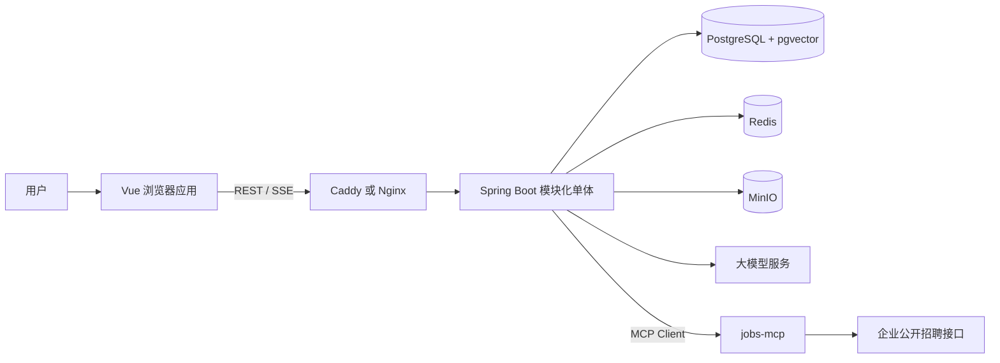
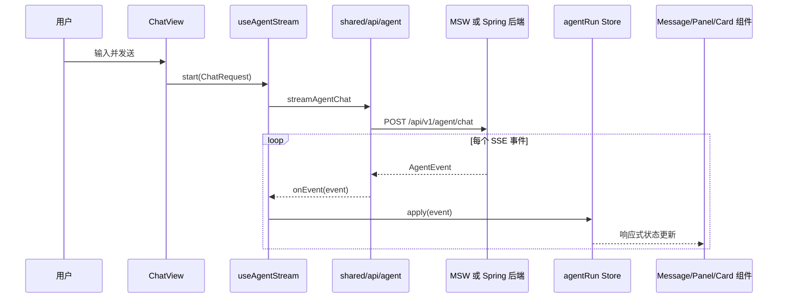

# 12 · 项目架构与源码导读

> 适用对象：第一次接触 OfferPilot、对 Maven 多模块、Vue 分层、SSE、Agent 或 MCP 不熟悉的开发者。
>
> 本文依据 2026-09-13 的仓库实际代码编写。本文会明确区分“当前实现”和“目标设计”，避免把设计文档中的规划误认为已经落地。

## 1. 先用一句话理解项目

OfferPilot（职航）是面向高校学生和应届生的求职 AI 助手。它想把职业探索、简历管理、岗位搜索、岗位匹配、求职看板、模拟面试和职业规划串成一个闭环，并让用户在界面上看到 Agent 的计划、步骤、工具调用、依据、用量和需要确认的操作。

它不是一个“只聊天”的机器人。设计目标是让模型负责理解和规划，让领域服务负责业务规则，让工具负责读取或修改数据，让前端把整个执行过程可视化。

## 2. 当前仓库处于什么阶段

理解本项目最重要的前提，是把三个层次分开：

1. **产品目标**：README 和需求文档描述的完整求职闭环。
2. **设计基线**：架构、AI、接口、数据库和前端文档描述的预期实现。
3. **当前代码**：已经可以编译或在浏览器中展示的实现。

当前代码属于早期骨架阶段：

- 前端已有应用壳、路由、聊天页、SSE 客户端、Agent 运行状态仓库、过程面板和三类生成式 UI 卡片。
- 前端开发模式默认启用 MSW，用脚本化事件模拟一段完整 Agent 运行，因此界面看起来比真实后端完成度更高。
- 后端已有 Maven 多模块结构、唯一启动入口、公共配置、错误处理、模型档位抽象、SSE 事件类型和一个最小聊天接口。
- 后端聊天接口目前只回显用户输入，没有调用大模型、数据库、Orchestrator、专家 Agent 或 MCP。
- identity、resume、job、career、interview 等业务模块目前主要只有 `package-info.java`，即模块边界已经命名，但业务类尚未实现。
- 数据库目前只有 V1 至 V4 迁移；数据库设计文档中 V5 以后的表是规划，不是当前数据库已有对象。

因此，调试项目时需要先确认问题位于“真实后端链路”还是“前端 Mock 链路”。

## 3. 系统全景与边界



各边界的职责：

- 浏览器负责页面、交互、流式展示、客户端状态和隐私敏感的端侧能力。
- Caddy/Nginx 负责 HTTPS、静态资源和 `/api` 反向代理，SSE 路径必须关闭缓冲。
- Spring Boot 后端负责认证、Agent 编排、业务规则、模型和工具接入、数据持久化。
- PostgreSQL 保存业务数据、Agent 事件、知识库文本和向量。
- Redis 计划用于短期会话、限流、SSE 缓冲和审批等待状态。
- MinIO 计划用于简历、录音和导出文件。
- jobs-mcp 把企业公开招聘接口包装成 Agent 能理解的 MCP 工具。

## 4. 为什么后端是“模块化单体”

后端看起来有很多模块，但不是多个独立服务。`offerpilot-bootstrap` 会把它们组装成一个 Spring Boot 进程和一个部署产物。

```text
offerpilot-bootstrap
├── offerpilot-platform
├── offerpilot-agent
├── offerpilot-identity
├── offerpilot-resume
├── offerpilot-job
├── offerpilot-career
└── offerpilot-interview
```

这样做兼顾两点：代码可以按业务边界隔离，部署时又不必处理微服务注册、跨服务事务、链路治理和多个部署单元。

依赖规则是：

- `bootstrap` 可以依赖所有模块，因为它负责最终装配。
- `agent` 当前依赖 `platform`，用它提供的 ID、模型和公共配置。
- 业务模块之间不应直接访问彼此的 Controller、Repository 或 JPA Entity。
- 跨业务模块调用应通过拥有方暴露的小型 application 接口和 DTO。
- `platform` 只能提供技术能力，不能逐渐变成存放所有业务代码的“公共垃圾桶”。

## 5. 仓库根目录文件

### `README.md`

项目入口说明，回答产品是什么、核心能力是什么、技术栈是什么、仓库怎样组织以及如何启动。README 中部分内容描述的是目标架构，不能仅凭 README 判断功能已经实现。

### `CONTEXT.md`

项目领域词汇表。它规定 `User`、`Career Profile`、`Resume`、`Job`、`Application`、`Agent Run`、`Interview Session` 等术语的准确含义，减少同一概念在代码和文档中被不同名称表达的问题。

例如 `Job` 是职位信息，`Application` 是用户针对某个职位建立的求职跟踪记录。二者不能混用，否则数据库、接口和前端类型会逐渐失去一致性。

### `AGENTS.md`

给参与本仓库开发的 AI 编程助手使用的项目规则。它规定后端模块边界、前端依赖方向、文档同步要求、测试命令和变更纪律。它不是应用运行时配置，删除后不会直接导致程序报错，但会使后续 AI 开发更容易破坏项目约定，因此应保留。

### `.env.example`

后端、Docker Compose 和外部服务的环境变量模板。真正的密码和 API Key 应放在未提交的 `.env` 或部署平台密钥中，不能写进模板或源码。

### `.editorconfig`

统一不同编辑器中的缩进、换行符、文件编码和文件末尾换行，减少与业务无关的格式差异。

### `.gitattributes`

告诉 Git 如何处理行尾和特定文件类型，尤其用于降低 Windows 与 Linux 之间 CRLF/LF 差异造成的无意义变更。

### `.gitignore`

排除构建产物、IDE 临时文件、本地环境变量、依赖目录等不应提交的文件。

### `.nvmrc`

声明前端使用的 Node.js 主版本。支持 nvm 的开发者可以用它快速切换一致的 Node 环境。

### `.github/`

保存 GitHub 工作流或仓库协作配置。它属于持续集成和协作层，不参与应用业务运行。

### `.idea/`

IntelliJ IDEA 项目配置目录。里面可能包含模块识别、代码风格和运行配置。是否提交应按团队约定决定，不能把整个目录简单视为无用文件。

### `.corepack/`

当前工作区中的未跟踪目录，不属于已提交源码。它通常与 Node 包管理器 Corepack 的本地状态有关。删除前应先确认其中是否保存了项目专用配置；本导读不对它做任何修改。

## 6. 后端父工程与构建入口

### `backend/pom.xml`

这是 Maven reactor 的父 POM，自己不产生可运行应用。它统一定义：

- Java 21；
- Spring Boot、Spring AI 和测试容器等版本；
- 子模块列表；
- 共享的依赖版本；
- Spring Boot Maven 插件管理。

从 `backend` 执行 Maven 命令时，Maven 先读取这个文件，再按 `<modules>` 找到所有子模块。

### `backend/mvnw` 与 `backend/mvnw.cmd`

二者是 Maven Wrapper 启动脚本：

- `mvnw` 给 Linux、macOS 和类 Unix shell 使用；
- `mvnw.cmd` 给 Windows 命令提示符和 PowerShell 使用。

它们读取 `.mvn/wrapper/maven-wrapper.properties` 中的 Maven 下载地址，使没有全局安装 Maven 的开发机和 CI 也能构建项目。删除后，如果机器上没有可用的 `mvn`，README 中的可复现构建会失效。通常应将这三个文件作为一个整体保留或整体替换，而不应只删除其中一个平台的脚本。

### `backend/.mvn/wrapper/maven-wrapper.properties`

声明 Wrapper 版本、Maven 分发类型和下载地址。当前配置使用阿里云 Maven 镜像下载 Maven，适合国内网络环境。

### `backend/Dockerfile`

定义如何在容器中构建和运行后端。它与 `deploy/docker-compose.yml` 配合：Compose 负责组合服务，Dockerfile 负责制造后端镜像。

## 7. `offerpilot-bootstrap`：最终装配模块

### `offerpilot-bootstrap/pom.xml`

依赖其他所有后端模块，并启用 Spring Boot Maven 插件。业务模块像零件，bootstrap 像装配这些零件并提供电源开关的机箱。

### `OfferPilotApplication.java`

唯一的 `@SpringBootApplication`。`main` 方法调用 `SpringApplication.run` 后，Spring 扫描 `com.offerpilot` 下所有模块中的组件，将 Controller、配置和服务装配进同一个容器。

它还启用 `OfferPilotProperties`，让 `application*.yml` 中 `offerpilot.*` 配置绑定为强类型 Java 对象。

### `application.yml`

公共运行配置。应放所有环境共享的默认值和结构，不应放真实密钥。

### `application-dev.yml`

开发环境覆盖项，例如本地数据库、Redis、MinIO、开发日志和本地 MCP 地址。

### `application-test.yml`

自动化测试使用的覆盖项，目的是让测试隔离外部服务、稳定复现，并避免误连生产资源。

### `application-prod.yml`

生产环境覆盖项。敏感值应通过环境变量注入；这个文件只保留变量引用、超时、连接池和日志等级等配置结构。

### `prompts/orchestrator/intent.st`

Orchestrator 的意图识别 Prompt 模板。`.st` 表示模板资源，而不是 Java 类。未来 Prompt Repository 会读取它、填充上下文并交给模型，用于判断用户请求属于哪个 Agent 模式。修改它会改变 AI 行为，因此需要同步 `04-AI技术方案.md` 中的 Prompt 契约。

### Flyway 迁移

- `V1__extensions.sql`：启用 PostgreSQL 扩展和公共数据库能力，尤其是 pgvector。
- `V2__users.sql`：创建用户、偏好、刷新令牌和集成信息相关表。
- `V3__conversation_agent.sql`：创建会话、消息、Agent Run、步骤、工具调用、审批和事件相关表。
- `V4__files.sql`：创建文件元数据表，为 MinIO 对象、简历和录音建立数据库索引。

Flyway 按版本顺序执行迁移。已经共享或在环境中执行过的迁移不能直接改写；数据库变化要新增 `V5__...sql`、`V6__...sql` 等文件。

## 8. `offerpilot-platform`：公共技术能力

`platform` 是 Agent 和业务模块使用的基础设施适配层，不拥有简历、岗位或面试等业务规则。

### `offerpilot-platform/pom.xml`

引入 Web MVC、Security、Validation、Actuator、REST Client、JPA、Redis、Flyway、Spring AI、MCP、MinIO、Tika、PDFBox、JWT、限流、熔断、OpenAPI、ULID 和测试依赖。依赖存在只表示模块具备开发这些能力的条件，不表示每项能力已经实现。

### `config/OfferPilotProperties.java`

把 `offerpilot.*` 配置绑定为嵌套 record，集中描述：

- JWT 密钥和访问/刷新令牌寿命；
- CORS 来源；
- Demo 账号和重置周期；
- MinIO 地址、密钥和 bucket；
- 应用层加密密钥；
- 用户请求频率和并发 Agent Run 限制；
- 模型档位、供应商、模型名、超时和回退链；
- jobs/search MCP 地址。

调用关系为 `application*.yml → OfferPilotProperties → ModelGateway/SecurityConfig/未来的存储和 MCP 组件`。

### `config/JacksonConfig.java`

创建统一 `ObjectMapper`，处理 Java 时间类型、未知 JSON 字段和时间序列化。`AgentController` 使用它把 `AgentEvent` 转成 SSE 的 JSON data。

### `config/SecurityConfig.java`

建立 Spring Security 过滤链，决定哪些接口公开、哪些需要认证，以及 CORS/CSRF 等策略。当前仍是骨架安全配置；未来 JWT 过滤器和用户认证实现会接入这里。

### `config/OpenApiConfig.java`

配置 OpenAPI 元信息和 Bearer JWT 安全方案。后端生成的 `/v3/api-docs` 未来可由前端 `pnpm gen:api` 转换成 TypeScript 类型。

### `llm/ModelTier.java`

定义 `FLASH`、`CHEAP`、`PRO`、`VISION_ALT` 四个逻辑档位。业务代码依赖逻辑档位，而不是散落硬编码具体模型名，这样切换供应商时不必修改所有 Agent。

### `llm/ModelGateway.java`

根据配置解析默认档位、模型名和回退链，并从 Spring 容器取得 `ChatModel`。当前实现还没有真正按档位维护多个模型实例，也没有落实超时、熔断、用量日志和自动回退。

当前调用链是 `AgentController → ModelGateway.defaultTier/modelName → OfferPilotProperties`。注意当前 Controller 只把模型名放进 `run.started`，没有调用 `chatModel(...).call(...)`。

### `common/id/IdGenerator.java`

使用 ULID 生成带业务前缀且大致按时间有序的 ID，例如 `conv_...`、`run_...`、`msg_...`。Controller、实体和事件应复用它，避免各模块采用不同 ID 规则。

### `common/api/ApiResponse.java`

普通 REST 接口的统一响应封装，包含业务码、消息、数据、traceId 和可选字段错误。SSE 接口返回的是事件流，不套这个普通响应壳。

### `common/error/ErrorCode.java`

集中定义业务错误码、HTTP 状态和默认消息。前端可以用稳定错误码处理场景，避免依赖可能变化的中文错误文字。

### `common/error/BusinessException.java`

领域或应用服务主动抛出的可预期异常，携带 `ErrorCode`。它和数据库断线、空指针等系统异常不同。

### `common/error/GlobalExceptionHandler.java`

捕获参数校验、`BusinessException` 和未处理异常，将它们转换成 `ApiResponse`，附带 traceId 并记录日志。这样每个 Controller 不需要重复写 try/catch。

### `common/web/TraceIdFilter.java`

为每个 HTTP 请求读取或生成 traceId，把它写入日志 MDC 和响应头。一次请求经过 Controller、服务、模型和数据库时可以用同一个 traceId 串联日志。

### `mcp/package-info.java`

只声明包用途：未来放 MCP Client 连接管理和 MCP Server 工具暴露。`package-info.java` 可以承载包级 Javadoc，但当前没有可执行逻辑。

### 测试

`IdGeneratorTest.java` 验证生成 ID 的基本格式。它依赖 `IdGenerator`，防止前缀或格式重构时静默破坏已有契约。

## 9. `offerpilot-agent`：Agent 协议与编排入口

### `offerpilot-agent/pom.xml`

依赖 `offerpilot-platform`，并引入 Web MVC、参数校验和 Web 测试能力。依赖方向允许 Agent 使用平台技术能力，但不允许 platform 反向依赖 Agent 业务。

### `agent/web/ChatRequest.java`

定义 `/api/v1/agent/chat` 的请求体：

- `conversationId`：为空时创建新会话，有值时继续已有会话；
- `content`：用户文本，当前限制 1 至 4000 字符；
- `attachments`：附件文件 ID 和种类；
- `mode`：AUTO 或指定专家模式；
- `options`：模型档位、是否启用推理摘要和附加上下文。

`@Valid`、`@NotBlank` 和 `@Size` 会在进入业务代码前验证请求。失败后由 `GlobalExceptionHandler` 返回统一错误。

### `agent/web/AgentController.java`

当前唯一真实 Agent HTTP 入口。它创建一个十分钟超时的 `SseEmitter`，生成 conversation/run/message ID，解析模式和模型档位，然后在 Java 虚拟线程中发送事件。

当前事件序列只有：

```text
run.started → text.delta（一段或多段）→ run.completed
```

`emit(...)` 同时写入 SSE 的 `id`、`event` 和 JSON `data`。`withId(...)` 为事件对象填充递增 ID。当前只实际发送三种事件；其他分支是为了 sealed interface 的穷尽处理。

未来应由 Orchestrator 服务接管虚拟线程中的回显逻辑。Controller 应只负责请求校验、SSE 生命周期和调用应用服务，不应承载规划与业务规则。

### `agent/event/AgentEvent.java`

后端 Agent 事件协议，是前后端流式通信的核心。它使用 sealed interface 和 Jackson 多态信息，确保每个事件都有 `type`、`id`、`runId` 和 `ts`。

事件含义：

- `run.started`：运行开始，给出会话、消息、模型和模式。
- `plan.created`：Orchestrator 创建目标和步骤依赖图。
- `step.updated`：步骤进入等待、运行、完成、失败或跳过状态。
- `reasoning.delta`：面向用户的简短推理摘要增量，不应泄露内部机密推理。
- `text.delta`：最终回答正文增量。
- `tool.call`：开始调用本地或 MCP 工具，包含参数和访问级别。
- `tool.result`：工具结束，包含成功状态、结果预览、耗时和截断标记。
- `ui.card`：发送结构化卡片数据，由前端注册表选择组件渲染。
- `approval.required`：写操作或外部副作用需要用户批准。
- `approval.resolved`：批准、拒绝或超时结果。
- `citation`：RAG 或外部资料的引用来源。
- `memory.used`：本轮使用了哪些长期记忆事实。
- `usage`：模型、输入/输出 Token、成本估计和回退情况。
- `error`：可恢复或不可恢复错误。
- `run.completed`：运行最终状态、消息 ID 和耗时。

`AgentEvent.java` 与前端 `shared/types/agent-events.ts` 是同一协议的两种语言表示，修改一边必须同步另一边和 `05-接口文档.md`。

### `agent/domain/AgentMode.java`

表示用户选择的工作模式。AUTO 由 Orchestrator 判断专家；其他模式把请求限制在职业探索、简历、岗位、面试或规划上下文。

### `agent/domain/ExpertType.java`

表示计划步骤的执行者。它与 AgentMode 相似但用途不同：AgentMode 是一次请求的入口偏好，ExpertType 是计划中每个步骤实际分派给谁。

### `agent/domain/Plan.java`

包含总目标和步骤列表，是模型结构化规划结果的领域表示。

### `agent/domain/PlanStep.java`

包含步骤 ID、标题、专家类型、输入和前置依赖。`dependsOn` 允许表达有向无环图，而不只是固定顺序列表。例如“优化简历”依赖“选出目标岗位”，两个独立搜索步骤则可以并行。

### 三个 `package-info.java`

- `agent/orchestrator/package-info.java`：预留意图识别、规划、执行和反思。
- `agent/experts/package-info.java`：预留五类专家 Agent 的装配。
- `conversation/package-info.java`：预留会话、消息和消息 parts。

它们目前都没有运行时代码，只是明确未来代码应放在哪里。

### `AgentControllerTest.java`

使用 Spring MVC 测试验证聊天接口、参数校验和 SSE 基本输出。修改 Controller、Jackson 配置或事件 JSON 时，该测试应帮助发现协议回归。

## 10. 五个业务域模块

这些模块现在主要由 POM 和包说明构成。下面既说明模块职责，也说明未来跨模块应如何调用。

### `offerpilot-identity`

- `auth/package-info.java`：注册、登录、JWT、刷新令牌和体验账号。
- `user/package-info.java`：用户、偏好和 Career Profile 的用户侧基础信息。

其他模块需要当前用户时，应依赖 identity 暴露的用户上下文或查询接口，不应直接查询 identity 的 Repository。

### `offerpilot-resume`

- `resume/package-info.java`：简历上传、解析、结构化、诊断、改写、版本和导出。

典型链路是 `文件上传 → MinIO → files → 文本/视觉解析 → resume_versions → 诊断或 JSON Patch → 新版本`。岗位模块需要简历摘要时，应调用 resume 的 application 接口，而不是依赖其实体。

### `offerpilot-job`

- `job/package-info.java`：岗位来源、搜索、导入、归一化、去重、匹配和校招日历。
- `board/package-info.java`：用户针对岗位创建的 Application 及状态变化历史。

`Job` 是岗位本身，`Application` 是用户的求职跟踪记录。创建看板记录属于写操作，Agent 自动执行前应经过审批策略。

### `offerpilot-career`

- `discovery/package-info.java`：对话式测评、Career Profile、兴趣代码和职业推荐。
- `career/package-info.java`：技能差距、学习路线和职业规划问答。
- `knowledge/package-info.java`：文档入库、分块、嵌入、混合检索和引用。

知识库是基础能力但目前放在 career 业务模块，因为主要服务职业条目、岗位能力模型和规划问答。未来如果多个模块都深度依赖它，应通过稳定检索接口复用，而不是复制检索 SQL。

### `offerpilot-interview`

- `interview/package-info.java`：面试会话、题目、追问、回答、评分、报告和浏览器端聚合指标。

面试模块可通过接口读取目标 Job 和 Resume 的只读快照。历史面试不应因为用户后来修改简历而失去当时上下文，因此需要保存版本 ID 或必要快照。

## 11. 前端分层规则

前端采用 `app → widgets → features → shared` 的总体依赖方向：

- `app` 负责应用启动、路由和顶层布局。
- `widgets` 组合多个较小组件，形成跨功能区域使用的大块 UI。
- `features` 按用户功能组织页面和局部组件。
- `shared` 提供与具体业务功能弱相关的 API 基础、类型、通用组件和工具。

实际代码允许页面 feature 引用跨功能 widget，例如 ChatView 使用 AgentPanel；“feature 之间不得直接 import”是为了避免岗位功能直接侵入简历功能。跨功能组合应上移到 widget 或 app，数据契约下沉到 shared。

`@/` 在 Vite 和 TypeScript 配置中指向 `frontend/src`，所以 `@/shared/api/agent` 等价于 `frontend/src/shared/api/agent.ts`。

## 12. 前端工程与构建文件

### `frontend/package.json`

声明 Node 版本、pnpm 版本、运行脚本和依赖。常用脚本：

- `pnpm dev`：启动 Vite 开发服务器；
- `pnpm build`：先做 TypeScript/Vue 类型检查，再生产构建；
- `pnpm lint`：运行 ESLint；
- `pnpm test -- --run`：一次性运行 Vitest；
- `pnpm gen:api`：从后端 OpenAPI 生成 TypeScript 接口类型。

### `pnpm-lock.yaml`

锁定依赖的精确版本和完整依赖图，保证不同机器安装出一致依赖。它不是缓存文件，通常必须提交。

### `pnpm-workspace.yaml`

声明 pnpm 工作区范围。即使当前只有一个前端包，它也为后续共享包或组件包保留一致的包管理入口。

### `vite.config.ts`

配置 Vue 插件、Tailwind 插件、路径别名、开发服务器和构建行为。

### `vitest.config.ts`

配置测试环境、测试文件、浏览器 DOM 模拟和覆盖率等测试行为。

### `tsconfig.json`、`tsconfig.app.json`、`tsconfig.node.json`

- 根 tsconfig 组织项目引用；
- app 配置浏览器端 Vue/TS 代码；
- node 配置 Vite/Vitest 等在 Node 环境执行的配置文件。

### `eslint.config.js`

ESLint flat config，统一 Vue 和 TypeScript 静态检查规则。

### `index.html`

Vite 的 HTML 入口，提供 Vue 挂载节点 `#app` 并加载 `src/app/main.ts`。

### `frontend/.env.example`

前端公开环境变量模板，例如 API 基础地址、应用名称和 Mock 开关。只有 `VITE_` 前缀变量会注入浏览器，因此绝不能在这里放服务器密钥。

### `frontend/Dockerfile`

构建前端静态资源并放入 Web Server 镜像，供 Compose 和生产部署使用。

### `public/favicon.svg`、`public/icons.svg`

不经过模块打包直接复制到输出目录的静态图标资源。

### `public/mockServiceWorker.js`

MSW 的浏览器 Service Worker 脚本。开发环境的 `shared/mocks/browser.ts` 需要它才能拦截网络请求；如果仍使用浏览器 Mock，不应删除。

## 13. `frontend/src/app`：应用组装层

### `app/main.ts`

前端入口。执行顺序是：初始化主题 → 创建 Vue App → 注册 Pinia、Router 和 Vue Query → 开发环境按开关启动 MSW → 挂载到 `#app`。

由于挂载动作放在 `enableMocking().finally(...)` 中，Mock 启动失败也不会阻止应用显示，只会回退到真实后端请求。

### `app/App.vue`

根组件。它渲染全局 Aurora 背景、当前路由页面和页面切换幕布。这里不应放具体简历或岗位业务。

### `app/router/index.ts`

定义 URL 到页面组件的映射。页面使用动态 import，因此按路由懒加载。登录页使用 `AuthLayout`，其余主要页面使用 `AppLayout`，未知路径进入 `NotFoundView`。

### `app/router/guards.ts`

注册全局前置/后置路由守卫，配合 `usePageCurtain` 播放切页动画；未来也承载登录态与体验账号限制。

### `app/router/meta.ts`

扩展 Vue Router 的 RouteMeta TypeScript 类型，约束 `title`、`public` 等元数据字段。

### `app/layouts/AppLayout.vue`

登录后页面的外壳：左侧导航、顶部栏、通知入口和内部 `RouterView`。它根据路由名称高亮导航，根据路由 meta 显示页面标题。

### `app/layouts/AuthLayout.vue`

公开认证页面的居中玻璃卡片外壳，内部 `RouterView` 当前渲染 LoginView。

### `app/providers/query.ts`

创建 TanStack Query 的 `QueryClient`，统一服务端数据缓存、重试和失效策略。当前业务列表接口尚未全面实现，但入口已注册。

## 14. `frontend/src/shared`：共享基础层

### `shared/api/client.ts`

提供 API URL 拼接、认证请求头、traceId 和 `ApiError` 转换。业务 API 文件应复用它，避免每个 feature 重复处理 Token 和错误结构。

### `shared/api/sse.ts`

将 `ReadableStream<Uint8Array>` 解析为 SSE 帧。它先统一 CRLF/LF，再按空行切帧，解析 `id`、`event` 和多行 `data`，忽略注释心跳，并在流结束时冲刷最后一个未闭合帧。

### `shared/api/agent.ts`

实现三个 Agent 网络操作：

- `streamAgentChat`：POST 聊天请求并逐个回调 AgentEvent；
- `resumeAgentRun`：携带最后事件 ID 恢复中断的事件流；
- `cancelAgentRun`：请求后端取消运行。

它使用 fetch 而不是 EventSource，因为 EventSource 不能发送 POST JSON 和自定义认证头。

### `shared/api/sse.spec.ts`

验证切帧、字段解析、跨网络 chunk 和尾帧冲刷等边界情况。

### `shared/api/agent.spec.ts`

使用 Node 侧 MSW 测试 Agent 客户端能否消费事件、处理取消和把非 2xx 转成 ApiError。

### `shared/types/agent-events.ts`

后端 `AgentEvent.java` 的 TypeScript 对应物。它通常用辨识联合描述事件，使 `switch(event.type)` 能自动缩小类型。

### `shared/types/cards.ts`

定义每种生成式 UI 卡片的 `cardType` 与 payload，例如岗位匹配、简历差异和看板更新。它连接后端卡片协议、Store 和具体 Vue 组件。

### `shared/stores/agentRun.ts`

Pinia 运行时状态仓库。它按 `runId` 保存多次 Agent Run，把离散事件归约为页面可直接读取的状态：计划、步骤、工具、审批、引用、记忆、卡片、文本、用量和错误。

`apply(event)` 是唯一事件入口。新增事件类型后，`assertNever` 让未处理分支在编译期暴露。`lastEventId` 用于断线续传，`activeRunId` 决定当前 AgentPanel 展示哪次运行。

### `shared/stores/agentRun.spec.ts`

把 Mock scenario 中的事件依次送入 Store，验证最终状态是否正确。这是事件协议变更时非常重要的回归测试。

### `shared/composables/useAgentStream.ts`

协调网络流与 Store：`start` 创建 AbortController 并消费新运行，`stop` 先中止本地流、乐观标记取消，再通知后端，`resume` 从 Store 的最后事件 ID 继续。

### `shared/composables/usePageCurtain.ts`

管理页面切换幕布的共享响应式状态，供路由守卫触发、StageCurtain 组件读取。

### `shared/mocks/browser.ts`

创建浏览器端 MSW Worker，并注册 handlers。只在开发环境按配置动态加载，不进入正常生产请求路径。

### `shared/mocks/handlers.ts`

拦截聊天和取消 API。聊天 handler 把 scenario 中的事件编码成真实 SSE 字节流，并按事件类型加入不同延迟，从而模拟模型流式响应。

### `shared/mocks/scenario.ts`

构造当前前端演示的完整 Agent 剧本：岗位搜索、匹配、简历优化审批、简历 diff、看板写入审批、卡片、引用、记忆和用量。这里的数据都是演示数据，不来自后端、数据库或真实公司 API。

### 通用组件

- `shared/components/AuroraBackground.vue`：全局视觉背景。
- `shared/components/StageCurtain.vue`：读取页面幕布状态并渲染切换动画。
- `shared/components/MarkdownView.vue`：把文本交给 Markdown 工具处理后渲染。
- `shared/components/ComingSoon.vue`：未实现页面的统一占位，多个业务页面当前依赖它。
- `shared/views/NotFoundView.vue`：未知路由的 404 页面和返回入口。

### 工具函数

- `shared/utils/theme.ts`：初始化、读取和应用主题。
- `shared/utils/payload.ts`：在运行时把未知卡片 payload 安全收窄为对象，避免组件直接假定后端数据合法。
- `shared/utils/markdown.ts`：使用 markdown-it 解析文本并用 DOMPurify 消毒，降低模型输出注入恶意 HTML 的风险。
- `shared/utils/cn.ts`：组合条件 class，并用 tailwind-merge 解决冲突的 Tailwind 类。
- `shared/utils/assertNever.ts`：为事件和枚举 switch 提供编译期穷尽检查。

### 样式

- `shared/styles/index.css`：Tailwind、主题变量、全局基础样式和项目设计 token。
- `shared/styles/transition.css`：页面、幕布和元素进入动画。
- `shared/styles/markdown.css`：Markdown 标题、列表、代码块、引用和链接样式。

## 15. `frontend/src/features`：按用户能力拆分

### `features/auth/views/LoginView.vue`

登录页面。当前主要负责演示登录交互和路由跳转，真实认证 API 与用户 Store 尚未完成。

### `features/dashboard/views/DashboardView.vue`

工作台首页，提供各求职功能入口和项目状态概览。

### Chat 功能

- `chat/views/ChatView.vue`：聊天页面容器；创建输入值和消息视图，调用 `useAgentStream`，读取 `agentRun` Store，并组合 MessageList、Composer 与 AgentPanel。
- `chat/components/Composer.vue`：输入框、发送和停止操作，通过 emit 把用户动作交给 ChatView。
- `chat/components/MessageList.vue`：遍历消息并交给 MessageItem，保持列表组件职责简单。
- `chat/components/MessageItem.vue`：根据消息角色渲染气泡；助手消息用 MarkdownView 显示文本，用 CardRenderer 渲染结构化卡片。
- `chat/types.ts`：只属于聊天展示层的消息类型，引用 Store 中的 CardView，但不重新定义整个 Agent 协议。

### Discovery 功能

- `discovery/views/DiscoverView.vue`：职业探索入口。当前依赖 ComingSoon，说明测评、画像和推荐 UI 尚未实现。

### Resume 功能

- `resume/views/ResumeListView.vue`：简历列表入口，当前为占位。
- `resume/views/ResumeDetailView.vue`：简历详情入口，当前为占位。
- `resume/components/PatchDiffViewer.vue`：已经实现的生成式 UI 组件，读取 `resume_diff` payload，显示改写前后、理由、JD 证据和需要用户确认的示例数字，并维护逐条选择状态。

### Job 功能

- `job/views/JobSearchView.vue`：岗位搜索入口，当前为占位。
- `job/views/JobDetailView.vue`：岗位详情入口，当前为占位。
- `job/components/MatchReport.vue`：已经实现的 `job_match` 卡片组件，显示综合分、维度分、匹配证据、能力缺口和建议。

### Board 功能

- `board/views/BoardView.vue`：求职看板入口，当前为占位。
- `board/components/BoardUpdateCard.vue`：已经实现的 `board_update` 卡片，显示新增或变更的 Application，并提供进入看板的链接。

### Interview 功能

- `interview/views/InterviewListView.vue`：面试列表，当前为占位。
- `interview/views/InterviewRoomView.vue`：面试房间，当前为占位。

### 其他功能

- `career/views/CareerView.vue`：职业规划入口，当前为占位。
- `kb/views/KnowledgeView.vue`：个人知识库入口，当前为占位。
- `settings/views/SettingsView.vue`：偏好、隐私、记忆、MCP 和用量入口，当前为占位。
- `notifications/views/NotificationsView.vue`：通知列表入口，当前为占位。

## 16. `frontend/src/widgets`：跨组件组合

### AgentPanel

- `AgentPanel.vue`：右侧 Agent 过程面板，根据 RunState 组合计划、工具、审批和用量。
- `PlanSteps.vue`：显示步骤状态、依赖、摘要和耗时。
- `ToolTimeline.vue`：显示工具名、来源、访问级别、参数、结果和耗时。
- `ApprovalCard.vue`：显示待审批工具调用、原因、参数、可编辑字段、到期时间和决策状态。
- `UsageBadge.vue`：显示模型、Token、费用估算和是否发生回退。

### CardRenderer

- `CardRenderer.vue`：收到 cardType 和 payload 后，通过 registry 解析组件并动态渲染。
- `registry.ts`：维护 `job_match → MatchReport`、`resume_diff → PatchDiffViewer`、`board_update → BoardUpdateCard` 映射；使用异步组件减少首屏体积。
- `CardSkeleton.vue`：异步卡片加载时的占位。
- `CardFallback.vue`：未知 cardType 或组件加载失败时的兼容展示。
- `registry.spec.ts`：验证已知类型能找到正确组件、未知类型能回退，保护后端扩展卡片时的兼容性。

## 17. 当前前端真实调用链



开发环境默认路径中，`M` 是 MSW：`main.ts → browser.ts → handlers.ts → scenario.ts`。关闭 `VITE_ENABLE_MOCK` 后，`M` 才是 `AgentController.java`。

## 18. 计划中的后端完整调用链

```text
AgentController
  → AgentRunApplicationService
  → 输入安全与 PII 处理
  → Orchestrator 识别意图并创建 Plan
  → 按 dependsOn 调度专家 Agent
  → 专家 Agent 调用 ModelGateway
  → Tool Policy 判断 READ / WRITE / EXTERNAL_SIDE_EFFECT
  → 本地领域工具或 MCP 工具
  → application 接口
  → 领域服务
  → Repository / PostgreSQL / Redis / MinIO
  → 发布 AgentEvent
  → SSE 推给前端
```

这一链路中，Controller 不直接写数据库，Agent 不直接操作 Repository，MCP 结果也不直接渲染页面。每层通过明确契约协作，可以分别测试和替换。

## 19. `mcp-servers/jobs-mcp`

### `package.json`

定义一个 Node.js 22+ 的私有 ESM 包，提供 `start` 和 `dev` 命令。目前没有声明第三方依赖，说明实现仍很轻量。

### `src/server.js`

jobs-mcp 的服务入口。目标是把不同企业官网公开招聘接口的差异隐藏在统一工具之后，使 Java Agent 只需要调用稳定的 `search_jobs/get_job` 等工具契约。

### `Dockerfile`

把 jobs-mcp 制作为独立容器。它与 Java 后端分开，是因为 MCP 工具适配器适合独立迭代，并不代表所有业务域都要拆成微服务。

计划调用链为 `岗位专家 → Java MCP Client → jobs-mcp → 企业招聘接口 → 标准岗位 DTO → 岗位领域服务缓存/去重 → SSE 卡片`。

## 20. `deploy` 部署文件

### `deploy/docker-compose.yml`

描述本地或单机部署的服务拓扑、网络、端口、环境变量、卷和健康检查。它把前端、后端、PostgreSQL、Redis、MinIO 和 jobs-mcp 组合起来。

### `deploy/Caddyfile`

推荐的入口代理配置，处理自动 HTTPS、静态前端、SPA history 回退和 `/api` 代理。Agent SSE 路径需要关闭响应缓冲并设置足够长的读取超时。

### `deploy/nginx/default.conf`

与 Caddy 类似的备用 Nginx 配置。是否保留取决于项目是否确实需要提供两种代理方案；删除前应先确定最终部署选型。

### `deploy/scripts/backup.sh`

计划执行 PostgreSQL 备份并处理保留周期。备份脚本属于灾难恢复能力，不能仅因开发环境暂时不用就判断为无用。

### `deploy/scripts/reset-demo.sh`

计划重置比赛体验账号和演示数据。它与 Demo 环境配置配套，正式产品环境不应误执行。

## 21. 文档目录的职责

- `00-赛题分析与评分对照.md`：比赛规则、评分权重、提交要求和风险自查；开发运行不依赖。
- `01-项目计划书.md`：产品背景、用户、价值、场景、创新、里程碑和风险；偏立项与答辩。
- `02-需求分析与功能清单.md`：用户故事、功能优先级和验收标准；回答“做什么”。
- `03-系统架构设计.md`：层次、模块、流程、部署和非功能设计；回答“系统如何分解”。
- `04-AI技术方案.md`：模型、Agent、Prompt、工具、MCP、RAG、记忆、安全和评估；是 AI 行为事实来源。
- `05-接口文档.md`：REST、SSE、事件、卡片和 MCP 契约；是前后端协作事实来源。
- `06-数据库设计.md`：ER、DDL、索引、迁移、保留策略和容量；是数据库事实来源。
- `07-前端设计规范.md`：依赖方向、路由、状态、API、SSE、组件、样式、性能和测试；是前端事实来源。
- `08-开发计划与分工.md`：排期、分工、Git 节奏和风险；日期失效后适合归档而不是继续充当架构依据。
- `09-部署与运维.md`：环境、容器、代理、CI/CD、备份、监控和故障处理；是运行环境事实来源。
- `10-测试与评估方案.md`：测试分层、性能、AI 评估、安全和用户测试；是质量标准事实来源。
- `11-提交材料清单.md`：比赛 PDF、视频、在线演示和答辩检查表；比赛结束后可归档。
- `adr/0001-modular-monolith.md`：记录模块化单体决策及理由；即使很短也有长期价值。
- `README.md`：本目录导航，帮助按任务找到事实来源。
- 本文：以当前源码为准的入门导读和文件关系说明。

## 22. 哪些文件看似没用但不应轻易删除

- `backend/mvnw`、`mvnw.cmd`、`.mvn/wrapper/...`：保证可复现构建和跨平台开发。
- `package-info.java`：当前没有逻辑，但标记业务包边界并承载包级文档；在骨架阶段有导航价值。
- `public/mockServiceWorker.js`：开发 Mock 的必要运行文件。
- `pnpm-lock.yaml`：锁定依赖，不是可随意重建后忽略的缓存。
- `application-test.yml`：防止测试误连真实基础设施。
- `CardFallback.vue`：保障服务端新增卡片而前端尚未升级时不会直接崩溃。
- ADR：解释“为什么这样设计”，避免后来反复争论同一决策。

## 23. 真正可能需要整理或归档的内容

以下判断关注“是否影响运行”和“信息是否会持续有效”，不等于授权删除：

- `00`、`01`、`08`、`11` 偏比赛和项目管理；比赛结束后可以移到 `docs/archive/competition/`，通常比直接删除更安全。
- `deploy/nginx/default.conf` 与 `Caddyfile` 提供两套代理方案；确定只使用 Caddy 后，可以删除 Nginx 备用方案并同步部署文档。
- 多个 ComingSoon 页面虽然没有业务功能，但它们仍被路由直接引用，删除会导致构建失败；应在对应真实页面实现后逐个替换，而不是提前删除。
- 各业务模块的 `package-info.java` 对编译不是必需，但在模块仍为空时承担唯一边界说明，现阶段建议保留。
- `.idea` 是否提交取决于团队协作策略，应先检查其跟踪状态和具体内容，不能批量删除。

## 24. 新开发者推荐阅读和调试顺序

1. 先运行前端并确认 Mock 场景，理解预期用户体验。
2. 阅读 `agent-events.ts` 和 `AgentEvent.java`，掌握前后端核心协议。
3. 跟踪 `ChatView → useAgentStream → agent.ts → sse.ts → agentRun.ts`。
4. 关闭前端 Mock，跟踪真实 `AgentController`，观察当前只有回显事件。
5. 阅读 V1-V4 迁移，区分已存在表和数据库文档中的规划表。
6. 实现新功能前先选择业务拥有模块，再定义 application 接口，最后接 Controller、工具或 Agent。
7. 接口、数据库、Prompt 或前端结构变化时同步更新对应事实来源文档。

## 25. 判断一个新文件应该放在哪里

- HTTP 参数和 SSE 生命周期：`offerpilot-agent/.../web` 或业务拥有模块的 web 层。
- Agent 规划和调度：`offerpilot-agent/.../orchestrator`。
- 专家 Agent 装配：`offerpilot-agent/.../experts`。
- 模型供应商、MCP、文件、缓存等适配：`offerpilot-platform`。
- 简历规则：`offerpilot-resume`。
- 岗位和看板规则：`offerpilot-job`。
- 职业探索、规划和知识库：`offerpilot-career`。
- 面试规则：`offerpilot-interview`。
- 用户与认证：`offerpilot-identity`。
- 前端通用无业务组件：`frontend/src/shared`。
- 单一业务页面与局部组件：`frontend/src/features/<feature>`。
- 跨功能的大型组合 UI：`frontend/src/widgets`。
- 最终路由、Provider 和应用壳：`frontend/src/app`。

## 26. 最终心智模型

可以把 OfferPilot 记成四条主线：

1. **契约线**：`ChatRequest + AgentEvent + cards` 规定前后端怎样对话。
2. **执行线**：`Controller → Orchestrator → Expert → Tool → Domain` 规定任务怎样完成。
3. **展示线**：`SSE → useAgentStream → agentRun Store → Message/Panel/Card` 规定过程怎样显示。
4. **持久化线**：`Domain → Repository → PostgreSQL/Redis/MinIO` 规定结果怎样保存。

当前仓库已经较完整地搭起契约线和展示线，执行线只有入口骨架，持久化线主要停留在 V1-V4 迁移与设计文档阶段。后续开发的核心不是继续增加占位页面，而是沿着这四条线逐个打通真实业务闭环。
