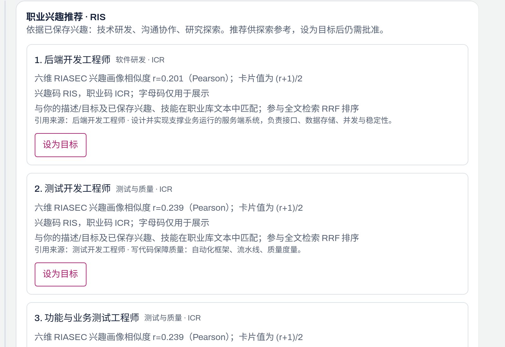
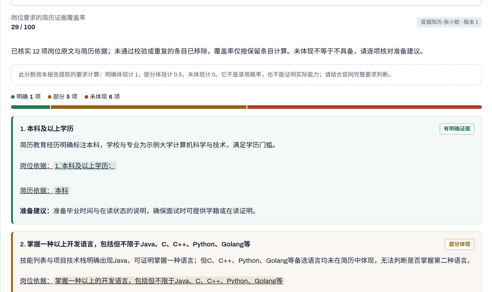
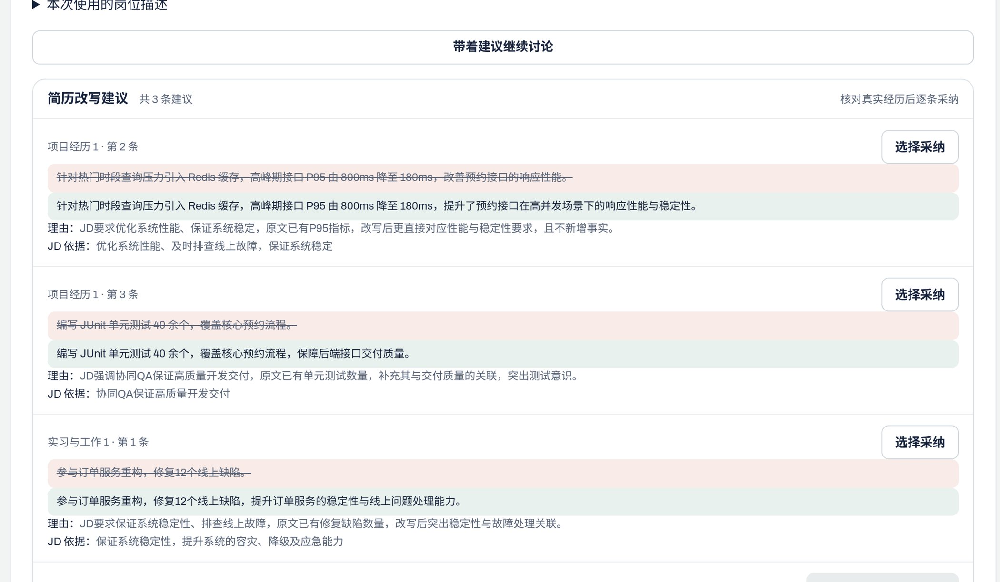
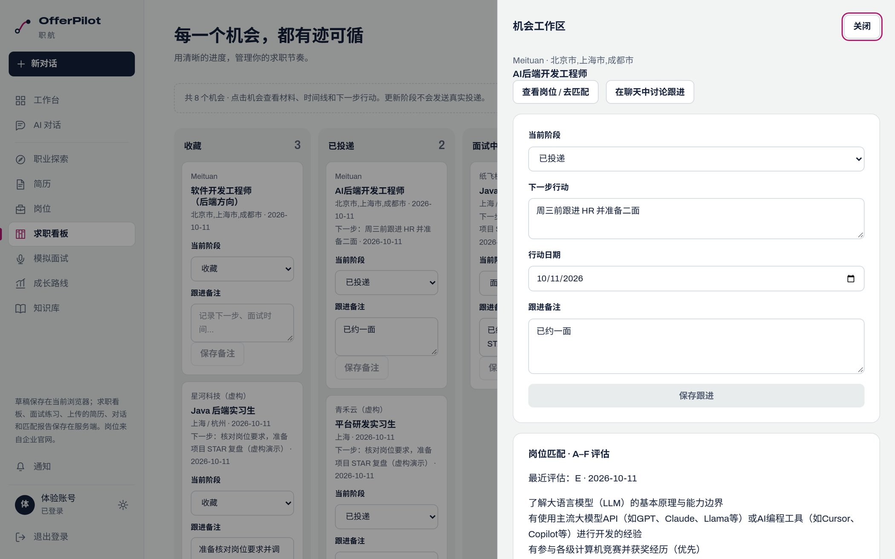

<!-- page: 1 -->
# OfferPilot（职航）
## 作品介绍

对应上传表「6. 作品介绍文档」的七项。只写 [评分证据对照](评分证据对照.md) 中已落地且标为 ✅ 或 🟡 的能力。

| 项目字段 | 内容 |
| --- | --- |
| 参赛组别 | 【TODO · Benjamin：参赛组别】 |
| 团队 / 学校 | 【TODO · Benjamin：团队名称】 / 【TODO · Benjamin：学校】 |
| 作者与成员 | 【TODO · Benjamin：作者与成员】 |
| 指导老师 | 【TODO · Benjamin：指导老师】 |
| 代码仓库 | https://github.com/MAOsaikou/offerpilot |
| 在线演示 | 公网未上线 |
| 文档日期 | 2026-10-25 |

**事实基线：** main `97f29a0cefe2d8c78d6f113f3fa3b903f66bc048`。界面中的姓名、项目和数字都是虚构演示材料。

# 1 项目详情及使用方式

OfferPilot 是面向准备实习、校招或转换方向的高校求职者的 Web 应用。用户提供已有的兴趣、技能和简历，并明确选定岗位。系统返回可以核对的职业理由、匹配依据、简历修改建议、面试复盘和下一步行动。场景来自项目计划书，尚未做真人访谈，因此这里不用人数或求职成功率说明需求。

| 用户要做的决定 | 系统给出的材料 |
| --- | --- |
| 先准备哪一类职业 | Holland 六维兴趣画像、推荐理由、职业库原文引用 |
| 哪段经历与岗位有关，如何改而不补造数字 | 要求证据、字段级 diff、逐条确认、版本保存 |
| 哪次机会还要跟进，材料属于哪个岗位 | 收藏看板、机会抽屉、时间线、到期行动 |
| 回答哪里弱，下周练什么 | 文字规则评分、STAR 线索、带来源的四周路线 |

本地按仓库 README 启动：复制 `.env.example` 为不提交的 `.env`，填入模型 Key，自行生成 `JWT_SECRET` 与 `DATA_ENCRYPTION_KEY`，再用 Docker Compose 的 full 配置启动，信任本地证书后打开 `https://localhost`。聊天和生成需要模型 Key。登录页使用「体验账号一键登录」，进入虚构数据。请勿填写真实简历或证件。仓库不保存体验密码。公网地址尚未发布。

使用顺序：体验登录 → 职业探索，批准后再设为目标 → 选择岗位和 READY 简历，查看要求证据与 A–F → 按该岗位改写、逐条采纳，导出当前已保存版本的 PDF → 收藏后在机会抽屉查看材料、时间线和下一步 → 模拟面试，下载复盘，确认后再把 STAR 入库 → 成长教练按缺口排列四周任务。最近完成的面试不自动属于当前岗位。没有岗位标识的旧材料不会按名称归入。系统不代替用户投递，也不承诺面试或 Offer。官网不可用时，搜索可退回标明「离线快照 / 非实时」的 40 条示例岗位。

**依据：** [项目计划书](../01-项目计划书.md)、[证据表 §2、§4、§8](评分证据对照.md)。

<!-- page: 2 -->
# 2 项目亮点

亮点是这条闭环里已经能演示的做法。下面每条都能在第 4、5 节和证据表里找到实现，不写成行业首创，也不写成已经提高求职成功率。

**同一条路径上留得下材料。** 体验账号可以走完「探索 → 搜岗匹配 → 改简历并导出 PDF → 看板 → 面试 → 成长路线」。收藏之后，机会抽屉按同一用户、同一明确岗位汇总匹配、改写、面试和 STAR。创建时没有岗位标识的旧记录保持不关联，而不是按岗位名称猜测。

**计算事实和模型措辞分开。** 定向改写输出字段级 JSON Patch。生产校验要求新文字里的数字来自同一原字段；用户逐条确认后才保存新版本。PDF 由程序模板渲染当前已保存版本，不由模型排版。职业推荐保留 Holland 六维的可读理由，并与职业库检索做 RRF；卡片引用摘自职业原文，不交给模型改写。成长路线中的差距由程序排序（未体现、面试弱项、部分体现、A–F 低分、职业技能），模型只写说明。

**用户先看见依据，再决定是否写入。** 聊天里的看板修改、设目标、面试写入、成长任务、简历补丁、STAR 入库和事实记忆，都先出现审批卡。拒绝、超时或取消不会写入。匹配用「明确 / 部分 / 未体现」和两侧引文表达；A–F 是覆盖、证据、信息、薪酬信号、风险、优先级六个确定性维度，不是录用概率。长任务出现在进度坞中，可以取消。

**依据：** [证据表 §2、§9](评分证据对照.md)。

<!-- page: 3 -->
# 3 AI 测试技术落地使用情况

自动化测试分四层：后端单测覆盖匹配、数字来源、额度、审批和终态；HTTP / Testcontainers 覆盖身份、owner、迁移和 MCP；前端 Vitest 覆盖 SSE、diff、审批和面试重试；jobs-mcp 用 Node 测试覆盖缓存、来源和离线回退。真实模型用例默认不执行，需要显式开关。日常命令和普通 CI 跑必要回归，不启动 Docker、不调用真实模型。默认通过不能代替容器集成或 live 结果。

2026-10-11 的第三轮精简是历史口径，不是当前测试总数：后端默认方法 434 → 401，参数展开项 506 → 464；前端 42 个文件 / 226 项 → 38 个文件 / 194 项；jobs-mcp 14 → 11 项。该轮保留了安全、审批、核心业务、PDF、MCP 和 live 门禁。

效果只引用有方法和样本量的结果：

| 已测内容 | 结果 | 同时成立的限制 |
| --- | --- | --- |
| 10 组虚构简历 / JD 的改写，`deepseek-flash`，temperature 0.3 | 首次结构化校验 7 / 10 → 10 / 10 | 只做自动结构与数字来源校验。真人评分未做，不能写成无编造率或采纳率 |
| 9 个预设职业关键词，PostgreSQL + pgvector | 规则 Hit@3 为 0 / 9，测试 hybrid 为 8 / 9 | 1024 维测试哈希向量，只表示字面相似。前端 TypeScript / Vue 案例的目标职业仍未进 top 3 |
| 红队 | 离线系统边界 40 / 40；FLASH 机械检查 5 / 7 | 40 / 40 不是语义拒绝率。live 只有 7 条提示、13 次调用 |

真人试用、双人语义评分、真实 embedding 下的职业检索，以及公网环境中的效果，都还没有做。职业库共 402 条（24 条中文维护 + 378 条 O*NET）。378 条准备路径是 Job Zone 的中文改编，不是晋升承诺。

**依据：** [证据表 §7、§8](评分证据对照.md)、[数字来源记录](../research/2026-10-09-summary-numeric-provenance.md)、[职业 RAG 对照](../research/2026-10-09-occupation-rag-vs-rules.md)、[红队记录](../research/2026-10-10-红队回归.md)、[第三轮测试精简](../research/2026-10-11-测试精简第三轮.md)。

<!-- page: 4 -->
# 4 项目涉及的关键技术

业务后端是一个模块化单体：identity、resume、job、career、interview、agent、platform 分模块编译，由 bootstrap 启动为同一进程。jobs-mcp 是独立进程。前端为 Vue 3、TypeScript、Vite，按 app / shared / features / widgets 分层，经 HTTP 与 SSE 访问后端，不持有模型密钥。数据使用 PostgreSQL 17 + pgvector 与 Redis 7。版本以当前工程文件为准：Java 17、Spring Boot 3.3.5、Spring AI 1.0.0。

| 技术 | 已经落地的做法 | 边界 |
| --- | --- | --- |
| 模型网关 | DeepSeek、百炼和 OpenAI 兼容端点；用户可选快速 / 深度；提示词为版本化 `.st`；每用户每日 token 与 RPM | 限流 40011，日额度 40008，超时 40001。Redis 故障时拒绝调用 |
| Agent | Orchestrator 将意图交给 5 个专家：职业发现、简历、岗位与看板、面试官、成长教练。面板显示计划、步骤和工具 | 显式岗位匹配走确定性路由。面板不是内部思维链。事实记忆最多 50 条，当前为有界全文召回 |
| 审批 | 写操作先发票据，用户批准后再次校验并提交 | 覆盖看板、设目标、面试写入、成长任务、聊天采纳补丁、STAR 入库、记忆写入。重启后待审批不恢复 |
| 职业库 RAG 与私有笔记 | 402 条职业做向量与全文 RRF，再与 Holland 规则融合；引用保持原文。私有笔记按 owner 隔离，可被面试、教练和简历指导有界引用 | 无向量时职业推荐退回规则。笔记向量失败仍可保存。真实 embedding 质量未评测，聊天不能写笔记 |
| MCP | Client 调用 jobs-mcp（36 家企业官网公开接口）。Server 默认关闭，用 API Key 提供 `resume.diagnose`、`jobs.search`、`jobs.match` | 这三个工具不修改私人简历、投递、面试或任务。失败时可退回离线快照 |
| 多模态 | 图片和扫描简历走视觉解析；面试使用浏览器听写和读题 | 解析结果需用户核对。拒绝麦克风或扬声器权限后改用文字。端侧摄像头不作为验收项 |
| 安全 | 认证 IP 限流；网关对三类文本做可逆脱敏，默认开启；用户可删除账号及私有数据；密钥只放环境变量 | 脱敏不覆盖图片、姓名和地址。红队数字见第 3 节 |

跨领域材料不互相读取仓储。岗位来源由调用方传入。成长教练只读所选岗位最新完成的匹配，以及当前用户最近完成的面试。

**依据：** [系统架构](../03-系统架构设计.md)、[AI 方案](../04-AI技术方案.md)、[证据表 §1、§9](评分证据对照.md)。

<!-- page: 5 -->
# 5 项目相关图片

下面四张图都在 2026-10-11 从本地页面采集，数据来自当时的虚构演示账号。其后界面做过视觉调整，这些图不代表当前像素，也不是公网环境。图中的项目经历和分数都是演示内容。

<figure class="shot"><figcaption>图 1　职业推荐。卡片给出六维兴趣相似度、规则理由，以及职业库原文引用。相似度是该次样本的规则值，不是推荐准确率。</figcaption></figure>

<figure class="shot"><figcaption>图 2　岗位匹配。明确、部分和未体现分开计数；学历条目同时给出岗位依据和简历依据。覆盖分不是录用概率。</figcaption></figure>

<figure class="shot"><figcaption>图 3　按岗位改写。每条建议对照原文与新文，由用户选择采纳。采集时没有为截图而采纳这些补丁。经历中的数字是虚构的。</figcaption></figure>

<!-- page: 6 -->
<figure class="shot">

<figcaption>图 4　左：成长教练的差距卡，标出来源并可以打开匹配报告。右：机会工作区中的阶段、下一步和日期。均为 2026-10-11 本地虚构数据。</figcaption></figure>

# 6 是否发表过或获奖

尚未发表，也尚未获奖。`docs/00` 至 `docs/11` 没有论文、专利或其他赛事奖项的记录。

# 7 是否在其他项目基础上优化

本项目的业务编排、审批、领域服务和 Vue 界面在本仓库中实现。它不是其他参赛作品或开源求职应用的 fork，也不是在那些项目上换皮后的优化。

运行时使用的第三方软件包括 Java 17、Spring Boot 3.3.5、Spring AI 1.0.0、Vue 3、TypeScript、Vite、PostgreSQL 与 pgvector、Redis、Flyway，以及浏览器的 Web Speech。jobs-mcp 通过开源 [jobhunt-cli](https://github.com/Enzoding/JobHunt-CLI) 读取企业官网的公开招聘接口；该工具仍是独立项目，本仓库的匹配、改写、审批和界面不是它的改版。职业库中的 378 条来自 O*NET 31.0（CC BY 4.0，National Center for O*NET Development），中文为改编；另外 24 条是仓库内维护的中文职业。项目许可证为 MIT。

姓名、学校、组别和指导老师见第 1 页，待 Benjamin 填写。
