<!-- page: 1 -->
# OfferPilot（职航）
## 参赛作品介绍与技术文档

面向高校求职者的 AI Agent 助手。一份 PDF 同时覆盖赛方技术文档与作品介绍七项。

| 项目字段 | 内容 |
| --- | --- |
| 参赛组别 | 【TODO · Benjamin：参赛组别】 |
| 团队 / 学校 | 【TODO · Benjamin：团队名称】 / 【TODO · Benjamin：学校】 |
| 作者与成员 | 【TODO · Benjamin：作者与成员】 |
| 指导老师 | 【TODO · Benjamin：指导老师】 |
| 代码仓库 | https://github.com/MAOsaikou/offerpilot |
| 在线演示 | 公网未上线。截图为 2026-10-11 本地画面，早于 #205 |
| 发表或获奖 | 否。docs/00–11 未记录论文、专利或其他赛事奖项 |
| 是否基于他项 | 否。业务与界面自研；依赖见第 30 页，不是 fork |

**事实基线：** main `6727e228ef92ffe9757ba0454d57e906c93fb864`（#205），核对日期 2026-10-25。只写入已合并、并能在 docs/02、docs/07、docs/10 或源码核对的增量。PR 号是变更记录；测试名不等于本稿重跑。界面履历均为虚构材料。证据对照表头早于本基线。

### 作品介绍七项

| 赛方要求 | 本文位置 |
| --- | --- |
| 1 项目详情与使用方法 | §1–§2；启动、体验入口与主流程在 §2.2 |
| 2 项目亮点 | §7 |
| 3 AI 测试技术实现概况 | §8；分层、live 开关与限制见 docs/10 |
| 4 项目涉及的关键技术 | §3.4 与 §4 |
| 5 项目相关图片 | 图 1–9，截图 01–18；清单见现场证据 |
| 6 是否曾发表或获奖 | 否，见上表 |
| 7 若基于其他项目优化 | 否。自研边界与开源依赖在第 30 页 |

<!-- page: 2 -->
# 1 项目概述
## 1.1 用户与四个问题

OfferPilot 面向准备实习、校招或转向新职业方向的高校求职者。输入是用户已有的兴趣、技能、简历和明确选择的岗位；输出是可以核对的职业理由、匹配依据、简历建议、面试复盘与下一步行动。

需求来自项目计划书中的场景假设，尚未经过真人访谈或试用验证。本文不使用应届生人数、求职成功率或用户满意度来证明需求。

| 问题 | 用户要做的决定 | 本系统提供的材料 |
| --- | --- | --- |
| 方向难选 | 先准备开发、数据还是其他方向 | Holland 六维兴趣画像、职业库推荐理由与原文引用 |
| 简历难改 | 哪条经历与当前岗位有关，怎样改而不补造事实 | 要求证据匹配、字段级 diff、逐条确认和版本保存 |
| 机会难跟踪 | 哪个岗位需要继续跟进，材料属于哪次机会 | 收藏看板、机会抽屉、时间线、到期行动 |
| 面试与补差脱节 | 回答哪里弱，下周应练什么 | 文字规则评分、STAR 线索、基于匹配与面试证据的四周路线 |

计划书还单列了岗位信息分散问题。本稿将其放入“机会难跟踪”：搜岗保留企业官网链接，官网不可用时展示明确标记的离线示例，不把示例当实时招聘。

### 对不同用户的范围

方向尚未确定的用户先补充兴趣和技能，推荐用于探索。目标已确定的用户选择岗位与简历版本后做匹配和改写。跨专业用户可以查职业技能和差距，但系统不能仅凭兴趣相似度判断转行可行性。

教师班级视图、批量组织面试和商业收费均不属于当前实现。系统不代替用户向招聘平台投递，也不承诺获得面试或 Offer。

**依据：** [项目计划书 §1–§3](../01-项目计划书.md)、[需求清单](../02-需求分析与功能清单.md)、[证据表 §4–§5](评分证据对照.md)。

<!-- page: 3 -->
## 1.2 已实现的求职故事线

用户先探索职业方向，再选择岗位与简历版本。匹配报告展示 MET / PARTIAL / MISSING 原文依据，A–F 卡补充六个评估维度；定向改写生成只读建议，用户采纳后保存新版本并导出 PDF。收藏记录把匹配、改写、面试和 STAR 材料放入同一机会工作区。成长教练读取匹配缺口与最近完成面试的弱项，生成带来源的路线。

<figure>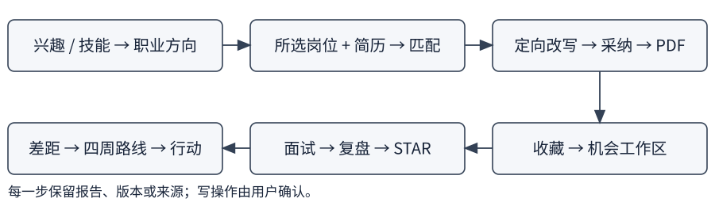<figcaption>图 1　已实现的流程；来源关联使用显式岗位标识（#80、#82、#83）。</figcaption></figure>

### 与单点工具的比较

这是按计划书中的工具类型做功能范围比较，没有对外部品牌进行效果或价格实测。模板工具主要提供排版，题库主要提供练习题，招聘平台主要提供岗位入口。OfferPilot 的实现重点是让这些步骤共用简历版本、岗位来源与复盘证据，并将写操作放在用户确认之后。

<figure class="shot" data-crop="1180,95,600,305" data-width="125">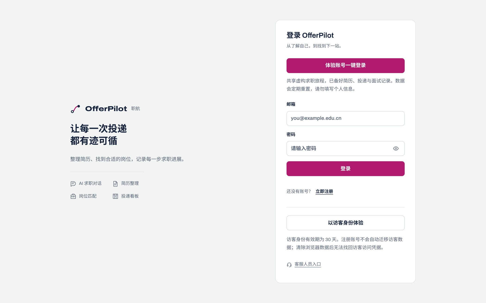<figcaption>截图 01　旧共享录屏登录页的体验入口局部。演示材料为虚构数据。</figcaption></figure>

默认体验入口是独立沙箱（#90）：私有数据和模型额度按用户隔离，到期后清理。上图仍是更早的共享录屏入口，只证明采集当日的本地画面。#205 只改视觉，未重拍。公网演示未上线。

**依据：** [证据表 §2、§9](评分证据对照.md)、#80 / #82 / #83 / [#90](https://github.com/MAOsaikou/offerpilot/pull/90)；[截图说明](assets/现场证据.md)。

<!-- page: 4 -->
# 2 需求与功能
## 2.1 实现范围与功能地图

功能地图只画学生主路径里已经能演示的入口。端侧表现改为无摄像头跳过即完成，见 §4.7。通用面经和行业报告入库仍未做。STAFF 文档上传、岗位截图导入不在此图。

<figure>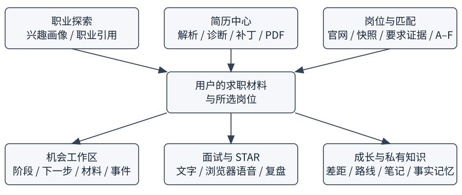<figcaption>图 2　页面与领域功能围绕同一用户的材料、岗位和练习展开。</figcaption></figure>

| 入口 | 已实现行为 | 验收边界 |
| --- | --- | --- |
| 职业探索 / 对话 | 兴趣推荐、引用、设目标审批 | 推荐不是能力证明；向量质量未用真实 embedding 复测 |
| 简历中心 | 上传解析、诊断、定向改写、版本、当前版本 PDF | 解析需用户核对；建议不会自动覆盖原件 |
| 岗位 / 看板 | 官网与快照、证据匹配、A–F、收藏、行动和材料 | 看板阶段更新不会发送真实投递 |
| 面试 / 成长 | 固定题库文字练习、语音入口、复盘、STAR、证据路线 | 评分为文字规则线索；语音依赖浏览器能力 |
| 知识库 / 设置 | 私有笔记、事实记忆、PII 设置、账号删除 | 笔记向量效果未评测；PII 覆盖有限 |

**依据：** [需求清单 §3](../02-需求分析与功能清单.md)、[证据表 §1–§5、§9](评分证据对照.md)。

<!-- page: 5 -->
## 2.2 如何运行、体验入口与主流程

本地完整栈以仓库 README §6 为准。复制 `.env.example` 为不提交的 `.env`，填入模型 Key，并用 `openssl` 自行生成 `JWT_SECRET` 与 `DATA_ENCRYPTION_KEY`。然后执行 `docker compose --env-file .env -f deploy/docker-compose.yml --profile full up -d --build`，信任本地 Caddy CA 后打开 `https://localhost`。只启动数据库等依赖时，另以 JDK 17 运行 bootstrap，并在 `frontend/` 执行 `pnpm install` 与 `pnpm dev`。README 写明十分钟启动是目标，下载时间不作保证。聊天和生成仍要模型 Key。公网固定域名尚未发布。

默认 `DEMO_SANDBOX_ENABLED=true`。登录页「体验账号一键登录」每次新建独立沙箱，私有数据与额度按 owner 隔离，到期后拒绝认证并清理（#90）。仓库不保存体验密码。只有关闭沙箱，且 `DEMO_ACCOUNT_EMAIL` 与密码长度合格时，才进入共享虚构旅程；密码为空则返回 403/20007。请勿填入真实简历或证件。

主流程：体验登录 → 职业探索并批准设目标 → 选择岗位与 READY 简历查看匹配和 A–F → 按该岗位改写、逐条采纳、导出当前版本 PDF → 收藏后在机会抽屉查看材料、时间线与下一步 → 练习、下载复盘并确认 STAR 入库 → 教练按缺口排四周路线。最近完成的面试不自动等于当前岗位。界面可切换 zh-CN / en-US（#161）；职业库正文仍为中文。

## 2.3 两个可检查的场景

方向未定时，推荐卡给出职业名称、兴趣理由和职业库摘录。设目标必须先审批，拒绝不改档案。没有匹配报告时，教练说明缺报告，不编造岗位短板。已有目标时，从收藏岗位打开报告，按该岗位改写并导出当前版本 PDF，再从同一入口练习、入库，并打开带来源的路线。

| 阶段 | 可以检查 | 不能推断 |
| --- | --- | --- |
| 审批 | 拒绝不改；批准后看保存结果 | 点击批准即等于写成功 |
| 改写 | 补丁引用、数字来源、基准版本 | 自动校验通过即内容真实 |
| 工作区 | 同 owner + 显式 job_id | 按岗位名或相似 JD 归属旧材料 |
| 复盘与路线 | 原回答、规则弱项、周次来源 | 最近面试必然属于当前岗位 |

这是验收场景，不是真人试用。2026-10-11 走查与 #91 的有限复测见第 8 章。

**依据：** README §6、#34、#43、#78、#80、#82、#83、#90、#161；[接口契约](../05-接口文档.md)、[现场证据](assets/现场证据.md)。

<!-- page: 6 -->
# 3 系统架构
## 3.1 模块化单体与依赖方向

后端用 Maven 模块划分 identity、resume、job、career、interview、agent 和 platform，只有 bootstrap 是 Spring Boot 启动入口。它们部署为同一个业务后端进程。独立 jobs-mcp 承载企业公开接口抓取和工具协议。

<figure>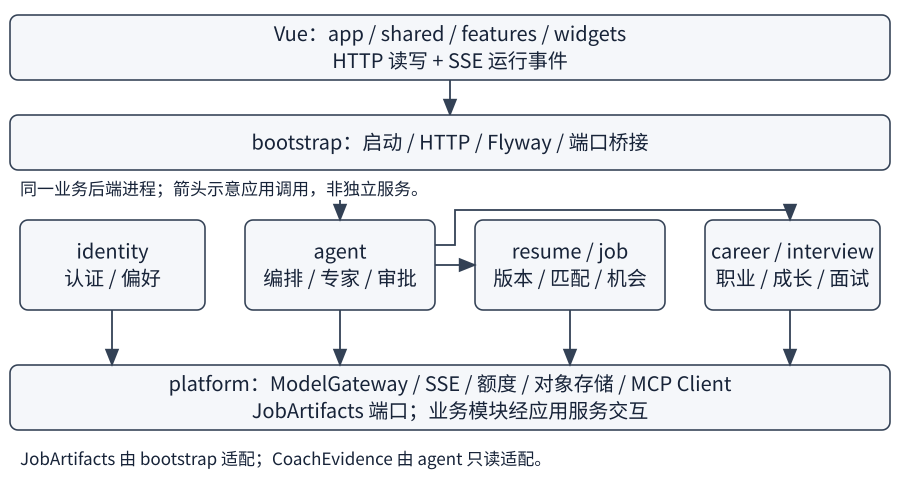<figcaption>图 3　模块边界与应用调用。一个业务后端进程，另有 jobs-mcp 进程。</figcaption></figure>

模块化单体适合当前跨领域的 Agent、审批和事务：不用先引入远程服务调用来完成一次写操作，同时仍能通过应用接口限制访问范围。代价是业务后端无法按领域独立扩缩容；审批等待还是单实例能力。

前端按 app / shared / features / widgets 分层。页面消费 shared API 与类型；AgentPanel 展示运行事件，CardRenderer 根据 cardType 加载业务卡片。前端不直接连接数据库或外部模型。

**依据：** [系统架构](../03-系统架构设计.md)、[ADR 0001](../adr/0001-modular-monolith.md)、`backend/pom.xml`、`frontend/src/app/router/index.ts`；[证据表 §1、§3](评分证据对照.md)。

<!-- page: 7 -->
## 3.2 部署拓扑与本机实际环境

Compose 的 full 配置包含 Caddy、前端静态产物、业务后端、PostgreSQL + pgvector、Redis、对象服务和 jobs-mcp。Caddy 负责静态页面及 API / SSE / 可选 MCP 代理；数据服务默认只发布到宿主回环地址。

<figure>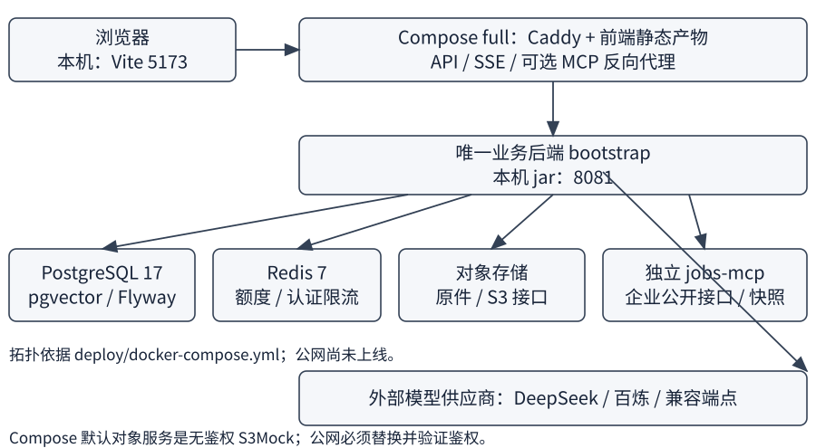<figcaption>图 4　Compose 部署设计与本次本机端口；公网服务未上线。</figcaption></figure>

本次截图使用 Vite `127.0.0.1:5173` 代理后端 `8081`；今天记录中的数据库、Redis 和对象服务由本机 Docker 提供。它不是 Caddy 公网部署验收，也不是生产静态构建的性能测量。

**对象存储限制：** Compose 的 minio 服务名称下，默认镜像实际是 S3Mock，不能验证对象访问密钥。只监听回环地址仍不能把它视为生产鉴权存储。公网启用前必须使用仓库中的认证存储覆盖方案，并测试正确密钥、错误密钥和匿名访问。

**依据：** [deploy/docker-compose.yml](../../deploy/docker-compose.yml)、[部署与运维 §2.1、公网清单](../09-部署与运维.md)、[现场证据](assets/现场证据.md)。

<!-- page: 8 -->
## 3.3 机会材料来源：端口与桥接

#80 的 V24 将下一步行动、日期和事件时间线放入机会记录。#82 的 V25 为改写任务及面试会话增加可选 job_id，STAR 故事沿来源会话关联岗位。只有创建时明确选择的岗位才成为材料来源，旧材料不按岗位名或 JD 相似度补猜。

platform 定义小型 `JobArtifacts` 端口，bootstrap 的 `JobArtifactBridge` 组合岗位可见性、同 owner + job 的材料聚合与事件写入。resume、interview、job、agent 不因此直接读取彼此仓储。收藏与材料关联复用 users 锁；材料与关联事件同事务保存。

<figure class="shot" data-crop="25,350,725,575" data-width="130">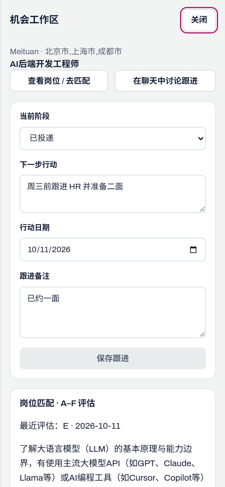<figcaption>截图 17　真实移动端机会抽屉的阶段、行动与日期；演示数据来自旧共享录屏账号。</figcaption></figure>

详情读取不调用模型或 MCP。抽屉每次重开刷新材料，并提供报告、改写、面试和 STAR 导航。某次改写的 PDF 链接仍导出简历当前保存版本，不能当作该历史改写版本的归档 PDF。

**依据：** #80、#82；[架构增量](../03-系统架构设计.md)、[数据设计 V24 / V25](../06-数据库设计.md)、`JobArtifacts.java`、`JobArtifactBridge.java`、`ApplicationTimeline.java`；[证据表 §9](评分证据对照.md)。

<!-- page: 9 -->
## 3.4 关键技术、数据生命周期与选型

下表回答作品介绍中的「关键技术」。版本取自当前工程文件，不是跑分结论。开源依赖与「不是 fork」的边界写在第 30 页。

| 选择 | 当前用途 | 为什么这样实现 / 代价 |
| --- | --- | --- |
| Java 17 / Spring Boot 3.3.5 / Spring AI 1.0.0 | 业务 HTTP、模型适配与编排 | 复用统一网关及事务；这些版本取自当前 pom，而非性能结论 |
| PostgreSQL 17 + pgvector | 私有业务数据、职业全文与可选向量 | 同库维护 owner、版本与索引；真实 embedding 质量另需评测 |
| Redis 7 | 用户模型额度与认证 IP 限流 | 原子计数；已配置 Redis 故障不能放行模型调用 |
| S3 接口对象存储 | 简历原件 | 文件与版本分开；默认本地 S3Mock 不具备生产鉴权 |
| jobs-mcp 独立进程 | 企业官网数据与离线快照策略 | 协议和发布独立；依赖公开接口可用性 |
| Vue 3 / TypeScript / Vite | 页面、流式状态和卡片 | 类型与组件复用；当前前端包中的 Vite 为 8.x，早期设计写 7 |

上传后原件进入对象存储，解析任务登记在数据库。worker 在事务外调用模型，成功后提交结构化版本；过期任务不允许迟到结果覆盖新任务。诊断、改写和匹配保存任务状态及结果，生成建议不会直接修改简历版本。

用户明确采纳补丁后才产生新版本；幂等决策返回已有版本，竞争写入检查当前基准版本。账号删除使用认证身份而不是请求中的 owner，删除私有记录并通过清理凭据重试文件与额度清理；迟到解析和用量不能重建已删数据。独立体验沙箱允许自助删除；共享录屏账号与 STAFF 仍拒绝此入口。

沙箱到期后即拒绝认证，不等待后台删除。默认每分钟扫描到期用户，复用账号删除清理私有记录；对象文件与 Redis 用量通过持久化凭据重试，共享岗位和职业库保留。V26 保存到期时间与每日准入计数，代码见 `DemoSandboxService`、`AccountDataDeletionService`。

**依据：** [数据库设计](../06-数据库设计.md)、[系统架构](../03-系统架构设计.md)、`backend/pom.xml`、`frontend/package.json`；#55、#82、#83、[#90](https://github.com/MAOsaikou/offerpilot/pull/90) 与 [证据表 §1、§9](评分证据对照.md)。

<!-- page: 10 -->
# 4 AI 技术方案
## 4.1 模型网关与额度（大模型集成）

业务模块调用 `ModelGateway`，不各自维护供应商密钥和重试逻辑。网关支持 DeepSeek、百炼和自定义 OpenAI 兼容端点；供应商、模型名及档位通过环境配置。用户看到“快速 / 深度”两档，当前默认分别映射 FLASH 与 PRO；旧第三档做兼容映射，视觉备选独立配置。

| 边界 | 已实现处理 | 证据 |
| --- | --- | --- |
| 用户身份 | 可信 owner 经 Reactor context 或同步 scope 传入网关 | `LlmUserContext`、`UserLlmQuotaIdentity` |
| 请求额度 | 每用户 RPM 和每日 token；天界按 UTC | `LlmQuotaLimiter`、`RedisLlmUsageStore` |
| 日额度 | 注册用户默认 200000；匿名访客 50000；体验沙箱独立上限默认 200000 token / UTC 日 | `application.yml`、`UserLlmQuotaIdentity` |
| 超时 | 当前 FLASH 配置 60s、PRO 180s；匹配生成与修复共享总预算 | `ModelGateway.timeout`、`JobMatchDeadlineTest` |
| 失败 | 限流 `LLM_RATE_LIMITED / 40011`；日额度 `40008`；超时 `40001` | `ErrorCode`、`LlmQuotaGatewayTest` |

真实供应商调用入口消耗 RPM，返回用量后累计 token。额度是调用控制，不保证正在进行的单次请求绝不会越过剩余额度。匿名访客不能使用 PRO，不静默降档；体验沙箱是独立 USER，不与匿名 guest 混用。非测试环境缺 Redis 或 Redis 故障应拒绝请求，避免重新开始本地计数绕过限制。

沙箱预算不能通过用户偏好扩大；默认存量上限 30、UTC 每日新建上限 100，均可配置。这是成本准入上限，不是并发性能结论。横幅展示剩余时间和已结算额度；跨 UTC 零点重置日预算，24 小时生命周期并不等于总 token 封顶。

**依据：** #14、#46、#52、[#90](https://github.com/MAOsaikou/offerpilot/pull/90)；[AI 方案](../04-AI技术方案.md)、`backend/offerpilot-platform/.../llm/ModelGateway.java`、`.../llm/quota/`、`backend/offerpilot-bootstrap/src/main/resources/application.yml`；[证据表 §1](评分证据对照.md)。

<!-- page: 11 -->
## 4.2 提示词与结构化输出（大模型集成）

提示词以 `.st` 文件保存在 bootstrap 资源目录，与代码一同版本管理。简历和 JD 作为不可信数据传入，不能成为系统指令；资源标识只从调用方上下文读取，不接受模型猜测出的 ID。业务输出先解析和校验，再用于报告或卡片。

定向改写输出 JSON Patch 建议：指向已有字符串叶节点，携带原值、新值、理由和 JD 依据。它不直接生成整份新简历。生产校验检查补丁结构、原值与路径，以及新值中的数字是否来自同一原字段；摘要不能借用其他项目的数字。

<figure>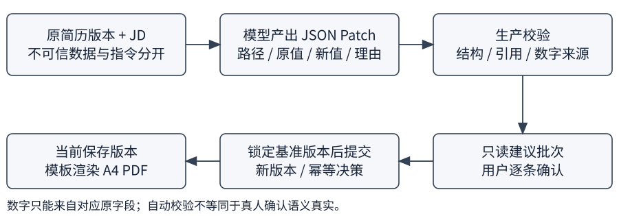<figcaption>图 5　模型只产建议；校验、用户决策、版本提交与 PDF 排版由程序处理。</figcaption></figure>

### 数字来源修正的已测结果

| 指标 | 基线 | 强化摘要来源提示词后 |
| --- | --- | --- |
| 首次结构化校验 | 7 / 10 | 10 / 10 |
| 新提示词模型调用 | — | 10 例各首次通过，无修复调用 |
| 评价方式 | 自动结构与来源校验 | 相同自动校验；真人评分未做 |

样本为 RS-05 的 10 组虚构简历 / JD，模型 `deepseek-flash`，temperature=0.3。报告中的三例基线失败均为摘要借入其他字段数字。这个对照只说明有限样本的首次校验结果，不证明“无编造率 100%”，也没有测采纳率或求职效果。

**依据：** #16、#17；[数字来源约束对比](../research/2026-10-09-summary-numeric-provenance.md)、[改写真实模型评测](../research/2026-10-09-简历定向改写真实模型评测.md)、`ResumeOptimizationValidator`、`ResumeOptimizationSummaryProvenanceRegressionTest`；[证据表 §7](评分证据对照.md)。

<!-- page: 12 -->
### 4.2 续：自动校验能挡住什么

原简历写“参与订单服务重构”，模型把它改成“主导重构”但不新增数字，数字检查本身无法证明角色是否真实。因此用户仍需读 diff，检查贡献、范围和结果。空建议也是合法结果：原文已清楚或没有与 JD 有关的事实时，不强行生成。

```java
// 生产校验器中的数字来源检查；不是语义真实性判定。
require(numbers(patch.path("from").asText())
    .containsAll(numbers(patch.path("value").asText())));
```

以上摘自 `ResumeOptimizationValidator.java`。检查通过后只保存建议批次；采纳时还需校验 owner、简历与基准版本。聊天采纳通过 #43 的审批工具进入同一补丁服务，不绕过版本锁。

**依据：** #17、#43；[接口中的补丁与改写契约](../05-接口文档.md)、[证据表 §1、§9](评分证据对照.md)。

## 4.3 Orchestrator 与 5 个专家（Agent）

Orchestrator 先校验计划，再按依赖顺序调用注册的专家。显式岗位匹配动作使用确定性路由；AUTO 规划可以结合用户所选简历与岗位，但不能自己换用其他材料。执行产生计划、步骤、工具和业务卡片事件，最后把有界结构化摘要交给模型写叙述。

<figure>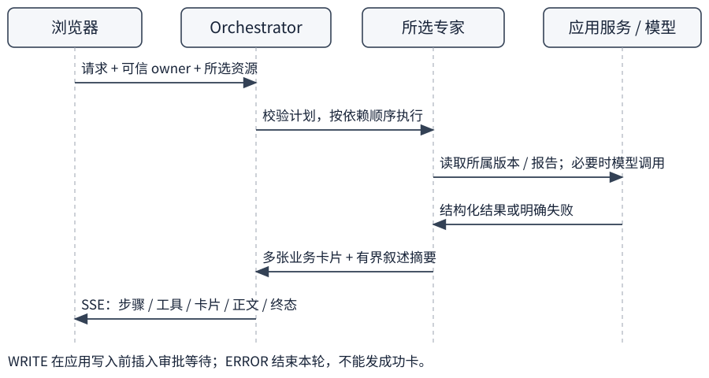<figcaption>图 6　读路径的执行顺序；写路径插入第 4.4 节的审批。</figcaption></figure>

**依据：** #26、#34、#36、#40、#49、#50；`Orchestrator`、`ExpertRegistry`、`OrchestratorTest`、`IntentBenchmarkTest`；[AI 方案](../04-AI技术方案.md)。

<!-- page: 13 -->
### 4.3 续：专家的输入与输出

| 专家 | 输入 / 工具边界 | 可见输出 |
| --- | --- | --- |
| 职业发现 | 当前兴趣、职业档案与职业库；设目标需审批 | 推荐卡、理由、原文引用 |
| 简历 | 所选简历 / 版本 / JD；诊断、改写、补丁服务 | 诊断卡、diff；确认后新版本 |
| 岗位与看板 | 明确岗位、简历版本和机会；搜索、匹配、看板应用服务 | 岗位卡、证据匹配、A–F、批准后的看板变化 |
| 面试官 | 所属会话、题目与回答；评分和 STAR 只读召回 | 练习状态、具名评分、STAR 引用 |
| 成长教练 | 目标职业、所选岗位最新完成匹配、最近完成面试 | skill_gap、roadmap 与来源导航 |

#83 的差距顺序是程序计算：MISSING → 面试弱维度 / STAR 少于 3 项 → PARTIAL → A–F 低于 60 → 职业核心技能；归一去重后最多 8 项。四周任务通过 gapIds 和证据来源关联，模型不能任意替换排序事实。最近完成面试不保证是同岗位，会保留其真实来源。

<figure class="shot"><figcaption>截图 08　同一差距卡的标题、证据等级与来源按钮局部；点击来源可查报告。</figcaption></figure>

缺少匹配或面试时说明缺项，不补造报告。#92 用本轮 `evidenceAvailability` 标记报告是否存在，叙述优先于旧目标 / 旧记忆；无弱项也不能说缺报告。完成任务同步仍需审批。

**依据：** #83、[#92](https://github.com/MAOsaikou/offerpilot/pull/92)；`CoachEvidenceAdapter`、`DefaultCoachPlanForChat`、`CoachPlanForChatTest`；[证据表 §9](评分证据对照.md)、[AI 契约](../04-AI技术方案.md)。

<!-- page: 14 -->
### 4.3 续：记忆、引用与运行状态

用户事实记忆支持查看、编辑、单删、清空和关闭，按 owner 隔离，最多 50 条。当前是有界全文召回，不是无限上下文或向量长期记忆。非空召回发 `memory.used`；显式保存和建议写入要经审批。

#68 / #75 让面试官与教练只读复用已入库 STAR。#78 根据所属面试的岗位、题目和回答检索，返回具名评分摘要；引用构建失败发 error 并结束本轮。#86–#88 修正评分自然说法、叙述与卡片不一致，以及 STAR 引用卡渲染。运行面板显示工具与状态，不等于展示模型内部思维链。

<figure class="shot compact" data-crop="0,0,595,435" data-width="85"><figcaption>截图 11　本轮新请求的真实执行面板；审批等待时仍有明确状态。</figcaption></figure>

**依据：** #64、#68、#75、#78、#86、#88；[记忆限制](../research/2026-10-10-长期记忆.md)、[面试闭环可靠性](../research/2026-10-11-面试闭环可靠性.md)、`MemoryChatTest`、`StarStoryContextTest`。

## 4.4 HITL 审批（安全）

写工具先提出票据，绑定 owner、运行与参数快照。用户看到操作内容后决定批准或拒绝。批准只是决策，应用服务再次校验并成功提交才算写入；拒绝、超时、取消都不能写业务记录。

<figure>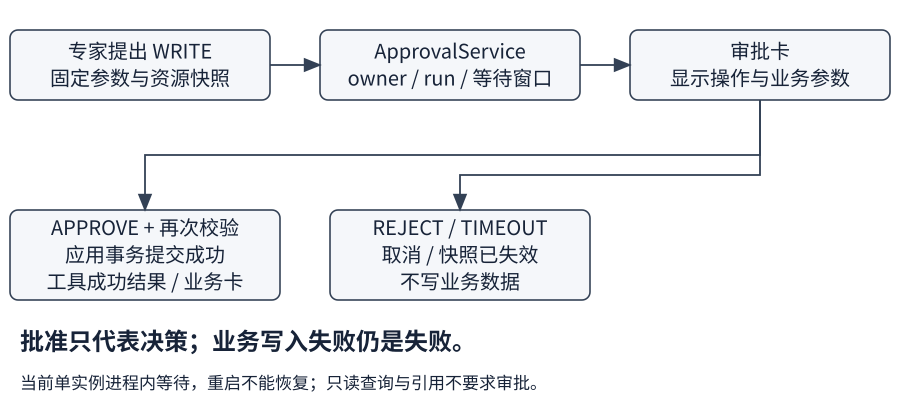<figcaption>图 7　WRITE 的决策与执行结果分开。READ 无审批。</figcaption></figure>

<!-- page: 15 -->
### 4.4 续：覆盖范围与当前限制

审批覆盖聊天看板写入、设职业目标、面试写入、成长任务同步、聊天采纳简历补丁、STAR 入库和事实记忆写入。普通页面上的显式保存 / 确认按钮使用相应 HTTP 契约；并非每个 HTTP 写请求都会再出现 Agent 审批卡。

<figure class="shot compact"><figcaption>截图 03　新创建的目标审批；采集后拒绝，未修改职业目标。</figcaption></figure>

审批窗口为 10 分钟，当前在单实例进程内等待。重启后待审批不能恢复，也没有跨实例广播或事件续传。过期、重复决策及越权请求拒绝；等待期间资源变化时按旧快照拒绝写入。

**依据：** #26、#34、#36、#40、#43、#64、#68；`ApprovalService`、`BoardApprovalTest`、`CareerApprovalTest`、`InterviewApprovalTest`、`CoachApprovalTest`、`ResumePatchApprovalTest`；[接口 §4.2](../05-接口文档.md)。

## 4.5 职业库 RAG（RAG）

职业库包含 402 条职业：24 条中文维护职业与 378 条 O*NET 条目。索引任务为 canonical document 幂等生成 embedding 与 tsv，检索融合向量余弦和全文名次，再与 Holland 规则候选融合。推荐卡引用直接来自职业原文，不让模型重写引用。

无 Key、无向量或供应商失败时退回规则推荐。全文仍可单独召回；兴趣匹配零分过滤保留，不能用文本命中声称用户具备职业能力。本轮本地未配置真实职业 embedding，截图只证明规则 / 全文路径和引用可读。

**依据：** #39；`OccupationHybridRetriever`、`OccupationEmbeddingJob`、`OccupationRrf`、`OccupationIndexTest`；[职业 RAG 对照](../research/2026-10-09-occupation-rag-vs-rules.md)。

<!-- page: 16 -->
### 4.5 续：检索管道与已测对照

<figure>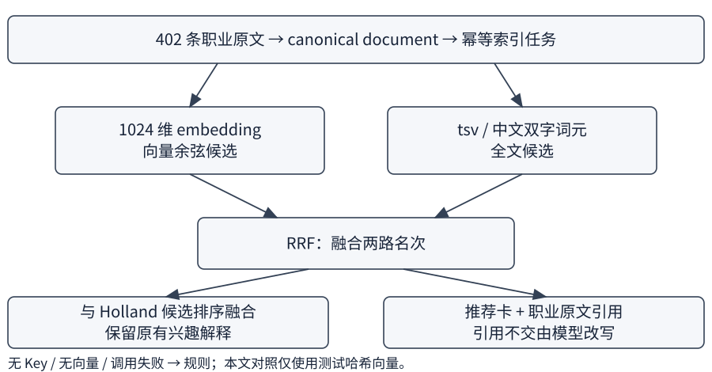<figcaption>图 8　两路名次融合与引用输出；降级路径不依赖模型写理由。</figcaption></figure>

对照在 PostgreSQL 17 + pgvector IT 中运行，候选 K=20，RRF 常数 60，top-N=3。向量是 1024 维字符二元组特征哈希测试向量，只表达字面相似；不是百炼真实语义 embedding。

| 指标 / 案例 | Holland 规则 | 测试 hybrid |
| --- | --- | --- |
| 9 个预设关键词意图，目标 Hit@3 | 0 / 9 | 8 / 9 |
| 目标 Top1 | 对照未单列汇总 | 3 / 9 |
| 前端 TypeScript Vue，IRC | 目标未进 top3 | 目标仍未进 top3 |
| 纯兴趣、无查询 | 原规则结果 | 与规则完全一致，不计入命中统计 |

前端失败不能隐藏：前端职业与 IRC 规则候选重叠不足，两级 RRF 偏向两路都支持的候选，单路强命中仍可能提升不够。这说明融合有取舍，不能把“8 / 9”扩写成泛化准确率。

私有笔记与公开职业库分开：owner 隔离、中文全文、可选向量融合、有界原文引用；向量失败不阻塞保存。真实 embedding 效果未评测。378 条直接 O*NET 职业已按 31.0 Job Zone 写入中文准备摘要（#204）：同分区共用学历、经验与培训要求，不是晋升承诺或中国准入标准；薪资仍为空；24 条中文路径保留。数据 CC BY 4.0，归属 National Center for O*NET Development，中文为改编。

**依据：** #39、#51；[完整查询与失败表](../research/2026-10-09-occupation-rag-vs-rules.md)、`OccupationRagIntegrationTest`、`KnowledgeNotesIntegrationTest`、`KnowledgeNoteContextTest`；[证据表 §1、§7](评分证据对照.md)。

<!-- page: 17 -->
## 4.6 MCP 双向（MCP）

**Client：** 后端 `JobsMcpClient` 调用独立 jobs-mcp，进行 initialize、initialized 通知和 tools/call。jobs-mcp 仓库目录覆盖 36 家企业官网公开招聘接口；覆盖不等于这些接口每次都可用。AUTO 在失败或超时时可退回 40 条人工整理示例快照；正常空结果不伪造岗位，LIVE 保留错误。

**Server：** bootstrap 对外提供 `resume.diagnose`、`jobs.search`、`jobs.match` 三个工具，以 API Key 保护 SSE 传输，默认关闭。本次 8081 已开启，可用标准库烟测脚本验证工具列表与搜索调用。

<figure class="shot terminal" data-crop="70,235,980,475" data-width="160">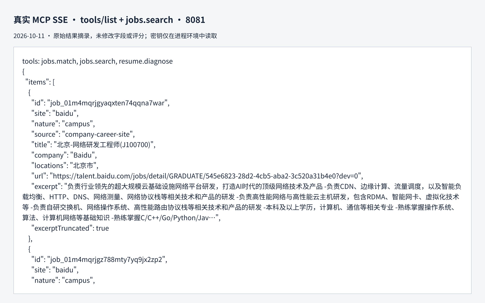<figcaption>截图 10　backend/scripts/mcp-smoke.py 的真实工具列表与结果开头；完整输出见证据链接。</figcaption></figure>

只读是指不修改私人简历、投递、面试和任务。`jobs.search` 仍可能刷新公共岗位缓存；诊断 / 匹配会调用模型。MCP 不暴露应用写工具，外部客户端不能跳过界面中的用户确认去改私有业务数据。

#87 限制搜索结果体积、保留复合 JD 枚举项并修正 Unicode 截断。现有调用结果仍应核查原文；工具成功不等于模型结果语义完全正确。

**依据：** #42、#87；[MCP 接口与客户端说明](../05-接口文档.md)、[jobs-mcp README](../../mcp-servers/jobs-mcp/README.md)、`OfferPilotMcpToolsTest`、`McpServerHttpIntegrationTest`、`McpApiKeyFilterTest`；[现场证据](assets/现场证据.md)。

<!-- page: 18 -->
## 4.7 多模态（多模态）

简历解析支持文本、PDF / DOCX 及图片；扫描页和嵌入图片通过配置的视觉模型处理。提取结构需用户核对，本文无扫描准确率数据。面试采用浏览器 ASR 听写 / TTS 读题；#93 分别检测两种能力，缺少一项时保留另一项，权限失败可用文字。

<figure class="shot compact" data-crop="30,145,890,215" data-width="155">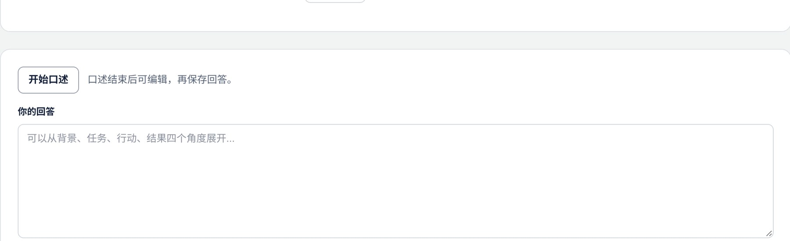<figcaption>截图 09　真实面试页的口述按钮与文字输入区局部；语音字幕 + STAR 同屏【待补截图】。</figcaption></figure>

上图采集时麦克风不可用，不能证明识别成功。#93 分项降级，桩测试不代表真人语音质量。MediaPipe 由 [#196](https://github.com/MAOsaikou/offerpilot/pull/196) 与 [#200](https://github.com/MAOsaikou/offerpilot/pull/200) 接入；IV-06 以无摄像头自动跳过为完成，真摄像头不验收。面试报告另有多维分数雷达和可读数值表（#199）。岗位截图在送视觉模型前把超高图裁到顶部 2400px（#198）；docs/02 标为完成，并写明不是手机实拍。

**依据：** #41、[#93](https://github.com/MAOsaikou/offerpilot/pull/93)；`ResumeExtractor`、`useSpeech.ts` / `useSpeech.spec.ts`、`InterviewRoomView.vue`、`interviewViews.spec.ts`；[证据表 §1](评分证据对照.md)。

## 4.8 安全护栏汇总（安全）

| 边界 | 实现 | 限制 |
| --- | --- | --- |
| 认证与请求 | CurrentUser、认证 IP 限流、请求校验、owner 过滤 | 结构测试不能证明所有分支执行顺序，仍需 HTTP 回归 |
| 工具与提示词 | 有界数据摘要、数据标签转义、只读 / 写入分开 | 不以工具调用成功代替语义校验 |
| 隐私 | 网关三类文本 PII 可逆脱敏，默认开启，关闭需提示 | 不覆盖图片、姓名、地址；不是全信息匿名化 |
| 凭据与演示 | 密钥走环境变量；#90 私有数据、审批与预算按沙箱 owner 隔离 | 旧截图是共享录屏环境；公网多人验收未做 |

**依据：** #13、#15、#18、#54；`RequestValidationTest`、`ControllerIdentityArchitectureTest`、`PiiMaskerTest`、`PiiGatewayTransportTest`、`RedteamRegressionTest`；[红队记录](../research/2026-10-10-红队回归.md)。

<!-- page: 19 -->
# 5 核心功能实现
## 5.1 职业探索

用户在职业档案填写兴趣、技能、城市和目标，或在 CAREER_DISCOVERY 对话中描述偏好。应用服务读取当前档案与本轮文字，基于六维 RIASEC 画像、显式技术方向和检索候选生成推荐卡。卡片分别展示兴趣相似解释与职业原文引用。

<figure class="shot" data-crop="50,0,1470,530" data-width="170"><figcaption>截图 02　真实保存推荐卡的第一项。卡片中的相似度是该样本的规则值，不是推荐准确率。</figcaption></figure>

选择“设为目标”发送正式职业标识和名称，服务端核对职业存在、参数一致，再进入审批。当前档案状态优先于历史记忆；叙述不能把“本轮未修改目标”写成“用户从未设置目标”。#88 增加当前档案摘要并隐藏职业内部 ID。

| 流程 | 接口 / 边界 |
| --- | --- |
| 读取 / 保存职业档案 | `/api/v1/career/profile`；owner 隔离 |
| 推荐与设目标请求 | `POST /api/v1/agent/chat`；mode=CAREER_DISCOVERY |
| 确认目标 | `POST /api/v1/agent/runs/{runId}/approvals/{approvalId}` |

**依据：** #33、#34、#47、#88；[接口中的职业探索增量](../05-接口文档.md)、`CareerRecommendForChatTest`、`CareerApprovalTest`、`OccupationRecommendationTest`；[证据表 §1](评分证据对照.md)。

<!-- page: 20 -->
## 5.2 搜岗、要求证据与 A–F

用户选择岗位和 READY 简历版本后生成匹配报告。#91 先从 JD 抽取并核验要求，再按固定要求标识与顺序评估所选简历。只缓存 JD 要求，不缓存用户简历引用、状态或分数；同一快照复用首个校验列表，避免每轮重新拆分要求。

<figure class="shot" data-crop="75,675,1100,175" data-width="150"><figcaption>截图 04　真实报告中学历要求的双侧引文局部；原报告来自修复前基线。</figcaption></figure>

核实项分为明确、部分与未体现，覆盖分按 1 / 0.5 / 0 计算。无法核验的单项进入 UNVERIFIED，显示数量与固定说明，不保存失败引文、不计分；全无核实项才返回可重试的 40003。修复最多一次，与抽取和评估共用总超时预算。

A–F 是已有报告上的确定性维度：A 要求覆盖、B 证据、C 信息、D 薪酬信号、E 风险、F 优先级，不另让模型评总分。部分核实报告的分数只描述核实项，不代表全部要求或录用概率；下载、页面与聊天读取同一报告。

<figure class="shot"><div class="paired"></div><figcaption>截图 13　同一评估卡 A 维度的说明与分数局部；六维定义见正文，不代表就业预测。</figcaption></figure>

接口：`POST /api/v1/jobs/{id}/matches`；`GET /api/v1/jobs/matches/{id}`；`GET /api/v1/jobs/matches/{id}/eval.md`。详情与下载均检查 owner。

**依据：** #25、#27、#69、#74、#87、[#91](https://github.com/MAOsaikou/offerpilot/pull/91)；[接口](../05-接口文档.md)、`JobMatcherTest`、`JobEvalReportTest`、`JobsHttpIntegrationTest`；[A–F 研究记录](../research/2026-10-10-job-eval-report.md)、[匹配稳定性记录](../research/2026-10-11-匹配稳定性.md)。

<!-- page: 21 -->
## 5.3 按岗位改写、保存版本与 PDF

岗位入口传 jobId 和所选简历版本；服务端保存 JD 快照和来源。模型只提出 patch，用户在 diff 中逐条检查、选择或修改。采纳时基准版本必须仍是当前版本，避免覆盖后续编辑；旧批次仍可只读查看。

<figure class="shot"><figcaption>截图 05　同一条 FLASH 建议的采纳入口与原文 / 新文局部；项目数字为虚构演示材料。</figcaption></figure>

PDF 由程序模板渲染当前已保存结构化版本，不调用模型排版。未保存草稿、未采纳建议和历史预览都不进入当前 PDF。导出使用身份校验，失败可重试，不下载残缺替代件。

<figure class="shot pdf-shot" data-crop="90,407,1030,415" data-width="150">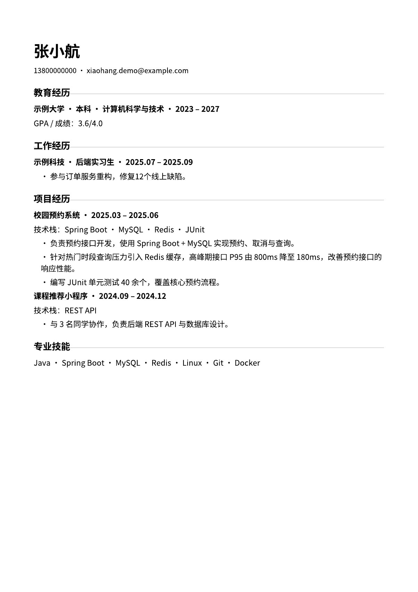<figcaption>截图 06　本轮真实下载的 A4 简历工作 / 项目经历局部，经 pdftoppm 渲染。</figcaption></figure>

接口：`POST /api/v1/resumes/{id}/versions/{versionId}/optimize`、`POST /api/v1/resumes/{id}/versions/{versionId}/apply-patches`、`GET /api/v1/resumes/{id}/export.pdf`。进度坞汇总生成任务，支持取消；改写离开分析页会停止，不等于无限后台执行。

**依据：** #17、#35、#43、#70、#82；[简历接口](../05-接口文档.md)、`ResumeHttpIntegrationTest`、`ResumePatchApprovalTest`、`ResumeOptimizationPanel.spec.ts`。

<!-- page: 22 -->
## 5.4 收藏、机会工作区与到期行动

收藏创建幂等的 Application。阶段、备注、下一步及日期独立保存；关键变动在原事务内记录时间线。聊天改阶段先审批，只有批准且保存成功后发 board_update；拒绝后的叙述明确“未执行、数据未改动”。

<figure class="shot"><div class="paired"><div></div><div></div></div><figcaption>截图 07　同一请求的审批说明、决策按钮与批准后的机会状态局部；空备注和日期字段省略。</figcaption></figure>

抽屉聚合同 owner + 显式岗位来源的匹配、改写、面试与 STAR，显示时间线及下一步。旧材料没有来源就不推断。首页读取今天到期或逾期、尚未 CLOSED 的行动，最多显示 5 条，点击深链打开同一抽屉。

<figure class="shot" data-crop="485,840,965,110" data-width="150">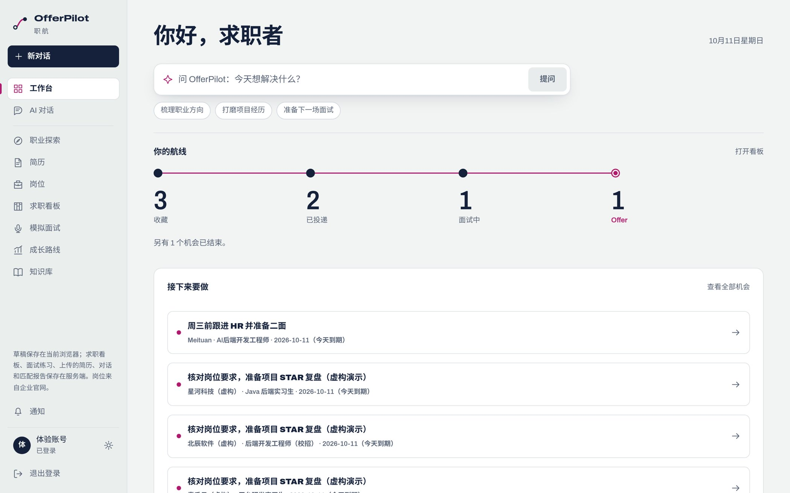<figcaption>截图 18　真实到期行动列表的标题、岗位与日期局部；不当作通知送达结果。</figcaption></figure>

接口：`POST /api/v1/applications`、`GET /api/v1/applications/{id}`、`PATCH /api/v1/applications/{id}`。看板阶段变化不会发送真实投递，也没有证明邮件或站外提醒送达。

**依据：** #80、#82、#85、#87；[机会接口](../05-接口文档.md)、`ApplicationService`、`ApplicationTimeline`、`BoardView.spec.ts`、`JobsHttpIntegrationTest`、`ChatHttpIntegrationTest`。

<!-- page: 23 -->
## 5.5 文字 / 语音面试、STAR 与复盘

固定题库会话保存题目、回答、进度和可选岗位来源。完成后按文字规则计算 STAR 线索与具名维度；这不是面试官人工评分。满足候选条件的回答需确认入库，之后面试官只读召回故事。候选加载、保存和复盘下载失败均提供重试，失败不下载本地拼出的残缺替代件。

<figure class="shot" data-crop="50,265,1180,235" data-width="170"><figcaption>截图 15　已入库故事的角色、STAR 线索、完整原回答与删除入口；项目事实为虚构。</figcaption></figure>

接口：`/api/v1/interviews` 与 `/{id}` 管理会话；`GET /api/v1/interviews/{id}/recap.md` 下载原回答与规则复盘。语音入口见第 18 页；没有真人语音准确率测量。

<figure class="shot" data-crop="85,245,735,260" data-width="125">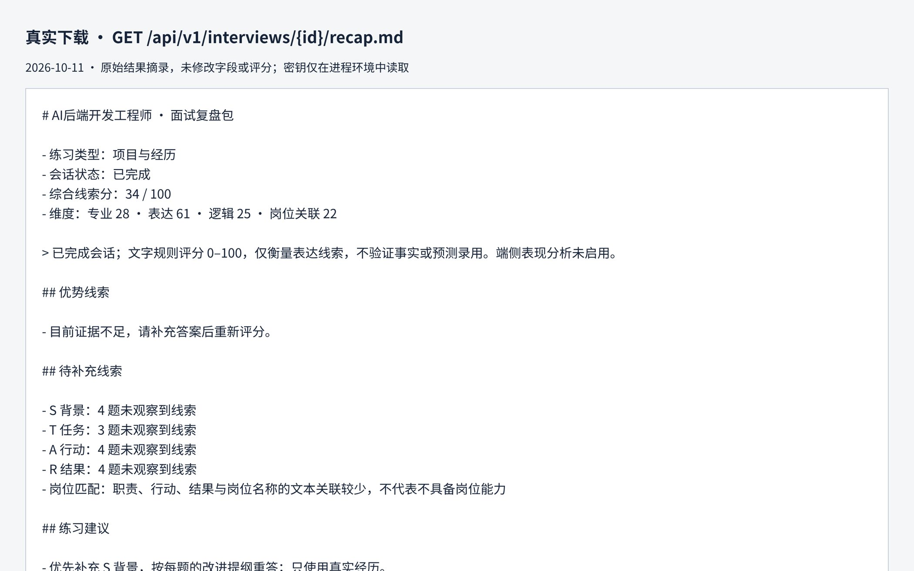<figcaption>截图 16　真实 recap.md 的标题、完成状态与规则评分局部；未改变字段或结果。</figcaption></figure>

## 5.6 基于证据的四周路线

从岗位或机会进入 COACH，读取所选岗位最新完成匹配和当前 owner 最近完成面试；差距、来源与四周任务互相引用（第 13 页截图 08）。来源标签可打开报告或复盘。没有材料时说明缺项；最近面试可能来自其他岗位。只有用户确认同步，才将已完成目录任务合并到服务端成长记录。

**依据：** #36、#40、#41、#67、#68、#75、#78、#82、#83；[接口](../05-接口文档.md)、[闭环可靠性](../research/2026-10-11-面试闭环可靠性.md)、`InterviewValidationTest`、`StarStoryHttpIntegrationTest`、`CoachChatAction.spec.ts`。

<!-- page: 24 -->
# 6 前端工程
## 6.1 分层、SSE 与长任务状态

<figure>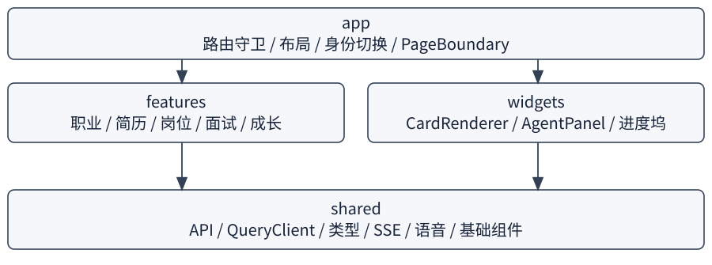<figcaption>图 9　app 组合页面，features 承载业务，widgets 组合跨页面交互，shared 提供公共能力。</figcaption></figure>

大纲曾记 12 类卡片。当前 `cardRegistry` 为 **17 类**，包括 `star_story_citations`、`skill_radar`、`campus_calendar`、`interview_turn_score`、`interview_report`、`job_evidence_match` 与 `knowledge_note_citations`。未知类型降级为文本。各卡片异步加载；失败只在卡片内重试，不卸载聊天。#88 去掉任意异步卡片超时，避免慢模块误取消整轮。

SSE 解析将运行、计划、步骤、工具、审批、卡片、正文和终态映射到 store。页面恢复读取已保存消息 parts；运行事件与最终消息不是同一持久化保证，不能声称所有计划事件都可完整回放。异常必须进入失败终态，不能一直显示生成中。

<figure class="shot" data-crop="445,1090,960,130" data-width="150">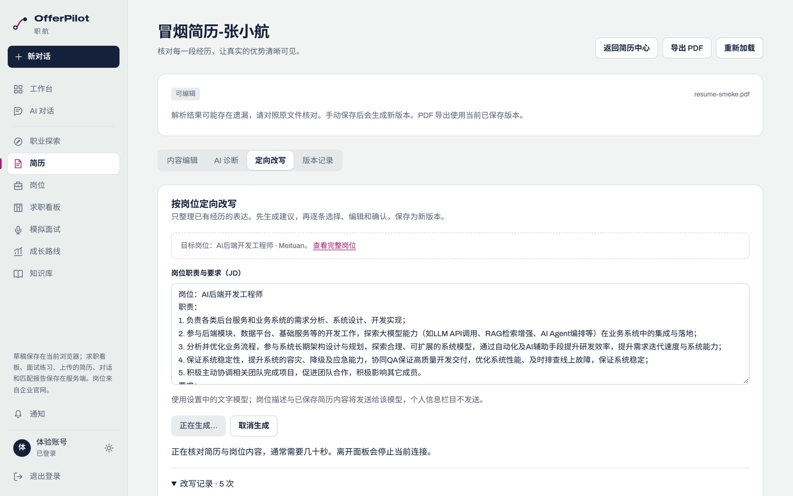<figcaption>截图 14　真实生成 / 取消按钮及离页停止提示局部，来自旧共享录屏环境。</figcaption></figure>

机会抽屉支持 deep link、焦点管理、关闭返回和重开刷新。身份切换取消旧查询并清缓存，迟到结果不得覆盖新身份；这些状态比单纯显示加载动画更关键。

**依据：** #22、#70、#80、#82、#88；[前端规范](../07-前端设计规范.md)、`widgets/CardRenderer/registry.ts`、`shared/composables/useAgentStream.ts`、`ChatPage.spec.ts`、`BoardView.spec.ts`、[今天 UI 走查](assets/现场证据.md)。

<!-- page: 25 -->
## 6.2 性能：方法、结果与未达项

#81 针对首次路由重复滚动、字体晚请求和加载布局偏移做修改。首次文档无恢复位置时跳过重复 scrollTo；Archivo 字体做保留字形的子集并 preload；首页和简历列表预留加载骨架。没有把业务状态简化成空白页来获取分数。

测量使用普通生产 gzip 静态构建与虚构 Node HTTP 后端，每响应固定等待 100ms。六页在 mobile / desktop 预设下各测 3 次，各指标独立取中位数。最终集成记录对应并入 main `374e420` 的构建，不代表当前 main 或真实后端 / 公网已经重测。

| 页面 | Mobile Perf | Desktop Perf | Mobile LCP / s | Mobile CLS |
| --- | --- | --- | --- | --- |
| 首页 | 96 | 100 | 2.28 | 0.0000 |
| 聊天 | 91 | 100 | 2.75 | 0.0000 |
| 简历列表 | 94 | 100 | 2.17 | 0.0000 |
| 搜岗 | 95 | 100 | 2.28 | 0.0392 |
| 看板 | 97 | 100 | 2.33 | 0.0000 |
| 面试室 | 93 | 100 | 2.24 | 0.0000 |

上述最终集成表的 A11y 和 Best Practices 均为 100。Perf 移动 91–97、桌面 100 只描述这组 fixture 负载；移动 LCP 2.17–2.75s 仍未达到 2s 预算。未测真实手机、真实模型 SSE、INP、长对话、打开抽屉或有到期行动的首页。

优化前后 mobile 首页 CLS 为 0.0675 → 0，简历为 0.2175 → 0，属于原 before / after 表。它们与上表最终集成复测分别记录，不能据此保证任意条数和长标题下 CLS 都为零。

2026-10-12 的真后端走查只核对当时的导航和错误状态，不是这组成绩的延伸。[#205](https://github.com/MAOsaikou/offerpilot/pull/205) 只改演示路径视觉：分段入场、计数滚动、评分环和按钮反馈；减少动态时直接显示终值。路由、接口和卡片数据未变。本稿截图采集于 2026-10-11，不能代表这次视觉。真实网络与公网性能未测。

**依据：** #81；[完整方法与最终表](../research/2026-10-11-登录后页面移动端性能.md)、[原始三轮值](../research/perf-app-pages/integrated-runs.json)、[性能工具](../../tools/perf/README.md)、[证据表 §3、§9](评分证据对照.md)。

<!-- page: 26 -->
# 7 项目亮点
## 7.1 应用亮点：让后续行动有材料可查

本章即作品介绍中的项目亮点。每条都能回到第 4–5 章的实现和限制，不写成行业首创，也不写成已经提高求职成功率。

### ① 同一机会保留跨阶段材料

收藏记录可以打开匹配、改写、面试、STAR 和事件时间线，用户不必靠记忆判断某份材料用于哪个岗位。关联限定同 owner 和显式 job_id，旧材料宁可不关联也不猜。实现与截图见第 8、22 页；#80、#82。

### ② 从报告缺口进入练习与路线

成长教练读取最新完成匹配和最近完成面试，将未体现、部分体现及弱项排入四周路线，并保留来源导航。它解决的是“建议从何而来”，尚未证明路线提高了求职成功率。实现见第 13、23 页；#83。

### ③ 将面试回答积累为可复用故事

用户从已完成练习确认 STAR 候选入库，面试官与教练可再次引用原回答。引用不自动等于本题答案或评分依据，用户可以检查故事库。实现见第 14、23 页；#68、#75、#78。

## 7.2 技术亮点：把事实计算与模型表达分开

### ① 字段级改写与数字来源边界

模型产出可逐条核对的 JSON Patch，生产检查路径、原值与数字来源，用户确认后才保存新版本。PDF 排版交给模板。10 组样本的首次校验由 7 / 10 到 10 / 10，但未做真人语义评分。实现与限制见第 11–12、21 页；#17、#43。

这些是本项目的设计贡献，不宣称为行业首创。效果范围以对应代码、测试与有限样本为准。

**依据：** [证据表 §2、§9](评分证据对照.md)、#17、#43、#68、#75、#78、#80、#82、#83；各页已列接口与测试。

<!-- page: 27 -->
### 7.2 续：技术创新

### ② 保留规则解释的职业混合检索

兴趣六维相似度与显式技术方向保留可读理由，职业全文和可选向量按 RRF 融合，引用来自职业原文。模型不负责改写引用。测试哈希向量有已测增益也有前端失败案例，真实 embedding 仍待复测。实现见第 15–16、19 页；#39、#47。

### ③ 应用端口连接跨域证据

JobArtifacts 由 bootstrap 组装材料聚合，CoachEvidence 经 agent 调应用服务。领域模块无需直接读其他领域仓储，来源由调用方明确选择。收益是边界可检查，而非已有分布式性能优势。实现见第 6、8–9、13 页；#82、#83。

## 7.3 交互亮点：让用户看见依据并控制写入

### ① 卡片、计划和审批同屏

用户在聊天内看到业务卡片及执行过程，写操作有明确的确认项。审批批准后仍以业务结果判断成功；加载卡片慢也不应取消聊天。实现见第 14–15、24 页；#26、#88。

### ② 热力依据与 A–F 分开表达

MET / PARTIAL / MISSING 展示要求和双侧引用，A–F 展示确定性维度，再提供原文及 md 下载。分数被限定为材料覆盖，不写成能力或录用概率。实现见第 20 页；#69、#74。

### ③ 逐条 diff 与可观察长任务

改写先核对再采纳，进度坞显示运行任务与取消入口；用户可在工作区继续找到有明确来源的材料。不同生成类型的离页行为明确提示，不能让“后台进行中”暗示所有任务都可跨页持续。实现见第 21、24 页；#35、#70、#82。

**依据：** [证据表 §2](评分证据对照.md)、#26、#35、#39、#47、#69、#70、#74、#82、#83、#88。

<!-- page: 28 -->
# 8 AI 测试与评估
## 8.1 测试分层与门禁

本节是 AI 测试实现概况。效果数字只重复证据表已允许、且写明方法的结果；其余 live 留在 docs/10。

| 层次 | 核查对象 | 仓库证据 |
| --- | --- | --- |
| 后端单测 | 匹配、数字来源、规则排序、额度、审批、终态 | `JobMatcherTest`、数字来源回归、各 `*ApprovalTest` |
| HTTP / Testcontainers | 身份、owner、事务、迁移、持久化、MCP SSE | `JobsHttpIntegrationTest`、`DemoJourneyIntegrationTest`、`McpServerHttpIntegrationTest` |
| 前端 Vitest | SSE 状态、异步卡、diff、深链、错误重试 | `ChatPage.spec.ts`、`BoardView.spec.ts`、`interviewViews.spec.ts` |
| Node | jobs-mcp 缓存、来源与回退 | `mcp-servers/jobs-mcp/src/*.test.js` |
| 可选 live | 真实模型有限样本 | research 记录；需显式环境开关，默认 CI 跳过 |

2026-10-22 起，日常命令和普通 CI 默认只跑必要回归：后端覆盖身份、隐私、网关、审批、匹配、改写、面试、SSE 和删号，不启 Docker；前端覆盖身份、SSE、审批、导航、隐私和 Markdown。全量离线用 `-Pfull-test` 与 `pnpm run test:full`；真实模型另加 `-Plive` 与原有开关。默认通过不能代替容器集成或 live。数量以 docs/10 当日记录为准，不跨轮相减。2026-10-12 的 [#90 CI](https://github.com/MAOsaikou/offerpilot/actions/runs/38135579503) 不是本基线的复跑。

### #79 历史口径（不是当前总量）

| 口径 | 精简前 → 后 | 含义 |
| --- | --- | --- |
| 后端默认方法 | 434 → 401 | 源码静态统计 |
| 后端参数展开项 | 506 → 464 | 参数行展开，不含 TestFactory 动态子项 |
| 前端文件 / 项 | 42 / 226 → 38 / 194 | 该轮 Vitest 基线 |
| jobs-mcp 项 | 14 → 11 | 该轮 Node 测试 |

当时保留安全、HITL、核心业务、PDF、MCP 与 live 门禁。本机烟测不等于重跑全部容器集成。

**依据：** [测试方案](../10-测试与评估方案.md)、[第三轮记录](../research/2026-10-11-测试精简第三轮.md)、`.github/workflows/ci.yml`。

<!-- page: 29 -->
## 8.2 效果证据与修复后的边界

| 已有测量 | 结果 | 不能外推 |
| --- | --- | --- |
| 10 组虚构改写，FLASH 自动校验 | 首次 7 / 10 → 10 / 10 | 不是真人“无编造率”或采纳率 |
| 9 个职业关键词意图 | 规则 Hit@3 0 / 9，测试 hybrid 8 / 9 | 哈希向量，不是真实语义效果 |
| 红队离线 / 有限 live | 系统边界 40 / 40；FLASH 机械检查 5 / 7 | 不是语义拒绝率；live 仅 7 条 / 13 次 |
| 六页性能 fixture | mobile 91–97 / desktop 100 | 不是当前真后端 / 公网性能 |

2026-10-11 的 `6ef3faa` 复测汇总为 34 / 35 PASS，但无逐项清单。原始 JSONL 的末次采纳为 409 / 30403（基准版本变化），末次聊天匹配通过；overnight 另记聊天匹配 1 / 4 次失败、FLASH 分数 33–57。这些历史口径分别保留。

#91 的独立 18081 真模型对照固定同一岗位 / 简历版本，前后各 6 轮交替 REST 与聊天：修复前成功 3 / 6、成功分数 32–45；修复后成功 6 / 6，均为 36 分、14 个核实项。后续重启复测命中同一要求快照。样本只有一组输入，前后要求粒度不同，不能外推为普遍稳定；详见 [原始方法与结果](../research/2026-10-11-匹配稳定性.md)。

正文截图来自 2026-10-11 的 8081 / 5173 共享环境，采集时看板请求曾超时。旧 UI 专项另用 18082 / 5174，保留各自口径，不算作新基线复测。

2026-10-12 从 `b1cce38` 重建 18081 隔离栈，以新沙箱和真实 FLASH 走通解析、匹配、改写 / 采纳 / PDF、机会、面试 / STAR / 复盘、教练与取消。初轮教练叙述与证据矛盾，#92 修复后专项复测通过；供应商连续超时后恢复并重跑。桌面 1280×860 / 窄屏 390×844 共 34 条导航记录无页面 / API 错误或横向溢出；合并后复测仍待收尾，见 [烟测摘录](assets/2026-10-12-烟测摘录.md)。

**依据：** [证据表 §7](评分证据对照.md)、[红队记录](../research/2026-10-10-红队回归.md)、[现场记录与证据索引](assets/现场证据.md)。

# 9 总结与展望
## 9.1 已完成与明确不足

当前实现把探索、所选岗位匹配、可确认的改写 / PDF、机会材料、面试 / STAR 和证据路线连接起来。用户能查原文、看版本和决定写入；这证明了流程实现，不等于求职效果已经被验证。

#90 起默认体验入口为独立沙箱。#91 匹配与 #92 教练叙述只有有限真模型复测。相对第一稿，已核对并写入的还有：O*NET Job Zone 准备摘要（#204）、17 类卡片、中英文界面（#161）、面试雷达（#199）、超长截图裁顶（#198）、无摄像头跳过的端侧分析（#196、#200），以及只改视觉的 #205。旧截图不代表这些界面。公网多人使用仍待验收。

<!-- page: 30 -->
### 9.1 续：尚未完成的工作

| 未完成 / 限制 | 后续怎么验收 |
| --- | --- |
| 真人试用未做；RS-05 双人评分搁置 | 只保留自动校验；不写无编造率或采纳率 |
| 真实 embedding 未复测；真实授权简历未测 | 虚构集和英文公开基准只留在 docs/10 |
| 公网未上线；Gitee 镜像未验证 | 换上会鉴权的对象存储后，再验 TLS、配额和隔离 |
| 截图早于 #205；真后端性能未测 | 重拍演示路径；性能仍用固定页面重复测量 |
| STAFF 文档索引缺容器验收 | 有 Docker 时再跑迁移和上传；单测不是向量质量 |
| 旧材料无岗位来源；面经与行业报告未入库 | 不按名字推断；准备摘要不是行业报告 |

**依据：** [证据表 §8](评分证据对照.md)、[测试方案](../10-测试与评估方案.md)、[部署与运维](../09-部署与运维.md)。

# 附录
## 自研边界与开源依赖

编排、审批、领域服务和 Vue 界面在本仓库实现。这不是其他求职产品或开源应用的 fork，也不是换皮。jobs-mcp 用 npm 依赖 `jobhunt-cli` 访问企业官网公开接口，上游仍是独立项目。职业数据使用 O*NET 31.0（CC BY 4.0，National Center for O*NET Development），中文为改编。其余运行依赖包括 Java 17、Spring Boot 3.3.5、Spring AI 1.0.0、Vue 3、TypeScript、Vite、PostgreSQL 与 pgvector、Redis、Flyway，以及浏览器 Web Speech 和可选的 MediaPipe。许可证为 MIT。

接口见 [05 接口文档](../05-接口文档.md)，表结构见 [06 数据库设计](../06-数据库设计.md)。关键类：`Orchestrator.java`、`ApprovalService.java`、`ModelGateway.java`、`ResumeOptimizationValidator.java`、`JobArtifactBridge.java`、`CoachEvidenceAdapter.java`、`registry.ts`。截图清单见 [现场证据](assets/现场证据.md)。

## 团队分工

README、项目计划书和分工文档只有角色，没有姓名、学校或指导老师。下表留给 Benjamin 填写，本稿不编造成员。

| 工作 | 负责人 |
| --- | --- |
| 后端、Agent 与部署 | 【TODO · Benjamin】 |
| 前端、交互与演示 | 【TODO · Benjamin】 |
| AI 评测、证据与文档 | 【TODO · Benjamin】 |
| 组别、团队、学校、指导老师 | 【TODO · Benjamin】见封面 |
